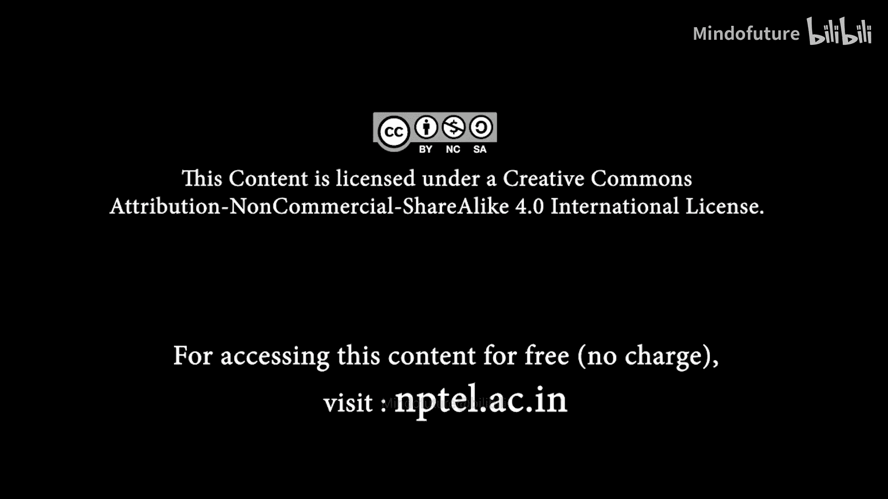
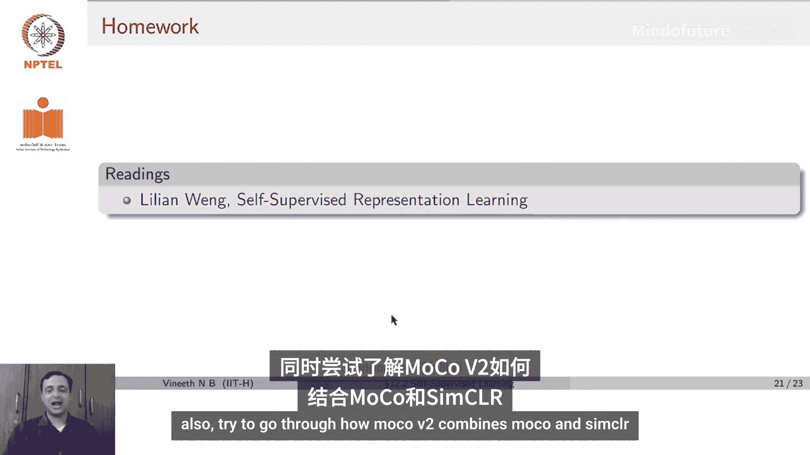

# 124：自监督学习与SimCLR



## 概述
在本节课中，我们将要学习自监督学习这一热门主题。我们将了解其基本概念、常见的预训练任务，并重点介绍基于对比学习的代表性方法，特别是SimCLR框架。

---

## 什么是自监督学习？🤔

自监督学习是无监督学习的一种变体。其核心思想是：在没有显式标注或类别标签的数据中，通过数据本身来构造标签，从而在无标签数据上诱导出一个监督学习模型。

具体而言，我们设计一些被称为**预训练任务**或**辅助任务**的监督任务。通过这些任务，模型可以学习到有意义的**数据表示**。这使得模型能够为后续的下游任务（如分类、语义分割等）做好更充分的准备。

---

## 为什么需要自监督学习？💡

我们知道，深度监督学习在拥有大量标注数据时效果很好。然而，现实世界中存在海量的无标签数据。自监督学习旨在利用这些无标签数据。其灵感来源于人类的学习方式：人类并非通过完全监督来学习一切，而是通过观察、预测和自我反馈来学习。

---

## 常见的自监督预训练任务

以下是几种在计算机视觉领域流行的自监督预训练任务示例。

### 图像修复 🖼️

图像修复任务的目标是遮挡或移除图像的某一部分，然后要求网络完成图像。这不需要外部标签。

在2016年CVPR发表的**Context Encoders**工作中，使用了一个编码器-解码器框架来执行图像修复。其损失函数结合了**L2重建损失**和**对抗损失**，以生成更逼真的修复结果。

**核心公式**：
总损失 = L2损失(预测图像, 真实图像) + 对抗损失(预测图像)

### 拼图游戏 🧩

该任务的目标是教会模型理解图像由多个部分组成，并学习物体及其空间排列的映射。具体做法是让神经网络解决一个九宫格拼图。

实现方式：将图像分成9个图块并随机打乱，神经网络需要预测出正确的排列顺序索引。这是一个分类问题，使用**交叉熵损失**进行训练。

**核心代码逻辑**：
```python
# 假设有9个打乱的图块 patches
predicted_permutation_index = model(patches)
loss = cross_entropy_loss(predicted_permutation_index, true_permutation_index)
```

### 预测旋转角度 🔄

给定一张图像，对其执行多种旋转（如0°，90°，180°，270°）。然后，使用同一个CNN模型来预测所应用的旋转角度。这有助于网络学习图像特征和物体属性。

**核心公式**：
设 `G` 为旋转变换函数，`F` 为CNN模型。
模型输出：`p = F(G(image))`，即对旋转类别的概率分布。
损失：`loss = CrossEntropy(p, true_rotation_label)`

### 图像着色 🎨

该任务的目标是输入一张灰度图像，预测其彩色版本。训练数据本身是彩色图像，我们取其灰度版本作为输入。

为了实现更锐利的着色效果，该方法通常将输出颜色空间（如LAB空间中的AB通道）量化为多个区间（例如313个），从而将回归问题转化为分类问题。

**核心思路**：
输入：灰度通道 `L`
输出：量化后的颜色通道 `AB` 的类别概率分布
损失：交叉熵损失

---

## 对比学习与SimCLR

近年来，自监督学习领域被**基于对比学习的方法**所主导。其总体目标是通过对比正样本和负样本来学习表示。

### 对比学习基本思想

目标是学习一个编码器，使得图像与其**相似样本**之间的相似度得分，大于该图像与**负样本**之间的相似度得分。

如果我们有类别标签，正负样本很容易定义（如三元组损失）。但在无监督设置下，我们需要从数据本身构造正负样本。

一种通用的损失函数形式是**带有温度参数的Softmax损失**：

**核心公式**：
`L = -log( exp(sim(q, k+) / τ) / Σ_{i=0}^{K} exp(sim(q, k_i) / τ) )`
其中，`sim` 是相似度函数，`τ` 是温度超参数。

**温度参数 `τ` 的作用**：
*   `τ > 1`：软化Softmax分布，概率更分散。
*   `τ < 1`：锐化Softmax分布，概率更集中。

### SimCLR 框架详解 🚀

SimCLR（A Simple Framework for Contrastive Learning of Visual Representations）是一个经典的对比学习框架。其核心思想是：**最大化同一数据样本的不同增强视图之间的一致性**。

**工作流程**：
1.  **数据增强**：对于一个批次中的每张图像，应用两种不同的随机增强（如裁剪、颜色抖动、模糊等），得到两个视图。
2.  **特征提取**：使用一个基础编码器网络 `f(·)`（如ResNet）提取两个视图的特征表示 `h_i` 和 `h_j`。
3.  **投影头**：使用一个小的MLP投影头 `g(·)` 将特征映射到对比损失空间，得到 `z_i = g(h_i)` 和 `z_j = g(h_j)`。
4.  **对比损失**：对于一对正样本 `(z_i, z_j)`，批次内的其他 `2(N-1)` 个增强样本均视为负样本。使用归一化温度缩放交叉熵损失（NT-Xent）进行优化。

**SimCLR 损失函数（对于正样本对 `(i, j)`）**：
`l_{i,j} = -log( exp(sim(z_i, z_j) / τ) / Σ_{k=1}^{2N} 1_{[k≠i]} exp(sim(z_i, z_k) / τ) )`
总损失是所有正样本对损失的平均值。

**SimCLR 的关键要素**：
*   **强大的数据增强**：组合使用裁剪、颜色失真、高斯模糊等是成功的关键。
*   **非线性投影头**：在表征层后使用MLP投影头可以改善所学表征的质量。
*   **大批次训练**：需要较大的批次大小以提供足够的负样本进行对比。

### 与其他方法的对比

*   **MoCo (Momentum Contrast)**：通过维护一个动态的**字典队列**来提供大量负样本，解耦了批次大小与负样本数量。其“动量编码器”的更新方式带来了更稳定的表征。
*   **SimCLR vs. MoCo**：
    *   SimCLR 优势：结构简单，使用了更强的数据增强和投影头。
    *   SimCLR 劣势：负样本数量受限于批次大小。
    *   MoCo 优势：通过字典队列可以提供更多负样本，有利于学习。
*   **BYOL (Bootstrap Your Own Latent)**：一种不需要负样本的方法。它使用两个网络（在线网络和目标网络），通过让在线网络预测目标网络对同一图像不同增强视图的输出进行学习，完全避免了负样本对比。

---

## 总结

本节课我们一起学习了自监督学习。我们从其基本定义和动机出发，介绍了图像修复、拼图、旋转预测等着色等多种经典的预训练任务。随后，我们深入探讨了基于对比学习的现代方法，重点剖析了**SimCLR框架**的原理、损失函数和关键组件，并将其与MoCo、BYOL等方法进行了对比。自监督学习通过巧妙利用数据本身构造监督信号，为在无标签数据上学习通用、强大的视觉表征提供了有效途径。



**课后阅读建议**：
1.  阅读Lillian Weng关于自监督表征学习的优秀文章。
2.  了解MoCo V2是如何结合MoCo和SimCLR优点的。