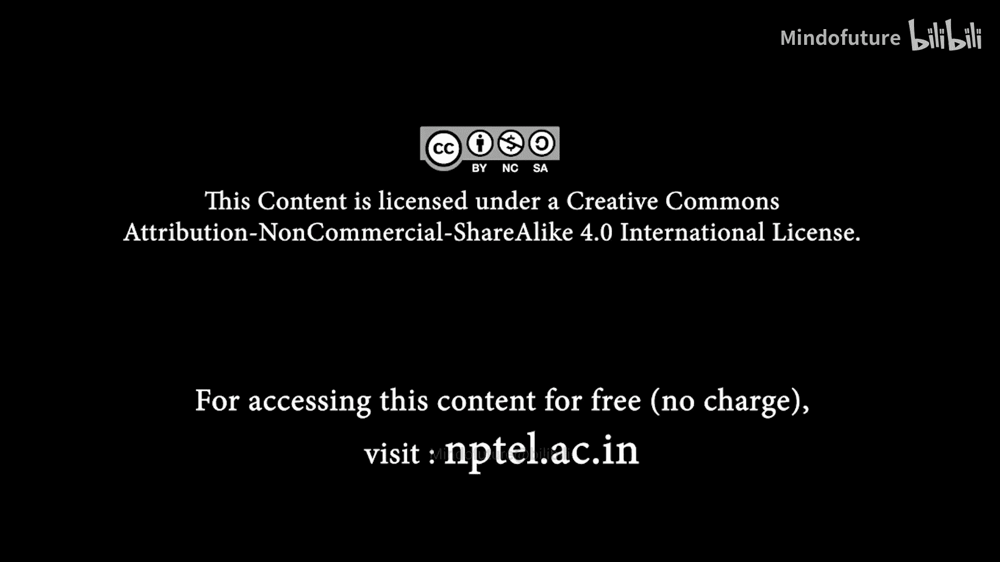
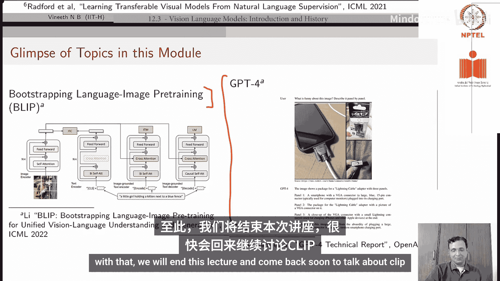

# 125：视觉语言模型 - 介绍和历史 👁️🗨️📖

在本节课中，我们将要学习一个当代热门主题——视觉语言模型。我们将了解其基本概念、发展历史，以及它如何将视觉与语言理解结合起来，实现更自然的人机交互。

## 概述

上一节我们探讨了计算机视觉的传统任务。本节中，我们来看看视觉语言模型。计算机视觉传统上专注于物体分类、检测、实例分割和语义分割等任务。这些任务对现实应用产生了重大影响。然而，它们输出的是类别标签、边界框或生成的图像。它们缺乏一个元素，即通过文本以有机和自然的方式与人类交流。

## 视觉与语言的早期结合

此前已有将语言融入计算机视觉任务的努力。在我们早期课程探讨的主题中，我们看到了图像描述。该任务接收一张图像，并提供关于该图像的文本描述。还有视觉问答。给定一张图像和一个问题，模型需要回答关于图像的问题。这些任务已经存在数年。

近年来，出现了更多此类任务。一个例子是文本到图像生成。得益于当代生成模型的成功，我们现在有了相当不错的文本到图像生成能力。或者还有在过去一年左右出现的文本到视频检索。

## 自然语言处理的视角

从自然语言处理的角度看，其标准任务包括搜索引擎、垃圾邮件过滤、机器翻译、情感分析等。这些任务也有其固有的局限性。虽然它们擅长分析和生成文本，但它们显然无法处理视觉线索。它们也无法根据现实世界的视觉参考来验证解释，尤其是在存在语言歧义时。

## 语言模型的发展

语言模型始于理解和生成文本的目标。近年来，它们主要基于Transformer架构。其尝试是从原始文本中学习。这些语言模型在过去几年演变成了大型语言模型。关键区别在于，LLMs在非常大的数据集上进行预训练。它们通常拥有非常多的参数，数量级达到数十亿或数千亿。用于训练LLMs的数据集是基于网络的文本数据集。

最流行的LLM例子是GPT。其每一步的输入是一个词序列或句子。目标输出是同一个句子，但向右移动了一个词元。GPT如何训练？训练此类大型语言模型的一个关键方面是通过自监督学习。模型从原始文本和句子中学习，目标序列向右移动一个词元。这使其能够掌握词之间的关系以进行准确的输出预测。

这被称为自回归模型。每个生成的词元都被添加到输入序列中，形成下一步的输入。GPT LLM模型与早期模型的一个关键区别是，GPT模型严格从左到右学习上下文。BERT是一种早期的语言模型，它使用双向方法，同时利用从左到右和从右到左的上下文。

## 其他流行的LLMs

以下是近年来流行的其他一些LLMs：

*   **LaMDA**：由Google开发，在1.56万亿词的公共对话数据上训练。它最初为Bard聊天机器人提供支持。
*   **LLaMA**：由Meta开发，这是一个相对较小的模型，参数约70亿。但它的准确度几乎与GPT-3相当。
*   **BLOOM**：一个开源的多语言模型，在46种自然语言和13种编程语言的数据上训练。
*   **Galactica**：同样由Meta开发，用于推理科学知识。
*   **Codex**：为GitHub Copilot提供支持的模型，精通十多种编程语言。
*   **PaLM-E**：由Google开发，更侧重于机器人任务。
*   **Chinchilla**：由Google DeepMind开发，旨在简化下游利用，因为其推理和微调所需的计算能力显著降低。

这些LLMs的应用包括代码生成、内容生成、文案写作、对话工具、教育工具等。但它们也有一些局限性。它们规模大、训练计算密集、可能存在偏见。最常被指出的局限性之一是，LLMs有时会产生幻觉，让用户相信给定的输出是真实的。

## 视觉语言模型的必要性

现在，让我们尝试通过结合视觉和语言模型来看看我们的方向。视觉系统是人类感知和理解世界的基础。然而，正如我们之前所见，这些视觉模型缺乏与人类进行有机交流的能力。人类如何交流？大多数情况下，物体之间及其在场景中位置的复杂关系是用人类语言或文本来描述的。

视觉语言模型试图通过共同理解两种模态来弥合视觉和语言之间的鸿沟。这是人脑非常擅长的一种能力。VLM的输出可以通过提供不同类型的提示来修改。可以提供边界框作为提示来分割图像。可以通过询问关于图像或视频的问题来进行交互式对话。甚至可以通过语言指令来操纵机器人的行为。

## 视觉语言模型的任务

以下是此类视觉语言模型能够解决的一些任务：

*   **图像检索**：从自然语言文本中检索图像。
*   **短语定位**：从输入图像和自然文本中执行物体检测。
*   **视觉问答**：从输入图像和自然语言问题中寻找答案。
*   **图像描述**：为给定图像生成描述。
*   **仇恨言论检测**：从可能涉及文本和图像组合的社交媒体内容中检测仇恨言论。

此时可能会问一个问题：这些都是我们已经用其他深度学习模型见过的任务。那么，为什么我们需要重新发明轮子，并称一种能够执行相同任务的新模型类型为视觉语言模型呢？存在一个关键区别，那就是我们将在后续课程中讨论的这些视觉语言模型，可以在不知道或没有任何关于它将与用户交互的标签的图像的情况下完成所有这些任务。因此，它可以以零样本的方式完成许多这些任务，这与我们过去看到的模型有显著不同。

过去我们看到的任何模型，这类任务都需要大量精心策划、标注的数据来进行模型的监督学习。而在我们将要看到的视觉语言模型中，你会注意到这类任务可以针对全新的图像，甚至是我们没有图像的文本来完成。

## 本模块内容预告

在本模块中，你将看到哪些主题？在紧接着的下一讲中，我们将看到VLM领域最流行的模型之一，即CLIP。它代表对比语言-图像预训练。在某种意义上，这是使视觉语言任务能够以我们刚才谈到的零样本方式扩展的关键模型。这是一张来自CLIP论文的图片，我们将在下一讲中详细讨论。

除了CLIP，我们还将看到CLIP的变体，包括像BLIP这样的模型。我们还将看到所谓的多模态大型语言模型，有时也称为大型多模态模型，例如GPT-4，它也能以跨模态的方式在图像和文本之间进行推理。

## 总结

本节课中，我们一起学习了视觉语言模型的基本概念和发展脉络。我们回顾了传统计算机视觉和自然语言处理的局限性，探讨了大型语言模型的发展，并理解了将视觉与语言结合以创建更强大、更通用模型的必要性。视觉语言模型能够以零样本的方式处理多种跨模态任务，这标志着人工智能向更自然、更全面理解世界迈出了重要一步。下一讲，我们将深入探讨实现这一目标的关键模型——CLIP。