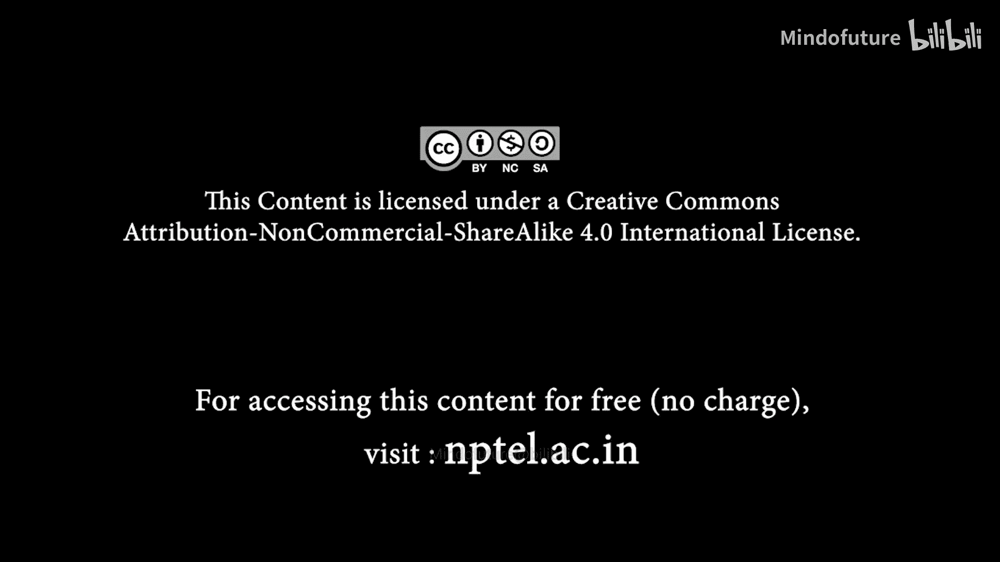
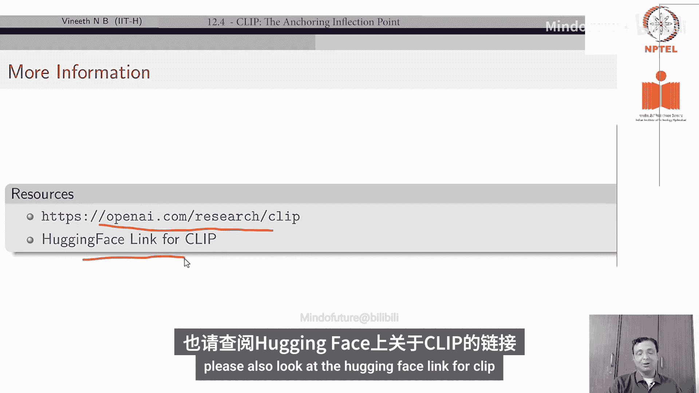

# 126：CLIP - 锚定拐点 🚀



在本节课中，我们将讨论CLIP模型，它被认为是视觉-语言模型成功道路上的一个锚定拐点。

## 概述

CLIP模型为视觉模型提供了一种利用文本进行监督的机制。它通过对比学习，将图像与其标题配对，使用一种非常简洁的方法，在多个数据集上超越了全监督学习的基线模型，并且正如我们在上一讲中提到的，它还能作为零样本分类器使用。

## CLIP模型简介

CLIP模型在论文《从自然语言监督中学习可迁移的视觉模型》中被提出，该论文发表于ICML 2021会议，由Alec Radford领导的多位作者共同完成。开发该模型的OpenAI官方链接提供了大量有用信息，建议查阅。

回想一下我们之前关于人脸处理任务的CNN模型讲座，我们曾讨论过对比学习以及三元组损失等概念。三元组损失的目标是**最小化锚点与正样本（相似样本）之间的距离**，同时**最大化锚点与负样本（不相似样本）之间的距离**。

## CLIP的核心思想

CLIP遵循了类似但更可扩展的逻辑。它旨在学习图像和文本的表征，使得匹配的图像-文本对之间的相似度最大化，而不匹配的对之间的相似度最小化。

以下是CLIP模型训练的整体思路：
*   输入包括图像和文本。例如，一张狗的图片和对应的标题“胡椒，一只澳洲牧羊犬”。
*   图像和文本分别通过对应的编码器（图像编码器和文本编码器）进行处理。
*   在训练过程中，这两个编码器的参数会被微调（而非从头训练）。图像编码器可以是ResNet或视觉变换器，文本编码器可以是文本变换器。
*   得到图像和文本的嵌入向量后，可以将它们组织成一个矩阵。我们的目标是，对于匹配的图像和文本（如I1和T1），我们希望最大化它们的点积（衡量相似度）；对于不匹配的对（如I2和T1），我们希望最小化点积。

## 损失函数与实现

让我们看看这是如何具体实现的。假设 **M_i** 是第i个图像样本对应的标签的一热编码向量。**Y_i^I** 是第i个图像样本的余弦相似度向量（即矩阵中的一行）。

我们希望最小化交叉熵损失，使得余弦相似度向量 **Y_i^I** 与匹配的文本标签的一热编码向量 **M_i** 尽可能一致。换句话说，我们希望矩阵的每一行（对应一个图像）都接近一个一热向量，其中匹配文本的位置为1。

类似地，对于文本样本，我们也有对应的损失。**T_i** 是第i个文本样本对应的一热编码标签向量（跨所有图像）。**Y_i^T** 是第i个文本样本的余弦相似度向量（即矩阵中的一列）。我们希望每一列也匹配一个一热向量。

用于训练文本编码器和图像编码器的总体损失是这两个损失函数的平均值。

CLIP的伪代码展示了其实现的简洁性：
1.  分别通过图像编码器和文本编码器得到嵌入向量 **I_f** 和 **T_f**。
2.  通过权重矩阵变换并归一化这些嵌入。
3.  计算所有图像嵌入和文本嵌入之间的两两余弦相似度作为逻辑值，并使用一个指数缩放因子进行放大。
4.  最后，对我们刚才提到的行向量和列向量实现交叉熵损失。

```python
# 伪代码示意
I_f = image_encoder(image)  # 图像嵌入
T_f = text_encoder(text)    # 文本嵌入
logits = scale_factor * cosine_similarity(I_f, T_f.T)  # 计算相似度矩阵
loss = (cross_entropy_loss(logits, image_labels) + cross_entropy_loss(logits.T, text_labels)) / 2
```

## CLIP的零样本学习能力

CLIP如何用于我们一直声称的零样本学习呢？首先，快速回顾一下零样本学习的含义：与监督学习不同，零样本学习中模型只在已见类别的数据上训练，但需要在测试时对未见类别进行分类。

传统的纯监督图像分类模型受限于固定的输出标签空间，在推理时缺乏对新标签的泛化能力。CLIP通过以下方式处理零样本分类：
1.  训练好图像编码器和文本编码器后，可以从标签文本创建数据集分类器。
2.  对于一张新图像和一个新的文本标签（例如训练时未见的“狗”），可以构建提示“一张狗的照片”。
3.  将图像通过训练好的图像编码器，将文本提示通过训练好的文本编码器。
4.  计算图像嵌入与所有文本嵌入的余弦相似度（点积）。
5.  具有最高相似度的文本标签即被预测为该图像的类别。

这种“魔法”之所以能发生，是因为图像编码器和文本编码器在大量数据上学习了高质量的嵌入，即使对于未见过的类别，也能将图像和文本映射到同一个空间，使得正确的匹配自动发生。

## 训练数据与模型设计

显然，这要求模型最初在大量数据上进行训练。CLIP的作者创建了名为WebImageText（WIT）的数据集，该数据集包含从互联网各种公开来源收集的**4亿个图像-文本对**，这是其成功的关键。

在模型设计方面，有以下考虑：
*   **视觉编码器**：尝试了ResNet系列和Vision Transformer系列模型。
*   **文本编码器**：使用了类似GPT的标准变换器改编版。
*   **优化**：使用Adam优化器，温度缩放因子为0.007，批量大小为32,768，训练32个周期。

最大的ResNet模型在592个V100 GPU上训练了约18天，最大的ViT模型在256个V100 GPU上训练了约12天。

## 实验结果

基于这种简洁的方法，CLIP报告了一些令人印象深刻的结果：

**零样本迁移性能**：在涵盖27个数据集的评估套件中，零样本CLIP分类器在16个数据集上**超越了在ResNet50特征上训练的全监督线性分类器**。这表明CLIP对于通用任务效果很好，但在卫星图像等特定领域任务上表现不佳，需要微调。

**线性探测性能**：在CLIP图像特征表示上训练的线性分类器，在多个基准测试中**显著优于EfficientNet等基线模型**，包括ViT。随着模型容量（每图像GFLOPs）增加，CLIP性能提升更明显。

**少样本学习性能**：CLIP的零样本性能已经很高。即使为其他模型提供每个未见类别16个样本，在CLIP特征上构建的线性分类器**仍然显著优于任何其他基线**。

**分布偏移的鲁棒性**：CLIP展现出强大的鲁棒性。例如，在包含“香蕉”类别的多个自然分布偏移数据集上，零样本CLIP的性能**保持稳定**，而仅在ImageNet上训练的ResNet101模型性能则随着分布偏移增大而下降。

## 总结

本节课我们一起学习了CLIP模型。它通过在大规模图像-文本对上进行对比学习，统一了图像和文本的表征空间。其核心在于最大化匹配对的相似度，最小化不匹配对的相似度。CLIP的简洁架构使其易于实现，而其强大的零样本、少样本学习能力以及对分布偏移的鲁棒性，源于在超大规模数据集（WIT，4亿对）上的训练。这些特性使其成为视觉-语言模型发展中的一个重要里程碑。



---
*注：更多关于CLIP模型的细节，请参阅其原始论文和OpenAI官方网站。如需了解代码实现，也可查看Hugging Face的相关链接。*