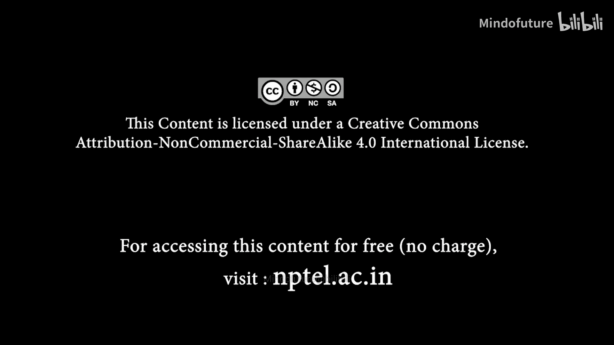
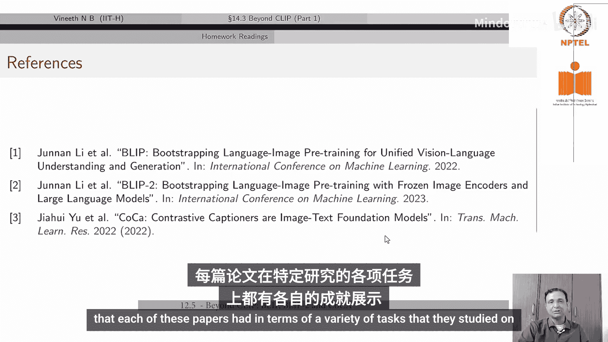

# 127：超越CLIP - BLIP、BLIP-2和CoCA

在本节课中，我们将学习几种扩展并超越CLIP的视觉语言模型。我们将探讨它们的架构组件，以及它们是如何被整合在一起的。

## 概述

我们将首先回顾CLIP模型的局限性，然后详细介绍BLIP、BLIP-2和CoCA这三个模型。这些模型在架构设计、训练目标和数据处理方面都做出了重要改进，旨在解决CLIP的不足，并在视觉语言理解和生成任务上取得更好的效果。

## CLIP的局限性

如果审视CLIP模型，可以发现几个它可能失效的局限性。

首先，CLIP的目标是学习良好的图像-语言联合表示。然而，这种编码器模型可能不容易迁移到文本生成任务，例如根据给定图像生成描述。

第二个局限来自数据层面。CLIP使用网络抓取的图文对数据来构建模型。我们将要讨论的后续工作之一BLIP指出，这种嘈杂的网络抓取数据对于视觉语言学习可能并非完全最优。

以下是几个网络抓取文本和使用BLIP训练的模型生成文本的示例。请注意，对于一张图片，网络抓取的文本可能是“在桑德布里奇我们租的海滩别墅度过的一周”。从网络抓取数据的问题有几个：人们可能写了一篇文章并附上了一张图片，因此文本可能不完全对应图片，而是围绕图片的故事。有时，抓取过程还会引入浏览器上用于无障碍访问的替代文本，这些文本有时可能与图片不完全匹配，甚至可能是出于营销或搜索引擎优化的目的而编写的。因此，这些嘈杂的网络抓取文本可能不完全有助于学习良好的视觉语言表示，这是这些后续模型之一的观点。

## BLIP：统一视觉语言理解与生成

那么，我们该怎么做呢？这就是BLIP发挥作用的地方。

BLIP代表**B**ootstrapping **L**anguage-**I**mage **P**retraining for Unified Vision-Language Understanding and Generation，这篇论文发表于2022年的ICML。他们的目标是解决CLIP中的模型问题。

他们的整个模型由四个组件构成：
1.  **VIT图像编码器**
2.  **BERT文本编码器**
3.  **基于图像的文本编码器**
4.  **基于图像的文本解码器**

系统的输入是一张被分割成块的图像，以及对应的文本描述。

### 模型架构详解

给定一张被分割成块的图像，通过一个标准的、包含N个Transformer块的VIT编码器，我们得到图像嵌入作为该编码器的输出。这里的VIT具有标准的自注意力模块和前馈模块。

在下一个模块中，我们有BERT文本编码器，我们向其提供与图像对应的文本描述（例如来自嘈杂的网络抓取文本），以及一个`[CLS]`标记。请记住，每当向Transformer提供`[CLS]`标记时，它有助于成为Transformer的输出标记，最终可以从中获得分类标签。因此，他们有`[CLS]`标记，并得到BERT文本编码器的输出。这里使用了**图像-文本对比损失**，我们稍后会讨论这是如何实现的。这个BERT文本编码器具有双向自注意力，这意味着自注意力作用于句子中给定标记的两侧。这里没有交叉注意力组件，因为此时没有图像输入到文本编码器中，所以只有Transformer中稍后的前馈层，最终得到Transformer输出的嵌入。

**图像-文本对比损失** 用于匹配预期匹配的图像-文本对的表示，并推开不匹配的图像-文本对的表示。这意味着在一个批次中提供正样本对和负样本对，以计算图像-文本对比损失。这与许多其他对齐图像和文本嵌入的方法类似。

接下来是第三个模块：**基于图像的文本编码器**。它接收相同的文本描述作为输入，以及一个名为`[Encode]`的标记。但这次，他们还把来自VIT的图像嵌入作为文本编码器的附加输入，这就是为什么它被称为“基于图像”的文本编码器。这里有一个**图像-文本匹配损失**。这个基于图像的文本编码器再次具有一个双向自注意力层，然后是一个交叉注意力层（用于测量图像标记和文本标记之间的注意力），接着又是一个前馈层。该模块的输出通过图像-文本匹配损失进行匹配，该损失试图学习图像-文本多模态表示，以获得更好的图像与语言对齐。

**图像-文本匹配损失** 的实现方式是输出一个单一的分类结果，判断图像和文本是否匹配。与对比损失检查正负样本对不同，在这种情况下，它是一个简单的图像-文本是否匹配的分类任务，可以假设为标准交叉熵或二元交叉熵损失。

最后，作为最后一个模块，我们有**基于图像的文本解码器**。这里再次将描述作为输入标记提供，以及一个名为`[Decode]`的标记。这个基于图像的文本解码器具有一个略有不同的自注意力模块，称为**因果自注意力模块**，这在许多语言模型中很常见。自注意力只作用于前面的标记，而不作用于任何后面的标记。因此，后面的标记被屏蔽，任何标记`t`的自注意力仅取决于该序列中所有小于`t`的标记。这样做是为了让模型以自回归的方式学习预测文本，即仅通过查看前面的文本来预测下一个词。显然，你可以想象这个模块的输出是什么：给定图像，输出文本描述。在第四个模块中，图像嵌入再次被提供以与文本标记一起进行“接地”。因此，该模块的目的是在给定图像的情况下生成文本描述，并优化**交叉熵损失**，该损失以标准的自回归方式训练模型以最大化文本的可能性。

以上就是BLIP整合在一起的不同模块。

### 数据清洗与增强

除此之外，BLIP还指出了嘈杂的网络抓取文本在学习良好视觉语言表示方面的次优问题，并对此采取了措施。他们为此引入了一个相当强大的处理流程。

他们引入了一个称为**Captioner and Filter**的模块。该模块包含两个网络。模型首先考虑这些网络抓取的文本，例如，像这样一张图片从网上抓取的文本可能是“日落公园的蓝天面包店，面包店通常会在网站上放出他们的菜单图片”。他们有一个过滤器来判断这是否是此类图像的合适描述。这个过滤器是单独在人工标注的数据集上学习的。他们还学习了一个专门的描述生成模块，给定这张图像，生成一个合成描述。这就是我们在前面幻灯片中看到的描述，现在写着“顶部有绿色糖霜和巧克力糖屑的巧克力蛋糕”。同一个过滤器将这个描述判定为这张特定图像的有效描述。

以下是构建这些描述生成模块和过滤模块的具体步骤：
1.  他们首先使用网络抓取的数据集和人工标注的数据集来训练他们的模型，该模型称为**多模态编码器-解码器**。
2.  一旦有了多模态编码器-解码器的初始版本，就用它来训练一个过滤模块。该过滤模块是一个基于图像的文本编码器，接收所有人工标注的图文对作为输入，并使用图像-文本对比损失和图像-文本匹配损失进行训练。这个过滤器学习查看图文对并判断它们是否良好。
3.  有了这个过滤器后，他们处理网络抓取的图文对，只有通过过滤模块的“好”样本被保留下来。
4.  同时，他们使用相同的人工标注数据训练一个描述生成模块（同样是一个基于图像的文本解码器）。基于这个描述生成模块，他们现在获取网络抓取的图像并生成一批合成描述。于是，现在有了网络抓取图像和生成的合成数据。
5.  这些数据现在被用来再次精炼过滤器，同时也得到网络抓取图像与合成数据的配对。
6.  最终，经过过滤的优质网络抓取数据、合成文本数据以及人工标注数据共同形成了一个新的数据集。
7.  这个新数据集被用来输入并精炼他们整体的多模态编码器-解码器模型，从而在最后得到一个更好的模型。

因此，他们不仅从架构上与CLIP不同，还通过这种方法改进了数据流水线以获得更好的结果。这个最终的多模态编码器-解码器模型被用于各种下游任务，如图像描述生成等。

## BLIP-2：使用冻结骨干模型

接下来是BLIP-2，它发表于2023年的ICML。

BLIP-2代表**B**ootstrapping **L**anguage-**I**mage **P**retraining with **F**rozen Image Encoders and Large Language Models。其动机是，我们通常希望使用冻结的预训练视觉模型或语言模型。不幸的是，在此之前的所有方法都试图进行大规模模型的端到端微调或训练，这可能非常昂贵甚至难以实现。BLIP-2的主要关注点是如何提出一种方法来使用冻结的视觉和语言任务骨干模型，这是他们的目标，并提出了一种有趣的方法来实现这一点。

当使用冻结的骨干模型时，显然可能会引入模态鸿沟，因为你不是在微调视觉编码器或文本编码器来对齐嵌入，而是冻结了它们。因此，BLIP-2引入了一个想法来克服这个问题，同时不需要显式地精炼骨干图像或文本模型。

他们的整体流程分为两部分：
1.  **视觉与语言表示学习**：这部分实际上尝试使用冻结的骨干，并找到一种方法来对齐表示。
2.  **视觉语言生成学习**：这部分生成文本。

以下是其工作原理：在视觉与语言表示学习模块中，给定图像和文本，将图像输入到一个冻结的图像编码器（图中图标表示该模块被冻结）。图像编码器的输出被提供给一个**Q-Former**，这是BLIP-2框架中的贡献，也称为查询Transformer。它有一组可学习的查询标记，与文本一起作为输入提供。在另一侧，从视觉语言生成学习的角度来看，他们有一个同样是冻结的大型语言模型，接收Q-Former的输出，并为提供给图像编码器的图像写出描述。

### Q-Former详解

在表示学习组件中，给定一张被分割成块的图像，它进入冻结的图像编码器。在Q-Former内部，有两种Transformer块。第一个Transformer块有一个自注意力模块、一个交叉注意力模块和一个前馈层。它还接收一组可学习的查询标记。可学习查询标记指的是在经验研究中，他们尝试了多达32个标记。这些标记是向量，预先初始化为某些值，但当模型学习时，也会通过反向传播更新这些标记，这就是我们所说的可学习查询。这些标记作为输入提供，在交叉注意力层中，这些查询标记和图像标记之间存在交叉注意力，其输出被提供给一个前馈层。在另一侧，有一个文本编码器，它再次具有自注意力模块和前馈模块，那里没有交叉注意力，因为在该特定模块中除了文本没有其他输入。这里也有一个图像-文本对比学习损失。

你看到的这三个损失（或对应损失的任务）——图像-文本匹配、图像-文本对比学习和基于图像的文本生成——与BLIP非常相似，并使用相同的损失函数。但这里还有一些不同之处，即注意力有三种不同的类型。通过颜色可以看出，这个Transformer和另一个Transformer中的前馈层是不同的，它们的权重不同，执行不同的任务。交叉注意力显然只存在于这个Transformer中。然而，自注意力权重在两个Transformer之间是共享的，但以一种略微独特的方式共享。他们以三种不同的方式使用这种注意力，分别用于图像-文本匹配、图像-文本对比学习和基于图像的文本生成这三个任务。

以下是注意力掩码的细节：给定Q个查询标记和T个文本标记，阴影块被屏蔽，非阴影块未被屏蔽。
*   **双向自注意力掩码**：用于图像-文本匹配。允许查询标记和文本标记完全双向相互匹配。
*   **多模态因果自注意力掩码**：用于基于图像的文本生成任务。他们使用因果自注意力，这意味着图像可以看到所有图像标记（因为图像部分没有因果性），文本也可以看到所有图像标记，但文本只能看到前面的文本标记，而不能看到后面的文本标记。后面的文本标记被屏蔽，因为与BLIP类似，他们使用因果自注意力，以便能够以自回归的方式生成文本，只查看迄今为止已看到的文本标记。
*   **单模态自注意力掩码**：用于图像-文本对比学习。可以清楚地看到，图像标记只能看到图像标记，文本标记只能看到文本标记，因此被称为单模态自注意力掩码。

以上就是构成BLIP-2视觉与语言表示学习整体框架的内容。

### 生成学习模块

一旦在Q-Former中完成这些，Q-Former的输出标记就进入生成模块。在生成学习模块中，他们考虑了两种不同的方法。
1.  Q-Former的输出标记（请注意，Q-Former的输出标记数量与可学习查询标记的数量相同）通过一个全连接层，作为输入提供给一个冻结的LLM解码器。在这个实验中，他们使用OPT LLM来研究他们的方法。然后，这个LLM解码器为图像输出文本，例如“一只戴着太阳镜的猫”。
2.  在生成模块中，他们还测试了一个变体，其中Q-Former的输出查询标记再次通过一个全连接层，然后首先作为查询和前缀文本提供给一个LLM编码器。然后，LLM编码器将其转发给一个LLM解码器。例如，给定前缀文本“一只猫”，模型输出“戴着太阳镜”。为此，他们使用Flan-T5编码器-解码器模型进行研究。

这就是BLIP-2的整体架构。

## CoCA：对比描述生成器

我们将在本讲座中讨论的第三个视觉语言模型是CoCA。

CoCA代表**Co**ntrastive **C**aptioners，这篇论文的标题是“对比描述生成器是图像-文本基础模型”，发表于2022年的《机器学习研究汇刊》。

CoCA模型的目标是统一不同的范式，即他们试图引入一种方法，将单编码器模型、双编码器模型以及编码器-解码器范式结合在一起，以获得能够解决各种任务的基础模型。因此，他们理想地希望训练一个包含所有这些方法功能的图像-文本基础模型。

他们的方法相当简单：他们有一个图像编码器，一个单模态文本解码器（请注意，他们从单编码器-解码器类模型开始，这是他们议程的一部分）。然后，他们使用单模态文本解码器的输出进行交叉注意力，构建一个多模态文本解码器。他们使用两种损失函数来训练这样的整体模型：**对比损失**和**描述生成损失**。

以下是其架构的更多细节：在预训练阶段，他们有一张图像和相应的描述，因此有这些图文对。他们还使用正负样本对，因为他们在方法中使用了对比损失。图像通过图像编码器，文本通过单模态文本解码器以及一个用于对比损失的`[CLS]`标记。图像编码器输出一组标记，以及一个用于对比损失的标记；文本解码器也输出一个`[CLS]`标记。对比损失由图像到文本和文本到图像两部分组成。他们使用标准的softmax形式的对比损失方程来比较正样本对（希望增加相似性）和负样本对（希望减少相似性）。

如前所述，从图像编码器获得的所有标记与文本解码器的输出进行交叉注意力，从而产生多模态文本解码器，该解码器也输出模型最终生成的描述。为了使用描述生成损失来训练描述生成任务，他们使用标准的自回归损失函数，试图最小化给定图像输入`x`和`t`之前所有标记的条件下，`y_t`的对数概率。这是一个标准的自回归损失。这些是他们用来构建框架的组件，他们训练模型的最终损失是对比损失和描述生成损失的加权组合。

他们展示了这种方法如何用于我们讨论过的不同范式：单编码器、双编码器和编码器-解码器。在预训练过程之后，整个方法现在可以用于多个下游任务。它可以用于视觉分类或图像分类下游任务；可以用于跨模态对齐任务；还可以将所有组件放在一起，然后使用描述生成损失进行训练。因此，可以通过同一种方法服务于多种目的。

## 总结

在本节课中，我们一起学习了三种超越CLIP的视觉语言模型：BLIP、BLIP-2和CoCA。

*   **BLIP** 通过引入多任务学习框架（结合理解与生成任务）和创新的数据清洗流程（Captioner and Filter），解决了CLIP在生成任务和数据噪声方面的局限性。
*   **BLIP-2** 专注于高效性，提出了Q-Former这一轻量级查询Transformer，成功桥接了冻结的预训练视觉编码器和大型语言模型，实现了强大的零样本生成能力，同时大幅降低了训练成本。
*   **CoCA** 则旨在统一多种视觉语言范式，通过一个结合了对比损失和描述生成损失的简单架构，使单个模型能够同时胜任分类、检索和生成等多种下游任务。

这些模型代表了视觉语言领域从单一对比学习到多任务统一、从全参数微调到高效利用冻结大模型的重要发展路径。

