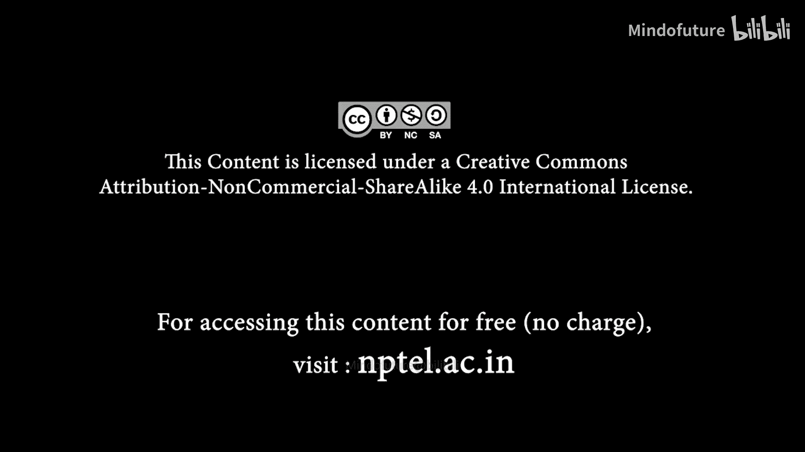
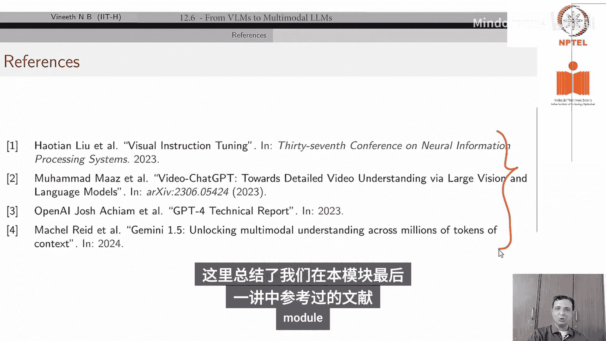

# 128：从VLM到多模态LLM 🚀

在本节课中，我们将超越视觉语言模型，探讨更近期的当代模型——多模态大语言模型。这些模型有时也被称为MLM或LMM。虽然这些缩写可能令人困惑，但它们通常指代多模态大语言模型或大型多模态模型。我们将尝试涵盖几种不同的模型，如Lava、Video-ChatGPT、GPT-4V和Gemini 1.5。请注意，关于Gemini 1.5，我们目前只有初步信息。

## 概述

上一节我们介绍了多种视觉语言模型。本节中，我们将探讨它们与多模态大语言模型的关键区别。核心差异在于，在多模态大语言模型中，我们**不修改大语言模型本身**，而是专注于如何将图像或视频作为额外的输入标记提供给大语言模型。相比之下，在CLIP和BLIP等模型中，我们尝试在架构内部对齐图像和文本。

## Lava：语言与视觉助手 🖼️

Lava是此背景下首个成功的图像-文本对话模型。它通过指令微调整合了视觉和语言模型，其目标是微调给大语言模型的指令，而大语言模型本身保持不变。

Lava利用GPT-4生成其多模态指令遵循数据。其指令微调（也称为视觉指令微调）采用两阶段流程。

### 两阶段流程

以下是Lava训练的两个主要阶段：

1.  **特征对齐预训练阶段**：在此阶段，模型使用图像-文本对进行特征对齐。视觉编码器和LLM的权重被冻结，仅更新投影矩阵 **W**。目标是学习最佳的图像标记，使其能与LLM的词嵌入一起作为输入。
    *   **公式**：`H_v = W * Z_v`，其中 `Z_v` 是视觉编码器输出的特征，`W` 是待学习的投影矩阵，`H_v` 是投影后的视觉标记。

2.  **端到端微调阶段**：在此阶段，模型使用多模态指令数据进行端到端微调。更新投影层和LLM的预训练权重，但保持视觉编码器权重冻结。

### 数据生成

为了训练模型，他们使用COCO数据集生成三种指令遵循数据：

以下是生成的三种数据类型：

*   **对话**：生成单轮或多轮问答。
*   **详细描述**：要求模型对图像场景进行详细描述。
*   **复杂推理**：提出需要多步推理的问题。

通过这种方法训练的Lava模型在多项任务上展现出强大的性能，特别是在零样本泛化到新领域方面，显著优于BLIP-2和Open Flamingo等模型。

## Video-ChatGPT：视频理解模型 🎥

从图像扩展到视频领域，Video-ChatGPT是一个专注于详细视频理解的多模态大语言模型。其目标是与视频生成有意义的对话。

### 模型架构

Video-ChatGPT将大语言模型与预训练的视觉编码器结合，以获取时空视频表征。其处理流程如下：

1.  **视觉编码**：使用ViT-L/14编码器处理视频帧，得到帧级特征。
2.  **时空池化**：
    *   **时间池化**：对帧级特征在时间维度上进行平均，得到表征全局时间信息的特征 `T_i`。
    *   **空间池化**：对帧级特征在空间维度上进行平均，得到表征每帧空间信息的特征 `Z_s`。
3.  **特征融合**：将 `T_i` 和 `Z_s` 拼接，形成最终的视频级特征 `V_i`。
4.  **投影与输入**：通过一个线性层 **G** 将 `V_i` 投影到语言解码器的嵌入空间，生成视觉标记 `Q_v`。这些视觉标记与文本查询一起输入到大语言模型中。

### 数据与训练

他们通过人工辅助和半自动标注，策划了约10万个高质量的视频-指令对，涵盖了广泛的概念。在微调过程中，他们使用特定的提示格式，例如“用户指令：[视频标记] 助手：”，以帮助模型理解输入包含视频。

评估显示，Video-ChatGPT能够有效回答关于视频内容的多种问题，例如描述活动、计数物体等。

## 向闭源模型的转变与影响 🔒

在介绍了Lava和Video-ChatGPT之后，我们来看更近期的模型如GPT-4V和Gemini 1.5。值得注意的是，过去几个月出现了一个趋势：转向闭源模型。

这一转变有利有弊：

**优点**：
*   保护公司的知识产权和专有技术。
*   可能降低模型被攻击的安全风险。

**缺点**：
*   **透明度与信任问题**：模型工作原理不公开，可能引发质疑。
*   **可复现性挑战**：其他研究者难以复现结果。
*   **创新限制**：学术界和小团队难以在这些基础模型上构建新应用。
*   **可访问性障碍**：可能导致技术和专业知识获取的不平等。

尽管存在这些担忧，目前许多领先模型如GPT-4V和Gemini 1.5都未公开其架构细节。

## GPT-4V 与 Gemini 1.5 的应用示例 ✨

由于无法深入探讨其架构，我们仅能展示这些模型的应用能力。

### GPT-4V 的能力

GPT-4V具备广泛的多模态能力：

以下是其主要功能示例：

*   **物体识别**：准确识别并描述图像中的物体。
*   **文本转录**：从图像中提取手写或印刷文本。
*   **图表理解**：从条形图、曲线图等图形内容中提取数据并总结。
*   **多条件处理**：分析不同条件下的图像。
*   **教育辅助**：将图表和视觉辅助工具转化为详细的文字解释。
*   **代码生成**：将流程图等视觉结构解释为代码。
*   **设计理解**：分解设计元素并提供文本见解。

### Gemini 1.5 的突破：超长上下文

Gemini 1.5的一个显著特点是其超长的上下文窗口，支持高达**1000万标记**的输入。这意味着：

以下是其上下文容量的具体体现：

*   可以输入长达1小时的视频、11小时的音频、3万行代码或70万单词作为提示上下文。
*   例如，可以将整个代码库作为上下文附加到问题中，让模型在代码中定位特定功能。
*   另一个例子是，将语法书和词典作为上下文输入，要求模型进行特定语言的翻译。

这种能力为复杂任务的理解和处理打开了新的大门。

## 总结

本节课中，我们一起学习了从视觉语言模型到多模态大语言模型的发展。我们探讨了Lava和Video-ChatGPT的架构与训练方法，分析了当前模型闭源化的趋势及其影响，并了解了GPT-4V和Gemini 1.5等先进模型的应用能力。多模态大语言模型通过将视觉信息作为标记输入大语言模型，正在推动人工智能在理解和交互方面迈向新的高度。