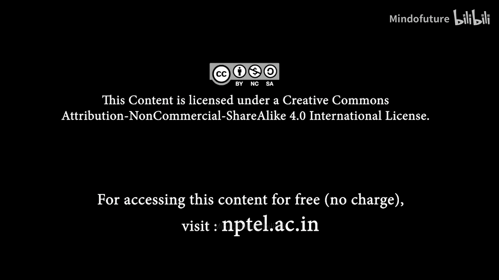
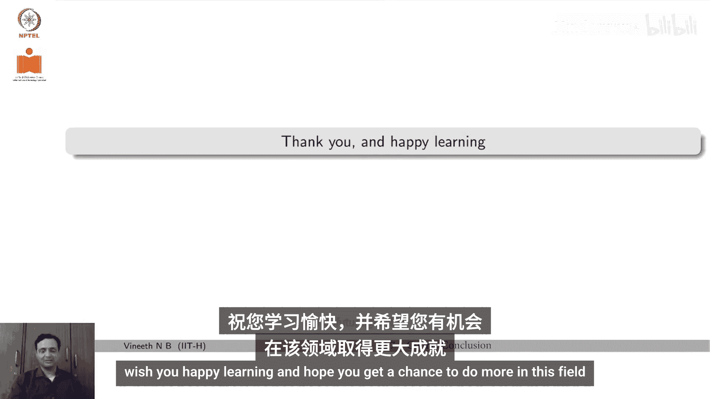

# 129：课程总结与前沿展望 🎓

在本节课中，我们将对为期12周的课程进行总结，并展望一些未能在课程中深入探讨的重要主题以及计算机视觉领域的新兴方向和应用。

## 课程回顾与展望

经过12周的讲座学习，希望各位已从中汲取了有价值的知识。现在，我们来到本课程的总结部分。在最后的这几分钟里，我将分享一些本课程未能涵盖的主题，并介绍一些值得关注的计算机视觉新兴领域和应用。

## 有限监督学习 📊

上一节我们回顾了课程核心，本节中我们来看看一个我们本周早些时候简要提及，但具有多面性和多维度的重要主题：**有限监督学习**。

在标准的监督学习设置中，你有一个训练集，训练一个学习器，得到一个模型，该模型用于测试集。现在，你可以将此范式适配到其他几种范式中，其中一些我们已经见过，一些尚未涉及。

以下是几种有限监督学习的范式：

*   **多任务学习**：在这种设置中，你使用来自多个不同任务的数据训练一个模型，学习一个单一的模型，使其在测试时能够对图像中的所有任务进行分类。例如，给定一张人脸图像，你可能希望使用单一模型识别人的身份、表情、姿态等，这就属于多任务学习。
*   **迁移学习**：我们在课程早期已经见过。你拥有源域数据并训练了一个模型，然后利用该模型的知识，在另一个目标数据集上训练一个不同的模型，使其在目标域上表现良好。微调是深度学习计算机视觉中最常用和首选的方法之一，但也有其他方法可用于迁移学习。
*   **领域自适应**：这是迁移学习的一个变体或泛化。在源域中，你不一定学习一个模型，而是直接使用源数据来训练一个在目标域上执行的模型。从图示上看，领域自适应与多任务学习相似，但存在细微差别。在多任务学习中，目标是在测试时在每个任务上都表现良好；而在领域自适应中，目标仅在目标域上表现良好，源域仅用于提供来自另一个领域的适应或额外信息。
*   **K样本学习**：这是少样本或零样本学习的泛化。我们有一组拥有大量数据的类别，以及一组只有k个样本（k可以是0）的类别。我们需要训练一个模型，使其在所有类别上都表现良好。我们在此看到了一些方法的示例。
*   **持续学习**：近年来变得流行。与多任务学习类似，你同样有多个任务，唯一的区别在于任务可能随时间不断增量式地到来，任务的范围可能不受限制。你需要训练一个模型，使其适用于迄今为止见过的所有任务。这在你无法访问先前任务数据时尤其具有挑战性。
*   **领域泛化**：可以将其视为领域自适应的扩展。在这种情况下，你有多个域（例如源域和目标域），你训练一个模型，但该模型现在必须在第三个或不同的域上工作。这就是我们称之为领域泛化的原因。

所有这些在计算机视觉的深度学习中都是非常当代的主题，旨在超越我们通常理解的、可以通过工程化网络并以全面方式训练和评估来解决的监督学习。

## 强化学习与计算机视觉的交集 🤖

另一个本课程范围未能涵盖的重要主题是**强化学习与计算机视觉的交集**。

强化学习是一种机器学习范式，类似于监督学习和无监督学习，其中智能体采取行动并与环境交互，以最大化潜在的延迟奖励。这通常被建模为马尔可夫决策过程。

强化学习在计算机视觉中何处使用？我们已经看到几个例子。我们看到了强化学习的使用，至少在硬注意力中简要提及过。在无法进行反向传播的情况下，我们说过使用基于强化学习的算法。我们刚刚看到的神经架构搜索也使用了基于强化学习的方法来搜索架构。

以下是强化学习在视觉中的一些应用用例：

*   **游戏**：例如，在Atari游戏中自动玩游戏，需要理解屏幕上的视觉元素，并使用强化学习给出智能体为获得特定奖励而必须采取的一系列动作。
*   **视觉巡视**：使用强化学习来移动电机，以实现特定目的（如捕捉图像）。
*   **视觉跟踪**：也可以使用强化学习来完成。

还有更多应用，但以上是强化学习在视觉中的一些示例用例。

## 其他当代主题与方法 🌐

更广泛地说，其他在方法方面的当代主题包括：

*   **自我中心视觉**：相机放置在穿越环境的人身上，而非作为监控摄像头或网络摄像头。问题涉及如何使用相机数据流来看待个体周围的世界。例如，基于像谷歌眼镜这样的可穿戴设备，或为视障人士开发技术，问题必须从该个体的自我中心视角来看待。
*   **具身视觉**：与自我中心视觉相似，我们讨论嵌入人体内的视觉技术。还有视觉感知与机器人技术的交叉，这是一个非常有用和当代的主题。
*   **高光谱图像分析**：试图理解不同光谱的图像，例如紫外线图像或红外图像等。我们目前讨论的许多方法可以直接应用于高光谱图像，可能只是输入通道数量的差异。然而，研究可见光及以外光谱的图像对于夜间视觉、天文学等许多领域是重要的研究领域。
*   **增强现实与虚拟现实的计算机视觉**：虽然过去可能用于娱乐行业的游戏，但如今对于任何类型的远程交互（无论是教学、教育还是简单的家庭互动）也变得重要起来。在增强现实和虚拟现实环境中进行计算机视觉正成为一个重要主题。
*   **公平、可解释和可信的模型**：这仍然是一个非常重要的主题。我们看到了解释CNN决策的各种方法，但可以更进一步，讨论这些模型的公平性，消除数据中可能存在的任何偏见，并帮助人类在这些模型上建立信任。

## 新兴应用领域 🚀

一些近年来非常流行并受到广泛关注的应用包括：

*   **自主导航视觉**：自动驾驶汽车，这是一个非常重要的主题，工业界投入了大量资金，如Uber、特斯拉、谷歌等公司都在这个方向上投入了大量精力。
*   **无人机图像视觉**：无人机在从安防到灾难管理的各种任务中变得越来越流行。如何理解来自无人机的图像成为一项重要任务。
*   **全季节视觉**：许多可用的数据集都基于日光场景。如何使这些任务在恶劣天气和光照条件下工作，成为视觉应用的一个非常普遍的背景。
*   **医疗保健和生物医学成像视觉**：继续是一个重要主题。
*   **农业视觉**：在过去几年中获得了很大关注，利用深度学习和计算机视觉模型进行精准农业，理解植物表型，喷洒农药，了解一块土地的收成等。
*   **时尚与零售视觉**：尝试使用虚拟试穿来看一个人穿某件衣服的效果，或者像亚马逊Go那样在购物环境中使用计算机视觉来自动化购物体验，是视觉应用的一个重要维度。
*   **体育视觉**：一个具有巨大商业利益的应用。在许多不同的体育项目中，计算机视觉正被用于理解人体生物力学（可能用于康复）、理解足球场上的策略、分析特定球员的动作（无论是针对对手还是该球员的教练）等。

## 总结与致谢

让我重申，计算机视觉远比我们在本课程中涵盖的主题更广泛。回想本课程的第一讲，我们说过可以将计算机视觉分为三个部分：基于学习的视觉、基于几何的视觉和基于物理的视觉。在很大程度上，本课程我们专注于基于学习的视觉。如果你想了解更多关于基于几何的视觉或基于物理的视觉，可以回顾并重新访问提供的链接。

借此机会，我要感谢所有资源，包括公开可用的深度学习和计算机视觉课程，它们无疑启发并帮助创建了本课程的内容。虽然本课程的内容是独立创建的，但肯定受到了不同来源的影响，内容也进行了改编和借鉴。我们感谢所有这些来源，如果材料中有任何错误，我们将乐意接受您的建议并在未来改进。

最后，感谢你们每一位参与本课程，希望你们通过讲座、测验和作业从本课程中学到了有价值的东西。祝你们学习愉快，并希望你们有机会在这个领域做更多的事情。谢谢。

---

本节课中我们一起学习了计算机视觉深度学习课程的总结，并展望了包括有限监督学习、强化学习交叉应用、以及多个新兴前沿领域（如自我中心视觉、AR/VR视觉、公平性模型）和实际应用（如自动驾驶、农业、体育分析）。我们认识到计算机视觉领域广阔，本课程主要聚焦于基于学习的视觉，鼓励大家继续探索基于几何和物理的视觉等其他分支。