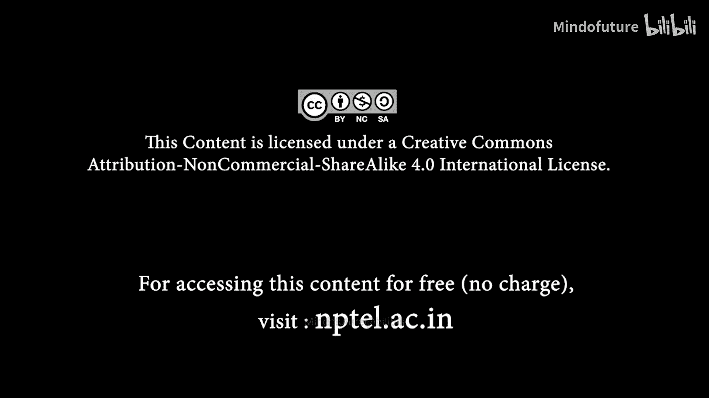
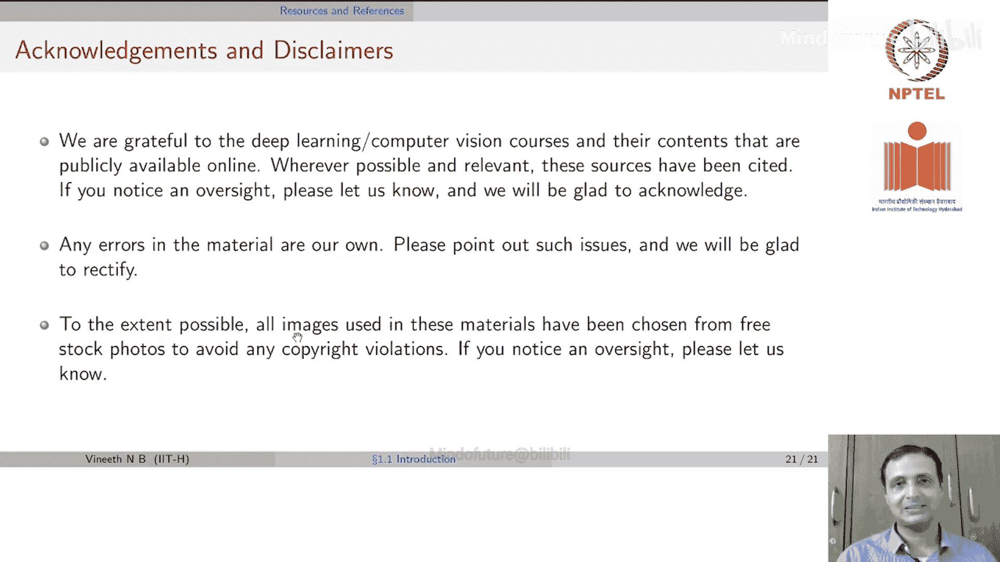

# 【NPTEL】计算机视觉的深度学习 p01 P01_课程介绍与概述 -BV1vNWkzpEua_p1-

Hello and welcome to this first lecture for this course， Deep Learn for Comp Vision。

My name is Vinie Bala Subramania， I'm a faculty in the Department of Computer Science and Engineering at IIT Hyderabad。

 hope all of you had a chance to look at the welcome video for this course。

 which may have given you an introduction of what to expect。Well， however。

 revisit some of those things in this particular lecture and talk about what to expect。

And why we need to study this particular course。To start with。

We will talk about what and why computer vision。Then we talk about the topics that we will cover in this course。

 the structure that we will follow， what are the objectives。

 what you will not learn and finally we will talk about the resources and references for this course in this first part of the lecture。

Firstly， to start with。What is computer vision？So if you looked at this image on the left。

And ask the question， where is the glue stick？Or can you find the book， what is its full title？

You probably take a few seconds。But if you observe closely。

 you will then find there's a glue stick here standing vertically。And there's this book。

Hidden behind other books， but that's the book that's likely to draw your attention and looking at some partial information。

 I would say the book's name is Lord of the Rings。The brain is really good at filling in information to get what is hidden in the image。

And the image on the right。By looking at it， if I ask you the question。

 what is wrong with this image？It seems very naturally made。

 but from our knowledge of the world and our knowledge of how the world behaves。

 we would probably say that somebody has tampered and created this image and this does not seem to meet some natural laws that we know of。

No。What we want to find out in this course is can a machine answer the same questions？

Is it trivial for a machine to understand the clutter in an image and isolate one particular glue stick who suppose is very untypical where the name glue stick is not revealed known in that particular object or can a computer be able to find out that from the word rings and from the font on that particular word can you fill in and say the book is lo of the rings and same here for the image on the right？

Can a computer have a knowledge of the world that can help it understand that there is something wrong with this image and be able to say what is wrong？

These are very difficult problems for a computer and the human brain is very。

 very good at filling in partial information and bringing in context and all of the knowledge that we have gained to be able to help us understand the world around us visually。

So what is computer vision？More formally speaking， you could say computer vision is a field。

That seeks to automate and end computing framework with the ability to interpret images the way humans do。

At the end of the day， we want that system to be able to serve humans。

 so we want a computer to interpret the world around us the way human users do。

And as all of us may know， computer vision is considered a subtopic of artificial intelligence screening。

There could be other definitions that many researchers over the years have defined。

You could call it the construction of explicit meaningful descriptions of physical objects from images。

 this was defined by Belllard and Brown or Traco very defined it as computing properties of the 3D world around us from one or more digital images or as Saman and Shapiro say to make useful decisions about real physical objects and scenes based on sensed images and one thing that I should mention here is when we say images。

 we also mean videos， images is more a placeholder for the visual world that a camera captures。

 could be images or videos in this particular context。Why do we need to study this field。

 apart from the curiosity to understand the world， apart from the need to make a computer to do what humans do。

 what are the applications of computer vision in today's world？

I'm quite sure many of you may already know this， but computer vision is all around us today。

Be it the phase detection on your Facebook or Picasa or any other visual platform that you have。

Two autonomous vehicles where the perception in front of a car is through various cameras。

 including cameras like radar cameras， surveillance。

Such as CCTV in your airports or railway stations or wherever it may be， factory automation。

 this is one of the oldest applications of computer vision where cameras are fixed in various settings in manufacturing pipelines or warehouses to be able to automate various aspects of factory cases。

Medical imaging， very important application today， human computer interaction So of you may have played the Kinect of the Xbox where there's a studio camera looking at a user and tracking the user to say whether a user is playing if the user is playing a bowling game or a tennis game whether the movement is a particular forhand or a backhand or any other movement for a particular game and finally visual effects and movies where where computer vision is used extensively these are just some sample applications from different domains but you can imagine there have many。

 many kinds of applications where one can use cameras and computer vision on the feet that you get from the cameras to be able to get knowledge using in an automatic manner。

There are many， many more applications here are a few more including some recent ones that I've tried to put together on this particular slide。

 in fact one of your homework for this particular lecture is going to be to click on some of these links and see how computer vision is used there and I can guarantee you that some of these are very very interesting applications which you may or may not have come across so far one of them is retail and retail security。

 some of you may have heard of。Amazon Go， and initiative of Amazon。

Where the entire shopping experience is without a billing counter so you go in into a store。

 pick up whatever objects that you have on the different shelves and you simply walk out of the store with no billing so the retail store automatically tries to understand what objects you picked and put into your basket and just deduct it from your Amazon wallet or any other thing any other wallet that you configure for your shopping experience Similarlyly this virtual try on where you try on a piece of cloth before buying it online and try to see how it looks so new stoplift to prevent shoplifting。

Healthcare， where you can use it for blood loss detection。

 for dermatology in agriculture for trying to find out various aspects of agriculture。

 for trying to find out livestockface recognition in banking and finance to be able to deposit your checks automatically through through a feeder so there's no human involved in trying to find out to whom that checks should be credited and what is the amount all of that is automated through vision system。

 insurance risks insurance risk profiling remote sensing where you do land use understanding using satellite imagery or forestry molding using drone or satellite imagery。

 structural health monitoring， a very important application today where you can do oil well inspection or drone based bridge inspection or 3D reconstruction or try to understand the health of railway tracks using drone imagery so on and so for there extremely important in in various settings where you may want to。

Monior the health of an infrastructure without having to physically inspect that infrastructure。

 for example， it may not be trivial to go under a bridge and try to find out if there are cracks under the bridge。

 but you could use a drone to fly through that area and use the images that you get from that drone to be able to process and understand the health of bridges。

 railway tracks。Oil refineries and any of those large infrastructures。Document understanding。

Optical character recognition is one of the oldest successes of computer vision， in fact。

 one of the oldest products that computer vision has delivered to the world。

Robotic process automation for document understanding you can click on these links to understand what each of these terms mean tell and social media image understanding brand exposure analytics augmented reality to be able to do visual support or warehouse and enterprise management so on and so forth in case any of these terms are not clear please do click on these links and each of those links will take you to a video or a description of what that application is and how computer vision is used in that setting please do do it to help you understand the various applications that computer vision has。

So in terms of studying computer vision。Very broadly speaking。

 there are a few different terms that often overlap the computer vision， computer vision。

 machine vision and image processing， So an obvious question you could ask here is how these different。

Today is popular called computer vision image processing often refers to low level image processing you try to process an image at a low level at a low level such as extracting edges or trying to。

Invert an image or try to do various processing operations straight on the image but computer vision is more about understanding higher level abstractions or knowledge of the world from images so there's a difference in abstraction of understanding between image processing and computer vision although these days I think the lines between them are very blurry and where one ends and where the other begins is very difficult to say we will obviously flow from one to the other in this particular course regarding computer vision and machine vision this is a little bit more trickier this is more in terms of the legacy of how these words developed machine vision was one of the popular terms that was used in the 80s and 90s when computer vision system was used in industry automation so today when you say machine vision you often talk about vision systems that are deployed as part of a larger machine or an industry system that's what you typically mean by machine vision that is computer vision refers to the particular。

Se of methods or algorithms that you use to extract knowledge from a camera so in a sense。

 computer vision methods are used as part of machines in machine vision once again。

 I think thats it's a perspective of usage and context and scope that you have you know in a particular setting that you use these terms。

So in terms of the various topics that are allied to computer vision。

 obviously artificial intelligence， artificial intelligence is there a larger realm and computer vision forms one aspect of artificial intelligence at this time。

 although computer vision has other facets too。Machine learning， of course。

 a lot of the way computer vision problems solve computer vision problems is solved today is to machine learning methods。

 mathematics， no surprise， neurobiology， because that's what helps us understand how the human visual system works imaging。

So the camera's image， the scene around us is important to be able to solve computer vision。

 the physics of the optics that's involved in lenses and how light falls on a particular object。

 how an object's appearance changes and the light source changes when the direction of the light source changes when the color of the light source changes or when there are multiple light source so on and so forth。

 signal processing because at the end of the day， an image is a two dimensional signal。

So a lot of the basic computer vision concepts follow through from signal processing。

 control and robotics。play an important role especially in robotic vision and of course there are various other peripheral areas such as cognitive vision statistics。

 geometry， optimization， biological vision smart cameras optics multivariable and nonlinear signal crossing robotic vision so on and so forth and these are all connected to those larger topics that you see them organized next to so that gives you a perspective of the various topics that are connected to computer vision obviously we won't have the scope to cover all of them I'll soon talk about what we're going to cover in this particular course。

So one question here is why is this hard our brain seems to be so good at perceing objects around us so in fact we will talk about the history of computer vision in the subsequent lecture but when people started studying computer vision in the 1960s it was assume that computer vision is something that you could solve through a summer project and obviously researchers have long since realized that it's not that simple but let's try to understand why is it really hard。

So one simple way of trying to understand it is by looking at optical illusions because they help you understand。

Why even we don't understand how we perceive certain things in the visual world around us so a very popular example is this mueller layerar illusion where one asks this question which line is longer？

So if you didn't think too hard， you would probably say that the line that is longer is the one below。

 but the true answer is that both these lines are exactly the same length。

Just the contextualization of those lines with those angled parenthsesis makes you get an illusion that one of the lines is longer than the other。

And there's a very popular illusion called the Herman grid illusion named after a German physiologist called Herman。

 where if you simply looked at that grid in in front of your eyes， you would start。

halucinating black dots and white dots at the intersection of those great points。

 so in fact some argue whether this is an illusion or as a hallucination。

 but it still proves the point that human vision is hard to understand and how we perceive things is still hard to understand。

Another popular example is called the Adson's brightrightness constancy illusion so theres again link please we' take a look at that link later on。

 but the question that we want to ask here is if you see closely here there are two squares A and B that are labeled on that checkerboard and we ask the question which is brighter A or B。

What's your answer？So the truth is obviously， it looks like B is brighter and a is darker。

The truth of it is A and B have exactly the same intensity at the level of a pixel。

 the pixels that are there in the a block and the B block exactly have the same intensities。

This can be a little surprising， but that's once again based on how human brain uses context and probably understands that there's a shadow falling on B and it compensates for that to make B look brighter than A but A and B exactly have the same pixel inten once again the brain does an amazing job here。

 but to make a computer to do this job is hard。And finally， this is an example where you have。

Two sets of。Csses so on the left part you have a bunch of red crosses on the right part you again have a bunch of red crosses and the task for you is to count the red crosses in both figures。

I'll let you take a moment for that。Clearly， if I ask you the question， which is harder。

You would say the one on the right。Because there are some red circles that are putting off your counting process and making it harder to count。

 although。Otherwise， it's the same rec process on both sides。So this is something again。

 that makes understanding how visual perception works hard。More deeply。

 if you have to ask why computer vision is hard。Most of the practical use cases of computer vision are what is known as inverse model applications what does this mean so this means that we have no knowledge of how an image was taken or what were the camera parameters when the image was taken so you do not know at what angled the image was taken。

 what were the settings on your camera when an image was taken but we need to model the real world in which the picture and the video was taken。

So that's why we call it an inverse problem， we do not know what was the world in which the image was taken。

 but we actually have to find out from the image as to what are the 3D characteristics of that world in which the image was taken。

So and often in practice， we almost have to model this from incomplete partial noisy information。

By that we mean there could be noise in the image， the noise could come from some motion blur。

 could come from a noisy spec on the lens， could come from noise on the CCD or the CMOS silicon that captures the image or could come from just the processing elements that were involved at various stages of the pipeline the noise could come from anywhere。

On the other hand to just make this clear forward model So we said this is an inverse model。

 so an obvious counter question then is what is a forward model a forward model is what could be used in say physics or computer graphics where you can define。

The various parameters that you have and you create the image in that setting like animation or graphics for that matter where you say I'm going to place a light source at this angle。

 the light source is blue in color and I have an object sitting at a particular location I have another another light source that's red in color in some other part of the room falling on the object and now we can actually create the room those kinds of applications would be called forward models of vision while the computer vision that we're going to talk about in this course is the inverse model and a lot of applications such as object recognition or detection or segmentation are all inverse models。

Secondly， one of the problems in computer vision is that image data is very high dimensional。

So even if you took a single one megapix image， which today is not very high resolution by the kind of cameras that we all have in our smartphones。

Re one megapixel image is 10 plus6 pixels。And once again if you took a color image。

 you typically would have a red channel， a green channel and a blue channel， an RGB image。

 which means you actually would have three in andpar6 pixels in that particular one megapixel image so that's  three million measurements for that one megapixel image and that's a very huge dimension to work with when you use machine learning algorithms for this kind of a data。

 so which means images have image processing such images and getting understanding from these images has very heavy computational requirements。

And another thing here is computer vision is set away what is known as AI Comp。So once again。

 anything that's blue in the slides is clickable， so please do feel free to click on it and learn more about what AI complete is but in very simple words AI complete means that a computer cannot solve the problem by itself and you need to bring a human to be able to solve the problem。

So that's what we call as a human AI complete in very cool words。

 please feel free to click on that link to understand more。

And as you can see here on the right limits if you simply want to check whether。

A photo that you click is in a particular national park you can probably do it easily。

 but if you want to find out finer details of a particular photo that you took what bird is it which which particular。

Kind or a sub kind of a bird are you looking at these kinds of things are very hard computer vision problems。

Further points here are that no complete models of the human visual system itself are known at this time。

 most of the existing models of the human visual system relate to subsystems and are not holistic in their understanding in terms of the entire central nervous system。

And there are also questions that you can ask as what is perceived and what is czized。

 especially things like optical illusions， there is a significant difference。

 especially if you took the example of the Herman gridit illusion that we saw。

 what you perceive and what you cze are two different things and you may look at a piece of thread in the night and think it's a snake so once again what you perceive and what you cze are different here。

So that makes the problem even harder and you could also ask the question when is an object important for a task and when is the context around the object important for a task。

 these are difficult questions to answer and some of these have been answered very convincingly today and some of them still remain open research questions for the field of computer。

And also the verifiability of the mathematical or physical models for these kinds of systems is nontri。

 for example， if you found a good way to represent an image as a low dimension vector per se。

How should similarity or dissimilarity between representations be defined？

Would that be a proper distance metric mathematically？Do all images in all settings， RGB images。

 thermal images， Li images， do all of them follow the same distance metric。

How do you change these distance metrics between these images unfortunately there's no universal answer。

 there's no clear verifiability for such， even if you develop a method。

 how do you verify this in a very reliable way is also an open question。Finally。

 how would you if you manipulated an image what is typically called a counterfactual a counterfactual is where you take an image and ask the question what if I had a particular object in this image changed so you had an image of the scene in front of you and let's say instead of a laptop if you placed a table lamp there how would the scene look like and what would change in your perception of that image so those that called counterfactuals。

So if you had a manipulation in a given environment。

 how would that change the behavior of the perception of the cognition of the image can a physical model or a mathematical model of your environment actually capture those kinds of counterfactuals and how the counterfactuals affect your perception these are open questions at this point and these are the reasons why computer vision stays a hard problem today。

So with that。Overall brief introduction to computer vision why we need to study it why is it hard。

 let's actually talk about this course and what we're going to cover in this course and whats going to be the structure of the topics so the way computer vision has evolved over the last few decades we will talk about the history of computer vision in a lecture or two you can broadly classify the topics into learning based vision geometry based vision and physics based vision。

Once again these topics are fairly porous so it's not that one topic doesn't flow into the other often to solve problems you need to use concepts from various subtopics。

 so by learning based vision we generally refer to problems in computer vision such as visual recognition such as object recognition or gesture recognition or emotion recognition from images。

Detect detection， detecting your face in Facebook in a Facebook photo or segmentation where you segment a scene into various parts at the pixel level or cracking an object or retreatreading in an image based on a search query。

 so on and so forth typicallyy all of these are solved using learning based methods So that's one segment of computer vision then there's geometry based vision where you talk about feature based alignment。

 emit stitching such as the panorama that you see on your cell phone if are geometry。

 structure from motion， 3D reconstruction， so on and so forth。

 typically you study that as part of geometry based vision and finally there's physics based vision where you talk about computational photography。

 photometry， light fields， color spaces， shaped from X where X could be shading or structure or any other any other topic。

 reflection， refraction polarization， diffraction interface。

and so on and so forth so clearly you can see a lot of this has to deal with the physics of how an image created so these are all different subfields of computation that have developed over the years。

And the focus of this course is going to be learning based vision and that's the reason this course is called deep learning for computer vision in terms of the topics that we will cover this course。

Starting from the offering of this course in 2024。We have restructured the topics to align and cater to more recent developments in computer vision in the last few years。

We will begin with a segment on the basics and history of computer vision。

Where we will talk about image formation。Lar filtering， correlation， convolution， edge detection。

 block detection， feature extraction， as well as description of those features。

Each of these topics comprise basics of image processing and computer vision。

This segment also includes additional lectures that you can view for your own optional understanding。

We will then subsequently move to feed forward and convolutional neural networks where we will begin with the basics of neural networks while the course assumes a prerequisite background in deep learning which is strongly recommended。

 we will however cover the basics of neural networks。

We will then move on to understanding what convolutional neural networks are which form the basis of computer vision。

We will talk about various architectures of CNNs， convolutional neural networks。

 variants and talk about fine tuning and visualizing them。

We will then talk about how CNNs can go beyond simple classification。

Towards what are seminal tasks in computer vision？Detection and segmentation。

Once we are done with this segment。We will move forward to adding the dimension of time。

We will talk about recurrent neural networks。Video understanding using a combination of CNNns and Rns。

Move on to understanding attention in vision models。

And the newer developments around transformers and self attention。

 we will then extend transformers to vision transformers and how they have been used for seminal tasks of detection and segmentation。

Then well move on to the next segment， which is on deep generative models。

Where we will begin with topics like generative adversarial networks and a little bit of variational auto encoders。

But will focus significantly on the recent developments in diffusion models。

 talk about different ways of training them， conditioning them， so on and so forth。😊。

The final segment will talk about more recent and advanced topics this includes self-supvised learning。

 contrastive learning， vision language models， foundation models for vision like clip。

 Blip and so on and we have an optional week of lectures which is purely additional in terms of taking the course which includes topics like few short learning。

 zero short learning， robustness， model compression， neural architecture search。

 and we will end with also recent vision language models。What are the prerequisites for this course？

It is expected that you've completed a basic course in machine learning。

It' is strongly recommended for you to have completed a course in deep learning。

 but not mandatory since we will cover the basics of neural networks also in one of the weeks of the course。

As you may expect， you may need to know basics of probability linear algebra and calculus。

This course will also have programming assignments so experience of programming in Python is required and knowledge of a deep learning framework like Pytorch or TensorFlow would be highly recommended in terms of resources and references the popular computer vision books that we will refer to which are also followed widely across the world is computer vision a modern approach by David Forit and John Po the book website is linked here computer vision algorithms and applications by Richard Celliky which a very popular book it's there in the open public domain for you to download the PDF we will follow this book for certain topics to and also computer vision models learning and inference once again the book website has the book and you can download it if you like by Simon Prince these are the popular computer vision books that we will follow there are also the popular deep learning references deep learning by Ian Goodflow Yo show。

Gon Aaron Kville， the book website has the book， theres also a very nice short online book by Michael Nielsen。

 which we'll refer to when required and also the book by Christopher Bishop on neuralural Networks for Pat recognition。

While these are good references for you to follow for each lecture we will point you to where you can look at and sometimes we will just point you to good blogs and posts that are online these days you have some excellent blogs that explain concepts well so you will point you to those as and when required and possible。

So if you wanted to learn geometry based vision so I said that the course is focused on learning based vision。

 so if you want to learn geometry- based vision what do you do is a very nice book called Multiip View geometrytry and Comp vision it's again linked here please do take a look at that book if you want to learn and there is also a course on NPL for geometry based vision please click on this link for these weeks in that particular course if you want to learn a little bit more about topics and geometry based vision and if you wanted to learn physics based vision once again a very nice book called physics based vision principles and practice is available on this link。

And there is also web based course， which is linked here。

 which you can follow if you want to learn more about physics based vision。

So one of the homeworks that you're going to let you take away from this inaugural introductory lecture is go through all the links on the applications of computer visionsion slide that was slide six for you theyre very very interesting views or reads to open your world to a lot of different computer vision applications which I think that some of you at least may not have come across that's going to be the homework for your first lecture today。

So to wrap up the first lecture， I think I should thank many。

 many people that have contributed to the creation of the slides and to my own knowledge in delivering this lecture。

 we are very grateful to the deep learning or computer vision courses and contents that are publicly available online。

Wherever possible and relevant these sources have been cited。

 but if you notice an oversight please let us know and we will be glad to acknowledge I will thank all of the specific people that have contributed to creation of lectures at the end of this course because there's a chance that I may add some contents a little later down I want to ensure that I thank all of them towards the end we will do that towards the end。

And obviously any errors in the material are our own。

 please do point out some issues well be glad to rectify rectify to the extent possible the images used have been taken from free stock photos or public spaces to avoid copyright violations。

 but if there is an oversight please let us know and we'll take it down or replace the image with something。

Something else there are also teaching assistants that have been involved in creating the slides and helping make this course possible to offer to you once again some of these teaching assistance contacts and names will be shared with you in the next few weeks。

 but we'll also acknowledge all of them at the end of this course for I。

There may be other people that contribute as the course progresses towards the end。

So that's the end of the first lecture。We'll continue soon with the next topics， thank you。

