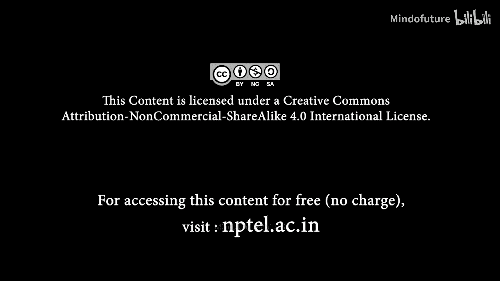
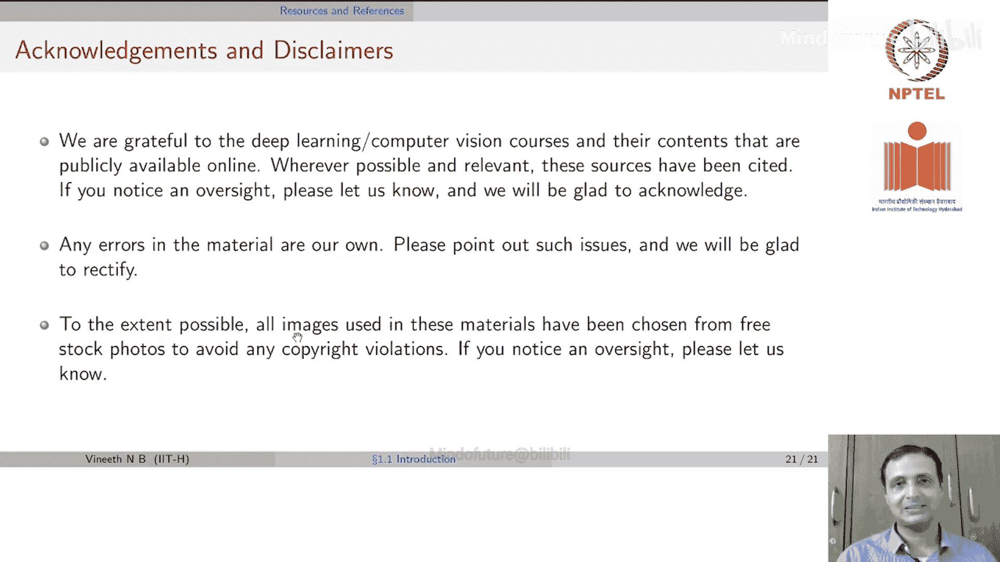

# 深度学习计算机视觉：P01：课程介绍与概述

在本节课中，我们将要学习计算机视觉的基本概念、其重要性、面临的挑战，以及本课程的结构和涵盖的主题。

---

## 什么是计算机视觉？🤔

计算机视觉是一个致力于让计算机系统能够像人类一样理解和解释图像的研究领域。其最终目标是使计算机能够以人类用户的方式解读我们周围的世界。计算机视觉通常被认为是人工智能的一个子领域。

多年来，研究人员给出了多种定义。例如，Ballard 和 Brown 将其定义为“从图像中构建物理对象的明确、有意义的描述”。Trucco 和 Verri 则定义为“从一个或多个数字图像中计算我们周围三维世界的属性”。Shapiro 和 Stockman 认为其目的是“基于感知到的图像，对真实的物理对象和场景做出有用的决策”。需要说明的是，这里所说的“图像”也泛指视频，它是相机捕捉到的视觉世界的载体。

## 为什么需要学习计算机视觉？💡

除了满足理解世界的好奇心以及让计算机具备人类能力的需求外，计算机视觉在当今世界有着广泛的应用。它已经无处不在，例如：
*   **社交媒体**：Facebook 或 Picasa 等平台的人脸检测。
*   **自动驾驶**：通过各类摄像头（包括雷达摄像头）进行环境感知。
*   **安防监控**：机场、火车站等场所的闭路电视系统。
*   **工业自动化**：在制造流水线或仓库中安装摄像头以实现自动化，这是计算机视觉最古老的应用之一。
*   **医学影像**：非常重要的现代应用。
*   **人机交互**：例如 Xbox 的 Kinect，通过摄像头追踪用户动作。
*   **视觉特效与电影**：计算机视觉被广泛应用。

以上只是不同领域的一些示例应用，实际上，利用摄像头和计算机视觉技术来自动获取知识的应用场景数不胜数。

以下是更多应用，包括一些近期出现的例子：
*   **零售与零售安防**：例如 Amazon Go 的无收银购物体验，商店自动识别顾客选取的商品并结账；在线购物的虚拟试穿。
*   **医疗健康**：用于失血检测、皮肤病学分析。
*   **农业**：分析农业的各个方面，进行牲畜面部识别。
*   **银行与金融**：通过支票扫描仪自动识别支票收款人和金额。
*   **保险风险评估**：进行风险画像。
*   **遥感**：利用卫星图像进行土地利用分析，或利用无人机/卫星图像进行林业建模。
*   **结构健康监测**：非常重要，可用于油井检查、无人机桥梁检测、3D重建或利用无人机图像评估铁路轨道健康状况等，实现对基础设施的无接触健康监控。
*   **文档理解**：光学字符识别是计算机视觉最古老的成功应用之一。
*   **机器人流程自动化**：用于文档理解。
*   **社交媒体图像理解与品牌曝光分析**。
*   **增强现实**：提供视觉支持。
*   **仓储与企业管理**。

如果对其中任何术语不清楚，请点击幻灯片中的链接，每个链接都会带你了解该应用的具体内容和计算机视觉在其中如何发挥作用。

## 相关领域辨析 🔄

在计算机视觉的学习中，有几个经常重叠的术语：计算机视觉、机器视觉和图像处理。

*   **图像处理** 通常指低层次的图像处理，例如提取边缘、图像反转或直接在图像上进行各种处理操作。
*   **计算机视觉** 则更多关注从图像中理解更高层次的抽象或世界知识。两者在理解的抽象层次上存在差异，尽管如今界限已非常模糊。
*   **机器视觉** 这个词更多源于历史沿革，在80-90年代工业自动化中常用。如今，机器视觉通常指作为大型机器或工业系统一部分部署的视觉系统。从这个意义上说，计算机视觉方法被用作机器视觉的一部分。这更多是使用语境和范围上的视角差异。

## 计算机视觉的相关学科 📚

计算机视觉与多个学科紧密相连：
*   **人工智能**：计算机视觉是其一个重要组成部分。
*   **机器学习**：当今解决计算机视觉问题的主要方法。
*   **数学**：基础工具。
*   **神经生物学**：帮助我们理解人类视觉系统的工作原理。
*   **成像与光学物理**：涉及镜头光学、光照变化对物体外观的影响等。
*   **信号处理**：图像本质上是二维信号。
*   **控制与机器人学**：在机器人视觉中尤为重要。
*   其他周边领域包括：认知视觉、统计学、几何学、优化、生物视觉、智能相机、光学、多变量与非线性信号处理、机器人视觉等。

显然，本课程没有范围涵盖所有内容，后续将介绍本课程的具体安排。

## 为什么计算机视觉很难？🤯

我们的大脑似乎非常擅长感知周围物体。事实上，在20世纪60年代计算机视觉研究起步时，人们曾认为一个暑期项目就能解决它。研究者们后来才意识到这远非那么简单。光学幻觉有助于我们理解为什么视觉感知如此复杂。

**穆勒-莱尔错觉**：哪条线更长？如果不加思考，你可能会说下面的线更长，但正确答案是两条线长度完全相同。只是两端箭头的朝向造成了错觉。

**赫尔曼网格错觉**：凝视网格时，会在交叉点“看到”并不存在的黑点或白点。

**棋盘阴影错觉（Adelson’s brightness constancy illusion）**：图中标有A和B的两个方块，哪个更亮？看起来B更亮，但事实上A和B的像素强度完全相同。大脑根据上下文（认为B处于阴影中）进行了补偿。

**计数干扰**：左右两组红色十字，哪边更难数？右边因为有红色圆圈的干扰而更难。这再次说明视觉感知的复杂性。

更深入地看，计算机视觉困难的原因在于：

1.  **逆问题**：大多数实际应用属于“逆模型”问题。我们不知道图像是如何拍摄的（相机参数、角度等），但需要从图像中反推出现实世界的三维特性。而且通常要从**不完整、有噪声**的信息中进行建模。噪声可能来自运动模糊、镜头污点、图像传感器或处理管线中的任何环节。
    *   **顺模型**：与之相对的是物理或计算机图形学中的“顺模型”，即给定参数（如光源、物体位置）来生成图像（如动画）。

2.  **数据高维**：即使是一张100万像素的彩色图像（RGB三通道），也有300万个数据点。处理如此高维的数据对计算要求极高。

3.  **AI完备性**：粗略地说，AI完备性问题意味着计算机无法独立解决，需要人类介入。例如，判断一张照片是否在某个国家公园很容易，但识别照片中特定鸟类的亚种则非常困难。

4.  **人类视觉系统模型不完整**：现有模型大多针对子系统，缺乏对整个中枢神经系统的整体理解。

5.  **感知与认知的差异**：例如在赫尔曼网格错觉中，你“看到”的和实际“存在”的是两回事。这增加了问题的难度。

6.  **任务相关性与上下文重要性**：何时物体本身重要，何时其周围环境重要？这些问题有些已有答案，有些仍是开放的研究课题。

7.  **数学模型的可验证性**：例如，如何定义图像表征之间的相似性？是否存在普适的距离度量？如何可靠地验证一个方法？这些问题尚无统一答案。

8.  **反事实推理**：如果改变图像中的某个物体（反事实），场景的感知会如何变化？当前的物理或数学模型能否捕捉这种变化？这些都是开放性问题。

## 本课程内容与结构 🗺️

计算机视觉在过去几十年的发展，可以大致分为：**基于学习的视觉**、**基于几何的视觉**和**基于物理的视觉**。这些领域相互渗透，解决问题时常需结合多个子领域的概念。

*   **基于学习的视觉**：涉及视觉识别（物体、手势、情感）、检测（如人脸检测）、分割（像素级场景分割）、基于搜索的图像检索等，通常使用学习方法解决。
*   **基于几何的视觉**：涉及特征对齐、图像拼接（如手机全景）、运动恢复结构、三维重建等。
*   **基于物理的视觉**：涉及计算摄影、光度学、光场、颜色空间、从X恢复形状（X可以是阴影、结构等）、反射、折射、偏振、衍射等，主要处理图像形成的物理过程。

**本课程的重点是基于学习的视觉**，这也是课程命名为“深度学习计算机视觉”的原因。

以下是本课程（2024年版本）的主题结构，我们已进行调整以涵盖近几年的最新发展：

1.  **计算机视觉基础与历史**：涵盖图像形成、线性滤波、相关、卷积、边缘检测、角点检测、特征提取与描述。这部分包括图像处理和计算机视觉的基础，并提供额外的可选讲座。

2.  **前馈神经网络与卷积神经网络**：从神经网络基础开始（尽管课程假设有深度学习背景，但仍会覆盖基础）。然后深入理解构成计算机视觉基石的卷积神经网络，讨论各种CNN架构、变体，以及微调和可视化。

3.  **超越分类：检测与分割**：探讨CNN如何应用于计算机视觉的核心任务——目标检测和图像分割。

4.  **引入时间维度**：讨论循环神经网络，结合CNN和RNN进行视频理解，进而学习视觉模型中的注意力机制，以及Transformer和自注意力的新发展，并将其扩展到视觉Transformer及其在检测和分割任务中的应用。

5.  **深度生成模型**：从生成对抗网络和变分自编码器入手，重点介绍近期扩散模型的发展，讨论其训练、条件控制等方法。

6.  **近期与高级主题**：包括自监督学习、对比学习、视觉-语言模型、视觉基础模型（如CLIP、BLIP）。还有一个可选讲座周，涵盖小样本学习、零样本学习、鲁棒性、模型压缩、神经架构搜索等主题，并以近期视觉-语言模型作为结束。

## 先修要求与参考资料 📖

**先修要求**：
*   完成机器学习基础课程。
*   **强烈建议**完成深度学习课程（非强制，因课程中会覆盖神经网络基础）。
*   需要概率论、线性代数和微积分基础。
*   本课程包含编程作业，需要Python编程经验。
*   熟悉PyTorch或TensorFlow等深度学习框架将非常有帮助。

**参考资料**：
*   **计算机视觉经典书籍**：
    *   《Computer Vision: A Modern Approach》 by David Forsyth and Jean Ponce
    *   《Computer Vision: Algorithms and Applications》 by Richard Szeliski （可公开下载PDF）
    *   《Computer Vision: Models, Learning, and Inference》 by Simon Prince
*   **深度学习参考书籍**：
    *   《Deep Learning》 by Ian Goodfellow, Yoshua Bengio, Aaron Courville
    *   Michael Nielsen 优秀的在线短书
    *   《Pattern Recognition and Machine Learning》 by Christopher Bishop
*   每讲会指出具体参考资料，有时会推荐优秀的在线博客和文章。
*   **如果想学习基于几何的视觉**：推荐书籍《Multiple View Geometry in Computer Vision》，以及NPTEL上相关的几何视觉课程。
*   **如果想学习基于物理的视觉**：推荐书籍《Physics-Based Vision: Principles and Practice》，以及相关的网络课程。

## 课后作业与致谢 🙏

**本讲的课后作业**：请浏览课程中关于计算机视觉应用的幻灯片（原幻灯片第6页）上的所有链接。这些是非常有趣的视频或阅读材料，能为你打开计算机视觉应用世界的大门，其中一些应用你可能尚未接触过。

最后，感谢所有为本课程幻灯片制作和知识传授做出贡献的人们。我们非常感谢那些公开在线的深度学习与计算机视觉课程和内容，并在可能和适当的地方进行了引用。任何材料中的错误均由我们承担，欢迎指正以便修正。使用的图片均来自免费图库或公共领域以避免版权问题。助教们也为制作幻灯片和使本课程得以开设提供了帮助，我们将在课程结束时一并致谢。

---

本节课中，我们一起学习了计算机视觉的定义、广泛应用、面临的巨大挑战以及本课程的整体框架和路线图。我们了解到，尽管人类视觉看似轻松，但让计算机实现类似的理解却是一个复杂的逆问题，涉及高维数据处理和AI完备性等挑战。本课程将聚焦于基于深度学习的视觉方法，带领大家从基础走向前沿。下一讲，我们将开始深入计算机视觉的具体基础知识。