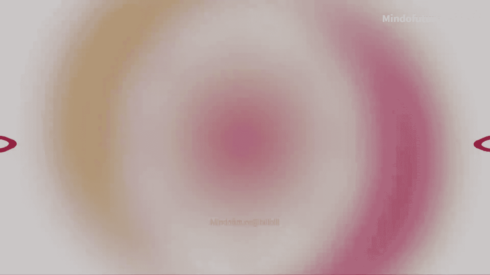
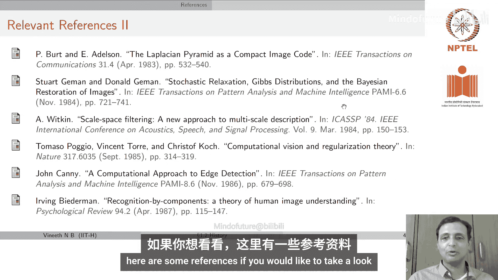

# 【NPTEL】计算机视觉的深度学习 p02 P02_历史 -BV1vNWkzpEua_p2-

Last lecture， we gave an introduction to the course and now we'll actually get started with the contents。

Well review history of computer vision over the last few decades just to give a perspective of where the field started from and how it has evolved over the last few decades。

So this lecture is structured into the four parts。We briefly described very initial forays in the field in the 50s。

 60s and 70s。Then we'll talk about efforts that contributed to low level understanding of images in the 80s largely。

Then we go to high level understanding that the community took up in the 90s and 2000s and of course。

 well then cover a brief history of replanning in the last decade or so。To start with。A disclaimer。

 this is going to be a history of the field as captured from multiple sources。Cleski's book。

 as well as many other sources that are mentioned on each of the slides。

It may be a slightly biased history from multiple perspectives one perhaps the way I have seen it and I have seen it to be important please bear with that personal bias it may also be biased to the topics that we cover in this course may not cover physics based vision geometry based vision in too much detail once again I'll refer you to those books that we talked about in the previous lecture if you want to know them in more detail。

There's also a slight predisposition to work down images more than videos。

 but still hopefully these slides give you a perspective of the field and how it's evolved over the last few decades。

The earliest history of computer vision was way back in the 50s when two researchers。

 David Hubin and Torsten Weasel published their work called Receptive Fields of S neurons in the Cat's stide cortex。

So they conducted multiple experiments to understand how the mammalian visual cortex functions and they took a cat and they did many experiments in this regard。

 but they inserted electrodes into a sedated cat。And then try to see how the cat's neurons fire with respect to visual stimuli presented to the cat。

Incidentally。For quite a long time， they could not make headway and accidentally they found that the cat's neuron fired when they switched slides in the projector in front of the cab。

They were initially perplexed。But they later realized and that was one of their propositions that the edges created on the screen by the slide that was inserted in the projector was what fired a neuron in the cap。

One of the outcomes of their early experiments was that simple and complex neuron exist in the mamalian visual corex and that visual processing starts with simple structures such as oriented edges。

So Hubel and Wsel in fact did many more experiments over the next two decades and they actually won the Nobel Prize in 1981 for their work in understanding the mammalian visual context so this was one of the earliest efforts in computer vision in the same year in 1959 there was actually another major development too which was。

By Russell Kersch and his colleagues， where for the first time。

They represented an image as a set of ones and zeros。

 so representing an image as a number grid was a huge achievement。

 which is something that we inherit to until today and in fact the first image taken was of Russell's infant sum which was a5 centm by5 centim photo about a 176 cross 176 array that was captured at that particular time。

 this is considered such a big achievement in the field of vision that this particular photo is still preserved in the Portland Art museum in the USA。

Then in 1963， there was a significant development。By a person called Lawrence Roberts and he wrote a PhD thesis on machine perception of3 dimensional solids the PhD thesis in fact。

 is hyperlinked on this particular slide so please take a look at it if you're interested but I think this thesis had some ideas even beyond its times at that point so the thesis discussed by Roberts talked about discussing extracting 3D information about solid objects from 2D photographs of line drawings So if you recall what we spoke in the previous lecture we said that the aim of computer vision is to understand the 3D world around us from 2D images that we get or the 2D videos that we get to some extent this is what was talked about way back in that PhD thesis in the early 60s。

So that these has discussed issues such as camera transformations， prospective effects。

 rules and assumptions of depth perception， so on and so forth。Interestingly， Lawrence Robert。

 Lawrence Roberts moved on from this topic， and he's actually more famous for some other big development that all of us。

😊，哦 o him放。So I'm going to leave that as a trivia quiz for you to find out well talk about in the next class but try to find out what Lawrence Roberts is known for and the hint is it's not for anything in computer vision but it's a huge technological development that all of us today o in for take a look at it and try to find it all before the next lecture。

Subsequently 1966， one of the earliest efforts in trying to come up with systems for computer vision。

 which happened in MIT 1966 by Paper and Sussman。Who decided that they could use a bunch of their summer interns to develop an endine system for computer vision。

They thought they could take a few summer interns and develop a platform to automatically segment foreground and background and extract non overlapping objects from real world images and this is something that they could they thought they could achieve within a sum Okay so this was actually the note that was written by paper at that time。

Obviously， you and I know now that the project did not succeed。

 but rather that the project opened up。Reers to the fact that this was a very deep problem and it was not something that could be solved in two to three months。

 and we still know that this problem， certain aspects of it are solved。

 but many other aspects still remain unsolved。Then the years went on and in early 1970s there were also works where people tried to study how lines could be labeled in an image as a convex concave occluded of things of those kinds of so that was one of the efforts by Huffman andclo in early in the early 70s and in 1973 came an important approach called the pictorial structures by Fer and Elaer which was again reinvented in the early 200s I'll talk about that which bit later。

 but what they talked about there was they wanted。That given a visual object's description。

 that somebody should be able to find out the object in a photograph。

So the part of the solution was to define an object as a combination of individual components and the connections between those components and they proposed a solution which was firstly a specification of a descriptive scheme of an object as I said。

 in terms of individual parts and connections between parts。

 but they also defined a metric on which one could base the decision of goodness of matching or detection based on such a descriptive scheme。

 this was a significant development at this time and a lot of the models that were developed in 200s inherited this approach to the problem。

Then between 1971 and 1978 there were a lot of efforts that were attempted by researchers and that period was also known as the winter of AI。

 but at that time many efforts on object recognition using shape understanding in some sense trying to envisionvis objects as summations of parts。

 the parts could be cylinders， parts could be different kinds ofke skeletal parts was an important effort in in that time。

 so generalized cylinders， skeletons and cylinders were all efforts at that particular time。

 and importantly there was also the world's first measuring vision course offered by the MIT's AI lab in that time in the in the 1970s so I talk about the applications later。

 but in the 1970s also one of the first products of computer vision was developed which was optical character recognition which was developed by Ray Kurzweil who was considered a visionary for the field of AI。

And this moves in the 70s again。Then between 1979 to 1982 was a again a landmark development for computer visionion。

 David Ma， whose research is followed until this until today and in fact the ICCV conference。

 the International Conference on Comp Visions actually gives out a prize named after David Ma for landmark achievements in Comp visionion。

 so David Ma proposed。A pretty important framework in his book called Vision。

 a computationalInvest into the human representation and processing of visual information。Firstly。

 he established that vision is hierarchical， and he also introduced a framework where low level algorithms that detect edges。

 curves， corners are then used to feed into a high level understanding of visual data。In particular。

 this representational framework。First had a primal sketch of an image where you have edges， bars。

 boundaries， etc， then you have a 2 and a half d sketch representation where surfaces。

 information about depth， discontinuities are all pieced together and finally a 3D model that is hierarchically organized in terms of surface and volumetric primitives。

So to some extent you could say that this also resembles how a human brain perceives information。

 but we'll talk about a bit later， but this was Mars representational framework which led to a lot of research in subsequent years and decades。

In the same period around the 8081 time， there was also a significant development by Kunhiko Fukushima called the Necgnetron。

 which is actually the precursor of convolutional neural networks that A we see today。

 I think it was a significant development for the time and Fukushima introduced a selforgan artificial network of simple and complex cells to recognize patterns。

In fact， you could call this the original con， it also talked about convolutional layers with weight vectors which are also called filters today。

 so that was one of the earliest versions of convolutional neural networks which are used to this day。

So that was the initial years and now we'll talk about some developments in low level understanding of images which largely happened in the 80s。

 so we may not cover all of the methods， but at least some of the important ones as we go forward。

So in 1981 there was a very popular method called optical flow。

 which was developed by Hanhn and Sunk and the idea of this method was to understand and estimate the direction and speed of a moving object across two images captured。

In in a timeline。So if a object moved from position A to position B。

 then what was the velocity of that object across the two images。

So flow was formulated as a global energy function。

 which was minimized and the solution solution was obtained and this is a method that was extensively used over many decades。

 especially for video understanding， and I think is still used in certain applications。

 such as say compression， video compression or other video understanding applications。

In 1986 came the canny edge detector， which was a significant development for edge detection。

John Canny proposed a multistage edge detection operator which is also known as a computational theory of edge detection。

 it used calculus of variations to find the function that optimizes a given functional it was a very welldefin principle method simple to implement and became very very popular for edge detection so it was extensively used for many years to detect edges probably until to this day in certain certain industries。

In 1987 there was also the recognition by components theory proposed by Biummen。

 which was a bottom up process to explain object recognition where the object was constituted in terms of parts which were labeled asons geoons simply meant3 basic three dimensional shapes such as cylinders。

 cones and so on as you can see in some of these images here which were assembled to form and object again this was a theory of visual recognition to see if we could recognize objects in terms of their parts。

In 1988 came what are known as snakes or active contour models。

 which helped delineate an object outline from a potentially noisy to the image it was widely used in applications like tracking。

 shape recognition， segmentation， edge detection， so on， and so forth。

In 1989 was the first version of back propagation for convolutional neural networks。

So it's not necessarily low level visual understanding。

 but I think it happened in the 80s and that's why I'm talking about it here。

And it was applied to handwritten digit recognition， as we talk about very soon。

Other things that happened in the 80s were the development of image pyramids。

 representation of an image and multiple scales， scale space processing。

 processing of an image at different scales。Wveletths， which was a landmark development at that time。

 shaped from X， which is shaped from shading， shaped from focus， shaped from sellout。

 basically trying to get shape from various aspects of image formation。

 variational optimization methods， Markov random fields， all of this were developed in the 1980s。

Then came the 1990s， where the community stepped into a higher level of understanding beyond low level artifacts such as edges or corners or sonic and so forth。

It started with eigenfaces for face recognition， which used a variant of eigen decomposition for doing face recognition happened in 1991。

 which was successful for face recognition at least in constrained settings。

There were also computational theories of object detection by Edelman that was proposed in 1997。

 then came perceptual grouping and normalized cuts。

 which was a landmark step for image segmentation methods that came in 1997。

Came particle filters and mean shift in 1998。Scale invariant feature transform。

 we'll talk about some of these methods in detail， which was an important。

Image key point detector and representation method which was developed in the late 90s， early 2000s。

Then Viola Joness faced detection again that came in the early 2000s。Conditional random fields。

 which was an improvement over Markov random fields。Then pictorial structures。

The method proposed in 1973 was revisited in 2005 to develop they came up with an improved statistical approach to be able to estimate。

The individual parts and the connections between parts。

 which was called pictorial structures at that time and they actually showed that that could work in practice and give good performance for image matching。

Pascal VOC。which is a data set that's popular to this day actually started in 2005 and around that time between 2005 to 2007。

 a lot of methods for scene recognition， panorama recognition。

 location recognition also grew at that time。Constellation models。

 which were part based probabilistic generative models。

 also grew at that time to be able to again recognize objects in terms of parts and how the parts were put together in the whole and deformable part models a very popular approach。

 I think considered one of the major developments of。

The first decade of 2000 of the 21st century came in 2009。And since then， of course。

 the big developments have been deep learning， so let's briefly review them too。In 2010。

 the Inet dataset was developed and the purpose of the dataset was that until then a lot of developments in computer vision relied on large scale datasets of course Pas VOC dataset changed this to some extent in 2005 and 2006。

But many other developments relied on lab scale data sets that were developed in various labs around the world and it it did not give。

A standard way to benchmark methods and compare them across a unified platform across a unified dataset set。

 and that's the purpose Inet sought to achieve at that particular time。

 So 2010 was when Igenenet arrived。And 2012 was a turning point for deep learning。

 as many of you may be aware， Alexni won the Inet challenge until then。

All the models that won Inet until 2012 were what known as shallow models so you extracted some features out of the images and then used machine learning models such as support vector machines to be able to do object recognition So in 2012 Alexnet came into the picture and it was the first convolutional neural network that won the imagenet challenge and it was a significant achievement because it took the accuracy in the imagenet challenge by significant amount beyond the previous previous years's best perform People talk about the numbers in all of these details when we get to this part in the course。

Then in 2013 came a variant of a convolutional neural network called ZFNe stands for。

Ziller and Fergus。If won they image a challenge， then also region CNNs of R CNNs were first developed in 2013 for object detection task。

And people also started investing efforts in trying to understand how CNNs work。In 2014。

 InceptionNe and VGG models arrived。Human post estimations were developed。

 so CNN started being used for other tasks beyond just object recognition。

 deep generative models such as generative adversarial networks。

 GNS and variational autoenrs VAs also were developed in 2014。In 2015。

 residual networks or ReNes arrived and CNNs matched human performance on IageNe。It was， again。

 a landmark achievement。2015 also saw segmentation networks that came into the picture。

 fully convolutional networks， segment and unit were all developed in 2015 for the task of semantic segmentation or labeling every pixel in an image with a particular class label。

The Coco data also started appearing at that time and also the first visual question answering dataset VQA dataset was actually developed in 2015。

In 2016， moving beyond region based CNNs for object detection。

 single stage methods such as you only look once and single shot detector Yolo and SSD were developed。

 the CTscapes data set arrived， the visual genome data set arrived。

And 2017 was the start of a higher level of abstraction in understanding images。

 which is scene graph generation， given an image， how do you understand what is the scene graph。

 a person sitting on a horse or a man going on a motorbike， so on and so forth。

And in 2018 and 19 higher levels of abstraction such as the visual Common sense reasoning dataset set where we try to see if we not only give an answer to a question on image but can also give a rationale to that answer and tasks such as panoptic segmentation have been developed so as you can see this journey has focused on going from low level image understanding to higher and higher abstractions of the world we see around us from images。

From an application standpoint， we are not going to walk through every application but at a high level in the 1970s。

 as I already mentioned， one of the earliest products that was developed was optical character recognition by Kurzweil Technologies。

 by Ray Kurzweil。That was one of the earliest successes of computer vision you can say in 1980s。

 most of the industry developments were in machine vision which installed cameras in various manufacturing setups or industrial settings probably finding defects in processing chips for example。

 or even in smart cameras where some of these algorithms like edge detection and so on and so forth。

 were embedded as part of the manufacturing of cameras itself which I think is known as smart cameras which is I think a field that's important winter today。

 in 1990s slowly the applications of vision started growing machine vision and manufacturing environments continued to grow biometrics or recognizing people from images。

coCould be from ga， could be from face， could be from iris， could be from gestures。

 all of that started growing， medical imaging started becoming important， recording devices。

 video surveillance， all of them started growing in the 90s。In 20000s， more of all of these。

Better medical imaging， object and face detection， autonomous navigation started in the mid 200s。

 Google goggles， Vi on social media， all of that started in 200s and in 2010s have not even going to try listing the applications。

 I think it's grown to a point where vision applications are in various domains all around us。

Hopefully that gave you a brief perspective of the history of computer vision over the last few decades。

I would recommend you to read Celliki's chapter1 at this time and also read some of these links that have been shared as part of these slides every slide had a footnote where the information was taken from so go through some of these slides go through the links you'll be able to understand how some of these。

Topics grew in specific areas on those links。We'll stop here for now and continue with the next topic recently soon。

Here some references if you'd like to take a look。

