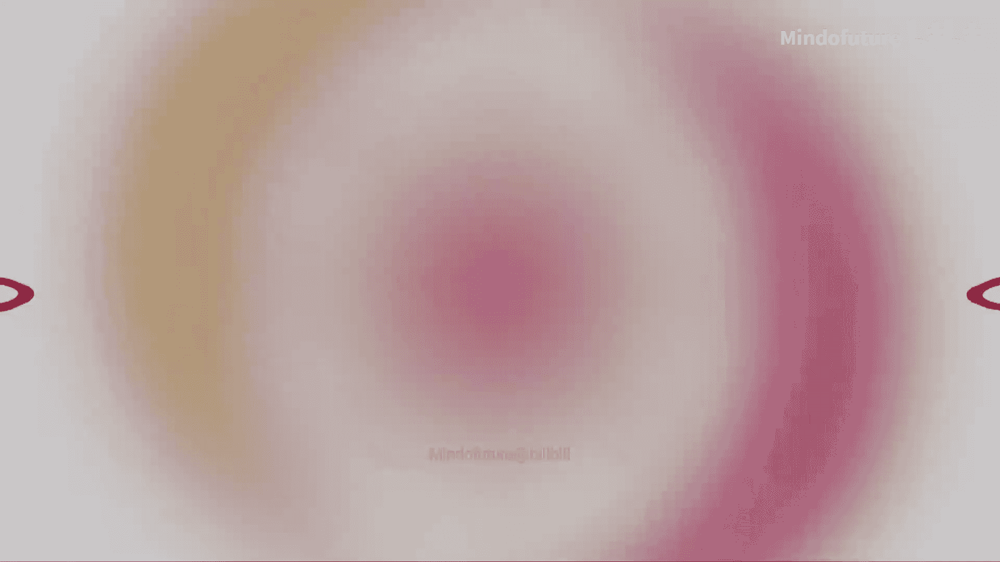
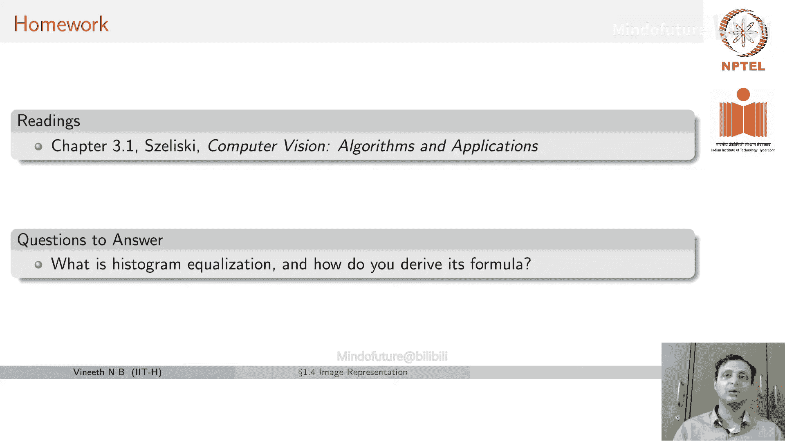

# 【NPTEL】计算机视觉的深度学习 p04 P04_图像表示 -BV1vNWkzpEua_p4-

Last lecture， we spoke about image formation and now we move on to how do you represent an image so you can process it using transformations。

So we did leave one question during the last lecture， which is if the visible light spectrum is。

With cure was to violate， why do we use an RGP color representation？

Hope you all had a chance to think about it， read about it， and figure out the answer。The answer is。

The human eye is made up of rods and cones。The rods are responsible for detecting the intensity in the world around us。

The cones are responsible for capturing the colors。And it happens。That in the human eye。

 there are mainly three kinds of coness and these cones have specific sensitivities and the sensitivities of these cones are at specific wavelengths which are represented by S。

And。And L on this particular figure。 So if you look at where。These cones， pe cap。

That happens to be close to red， green and blue， and that's the reason for representing images as they red green and blue。

In all honesty。The picking does not happen exactly at red， green and blue。

 it actually happens it some offculars in between， but for convenience we just use R G and B。

Some interesting facts here， it happens that the M and L wavelength here。

Are stronger on the X chromosome， so which means males who have the X Y chromosome。

 females have the X sex are more likely to be colorblind。

So also it's not that all animals have the same three cones， while humans have three cones。

 night animals have one cone， dogs have two cones， fish and birds have more color sensitivity。

 and it goes to five four， five or in a mante shrimp goes up to 12 different kinds of cones。

So nature has a abundance burden of how the colors are perceived。

Moving on to have an images represented。The simplest way to represent an image which you may have already thought of is to represent an image as a matrix so here is a picture of the Charminar and if you look at one small portion of the image the clock part you can clearly see that you can zoom into it and you can probably represent it as a matrix of values in this case line between 011。

And obviously we will have a similar matrix for the rest of the image too， so， but it's very。

 very common in practice while we are talking here about using it with values zero to1 in practice people use。

Up to up to a byte for representing each pixel， which means every pixel has can take a value between 0 and 2 55 to8。

And in practice， we also normalize these values between0 and1。

 and that's the reason why you see these kinds of values in a representation。

And also to keep in mind is that for every color channel you would have one such matrix。

 if you had a red green blue image， you would have one matrix for each of these channels。

What would be the size of this matrix？The size of this matrix would depend on the resolution of the image。

So recall again what we spoke about the image sensing component in the last lecture。

 so depending on what resolution the image sensor captures the image。

That would decide the resolution and hence the size of the matrix。

A matrix is not the only way to represent an image， an image can also be represented as a function。

Why so？ it just helps us。Have operations on images more effectively if we represent it also as a function。

 certain operations at least。So in this case， we would talk about dysfunction function being。

Going from r square to r where r square simply corresponds to one particular coordinate location on the image。

 say I comm J and that's what we mean by R square and the range R is the intensity of the image that could assume a value between 0 and to 55 or 0 and1 if you choose to normalize the image。

And a digital image is a discrete， a sample quantized version of that continuous function that we just spoke about。

Why is it a sample quantized version by sample， we mean that we sample it at that resolution originally。

The function can be continuous， which is like the real world in which the image was captured。

 and we sample the real world at some particular pixel and values on some grid with respect to a point of reference。

And。That is what we call as a sample discrete version of the original of the original continuous function。

 why quantized because we are saying that the intensity can be represented only as values between 0 and to 55 and also the same steps you cannot have a value 0。

5 for instance， at least in this particular example obviously you can change it if you like in a particular capture setting。

 but when we talk about using a byte for representing a pixel you can only have 01 to so on so 4 through to 55 you cannot have a 0。

5 so you've actually disctized or you've quantized the intensity value that you have in the image。

So let's talk about transforming images when we look at them as functions。

So here is an example transformation， so you have a face and we seem to have lightened the face in some way。

What do you think is the transformation here？Can you guess。Because you have not。

The transformation here is if your input image was I。And your output image was I hat。

 you can say that I hat is I of x Y plus 20。20 is just the number if you want it to be more lighter。

 you would say plus 30 or plus 40 again here we are assumingsuming that the values lie between 0 and 255。

One more example。Let's see， this is。The next example where on the left。

 you have a source match on the right， you have a target to match。

What do you think is the transformation？transformation is y hat of Xy would be i of minus x comma 1。

The image is reflected around the vertical axis， the by axis is fixed， and then you rotate。

 you flip the x axis values。If you notice here， both of these examples the transformations happen point voice or pixel voice in both these cases we have defined the transformation at a pixel level。

Is that the only way you can perform a transformation？Not necessarily。Very broadly speaking。

 we have three different kinds of operations that you can perform on an image you have。

Point operations， point operations are what we' have just spoken about where a pixel at the output。

Depends only on that particular pixel， the same coordinate location in the input。

That would be a point operation。A local operation is where a pixel at the output。

Depends on an entire region or neighborhood around that coordinate in the input image。

And a global operation is one in which。The value that a pixel assumes in the output image depends on the entire input on the entire input image。

In terms of complexity。For a point operation， the complex deeper pixel would just be a constant。

For a local operation， the complex deeper pixel would be P square assuming a peak cross Pe neighborhood。

The local neighborhood around the coordinate that you're considering that for that operation and in case of global operations。

 obviously the complexity per pixel will be n square where the image is n cross N。

Let's see a couple of more point operations and then we'll see local and global so here is a very popular point operation that you may have used in your smartphone camera or zombieby Photoshop or any other task or image editing task that you've call it's an image enhancement task and we want to reverse the contrast。

Soever in the contrast， you want the black to become white and the dark rate to become light。

 so on and so forth。What do you think。How do you implement。This。O。

in case you have not worked it out yet， the operation would be at a particular pixel it iss a point operation so at a particular pixel M not and not。

Your output will be im max minus the original pixel at that location plus Imin。You're flipping it。

So if you had a value， say 240 which is close to white， generally white is 255 and0 is black。

 if you had a value  to40 now that's going to become 15 because im max in our case is 255。

And I in is0 and I in is 0， I in obviously does not matter。

 but this formula is assuming a more general setting where Imin could be some of the value that you have that you have in practice。

Moving on， let's take one more example of image enhancement again。

 but this time you're going to talk about stretching the contrast。When we stretch the const。

You're taking a set of values and you're stretching it to use the entire set of values that each pixel can occupy so you can see here this is again a very common operation that you may have used if you edited images。

What do you think is the operation here？Okay， this is slightly more complicated than the previous one in case you already don't have the answer。

Remember， let's first find out the ratio， so you have a typical im max minus i in which is 255 minus0 by max of i in this image minus min of i in this image。

 let's assume hypothetically that this image on the left had its max value to be。200。

And its min value to be 100。Okay。If that's the case， this entire。

Rio here like you see is going to become 2。55 this is 255 minus0 divided by 100 200 minus100 it going be 2。

55 so youre simply saying that Im going to take the original pixel。Whatever is。

 let's assume for the moment that the ocean pixel had a value， say 150。So if this had a value 150。

 so you're subtracting the minimum， so which means now we have a value， the minimum is 100。

So you're going to have 50 into 2。55 plus I in for us， which is 0。

 which roughly comes to 128 so that's 50% of the overall overall output。

So what was 150 which was in the middle of the spectrum in the range of values that we had for this input image now becomes 128 which becomes the middle of the spectrum for the entire set of values between 0255 you are simply trying to stretch the contrast that you have to use all the values that you have between 0255 which means what would have gone from。

Dag gray or light gray now goes from black to white。That's how you increase a contrast。

 so this is called linear contrast stretching a simple operation again。But in practice。

 we do something more complicated， so we do what is known as histogram equalization。

 you may have again heard about it， perhaps used it in certain settings。If you've heard about it。

 read about it and that's going to be your homework for this particular lecture。Okay。

 so let's ask the question， do point operations satisfy all the requirements we have of operating on images？

Let's take one particular example， so we know that a single point inten is influenced by multiple factors we talked about at the last time and it may not tell us everything so because it its influenced by the light source strength。

 directions surface geometry sensor capture image representation so on。

So it may not be fully informative， so let's take an example to show this。

So let's assume we give you a camera and you have a still seen no movement。

How do you reduce noise using point operations？The noise could be caused by some dust blowing in the scene。

 could be caused by a speck of dust on the lens of your camera or by any other reason for that matter。

 could there there could be a damage on one of the sensors， noise could be at several。

At various levels。How would you reduce noise using only point operations？The answer。

You have to take many images and average them because it's still seen。

 you can keep taking images and hope that the noise gets averaged out across all of your images that you took and you take the average of all of your imagess it's a bunch of matrices you can simply take an element by average of all of those matrices and that can help you。

Mtigate the issue of noise to some extent， but clearly that's a stretch you don't get multiple images for every scene all the time and you don't get a still scene that's absolutely still all the time too there is always some motion and so this may not be a method that works very well in practice。

So to do this， we have to graduate from point operations to local operations。

So let's see what a local operation means。As we already said。

A pixel value at output depends on an entire neighborhood of pixels in the input around that coordinate。

 which we coordinate we want to evaluate the output。

So here is a very simple example to understand what a local operation is a standard example is what is known as the moving average so here you have your original input image I as you can see the input image I is simply a white box placed on a dark gray background or in this case a black background because you can see zeros as the values we assume that that means a black background so the image has a particular resolution in this particular case it is a10 cross10 image and a white box is located a particular image but the problem for us is we are going to assume that this black pixel in the middle here and this white pixel here are noise pixels that came in inadvertently so how do you remove it？

So the way we are going to remove them is to consider moving average edge so you take a three cross three window may not be three cross three all the time。

 it could be a different size， but for the moment we're going to take a three cross three and simply take the average of the pixels in that particular region。

So the average here turns out to be0， so you fill it at the center location that of that box。

Moving on， you now move the three cross three box to the next location and you again take an average now the sum turns out to be 90 90 by 910。

Similarly， move。The box， slide the box still further。

And once again take the average of all pixels in the box in the input and that gives you one value。

 the output clear you can clearly you can see that this is a local operation。

 the output pixel depends on a local neighborhood around the same coordinate location in the input image。

And you can continue this process and you finally will end up creating the entire image looking somewhat like this。

So you can see now you may have to squint your right to see this。 you can see now that。

The seemingly noise pixels here and here in the input have been smoothened out because of the values of the neighbors and the output looks much smoother here is a low resolution image so it looks a bit blocky but if you had a higher resolution it would look much smoother to your eyes。

So what is the operation that we did， let's try to write out what operation we did。

So we said here that I had at a particular location， say x y。Is going to be。

You're going to take a neighborhood， which means you're going to take the same location in your input image and say you're going to go from say x minus some window k。

To x plus some window， okay。Similarly， you're going to go from some y minus k。Do we老几。

And let's call the say I， let's call the say J， you're going to take the values of all those pixels in the input image。

And obviously， you're going to average all of them。

 so you're going to multiply this entire value by one by。

Because the neighborhood goes from x minus k to x plus k， there are totally 2 k plus1 pixels there。

so you're going to have2 k plus one square。Because for x， you'll have2 k plus1 pixels for y。

 you'll have2 k plus one pixels。And then you just， so the total number of pixels is going to be one across the other。

And in this particular examples that we saw， k was1 for us， we went from x minus 1 to x plus  one。

 so if you took a particular location on the output。

You took the corresponding location of the input and then one one to the left and one to the right right so from x minus1 to x plus 1 y minus1 to y plus1 and that creates a3 cross 3 matrix for you and that's what we are going to finally normalize it by。

That becomes the operation that you have for your moving average。

 so this is an example of a local operation。Mo to the last kind of an operation called a global operation。

 as we already mentioned in this case， the value at the output pixel depends on the entire input image。

Can you think of examples？In case you've already not figured out。

A strong example of something like this is what is known as a Fourier transform well see this in a slightly later lecture。

 but there are other operations too that can be global depending on different applications we'll see more of this a bit later and we'll specifically talk about Fourier transform a bit later。

That's about this lecture so your readings are going to be chapter 3。

1 of Cliky's book and also as we mentioned think about the question and read about histogram equalization and try to find out how it works and what's the expression you would write out to make it work。

