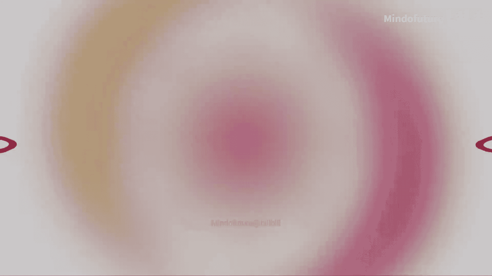
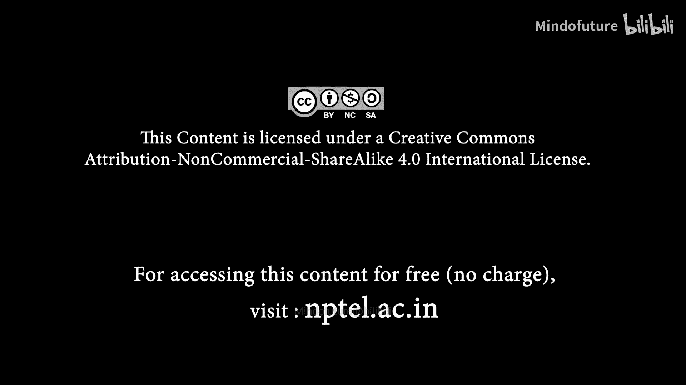
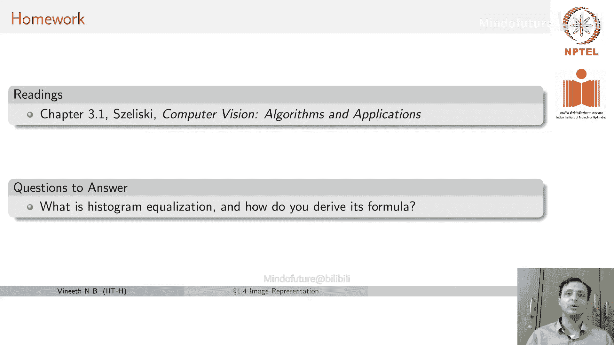

# 计算机视觉的深度学习：P04：图像表示 🖼️

在本节课中，我们将学习图像在计算机中的表示方法，以及如何对图像进行各种变换操作。我们将从最简单的矩阵表示开始，逐步深入到将图像视为函数，并探讨点操作、局部操作和全局操作这三种核心的图像处理方式。

## 为什么使用RGB颜色表示？🎨

上一讲我们讨论了图像的形成，现在我们将探讨如何表示图像，以便使用变换对其进行处理。

我们在上一讲留下了一个问题：如果可见光谱是连续的，为什么我们使用RGB颜色表示？

答案是：人眼由视杆细胞和视锥细胞构成。视杆细胞负责检测周围世界的强度，视锥细胞负责捕捉颜色。人眼中主要有三种视锥细胞，它们对特定波长敏感，这些敏感波长大致对应于红色、绿色和蓝色。因此，为了表示图像，我们使用红、绿、蓝三原色。

一个有趣的事实是，负责感知中长波长（M和L）的视锥细胞基因位于X染色体上，这意味着拥有XY染色体的男性比拥有XX染色体的女性更容易出现色盲。此外，并非所有动物都有三种视锥细胞。人类有三种，夜行动物有一种，狗有两种，而鱼类和鸟类可能有更多，例如螳螂虾有多达12种不同的视锥细胞。

## 图像的矩阵表示 📊

表示图像最简单的方法是将其表示为一个矩阵。下图是查米纳尔塔的图片，如果我们放大钟表部分，可以清楚地看到可以将其表示为一个值在0到1之间的矩阵。

实际上，人们通常使用一个字节（8位）来表示每个像素，这意味着每个像素可以取0到255之间的值。为了方便处理，我们通常将这些值归一化到0到1之间。对于RGB彩色图像，每个颜色通道（红、绿、蓝）都会有一个这样的矩阵。

这个矩阵的大小取决于图像的分辨率，而分辨率则由上一讲中提到的图像传感器捕获能力决定。

## 图像的函数表示 📈

图像也可以表示为一个函数。将其视为函数有助于我们更有效地对图像进行某些操作。

在这种情况下，我们将图像函数定义为从 **R²** 到 **R** 的映射。其中，**R²** 对应图像上的一个坐标位置 `(i, j)`，而值域 **R** 则是图像的强度值，可以是0到255之间的值，或者归一化后的0到1之间的值。

数字图像是我们刚刚讨论的连续函数的**离散、量化**版本。
*   **离散**：意味着我们在原始连续的现实世界场景上，按照一定的分辨率（网格）进行采样。
*   **量化**：意味着强度值只能表示为有限个离散值（例如0到255的整数），而不能是连续值（如0.5）。

## 图像变换操作 🔄

现在，让我们探讨如何将图像作为函数进行变换。

### 点操作

点操作是指输出图像中某个像素的值仅取决于输入图像中**同一坐标位置**的像素值。

以下是两个点操作的例子：

**1. 图像亮度调整**
我们有一张人脸图像，并使其变亮了。

变换公式为：
`I_hat(x, y) = I(x, y) + 20`
其中，`I` 是输入图像，`I_hat` 是输出图像。加上的常数（如20）决定了变亮的程度。

**2. 图像水平翻转**
左侧是源图像，右侧是目标图像，图像围绕垂直轴（y轴）进行了翻转。
变换公式为：
`I_hat(x, y) = I(-x, y)`

### 操作类型概述

广义上说，对图像的操作可以分为三类：

1.  **点操作**：输出像素仅依赖于输入图像中同一位置的像素。每个像素的计算复杂度是常数 `O(1)`。
2.  **局部操作**：输出像素依赖于输入图像中该坐标周围的一个**区域或邻域**。如果邻域大小为 `p × p`，则每个像素的计算复杂度约为 `O(p²)`。
3.  **全局操作**：输出像素的值依赖于**整个输入图像**。对于 `n × n` 的图像，每个像素的计算复杂度约为 `O(n²)`。

### 更多点操作示例

**1. 对比度反转（负片）**
这是一种常见的图像增强操作，使黑色变白，深色变浅等。

操作公式为：
`I_hat(x, y) = I_max - I(x, y) + I_min`
其中，`I_max` 和 `I_min` 是图像的最大和最小强度值。通常 `I_max=255`, `I_min=0`，所以公式简化为 `I_hat(x, y) = 255 - I(x, y)`。

**2. 线性对比度拉伸**
此操作将图像现有的强度值范围拉伸到整个可用范围（如0-255），以增强对比度。
操作公式为：
`I_hat(x, y) = ( (I(x, y) - I_min) / (I_max_input - I_min_input) ) * (I_max - I_min) + I_min`
其中，`I_max_input` 和 `I_min_input` 是输入图像的实际最大和最小值。通过此变换，输入图像中较暗和较亮的区域会分别变得更黑和更白。

在实践中，我们通常使用更复杂的方法，如**直方图均衡化**。理解其原理将是本讲的课后作业。

## 从点操作到局部操作 🧩

点操作能满足所有图像处理需求吗？并非如此。单个像素的强度受多种因素影响（光源强度、方向、表面几何、传感器等），可能信息不完整。

例如，考虑如何用点操作降低图像噪声（可能由灰尘、传感器损坏等引起）。对于静态场景，一个方法是拍摄多张图像并对它们进行平均，因为噪声在不同图像中随机出现，而场景内容不变，平均可以抑制噪声。但这要求场景绝对静止且能获取多张图像，在实践中往往不现实。

因此，我们需要从点操作进阶到局部操作。

### 局部操作详解

在局部操作中，输出图像中某个像素的值取决于输入图像中该坐标位置周围一个**邻域内所有像素**的值。

一个标准的例子是**移动平均（均值滤波）**，用于平滑图像和去除噪声。

假设我们有一个10x10的输入图像 `I`，一个白盒子放在黑色背景上。但图像中有两个噪声像素：一个在背景中的黑点（本应为灰色），一个在白盒子中的白点（本应为灰色）。

我们使用一个3x3的窗口进行移动平均来消除噪声：
1.  将3x3窗口中心对准输出图像的某个位置 `(x, y)`。
2.  计算输入图像中对应窗口内所有9个像素值的平均值。
3.  将这个平均值作为输出图像在 `(x, y)` 处的像素值。
4.  将窗口滑动到下一个位置，重复此过程，直到处理完整幅图像。

经过此操作，孤立的噪声像素由于其周围像素值的影响而被“平滑”掉，输出图像看起来更均匀。

移动平均的公式可以写为：
`I_hat(x, y) = (1/(2k+1)²) * Σ_{i=-k}^{k} Σ_{j=-k}^{k} I(x+i, y+j)`
其中，`k` 定义了邻域的大小。当 `k=1` 时，就是上述的3x3邻域。

## 全局操作简介 🌐

最后，我们简要介绍全局操作。在这种操作中，输出图像中某个像素的值依赖于**整个输入图像**。

一个典型的例子是**傅里叶变换**。我们将在后续课程中详细讨论它。除此之外，根据不同的应用，还有其他类型的全局操作。

## 总结与作业 📚

本节课中，我们一起学习了：
1.  图像在计算机中的两种主要表示方法：**矩阵**和**函数**。
2.  图像处理的三种基本操作类型：**点操作**、**局部操作**和**全局操作**，并理解了它们之间的区别和复杂度。
3.  通过具体例子（如亮度调整、翻转、对比度反转、拉伸、移动平均滤波）加深了对这些操作的理解。

你的课后阅读任务是教材的第3.1章。
此外，请思考并研究**直方图均衡化**：
*   它是如何工作的？
*   为了实现它，需要写出什么样的表达式？

这将帮助你更深入地理解一种强大且常用的图像增强技术。