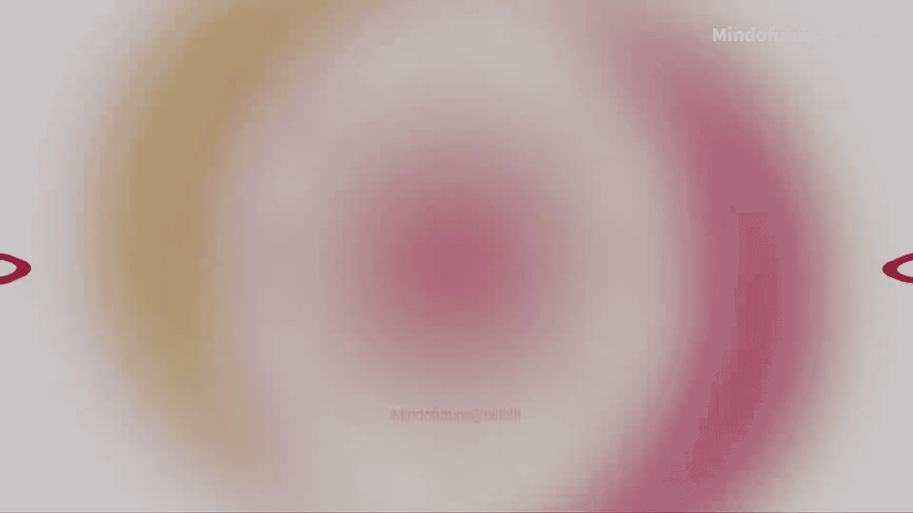
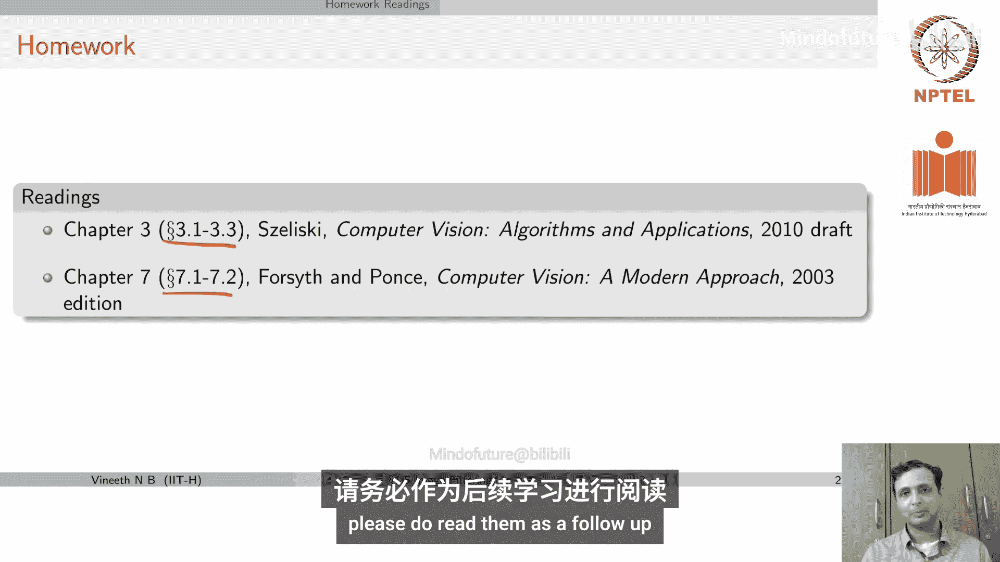

# 【NPTEL】计算机视觉的深度学习 p05 P05_线性滤波 -BV1vNWkzpEua_p5-

Last lecture。We spoke about representing an image。And we also saw a few operations that you perform on images。

Let's quickly review them and then move ahead。We talked about three types of operations point local and global。

And we did leave one question for you to find out about hope you put in some effort to answer that question。

The question was how do you perform histogram equalization。

 So we did talk about an example of linear contrast stretching。

And histogram equalization is a more complex variation of a contrast stretching operation。

So let's now see how histogram equalization， which is a very popular operation for。

Improving the quality of images， let's see how that is done。

So if you had I to be an image with m by N pixels， m cross and pixels， and let's assume。Iax。

Is the maximum image intensity value？And let's also create a histogram of the image which we denote as of H of I。

Remember that a histogram is nothing but bending your entire range of image values and counting how many pixels lie in each range。

 it's simply a frequency count in bins。So now you can integrate H of I。

To obtain a cumulative distribution C of5 for your image， we will see an example of this in a moment。

 and the cumulative distribution C of K would simply be given by if you go from1 to k。

But K be a particular。Intensity value， you count the number of pixels until that particular intensity value thistogram would be about bend it individually cumulative takes it as a accumulation。

 and then you normalize by the number of pixels。So here is an example of aative cumulative distribution。

 this red curve here。Is accmulative distribution， which tells which simply adds up the histogram as you go through from the lowest intensity to the highest intensity。

So the final transform image after doing histogram equalization is simply。

I max the maximum intensity into C PI J。Which is。What is the cumulative distribution at a particular point？

So in this particular figure， if you saw， we are saying here that if you had a gray level intensity 90。

In an image。In the histogram equalized image。You see what is the cumulative proportion of 90 in that image。

 so in this case it happens to be 029 and you simply multiply that by i max the maximum intensity。

Rather an intuitivetu way of understanding。Histogram equalization is。

You try to look at the distribution of intensities in your particular image。

And let's say a lot of your intensities was lying between 200 and 250。Which means。

And in a pixel with intensity 90， there would not be much cumulative distribution in that space。

 and hence in the histogram equalized image， it would get a lower value than。

Another pixel with a higher intensity。That's the idea of histogram equalization。You can again。

 read up the references for the sports， either Simon Ti's book or Silliky's book to the Stan。

Let's move on now to understanding what filters of an image are， so we to talk about operations。

 let's now formalize that into a concept called a filter。

So an image filter is a local typically a local operation can be global。

 but typically a local operation where you modify image pixels。

Based on some function of a local neighborhood of that pixel。

 exactly what we defined a local operation to be in the previous lecture。Let's take this example。

 you have a three cross3 image here and you have a pixel values。

Indicated in this particular location， in in this particular image。

Let's assume that you're going to use some filter and get the output at the central pixel to be4。

Can you guess。What the function is。Each pixel。 So in this particular case。

 it simply turns out to be an average of。All the pixels in the neighborhood。

You could also make this more complex and introduce a filter which has specific values in different locations and you simply do a dot product of every value in the location of the image with a corresponding value in the location in the filter。

So this filter is also sometimes called mask or kernel。嗯。These terms are overloaded in other fields。

 they mean different things in other fields， but when we talk about image processing or low level computer vision or today even in computer vision we call them filters or masks。

ごくす。So here is another example of a linear filter。Where。

You take this particular kernel that you see here。And simply do a linear combination of the original image with this kernel and you get the output the6。

5。Why is it called a linear filter？Because the output is a linear combination of the local neighborhood as defined。

By the combination in the colon。Let's formally define this now。So。

This operation that we saw on the earlier slide can be formally now written as。

If you had a kernel of size。2 k plus one cross 2 k plus one。So in our case。

 if you took a three cross3 filter， then k would be 1。

And then we define this operation to be correlation because it's simply a dot product between two quantities。

So your input I。And then your output G， your output G at a critical location， I comma J is given by。

The first term here is simply an averaging term， and you are simply taking the sum of going in of an index going from minus k to k。

V going from minus k to K， and you simply add up all the pixels in that middle。This is simply。

Correlation of also what is known as。嗯。Cross correlation and in cross correlation。

 the key difference here is that。6。Now have non uniform weights where you specify what should be the linear combination so if you're going to add up all the pixels in a neighborhood。

Should you simply add up an average or should you multiply each of those elements in that neighborhood by some value。

 if so what value and that value is given by H of U commodity。And this is called a cross correlation。

Between hedge and I。This is one of the simplest operations。

 so we've only formalized the operation that we did on the earlier slide。

So cross correlation is formally denoted by G of H and I。As I already mentioned。

 it can be viewed as a do product between the local neighborhood and the kernel or the filter or the mask for that particular pixel。

The entries of the kernel of the mask or the filter are called the filtered coefficients so on the previous slide。

The example that we saw。つくな。These values in this kernel are called the filter coefficients。

Let's see the example of the moving average operation that we saw on the last lecture as a linear freedom。

So。We said that given an image， the moving average filter。Gets you。

An estimate by removing certain kinds of noise。Where at each location。

 you simply do an average of the local neighborhood in the input image。

So if we saw this as a cross correlation operation or as a linear filter。What would the filter be？

Remember， it has to take an average of the values in enable neighborhood。The answer is。

It can simply be。1 by 9。All in all of those elements。

One by9 is simply to normalize the entire set of values。So obviously。

 if you are taking a5 by5 window。This would end up being one by 25 times 1，1，1，1 in a5 cross 5 feet。

So this becomes your linear filter for your moving average operation that we saw in the last lecture can help remove certain kinds of noise。

Okay， here is a more real world example of a moving average filter， so you can see here。

The input image。That's your input image。And on the right， you see the output image。Where you can see。

That。The output is an average versionversion or the smooth version。

 or you can also call it a blurry version because you're smudging by taking a local average your smudging。

The image at different pixels。 So this is also sometimes known as a box filter because the filter coefficients are all exactly the same same box in that sense。

One by nine in all those locations， as we saw on the earlier slide。Okay。

 now let's try to complicate this a bit and say we don't want a box filter。

We want to take an average。But we want to take an average in such a way that the middlemost element。

Should have the highest influence on the output。One neighbors away should have the next level of influence。

Two neighbors away should have a lower level of influence and so on and so forth。

 depending on the size of your filter。Remember， you could do an average。

 not just with a three cross3 neighborhood， you could do it with a5 crossfi neighborhood。

7 cross 7 neighborhood， and that is something that you have to define when you perform the operation。

So a Gasian average filter， which looks somewhat like this。

Where you can see that the middlemost element has the highest influence。

One neighbors have the next level of influence。And so on and so forth。

 and 1 by 16 is simply a normalizing factor because you do not want。

The pixel intensity in the output image to blow up。We wanted to be with them。The predefined range。

 and that's the reason you need to normal。 So this filter is a discrete version of your Gaussian function of a 2 d Gaussian function as these define like this。

And it gives you an averaging filter again because it again smoothens out or blurs your pixels at different locations。

 but it now does not do it in a box filter way， but gives more importance to a central pixel。

So if you took the same example that we saw a couple of slides back and see the box filter。

And the Gaussian filter。You see。That there are slight differences in how these two filters work。

 if you observe very carefully， you will see that the box filter has some binous artifacts whereas the Gaussian filter does not have these artifacts。

Why， because the block box filter does not smoothen out at the edges but keeps the same value across the entire neighborhood and that can introduce certain kinds of blockiness artifacts。

What are other kinds of linear filters that you can do。

 we will see more and more of them as we go in this course。

 but another typical example could be what is known as an edge filter。So given an image。

 you may want to extract the edges in the image， so let's take this example on the slide。

 so you have this input image。Let's assume that you want to extract， say some vertical edges。

 some horizontal edges and the question here is what would be your freedom kernel or mask？

So the last set of images here are simply the absolute value of the output image。

We'll see more on edge filters a bit later， but the question for you now is what would be edge if you simply wanted to extract edge information from your input image？

For purposes of convenience， lets let's stay with the three cross 3 filter。

 let's not increase the size we can do in practice， but they' are not going to increase it now。

If you have not guessed the filter already。The filter would look something like this。

 a vertical vertical filter would look something like this。Where you have-1，-1，-1 on one side and 1。

1，1 on the other side。So effectively， the filter would look for places in the image where there is a significant difference between。

The left of the pixel and the right of the pixel， vertically speaking。

And it would try to exaggerate those pixels in the output image。A horizontal pick。

 a horizontal edge filter would do the same thing。Along the horizontal directions。

This one by nine here is again a normalizing factor。

 but you typically do not need that in an edge filter because。

We are not interested in the absolute edge value， but we are interested in high intensities where theres an edge。

 We' will talk about this a bit more when we go into edge detection few lectures down the。

So let's ask an important question now。So let's take an impulse signal for those of you with a single processing background youll be able to appreciate this。

 so let's take an impulse signal which for us let's say we define it as a single white pixel in the middle of an entire black image we are going to call that as impulse signal。

And if you take a particular。Filter， let's say the filter is given by a set of values， A BC， D， E。

 F GH， so it's neither a box filter nor a Gassian filter， it is just a set of values that you have。

Organized as a filterer。What would the output be if you use cross correlation？

You can word this out a bit carefully by yourself。But you'll find that the answer would be。

Something like this， you would have an output image。왜。The output is completely flipped。

So you would have。The bottom right value going to the top left。

And the top left value going to the bottom right。Rather。

 the output will be a double flipped version of your input you can try out working out cross correlation pixel by pixel。

And you'll realize this yourself， for example。The output and this pixel here。

So let me perhaps erase these。The output at this pixel here is simply going to be taking this input pixel。

And placing this kernel。Exactly as it is there and it happens that this white value is the only value that will get multiplied by this one。

 all other kernel values will get multiplied by the corresponding black which is 0 and will not have any bearing on the output which means the output at this particular location is going to be white。

And you keep doing this over and over again at every pixel and you see that okay let's take one more example。

 so if you took this pixel on the output，Which would be。This pixel on the input。

So you take the same kernel， place it here as a three crossory neighborhood。And you' would see。

That the only pixel， the only value that could that could get highlighted is the one which is here。

 which you would get would get multiplied by  one， everything else would get multiplied by a0 because we're black。

And the output would be black itself because that's the value here。

You can do this for every pixel and realize that the output here is going to be double flipped。

This is something that we do not expect。We thought a typical identity operation， for example。

 an impulse signal， we would expect that if you perform the operation with the kernel。

 you get the kernel itself。But sadly here， we notice that you get the output to be double flipped。

What do we do if we want an operation like an identity operation where if you take an impulse signal and you do that operation with the kernel。

 you should get the kernel itself。Which， as you can see。

 does not happen when you do cross correlationoration。

That introduces us to the operation of convolution。

So convolution is very similar to cross correlation。

The main difference here is given a kernel of size 2 k plus 1 plus 2 k plus 1。

Given an input image I and a filter H。Your output is， at this time。

 you're going to say it's H of U kma V into I of I minus U and J minus v。What are you doing here？

When you're doing the operation itself， you're double slipping the filter。

So that your output turns out to become the same as the filter itself。Okay。

 so probably this slide has a minor issue， this is should there should be a normalizing factor here。

 but it really does not matter in practice as long as you normalize the values in the filter itself。

So if your filter values are not normalized， you have to explicitly normalize at the end。

 but if we assume that the filter values are not normalized， this normalization not be required。

 so as I just mentioned， convolution is equivalent to flipping the filter in both directions both the top and right to left and then applying cross correlation。

So convolution is typically denotted。In this manner where it is the filter and I is the image。

So here is an example of how it works， the same example now， you have the impulse signal。

You have a filter edge of UB。You're going to double flip it now。

Which means your double flipping is going to result in this filter on the right now you perform a cross correlation with this。

A cross correlation with this double flip filter。And you end up getting this。As the output。

 because you're doing a cross correlation with this filter now。

But the output now is the same as the filter that we gave as input。Operation。

Why do we really need to do this will'll answer in a moment。One reason， as we said。

 is we wanted some kind of an identity function， but well just come back in a moment。

Before we answer that question， if you recall。This slide that we had when we talked about the history of computer vision。

 we talked about these early experiments in the late 1950s。

That established that there are simple and complex cells in the human。

In the mammalian visual aquatics。There has been follow work along these lines that have shown that simple cells in the visual cortex perform simple。

 linear spatial summation over their receptive fields。Thecept field is simply。

What part of the input image are you focusing on while performing in operation， for example。

 when you take a three cross 3 convolution filter or a correlation filter。

 your receptive field is of the size 3 cross 3 because that is the part of the input image that youll focus on while performing one such operation。

Obviously， you keep repeating this at every pixel in your image and you get the output。

 but when you do one particular operation， your receptor field is three cross3。

So coming back to this point。So this work here in the late 1970s showed that simple cells actually perform linear spatial summation。

So it seems to hint that correlation and convolution could be operations that we could use。

Perform operations on images similar to the mammalian visual contexts。

It happens that correlation and convolution are both what are known as linear shift invariant operators。

Those of you with the linear systems， a signal processinging background， we already know this。

Larity means that if you had an image I。And if you add two filters， H not and H1。Then I operation。

 the operation could be convolution or correlation。And then I operation H1。

Whether you add up the filters first or add up the images。

 the output images after performing the operations to the individual filters。

 they both will be the same。This is linearity or what is also known as the superposition principle。

The other property here is shift in variance。 This an important property。

 something that can account for why convolution is used to this day in deep learning and so on and so forth。

 It's an important property。 It simply states that。

Shifting or translating a signal commutes with applying an operator。

 I'll try to make that a bit more clearer。Let's see you have。Okay。

 let me try to explain this slightly differently， this is the general definition here。

 but if you had H to be a certain image I，And G to be a certain image I had。So。

Your eye hat is simply a translated version of your eye。Why is it a translated version？

Because for every pixel at I had which is defined at I commma J。

 the value is given by what was the value in i at i plus k and j plus L。

 so its like moving the entire image in i a little bit left or depending on what case k could also be negative so it could be moving left or negative or or right。

So this is simply a translated version of your image eye。So now if you have a filter F。

Whether you convolve it with。I had。Or you convolve it。Witht。Which at the other locations。

 at the translated locations， you will get the same output。Rather。

 this seems trivial toward the first go， but this is an important property。

 but what it tells is if you have a filter F and you apply it at say a particular location of the inputiments say at one comm one of that image matrix。

It will have the same output as applying the same filter at3 comm 3 provided these two regions have exactly the same intensity values。

Why is it important？If you have a cat at the left top of the image or a cat at the right bottom of the image。

 if you use a particular filter， it will give you the same output。

Whether the cat is located at the left top of the image or the bottom right of the image。

 and that is what is shifting variance and that helps convolution induce translation invaris into any approach that uses convolution。

So another way of saying that is the effect of the operator is the same everywhere in the image as long as the image has the same characteristic。

不。Two images have the same characteristic？But the object of that corresponding to the characteristic is at different locations in that image。

The corresponding output at those locations will be the same for a given field。

Why do we need this in computer vision， I just explained that。Okay。

 so this is an important slide convolution， we said that cross correlation unfortunately did not help us maintain an identity with the impulse function。

Vas， whereas convolution did。And convolution has many more。

Mathematical properties that make it an elegant operation。 The first one is， it's commutative。

So a convolution B is the same as B convolution A， so this is an interesting and important property because this simply says that if a was your image I and b was your filtered edge。

Whether you call a your image or B your filter or the other way around doesn't matter because the operation is commutative。

The second property is associivity， which says。A convolution。

 B convolution C is the same as A convolution B， convolution C。Why is this important？

If you took an image。Defined given by a here。 and you have two different filters， B and C。

Now you can either apply the filter H1 on I first get an output。And then apply filter H2 or。

You can precompute the convolution of H1 and H2 and simply apply the output of that to the image。

You see some tangible， useful applications of this property a bit later。

Other properties are its distributive over addition。

 so a convolution b plus C is a convolution B plus a convolution C。

 I think we saw it with linearity2。It factors our skills。K a convolution B is a convolution Kb。

 which is nothing but k times a convolution B。And as we already saw it， if you had an unit impulse。

 which is defined by say， a vector like this。So it has a one in the center， zero everywhere else。

 remember， this is a。One dimension impulse in a two dimensional impulse。

We saw we already saw an example where you have a white value in the middle of the image。

 black everywhere， then a convolution， this unit impulse will be a itself。

Which for us did not hold the crossb issue。So convolution has a few elegant properties， which。

You will see helps us in many applications。Another important property of convolution is the notion of separability。

So typical convolution operator requires k square operations per pixel assuming k cross k to be your kernel。

 so the 3 cross 3 kernel， if you look at a particular output pixel， you need nine operations。

 three into three operations to be able to compute the value at that output pixel。

This can be costly because if an image is of a very large size。

 remember we have to repeat the same operations for every pixel in the image。

 so it could be9 into n square where n square is the size of the image。

 assuming you have an n cross n image。How do we reduce cost， Can we do something to reduce the cost？

It happens that in certain cases you can。For certain kinds of filters。

 you can speed up the convolution operation by first performing a 1 day horizontal convolution。

foollowed by a 1 d vertical convolution， so you first convolve along each row。

 remember that the entire operation of convolution while we defined it in an image processing context。

Which is the reason why we took two cross two sorry， two dimensional filters。

 like three cross  three so on and so forth。Convolution is a more general signal processing concept that can also be defined for one dimensional signals can be defined for three dimensional signals for any other dimension for that matter。

 just that the kernel or the filter that you have would have to be defined in that dimension。

So if you're performing a one day convolution along every row of the image。

You would define a one dimensional filter， a one dimensional filter would be something like this。

one題な。問題な。One， sorry up1 by nine in this case， it will come1 by three。I my three。1 by three。

Because there are three values if you're normalizing or one by three。

 this is a one dimensional filter。What we saw as a block filter or a box filter was one by nines in a three cross three location。

 Similarlyly， a vertical filter would be。One by three。One by three， one by three。

And we can perform exactly the convolution operation that we discussed。 We still have to double flip。

And。And then do it only along every row of an image or only along every column of an image。

If you do that， you only require 2K operations。Because every row would require I mean every 1 d kernel would require k operations。

 every 1 d vertical convolution would require k operations。

 you only need a total of k plus k operations， this becomes cheaper than k squared。

Remember that for a P cross 5 filter。A K square would mean 25 operations。

 while a 2 k would mean 10 operations， and this obviously this difference becomes more prominent when K becomes larger and larger and larger。

One point to add here is you did see these kernels here to be one by three， one by three。

 one by three or in a box filter one by three everywhere around。Remember。

 when you have filters such as this。Your double flipping really does not matter because the matrixes or matrix or the filter in this particular case is exactly the same everywhere In such a case。

 convolution and correlation will give you exactly the same output。So to make this a bit clearer。

 should we define a kernel k to be separable。If you can write it as an outer product of two10 vendors。

 V and H。If you can do that。Then such a kernel。Is said to be。Separable。

Because you can separate it into two 10 kernels。It's said to be separable。

And then you can use this trick to reduce the number of operations from k square to k by first performing a 1 d convolution with v and then performing a 1 d convolution with H。

Here's an example。So， if you have。A 2D kernel， which is given by this。 Do you recall this kernel？

This was called the Gasier gun， we saw it a few slides back。

You can write this as an outer product of V and H where both are equal and can be given by one by4。

 one，2 one。So then what you do is you simply take this kernel。Do a convolution in one dimension。

 take the transpose of it， do do a one dimensional convolution in the other dimension。

 rows and colorss。Should v and H be the same always， not necessarily， here is another example。With。

If you have a filter such as this， do you recall this filter？In case you don't recall。

 this was your edge filter。So in this case， as you can see。

 this can be written as an of the product of。V is equal to。

1 by four times this vector and h is equal to half times this vector。

 You can test it out to see if this actually is the outer product， but it happens to be this way。

 So now you can replace your 2 d convolution by21 d convolutions。Which can help reduce the cost。

But this raises one question。How can you look at a kernel and tell if it's separable？

So I said that if a kernel can be written as an outer product of two vectors。

Then you can say that the kernel is separable。But why， how can you say this？One option。

Is to visually look at it and try to work out various combinations and see find out which gives you the auto product you can probably work that out with with the example on the previous slide and see。

But there is a slightly more principle way to do this。

The principal way to do this is you can take the singular value decomposition of your。可能。

Remember the single value decomposition of any matrix or is given by U sigma B transpose and that can be written this way where。

U is a matrix whose column vectors are UI。V is a matrix whose column vectors are Vs。

 so that's what Uis and Vs are， so each of them is vectors and sigma I are the elements in your diagonal matrix。

SigmaSigma is your diagonal matrix。That's given by Sigma 1。这Sigma。ケケ aケます。Okay， is it。几。SK matrix。

Then this is your standard singular value decomposition。

 So if you write out the singular value decomposition of k。When it happens that。

Root sigma 1 U1 and root sigma 1 v1 will be the vertical and horizontal corners。

Try working without or checking on this to see if this actually works with the two examples that we saw on the couple of slides back。

 the Gasian kernel and the edge kernel。So let's talk about a few practical issues when you actually start using convolution or even correlation as an operation。

What do you think should be the ideal size for a filter？We talked about a filter being 3 cross 3。

 we said it can be5 cross 5， seven cross 7， so on and so forth。What is the ideal size？Obviously。

 it depends on a given application， but。The bigger the mask or the filter。

More neighbors are going to contribute。There's going to be a smaller noise variance of the output。

 so for example， if you had。Say some kind of a noise that got introduced in certain parts of your input dimension if your convolution is with a very small local neighborhood that noise will have an impact on the output。

But if you took a larger mask， then that noise will get subdued among the other pixels that you consider for that linear filter or for that local operation。

It can also result， on the other hand， in a bigger non spread。Because if you had noise in your input。

If you took a bigger filter。Impact of that noise is now going to be on a larger region。

 remember we talked about the receptive field， so a larger number of pixels in your output image will be impacted by that noise that's the other side of the same point I it on the previous on the previous bullet。

It the larger the size of the filter， if you do an averaging filter， it leads to more blurring。

 obviously， its also more expensive to compute。Smaller filters means the number of operations is going to be lesser。

 so three cross 3 filter has nine operations in a nonseable case。

 but a5 cross 5 filter has 25 operations。What about the boundaries。

 This is perhaps a question that would have been in your mind all through。

 So when you do convolution。We said。That if you have an input image。If you have a kernel。You canvol。

And you get M output image， but we said that for a particular location at the output image。

You have to place this three cross three kernel。At that particular location in the input image。

And if you not place this three cross， three kernel on one of those。Edge pixels。

There is no value outside the image to be able to perform that linear combination。

Which means you'll only be able to place these output pixels。

 one pixel in to the input image if you had a three cross 3 filter， obviously。

 if that was a5 cross 5 filter。You will have this impact for two sets of border pixels all around the image。

What do we do， do we have to lose information？Will the output image be smaller than the input image。

 So if you have 100。Cross 00 image。And a three cross three filter。

Because placing it at that very edge means two pixels will be outside。

 which you don't have values for。Will your output become lesser？The answer turns out to be yes。

 the output will become the size 98 cross 98 in this particular case。

What do we do if we want the output image to be the same size as the input image？

We can do what is known as paddding。Without padding， yes。

 we lose out information on the boundaries and the output image will be smaller than the input image。

 depending on the size of the filter。But there are many strategies for padding your input image with certain values so that you don't lose that information。

Let me show a few examples。So you can do what is known as zero padding where you simply pad beyond your image with black pixels。

So now you can place your filter at that corner location。

 you simply will have black values for the for the filter coefficients that go outside the image。

 you can wrap your image。So whatever it is here， So if this was。

Two pixels you simply just wrap those two pixels towards the other end。

 you can clamp the values which means whatever values you have at the output at the last value there。

 you just continue with the same values outside the image， you can mirror those values at the edges。

 so on and so forth。So in each of these cases， if you did say an average filter。

 these are the kinds of outputs that you will get。As you can see。There is not too much variation。

 but for the variation of the edges。And the larger the image becomes so these are cases where we are taken very low resolution image images。

 but your the larger your image has become the output of these padding strategies。

Don't change too much。From a visual impact。So let's end this lecture with a couple of questions for you。

So we went from defining cross correlation and said that it has a problem when you deal with an impulse signal and then define convolution。

And then we talked about a few elegant properties that convolution has。

 which correlation does not have。And then give a few examples。Now， one question that lingers is。

Do we need cross correlation at all？Can it be completely replaced by convolution in all kinds of applications？

Think about it。Well answer this in the next lecture， but please do spend some time thinking about it。

And the other question here is， why should we take a linear combination？

Why cannot we take a nonlinear combination of local neighborhoods of an input image？Obviously。

 in our case， we defined a linear filter that way， but let's try to see if this can be made nonlinear。

 think about it and well answer these questions in the next lecture。So for this lecture。

These are your readings with the specific section numbers listed here。

 please do read them as a follow。

