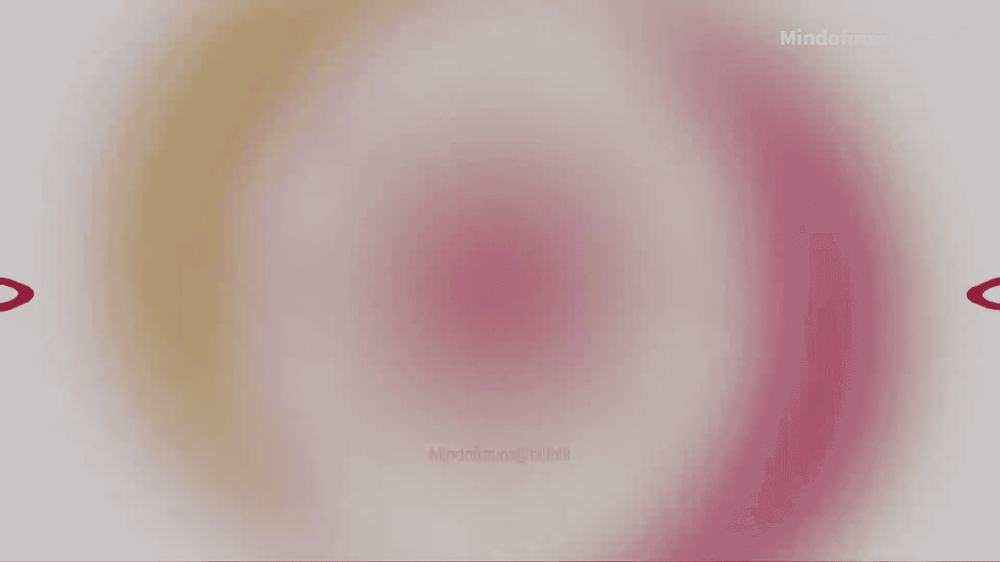
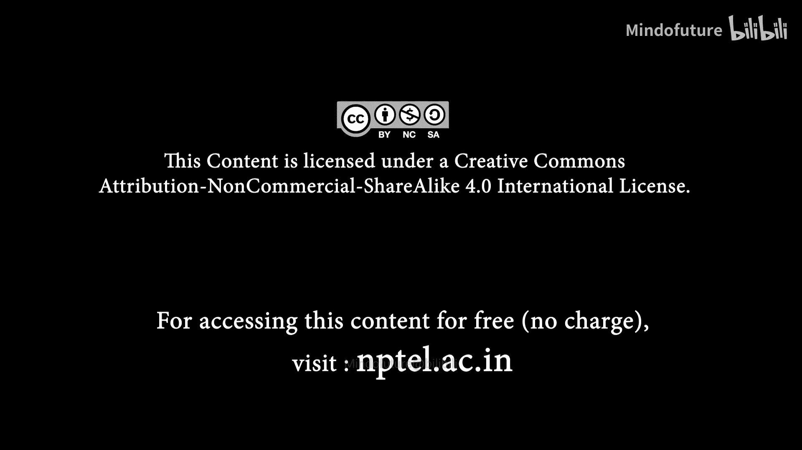
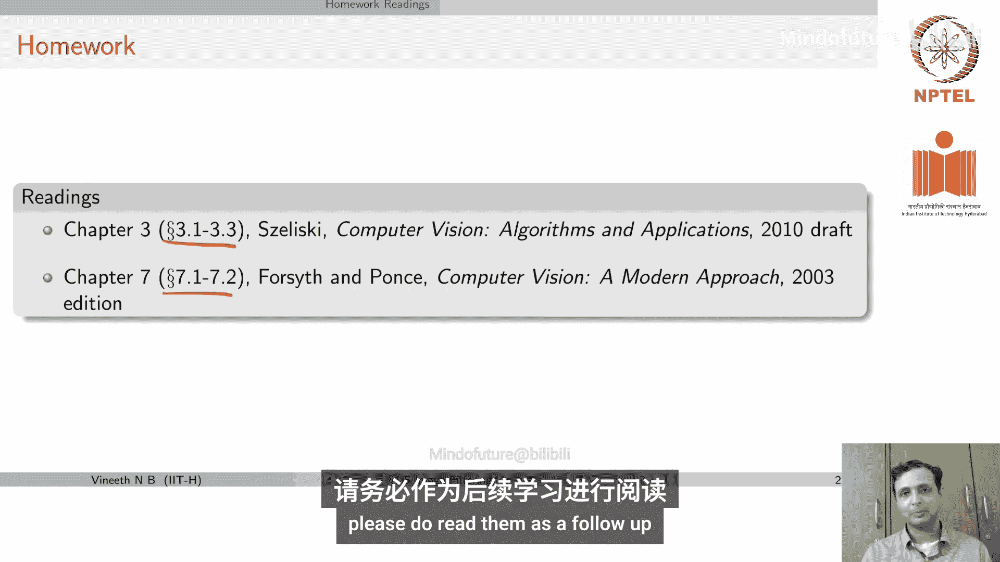

# 计算机视觉的深度学习：P05：线性滤波





## 概述
在本节课中，我们将学习图像处理中的核心操作——线性滤波。我们将从回顾上节课的三种图像操作（点、局部、全局）开始，然后深入探讨直方图均衡化的具体方法。接着，我们将正式定义图像滤波器，并重点介绍两种关键的线性操作：互相关和卷积。我们将通过公式和代码示例来理解它们的原理、区别以及在实际应用中的重要性。最后，我们会讨论滤波器的性质、可分离性以及实际应用中的边界处理问题。

---

## 回顾与直方图均衡化

上一节我们介绍了图像的三种基本操作。本节中，我们来看看一种更复杂的全局操作——直方图均衡化，这是一种用于改善图像质量的常用技术。

假设有一幅大小为 M x N 像素的图像 I，其最大强度值为 `I_max`。首先，我们创建图像的直方图 `H(i)`，它统计了每个强度区间内的像素数量。然后，对直方图进行积分，得到累积分布函数 `C(k)`。

**公式**：累积分布函数 `C(k)` 定义为：
`C(k) = (1 / (M * N)) * Σ_{i=1}^{k} H(i)`

直方图均衡化后的输出图像 `I_eq` 的每个像素值由以下公式计算：
`I_eq(i, j) = I_max * C(I(i, j))`

直观理解是，直方图均衡化试图将原始图像的强度分布拉伸，使得输出图像的强度在整个范围内更均匀地分布。

---

## 图像滤波器简介

在定义了局部操作后，我们现在将其形式化为“滤波器”的概念。

图像滤波器通常是一种局部操作，它根据像素的局部邻域函数来修改该像素值。滤波器有时也被称为“掩膜”或“核”。

以下是线性滤波器的一个例子。我们有一个3x3的图像区域和一个同样大小的滤波器核。输出是图像局部邻域与滤波器核的线性组合（点积）。

**公式**：对于一个大小为 (2k+1) x (2k+1) 的滤波器核 H，输入图像 I 与 H 的互相关操作 `G(i, j)` 定义为：
`G(i, j) = Σ_{u=-k}^{k} Σ_{v=-k}^{k} H(u, v) * I(i+u, j+v)`

滤波器核 H 中的值称为滤波器系数。

---

## 线性滤波器示例

让我们看几个具体的线性滤波器例子。

### 移动平均（盒式）滤波器
我们之前提到的移动平均去噪操作，可以看作一个线性滤波器。对于一个3x3邻域，其滤波器核的所有系数均为 1/9。

**代码示例（3x3盒式滤波器核）**：
```
H_box = [[1/9, 1/9, 1/9],
         [1/9, 1/9, 1/9],
         [1/9, 1/9, 1/9]]
```
应用此滤波器会使图像变得平滑或模糊。

### 高斯滤波器
与盒式滤波器不同，高斯滤波器给中心像素赋予最高权重，权重随着与中心距离的增加而减小。一个离散的3x3高斯滤波器核可能如下所示：

**代码示例（近似3x3高斯核）**：
```
H_gaussian = [[1/16, 2/16, 1/16],
              [2/16, 4/16, 2/16],
              [1/16, 2/16, 1/16]]
```
高斯滤波能产生更自然的平滑效果，避免盒式滤波可能带来的块状伪影。

### 边缘滤波器
边缘滤波器用于检测图像中的强度突变（边缘）。例如，一个检测垂直边缘的滤波器核可能如下：

**代码示例（垂直边缘检测核）**：
```
H_vertical_edge = [[-1, 0, 1],
                   [-2, 0, 2],
                   [-1, 0, 1]]
```
该核会强化图像中左右两侧的强度差异。

---

## 从互相关到卷积

上一节我们介绍了互相关。但互相关在处理脉冲信号时存在一个问题：它无法实现恒等操作。这引出了卷积的概念。

卷积与互相关非常相似，关键区别在于卷积在操作前会将滤波器核在水平和垂直方向上进行翻转。

**公式**：卷积操作 `G(i, j)` 定义为：
`G(i, j) = Σ_{u=-k}^{k} Σ_{v=-k}^{k} H(u, v) * I(i-u, j-v)`

对于脉冲信号（图像中心一个白点，其余为黑），使用卷积能得到滤波器核本身，而互相关得到的是翻转后的核。卷积的这一特性使其在数学上更具吸引力。

---

## 卷积的性质与重要性

卷积拥有几个优雅的数学性质，使其成为信号处理和深度学习中的基石。

1.  **线性（叠加性）**：`(I1 + I2) * H = I1 * H + I2 * H`
2.  **平移不变性**：如果图像 `I_hat` 是图像 `I` 平移后的版本，那么 `(I_hat * H)` 的结果等同于先将 `I` 与 `H` 卷积，再进行相同的平移。这意味着无论目标在图像中的哪个位置，相同的滤波器都会产生相同的响应，这对物体检测等任务至关重要。
3.  **交换律**：`I * H = H * I`
4.  **结合律**：`(I * H1) * H2 = I * (H1 * H2)`
5.  **与脉冲函数的卷积**：图像与单位脉冲函数（中心为1，其余为0）进行卷积，得到原图像本身。

这些性质使得卷积运算在理论和应用上都更加方便和强大。

---

## 可分离卷积

标准2D卷积的计算成本较高。对于一个 K x K 的核和 N x N 的图像，复杂度约为 `O(K² * N²)`。然而，如果滤波器核是可分离的，计算成本可以大幅降低。

一个核 `K` 是可分离的，如果它能被写成两个向量 `v` (垂直) 和 `h` (水平) 的外积：
`K = v * h^T`

**判断方法**：对核矩阵进行奇异值分解（SVD）。如果只有一个非零奇异值，则该核是可分离的。

**计算优势**：可分离卷积允许我们先对图像的每一行进行一维水平卷积（使用 `h`），再对结果的每一列进行一维垂直卷积（使用 `v`）。这样，计算复杂度从 `O(K² * N²)` 降低到 `O(2K * N²)`。

**示例**：
*   **高斯核**是可分离的。
*   **某些边缘检测核**也是可分离的。

---

## 实际应用问题

在实现卷积时，我们需要考虑几个实际问题。

### 滤波器尺寸选择
*   **大尺寸滤波器**：考虑更多邻域像素，输出噪声方差更小，但会导致更严重的模糊，计算成本更高，且噪声的影响可能扩散到更大区域。
*   **小尺寸滤波器**：保留更多细节，计算更快，但对噪声更敏感。

选择取决于具体应用，需要在平滑度、细节保留和计算效率之间取得平衡。

### 边界处理
当滤波器核移动到图像边界时，部分核会落在图像外部。如果不做处理，输出图像尺寸会缩小。

为了保持输入输出尺寸一致，常见的策略是对输入图像进行**填充**。以下是几种填充方式：
*   **零填充**：在图像外部填充0（黑色）。
*   **环绕填充**：使用图像对侧的像素值。
*   **复制填充**：重复边界像素的值。
*   **镜像填充**：镜像反射边界附近的像素。

不同的填充策略对图像边缘区域的处理效果略有不同，但对于大型图像，其视觉影响通常较小。

---

## 总结与思考

本节课中，我们一起学习了线性滤波的核心内容。我们从互相关操作出发，发现了它在恒等性上的缺陷，从而引入了卷积操作。我们详细探讨了卷积的平移不变性等重要性质，这些性质是其在现代计算机视觉和深度学习中广泛应用的基础。我们还介绍了可分离卷积来提升计算效率，并讨论了滤波器尺寸选择和边界处理等实际问题。



最后，留下两个思考题，我们将在下节课探讨：
1.  既然卷积性质更好，我们是否还需要互相关？卷积能否在所有应用中完全替代互相关？
2.  为什么我们只考虑局部邻域的线性组合？是否可以是非线性的组合？