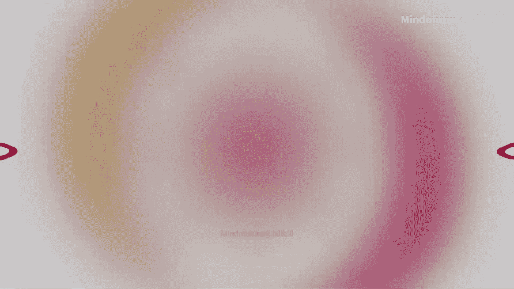
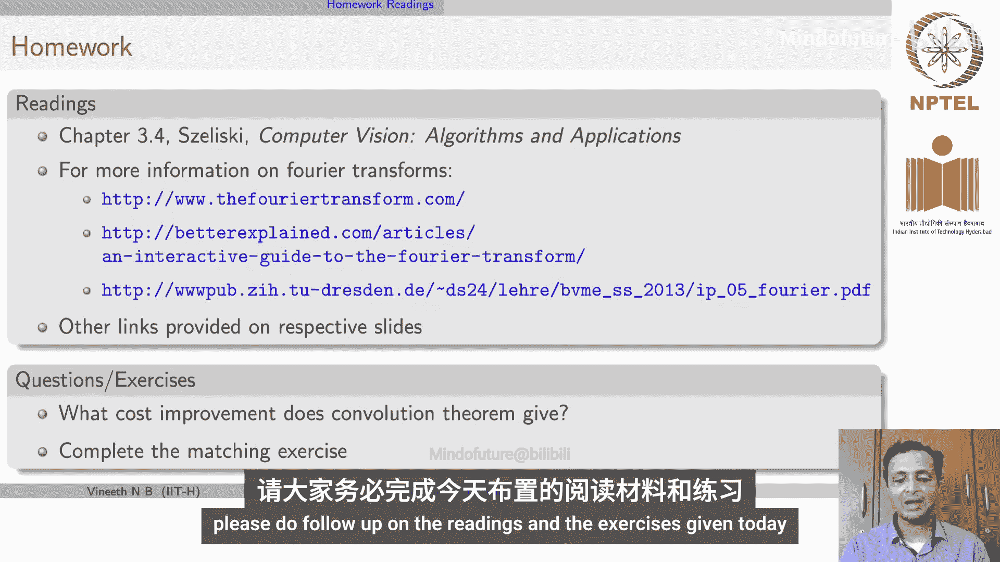

# 【NPTEL】计算机视觉的深度学习 p06 P06_频域图像 -BV1vNWkzpEua_p6-

Moving on from the last lecture。We not talk about。Representing images in a very different way。

Looking at it as a two dimensional signal composed of multiple frequencies。Before we go there。

I think we left two questions from the last lecture， which was。

Do we need cross correlation at all or is convolution sufficient for all applications of image processinging？

And the second question was， do filters always have to be linear？

Hope you had a chance to dig up a bit about those questions。Regarding correlation。While。

Convolution has mathematical properties that make it useful for various reasons。

Correlation can still be useful for a task such as template matching。

Template matching is a task where you are given a template and you have to find that template in a larger image。

 for example， you could be looking for this template in an image such as this。

And your goal is to highlight the regions in the image where that particular template is present。

In tasks such as this， correlation becomes a more direct choice。

Another example is finding an object in a more real world image here again a point to note is that your template and the object in the scene may not exactly match。

It may not exactly match。As long as they are similar in scale in orientation and general appearance。

 you'll still be able to template matching to be able to cast the object。As you can see if。

The car in the scene was from a different pose angle。

 a different size then this may not have word as there are ways to improve upon it we'll talk about that later。

 but a correlation may not work， but template matching is a task where correlation can still be useful。

Regarding linear and all linear filters。Let's try to give an example of a non nonlinear filter。

Using a practical use case。We all know that there are different types of noise that's possible in images so this was your original image you could have salt and pepper noise。

 you could have what is known as impulse noise， salt and pepper noise has black and white specs pepper and salt impulse noise has only white specs and you could also have a Gaussian noise where you add some gaussian to the signal at each location and things you have some noise due to that。

Give to that noise distribution。So let's consider one particular noise case。

 let's take the salt and pepper noise which all of you Im sure will agree is present in a lot of images that we see so salt and paper noise looks like this。

And if you now use a Gaussian filter which we saw on the earlier lecture and convolve this image with a Gaussian filter。

 its a 3 by3 Gaussian filter， you would get this output5 by5， this output7 by 7， this output。

Do you see the problem？Irrespective of the size of the Gaussian filter。

 you see that we are simply smudging around the salt and paper noise and not really removing the noise。

What do we do？The answer is obviously in a non nonlinear filter。And in this case。

 the non nonlinear filter is going to be a medium filter。

So we did see an average filter or a mean filter last lecture median filter is simply a variant of the main filter where you take the three cross 3 window。

Sort them all up and simply take the median author of the sorted list of values If you simply use this is the filter。

You see。That。In these cases， things become much better in the three by three。

 five by5 and seven by seven cases， and the salt and pepper noise is almost removed。

Why does this happen？If you take a more numerical example， so let's assume this was your image。

 so to speak。So if you're going to take one particular window。Take those values。Sort them out。

And take the median， which is a 10 in this case and put that median back here and you keep repeating this process。

All through your image。So in this particular example， 99 here is a salt mice。

 it has a very high white value right compared to the remaining set of values that you have in this image。

And when you come to that particular portion of the image。You list out your elements， you sort。

 take the median and when you do the median it becomes an automatic way of discarding the outliers in that sequence of values if you had done the main filter。

The 99 would have been used to compute the mean and hence the value in that location would have still been high。

But because you did medium。That value is no more relevant to you and you're going to get only 10 in that particular location and this helps you eliminate the certain pers。

Clearly， medium。You cannot get the medium to a linear combination of your input values。

 so it is a nonlinear filter。Another example which you may have seen in several places is what is known as bilateral filtering。

An example output from bicular filtering looks like this you may have seen these images。

 so whereas as you can see it almost looks like given a photo。

You have taken particular regions of the face and smoothened out pixels in those regions。

 for example， if you take the chief region。If you just take the region there。

 the pixel values in that region are smooth。And the pixel values in some other region are smooth by themselves。

 the pixel values in this region are smooth by themselves， and they don't bleed into each other。Now。

 how do you achieve such an effect using a filter， you may have seen this in imagerating softwares such as Adobe Photoshopgu。

So bilateral filtering is a nonlinear edge preserving smoothing and let's see how this is achieved。

So our main objective here is going to be if a pixel。

Dfers too much from the central pixel value in its intensity， we do not want to consider that pixel。

How do we implement it？It is going to again be a filter so remember that this is what you have I is your image。

 your filter is going to be a bunch of weights that you associate with。

Each of those filter locations。IJ or KL in this particular place。

 but now and the denominator is simply a normalization factor。

 we already know that normalizing a filter is important， especially for an averaging filter。

But you do see that there are four coordinates here。What do you think those four coordinates mean？

Let's see that using a specification of W IjKL， we're going to define W IjkL as。

It's like a Gaussian filter， we say that if the coordinate location is far from Ij。

Then weighted lesser that's one part of the term so the first term is very similar to a Gaussian filter if the neighborhood location is far from the central pixel weight that a bit lesser that part is the same as a Gassian filter but you have an additional term here which also says。

I don't want to design this based on only the location of the pixel I also want to design the filter value by what value is there in the image at that location remember so far in all our filters。

The filters。Only were relevant to the position of a pixel in an image。

 the filter coefficients did not change for different locations in the image。

But here we are talking about changing the filter coefficients for different locations and how do we change？

We say that is an image pixel at KL， which is one of those locations in the neighborhood around Ij。

Is going to be very far from the intensity value at Ij and the central pixel you want to wait that lesson。

So even if a pixel is an immediate neighbor of that central pixel that you are evaluating at。

 if it had an intensity that was very different from that central pixel。

 you were to wait that lesson。That's what this。This function does and we call this bilateral because you're doing it along the coordinates as well as along with intensities。

Why does this work？You see that on this slide。You can see on the left。Which。

is the representation of the image so these are a bunch of intensity values in a vicinity of a particular number and then there is a large separation before a neighborhood which has a different set of intensity values with some variations。

And this。Is how a filter will look remember again that this filter will vary for different parts of the image based on the intensities in that local neighborhood。

 So here you see that。TheThe filter in this part of the neighborhood varies like a Gaussian。

 as we said， if the intensities are similar， the only thing that affects is the coordinate location and then the value of the filter drops off significantly because there is a huge change in the intensity between a value here and a value。

down的。So now what is the result if you can this filter with this input。

 you get something like this where all the intensity values。In this range。

 get smoothened out here and all the intensity values are the bottom range。

Smooth in down here and that's how you got the boys' image with a smooth cheek area and。

Smooth regions in other parts of the face and neck。Moving on to the main topic of this lecture。

Let's start by asking ourselves this。What do we really lose in a low resolution image。

 so if you actually look at these two images？Perhaps eye has the same response to both these images。

We probably see a very similar scene in both cases， so what did we really lose？

When we reduced the resolution。You all know that we probably lost some sharpness or some edges in the image。

 but what does this really mean is what were going to talk more about。

So when we talk about images in the frequency domain， we mean Fourier domain。And when we say Furier。

 we go back to the scientist Fier， who lived in the 18th century， 18th and early 19th century。

Who proposed way back in 1807 that any univariate function can be written as a weighted sum of signss and cosines of different frequencies。

Unfortunately for his time at that time， many people you could say， of course what's new。

 you probably heard about it in some place， but at this time， many scientists including Lagrange。

 Laplace， Po and many others，Did not believe the idea and this is the statement that they gave they felt that it really was not complete and the work was not even translated to English until 1878 there was 70 years after he invented the idea and much much after he passed away。

But today we know that this is mostly true and this is called the Fourier series and it has some subtle restrictions but is more or less more or less true across signals that we know and we're going to talk about viewing images as 2D signals now but before we go there let's talk about the Fourier series itself so for simplicity we're going to talk about the Fourier series as representing any。

Time varying 1D signal as a sum of sinusoids will move to images after some time。

So the building blocks are sine waves and w is the frequency。

 phi is a phase and a is an amplitude of the signal。

So the idea here is that with these building blocks and with。

Of signals of different frequencies and faces， you could approximate any function。

 so let's see a more tangible example for this。Let's take this particular example here。

 this function here， G of T， what you see， as I said it a time varying one dimensional signal can be written as sine of 2 p ft plus 1 by 3 sine of 2 p3 f right so there are two frequencies F。

And3 F。F is the frequency that gives you this signal and 3 F is the C frequency that gives you the。

The others other signal。Now， let's see if this is the input signal to us。

We can write it as a sum of two frequencies because we know the actual actual definition。

Now in the Fourier domain， this kind of a signal can be represented as at the frequency you had along the x axis。

 you have different frequencies and at what we tell now is that the frequency F you have a certain amplitude and at the frequency 3 f you have a certain amplitude you have1 by3 at 3 f and you have 1。

 right？はいえ。So that's how you represent this signal in the frequency domain。

Now consider a slightly more complicated waveform such as this square waveform which is something like a periodic step function now let's try to see how this can be written using a fourier series。

So we could we know already that by using frequencies F and 3 F， we can get a signal such as this。

To this output signal， we can add one more。Signal of an even higher frequency and then you would get this signal。

And to that signal， you add a signal of an even more higher frequency and you would get this signal and you keep repeating this process over and over again until you go closer and closer to your original square wave function。

 as you can see， as you keep adding。Higher and higher frequencies。

 but in lesser and lesser amplitudes。You get closer and closer to a square wave。

 which means in the fourier domain。The final square wave can be the square wave can be finally written as。

In this written in this form。Where frequency f has the highest amplitude。

 the next frequency say 3 f has a slightly lesser amplitude， 5 f has an even lesser amplitude。

 so on and so forth， and as you keep adding more and more frequencies your waveform will get closer and closer to your original square wave。

Now let's come， that was a one day example， so if you came to images， how would this look？

So this is slightly more non trivialvial we will not get into every detail here。

 but hopefully I'll try to explain the basics。So if your original intensity image was something like this。

 so what you see here is there is no variation along the y axis or in there is no variation in any particular column。

 all the variations are along the rows so which means there are only horizontal frequencies here。

 no vertical frequencies remember we are talking about 2D signals so there are going to be signals in both directions。

But here in this particular example， there's no change。Along the columns。

 so there' is only a horizontal frequency， so typically so in the fourier image if you observe this carefully here。

 there are three dots。The central dot is the central dot is actually called the DC component。

 or it's simply the average intensity of your original spatial domain image。

The dot on the right here is the actual frequency， so you can now represent。

 let me try to draw it on this one so it's easier for you to see。Imagine that to be your axis。

Imagine the central point to be your origin。And that origin， as I said， is your DC component。

And on the x axis， this particular point refers to one kind of a frequency and you can see a white dot there white dot represents the amplitude of that frequency in your spatial domain image。

So the Fourier domain image is simply telling us that there is this much amount of that frequency in this image。

Now you could ask me what is the third dot here on the left hand side of your DC component you may ask what is this。

 just hold on to it and we talk about it on the next slide。Similarly on the second second column。

 you see that it's very similar to the first column， but the frequency has got a bit higher。

And because the frequency has got a bit higher， let me era these lines。

You can now see that on the x axis。We now have a slightly higher frequency。

Frequencies presence in this input dimension remember here that if you consider that to be an axis this had a lower value of the frequency。

 this has a higher value of the frequency。And if you take the third column。

 you can clearly see that there are frequencies both in the horizontal direction and vertical direction which boils down to points lying somewhere here so if you again thought of this as an axis in the Fourier domain。

So you have now。其都。You have now some frequency along the x axis and some frequency along the y axis。

 and that gives you that dot。We'll come to the third point in a couple of slides from now。So。

Another way of summarizing what we just said is that。In the Fourier domain。

 an image can be represented as in terms of the presence of different frequencies of the signals。

Starting from your zero frequency， which is nothing but your average intensity of the image zero frequency means this it is a constant value。

 so what is the average intensity of the image is the constant value on top of which you are going to add your frequency changes。

And F is a particular frequency where you record what amplitude of that frequency is present in this in this given image and you go the the excess goes all the way until what is known as the NCs frequency and we will come to that in the next lecture for the moment you can just。

Assume that that's something called My frequency。So a signal is plotted as a single peak at pointF if there is only one frequency in that image and the height of that peak corresponds to the amplitude or the contrast of your sinusso signal。

Now， if you noticed on these images， we did say that there is a third pixel on these images and I said I would answer it。

So it happens that when you plot your Fourier domain version of the spatial domain version of an image or a time varying signal for that matter。

You typically mirror your entire representation along your origin。

Why you mirror it I think we may not have the scope to get into it in this course but if you are interested please look at this post to understand why is the Fourier domain or why is the Fourier domain representation mirror so the third dot that we saw on the slide。

A couple of minutes back is just the mirrored version of the frequency that we saw along the Ex。

So here are more examples。So this is one kind of a harmonic frequency and this is something like 3F。

 this is 5F note that along the X axis that this dot here is actually moving forward and forward because the frequency is higher。

 youre moving further along the X axis， this is 7 f so and so forth。

Now you can combine these frequencies， this is again 1 f， this is1 plus 3 f。

 which means now you get dots in both those locations， this is 1 plus 3 plus F。

You get dots in all of those locations， this is one plus 3 plus 5 plus 7 dots in all of these locations。

 and you keep doing this further and further and further if you had a single。嗯。Image as a white dot。

That is going to get transformed into a horizontal line in the Fourier transform this could involve slightly more complex understanding of Fourier transforms but for those of you who are comfortable remember that a discrete signal in an original domain becomes periodic and continuous。

In your Fourier domain， so those are again we will not get into those details keeping the focus of this course。

 but I will share references with you through which you can learn more about this。

Here are some examples of howier of how real world damages look in the Fourier domain so you can see here that this is a Fourier domain image sorry this is a real world image these are two animals this is the log of the magnitude spectrum and what you see on the third column is the face of the image so as we already mentioned remember we said that。

In the foliier domain， you write out any signal as a sum of sinusoids with different frequencies and faces like faces are where the sinusoid starts。

 for example。So this is a certain sinusoid with a frequency。

This is a sinusoid with the same frequency。But with this slightly different phase。

 so the third column represents the face component of the signalss and will。

Try to talk about what that means for the next few slides。

So for your transencies of both magnitude and face。

 so in practice this is often written in terms of real and complex numbers。

The amplitude or the magnitude of the fourier signal is written this way where phi is the actual。

Representation and。The magnitude is simply root of real parts square plus imary square。

 as the face is given by tangverse of imrie by real。Once again， we won't credit it。Deepth of this。

 but Ill share references where you can understand this in more detail。Okay。

 to complete this discussion， so if you take a continuous signal such as this。

And if you take a fourier transform of that continuous signal。

 its Fourier magnitude spectrum would look something like this。

Which simply says that this is the DC component。You have certain frequencies with different amplitudes。

 so on and so forth。If you now sample that signal and get a discrete version remember that when we talk about images this is what we have we don't know the real signal across the continuous signal across the image。

 what we have is the signal sample at different pixels。

Remember this goes back to the representation of an image as a function。

If you take a foier transform of a sample signal。Your output would be a periodic continuous Fourier spectrum。

These are concepts for which you may need to do a little bit more reading of Fourier analysis and I'll again point you to references。

 but you can just keep this in mind that video your input is a discrete a periodic signal。

 your Fourier domain is going to be a periodic continuous signal and this is the kind of a signal that will end up end up having。

And this would be very similar to copying and shifting the magnetic spectrum for your preous motion of the signal。

Okay， so mathematically speaking， the continuous forier transform。

I given by integration over my integration from minus infinity to infinity h of x。

 which is your original signal e of minus geo omega x that omega is your frequency dx and the discrete version of it is where you go from 0 to。

Up to n minus1 samples total a total of n samples， and that's what is a discrete version of the Fourier transform。

So if you want to learn more about the Fourier transform。

 a highly recommended resource is this first one， an interactive guide to the Fourier transform it gives a very intuitive explanation。

 there are also other references here if youd like to know more you can click on those links to know more。

Let's come back to why we are talking about the Fourier transform in this lecture I mean why did we have to deviate to talk about something that's for which you need to read a lot more。

 there is a particular reason for that and that reason is what is known as the convolution theorem。

The convolution theorem states that the Fourier transform of the convolution of two functions is the product of their Fourier transforms rather。

If you take G convolution h to signals and you take the fourier transform of them。

 it happens that that will be the fourier transform of the individual signals。

And therefore the product of the Fourier transforms of the individual sequence。

 so what does that mean if we want to do convolution in spatial domain。

 we can obtain it through multiplication in the frequency domain。

And this can lead to some computational savings， not in all cases， but in certain cases。

 especially large filters and large images， this can be useful and we'll talk about that in more detail and that's the reason we needed to talk about the frequency of frequency domain here beyond just getting a fundamental understanding。

The Fourier transform has a lot of interesting properties which nicely fit into convolution。

 superposition， shift， reversal convolution， multiplication。

 differentiation scaling and so on and so forth， we are not going to walk into all of this。

 but there are a lot of useful properties of the convolution of the Fourier transform。

So if you now ask me the question， how does it really matter。

 looks like the Fourier transform also will take the same number of operations as Camvolution。

 let's try to analyze this。So the number of arithmetic operations to compute a Fourier transform of n numbers。

 let's say a function was defined with n samples。What do you think would be the number of operations？

It would actually be proportional to n squared。That could be the Fourriier transform just by the very definition of the Fourriier transform itself。

But it happens that there is an algorithm called the Fast foier transform。

 which helps reduce this computation to n login。Fast Fourier transform is a recursive divide and conquer algorithm。

 simply does this by dividing the set of samples that you have in different portions and then computing the overall Fourier transform you can see this link to understand this more intuitively but this reduces the number of computations from n square to n login and this is what is going to help us in making convolution more feasible by doing the operations in the frequency domain and this is a trick thats often used to this day when convolution is implemented in libraries which you may just call in your run deep。

Applications of A50 are in convolution and correlation。Okay so lets see an example of this。

 so if you have an intensity image and you take such a filter。

 this is an example of an edge filter you would get an output such as this where only the edges are highlighted this is your normal spatial convolution。

So what does this mean to go to the frequency domain？

ToGo to the frequency domain means this you take the original image。

Take the Fourier domain version of this particular image as you can see the Fourier domain version is still symmetric about that center00 point remember we talked about it being a mirrored version。

 but there are a lot of complex frequencies now because to look at an image。

Like this and be able to eyeball it and find the frequencies is hard so there are methods to do that so you get the frequency domain representation you take your edge filter。

 get the frequency domain representation。Multiply these two。Across pointwise and you get this output。

 then you do an inverse Fourier transform and you can get back your original image remember again if you go back here。

This step is your inverse for your transform。Which is what we implement using it inverse。Okay。

 now coming back to the slide。Now， can we ask the question？In this particular case what？

Specific cost improvement。Did the use of convolution theorem really give？

I'm going to leave this as a question for you to think about in this particular example。

 can you try to think？What。😮，Actual cost improvement would the use of the Fourier transform or doing this operation in the frequency domain frequency and Fourier are synonymous termss in this case。

would it give， think about it and we'll discuss the answer in the next lecture。

One more important concept here is the concept of what is known as low pass filters and high pass filters。

So when we talked about the filters or the masks or the kernels。

 its common practice to refer to some such filters as low pass filters。

 which means that they allow low frequencies to go through and block high frequencies。

What would be an example？You're Gossian freedom。Because it does smoothening。

Remember that when you smoothen an image you remove certain edge information which are high frequency components。

 high frequency components simply mean that there is a significant change between one pixel and the pixel immediately next to it that's what we mean by a high frequency in an image。

And high pass filters are filters that allow high frequencies to pass pass through and block low frequencies Can you think of an example here。

It would be an edge field because an edge is a high frequency component。

And it allows edges to go through， but。Blocks out your low frequency components across the image。

Now if you went back to the first slide that we used to start this entire discussion。

When you go to a low resolution image from a high resolution image。

 you actually lose your high frequency components。But it happens that the human eye is very good at working with medium frequency components that you can still make out the meaning in an image。

That's what you lose when you gowill your resolution much。

One last question before we wind up this discussion。Which is also an interesting topic is。

We said that there is a magnitude component and a phase component in every fourier version of LH and this is how the magnitude is something that we said is easy to interpret the phase is a little harder to describe so we will not get into it now but this is how it looks which do you think has more information。

We will try to understand this by perhaps swapping the magnitudes in the faces and doing an inversepo transform and seeing what what you get。

These are the kind of things that you will get。So if you now take the magnitude of， in this case。

 I think， yes， it's the magnitude of。y leopard or cheetah and your face from the zebra。

 and similarly you take the magnitude of the zebra and take the face from the leopard and you get these images。

What does this tell us？This tells us that the texture information comes from face whereas the frequencies actually come from your magnitudes。

So here is a popular example of。Popular example of doing this magnitude and face switch using a method called hybrid images where you exactly do what I talk about so you take an image you get。

You simply first get a low resolution version of that by applying a Gaussian filter。

You in fact can do it at multiple resolutions， we will come to that a bit later and then you swap your magnitudes and faces of different images and you can get pretty looking images that can be interesting these are called hybrid images and this was an interesting fight way back in the mid 2000s。

One more exercise before we stop。Here are a bunch of spatial domain images。

 sorry spatial domain images and corresponding frequency domain images on top。

 your task is to match which ones go where。Try this and we'll talk about this in the next lectures。

You'll stop here， please do follow up on the readings and。

エイズ。