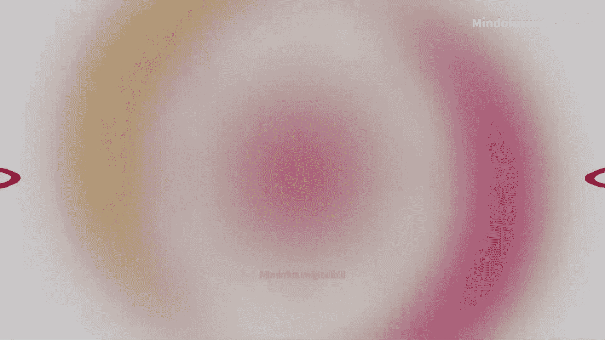
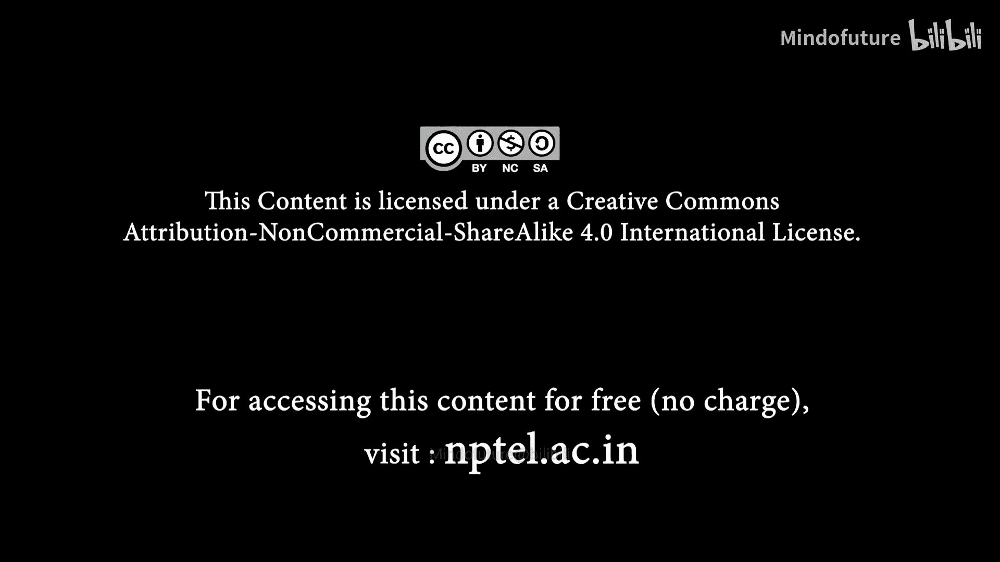
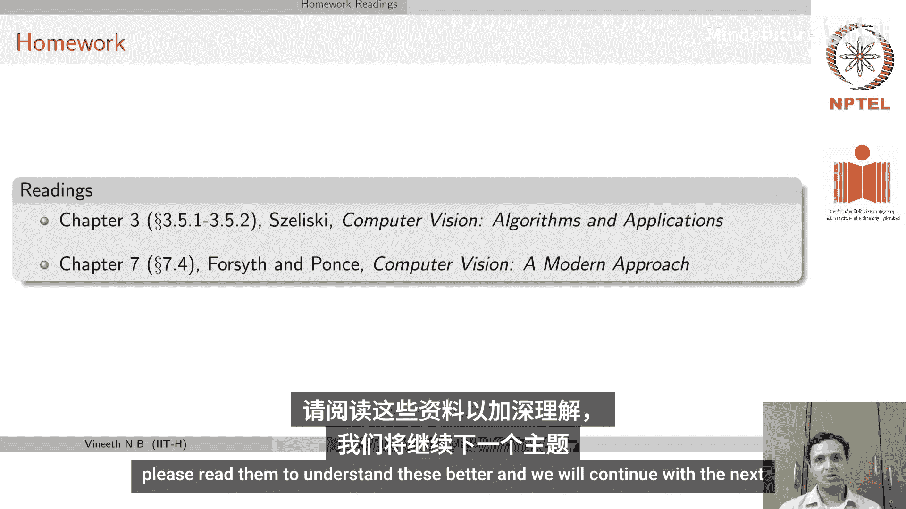

# 【NPTEL】计算机视觉的深度学习 p07 P07_图像采样 -BV1vNWkzpEua_p7-

The next topic we're going to look at is。Another important fundamental topic in processing of images。

 which is sampling and interpolation。Before we go there。

 we'll quickly review the questions that we left in the last lecture。

So one of the questions we asked last lecture， what was。

By implementing convolution by going through to a Fourier domain that is using the convolution theorem。

 what cost improvement do you really get？Convolution theorem allows us to define convolution in the spatial domain as a multiplication in the frequency domain and then taking an inverse Fourier transform So you take the individual Fourier transforms of。

Your G and H which can be your image and your filter or kernel and then you multiply them and then you do the inverse Fourier transform let's take a simple basic case here to explain the cost improvement so if your image convolution takes order of n square k square times times where n cross n is the image size and k square is the kernel size。

Then by performing convolution， the Fourier domain。

You're still going to have a cost of order of n square for doing a single pass over the image。

In addition to that to do the F50， you will need order of n square log n square for the image。

 recall that when we spoke about the fast Fourier transform， we said that if you have n samples。

The cost is going to be order of in login。In our case， an image has n square pixels。

So the cost of computing its full fast for your transform is going to be order of n square log n square。

Similarly， order of k squared， log k squared for the kernel， which is of size K cross K， So together。

Your computation is going to be of the order of。And squared log n squared plus K squared log K squared。

Any other computations that you're going to have are going to be additive and this would be the largest component which will。

overshadow the others and clearly you can see that this is cheaper than the cost in the original image convolution operations。

 especially when K gets bigger， which means if your filter size or your mask size gets bigger。

Using fastpho year transform to implement convolution is going to give you some cost benefits。

A lot of the deep learning libraries that you use today already implement convolution through fourier transforms。

 you may not know it， you may just be using a library， but deep learning library sales， for instance。

 and you just invoke convolution but the back end of this many of them already use fastphoier transforms to implement their convolution code which makes it first。

Okay， the other exercise we had was to match spatial domain images to Fourier domain images。

 hope you had a chance to figure out these answers yourselves。In case you had doubts on the answers。

 let's do the simple ones first， one would go to D。That's straightforward。Three would go to a。

Straightfor and we also had that clue in one of the slides in the earlier lecture and four goes to C mainly because you look at four。

 you see a very strong。Vertical set of edges and you see that image C has a lot of horizontal edges in the image。

 so horizontal edges in the original image would lead to a vertical edge in the Fourier transform go back and look at the sample for your images that we saw last lecture you will see that we saw an example of a vertical line in your spatial domain which led to a horizontal line in your Fourier domain which would be the endless the other way so if you had a horizontal line if you had a vertical horizontal line in your spatial domain you're going to get a vertical line in your frequency domain。

Once again， I think the scope of this course would not allow us to go too deep into the Fourier domains and related concepts。

But please do read the links that we shared in the last lecture。Regarding the other two images。

Ithi can be a bit tricky。Image 2 goes to E and the reason for that is if you look at image 2。

 there is a pretty strong vertical line there。And that comes from these horizontal lines at the horizon of the water or even these horizontal lines that you have in the ripples。

 so there are lots of horizontal lines in your ripples that's translating to this vertical line in the Fourier match and the fifth one is a straightforward extension and the fifth one is you can see that there are a lot of stalks in the flowers that are giving the horizontal aspect of the frequencies and there are also a lot of horizontal edges across the different flowers that give you some of these vertical frequencies。

Okay， let's review one of the questions we asked the last time again as to what sense does a low resolution image make to us？

If you had to go back and try to understand this from human perception perspective it is understood today that early processing in human filters in the human visual system are filters that look for different orientations and scales of frequency we will review this a bit more carefully later but sometimes people also relate them to what are known as Gabar filters。

And secondly the perceptual cues in the human visual system are largely based on mid to high frequencies so remember once again high frequency means an edge because theres a sudden change in intensity value as you move from one pixel to the next pixel along a row or a column if it is longer the row you would call that a vertical frequency which is a longer column you would call that a horizontal edge so。

Perceptual cues depend on mid to high frequencies in general so but。

When you see a low resolution image， it is equivalent to subampling the image or if you're seeing an image from very far away。

 you're actually subampling the image， which means you may be losing some of the high frequency information but you do get a lot of the low frequency and frequency information。

 which is good enough to get a sense of what the object is but may not give you finer details。

So how do you subsample an image as an operation， the simplest way to subsample is given an image such as this。

 you simply throw away every other row and column consider only every alternate pixel both row vice and column vice that straight away gives you a half size image you can then go to a repeating this to go to lower and lower resolutions。

Okay， but if you actually zoomed into these。Low resolution images for these subs sampleampled images。

 This is how they look。 We're just simply zooming in to these images here。

And if you just zoomed in and looked at those images。

The half sample image gets you something like this。

 the quarter sample image at the28 zoom gets you something like this。

The one by8 image at aphoic zoom looks like something， something like this。Okay， you may ask。

 say yes， that's expected。if you subsample， why do you， I mean。

 why do you worry about how it looks at close？That's a valid question。

 but there's a reason for bringing this up here is。The last image here looks pretty crafty。

It has too many artifacts can we at least make it look smooth。

We understand that by subsampling you've lost some information。

 but can it at least appear smooth when you zoom it in is what we are looking for we understand that you may have lost sharpness。

 but we still want to look make it look smooth。What do you think？How would you achieve this？Okay。

Let's wait for the answer for a moment， but let's also see another example of an effect such as this。

So do you know what is happening in this kind of an image？So this is the ocean image。

We have subampled in some way and you get an effect such as this。This effect is also known aslia。

So aing generally happens。When your sampling rate is not high enough to capture the amount of detail in the image。

 you're going to see a couple of examples and then revisit the painting that we saw and how do you ensure that it's not crafty。

So anyway， your sampling rate is not high enough。You will not get the detail， for example。

 you see a sinusoidal wave from on top here。If you subsample only at these points。

 remember that you are not looking at the downward trend of the sine wave。

 So if you only subs sampleample these black points， you may think that this。

Is the actual sine wave and remember here that the frequency of this red wave that we just drew is very different from the original wave。

And why is it so different only because we didn't sample the original signal when when I say original signal。

 I mean the one here in purple。Because we did not sample it enough。

 that's the reason why we end up getting this kind of a shape， which is very different。

From the original sin side wave。So。What you need to do to get the sampling right。

 ideally you need to know the structure of your original signal and this is where。

An important concept called the Nquis rate comes into the picture we also mentioned this briefly in the previous lecture。

But the minimum sampling rate that is required。To reconstruct your original signal or to capture the original signal in its actual form is called the Nquist rate。

So now what does the Nos rate mean？NICOrate goes back to fundamentals from information theory and signal crossing where Shannon is whose sampling theorem is very popular。

 proposed that the minimum sampling rate of the NICOS frequency is given by FS。

Which has to be at least two of F max。F max here is the highest frequency in a signal。

It's the highest frequency。In a signal。And we are saying now， and for an image。

 we would say it's an image。And we are saying that this your sampling rate or your knifeous frequency should be at least twice the highest frequency that you have in your image or signal。

Why is the so were going to see in a moment， but we can explain the impact of not doing this in an image setting。

 in a video setting or even in a graph a graphic setting let's see a couple of examples so in an image setting if you don't sample your original signal at the appropriate frequency which is twice Fmax。

Your shirt is going to look very weird and this is， as I said， what is known as LA S。

In a video this is something that you may have observed a lot sometimes when you go out on the road。

 you see a bicycle， especially it happens with bicycles or car wheels。

 you may although a car is moving forward when you look at the wheels alone it may appear that the wheels are circling backward so this could be a site bicycle or a car try observing this if you have not already done this if you have not asked yourself why this happens here is the reason。

The reason is if you now take the motion of a wheel to be the top row here。

 so the top row here is the actual motion。As you can see in the top row you can see that the arrow here is moving in a clockwise direction so you can assume that this is something like a cycle wheel moving in a clockwise direction but we have chosen to sample it only at three locations across all of these so the top row is the actual movement of the wheel。

 but these boxes here are the ones that are actually sampled。They are the ones that are sampled。

 so if you looked at only the sampled positions， you see that the arrows first here。Then， it's here。

Then， it's here。So on and so forth so probably in fact the second and third one could give you the reason why this effect happens so you see that if you only do the second and the third one you would actually think that your wheel is moving counterclockwise because those are the only two samples you have and the arrows moving in the counterclockwise direction but originally your wheel was moving in the clockwise in the clockwise direction。

This simply means that you're not sampling the wheel at the frequency at which it's rotating or at twice the maximum frequency at which it's rotating。

Here's another example from graphics and the reason is against again the same you can see in this particular case that the allying is prominent at these regions where the frequency is very。

 very high。Remember once again。When we say frequency in an image。

 we mean how quickly the pixels change between black and white。

 when we say black and white it can be dark gray to light gray。

 but going from black and white and that becomes very high closer to the horizon of this image and that's where the frequency is very high which means your sampling rate has to be twice that frequency to to be able to be true to the original image and this is an effect that we often see with graphics。

Okay a more tangible way to understand why you need to sample at twice the maximum frequency。

 we are not going to derive Shanon sampling theorem here because that' is not the focus of this particular course but let's try to intuitively understand why you need to do sample advice the maximum frequency let's take this example of a chessboard so you have a chessboard here and we argue now that the top row two examples of good sampling practices。

And the bottom row are bad sampling practices。So let's see here that if you see。This one here。

 that's the bottom left。You can see that the samples are these circles here。

 you can see those circles， and when you see the samples you can clearly see that we are sampling all of them at only blockss。

So if you had only those four samples， you can assume this entire board is a black board that there are no white squares in between because you never sampled in the white square。

So clearly you are not sampling at the appropriate frequency here the frequency here is how quickly does white and black change in how many pixels does it does it change。

 clearly you are not sampling at twice that maximum frequency and it's going to give you poor information。

Here is a slightly better sampling but still not complete so once again here you can see these hollow circles you can see that you improve your sampling a little bit but once again you see a black you see a white and again your third sample on that first row is a white again so which means。

Your perception or any further processing is going to imagine that this is black followed by a series of white that is not checkerboard or a chesboard。

 but it's just an entire block of white after the first。After the first small square of black。

 it's an entire block of white。Which， again， is re sampling。

So here is a sampling where we actually go at twice the frequency Okay， you may ask white twice。

 so in this case， remember here that the actual frequency is。

When a signal completely goes through between its variations， so in this case。

 a signal completes from here till here and theyre sampling twice。Inside those two boxes。

 which means were sampling at twice the maximum frequency and when you sample like that you've got a sample in every black square and every white square and you now know that this is a checkboard。

 obviously if you sample more than that that's even better for you。

Hopefully thatll give you an intuitive understanding of why you need to sample any signal。

 any image at at least twice the maximum frequency of content in the image。

So a good anlyizing technique is Gaussian pre filtering。

We'll talk about what Gaussian preing means in a moment。

 but this is the image that we saw earlier we said that this image was crafty and this is what we want to try to achieve We do understand that if you sub sampleample youre going to lose some information but we at least wanted to。

Make it look smooth。So how do you do Gaussian pre filtering？

You're first going to take an image and then do a Gaussian blur on it。

You know know what a Gaussian blur is it's Gaussian smoothing。

 you can take a three cross three Gaussian kernel in case。

You don't recall what a Gaussian kernel is remember it looked something like this at least a three cross 3 Gaussian kernel looked something like this and you also had a 1 by 16 to normalize it and that was your three cross 3 Gaussian kernel Similarlyly you can also build five cross5 kernels and so on and so forth so you fly first apply that kernel on your input image that gives you a blurred version of the image。

Now you subsample。Then before you subsample again， blur。Then subsample， blur， then subsample， blur。

 then subsamples on and so forth。Why do you think this works。There's a reason for this。Yeah。

Let me ask you this question。This， as we say。Is a Gasian filter。

Do you recall what a Gassian filter is， a low pass filter or a high pass filter？

A Gaussian filter is a low pass filter。Which means it removes high frequencies and only passes through the low frequencies。

 relatively lower frequencies， which means it's going to remove remember any smoothing filter removes a certain amount of high frequencies so by applying the Gaussian blur you have removed the high frequency which means the sampling rate now can actually be reduced remember again the Shannon sampling theorem states that you must sample at least twice the maximum frequency in the image if I reduce the maximum frequency in the image I can sample at a lesser rate。

And that's the trick that we employ to be able to subsample but still have a smooth effect in your output image。

 so you do a Gaussian blur now your overallal frequencies have come to a smaller range now you can afford to subsample without having an allying effect of kiness in the image and that's what we mean by Gaussian blue filter。

Okay， so now subsampling is one side of the story and the other side of the story is how do you ups sampleble？

Sometimes you need to go from a low resolution image to a higher resolution image。

And the simplest way to do this would be a very standard interpolation operation。

An interpolation between any two values you you're talking about the real axis。

The interpolation between any two values here is simply values that lie on the line connecting to or at least linear interpolation is on the line joining those two points。

So the simplest form of interpolation that we can do if we want to ups sampleampble an image is what is known as nearest neighbor interpolation where we simply repeat each row and column 10 times so every pixel you repeat it 10 times along the column and 10 times along the row so it almost becomes like one entire 10 by 10 block has exactly the same value then you take the next pixel repeat it for 10 columns repeat it for 10 rows which means the next 10 cross 10 block has the same value soon on and so forth。

Good news， your resolution goes up， bad news， you're going to have such artifacts across the image because this is exactly what you did。

Because you took several blocks， several pixel and simply expanded them into blocks。

How can we do better than this like clearly we do not want to ups sampleample images like this and have a blocky effect in the ups sampleample image。

So the way we can go about doing interpolation or upsembling while retaining some smoothness in the output。

I let's try to recall how digital image is formed again。

 recall an image being a discrete sampled version of the original continuous function or the original continuous signal。

So you have an original signal F。You quantize it at certain locations。

 which gives you your image or your signal。Capital F at X Y locations， like in our case。

 it's going to be an image。So， as we already said， this is nothing but the discrete point sampling of a continuous function。

 so when we do interpolation we are simply asking the question can we somehow reconstruct that original continuous function from the discrete samples？

That's the question that we're trying to ask because if we could do that。

 we could interpolate and go to any resolution that we want to go forward。Unfortunately in practice。

 we do not know the small F， which is your continuous function。

 we do not know that continuous function we do not know how what was the real world scene from which your image was captured in a sample in a sample manner。

However， we can try to approximate this in a principled way and the way we are going to do that is through a convolution approach。

So the first step that we want to do is。Convert your continuous function。Sorry， convert your F。

 which is your discrete sample version to a continuous function。

Because we do not know the original continuous function。

 we are going to define a pseudo continuous function which simply states that。

Wherever you know the value， you simply put the image's value there everywhere else you just say it is  zero。

This would be an automatic version of a continuous function this is at least a continuously defined function let me put it that way。

 at least for the moment。So we now try to reconstruct your F hat。

 which is the resolution at which you want to take F2 right。

By convolving this pseudo continuous image with some filter， so we want to ask if。If we have。

Some okay， this is not exactly right in terms of the function， so me is that。

But if we have this function continuous function f sub capital F。

 can we get some kernel h in such a way that we can construct the original not original。

 but at least an of sample signal？What do you think its should be？Okay。

 this image should give you some understanding， maybe a signal such as a tent in a shape of a tent could help you with the 1 d signal perhaps。

But that still doesn't answer how convolution can take us from one resolution to a higher resolution because the way we saw it。

 convolution can maintain the same resolution if you include padding and if you dont pad you you probably will lose a few pixels on the boundaries but now we want to go to a higher resolution then we use convolution。

Now， to be able to perform interpolation and then up an image to a higher resolution using convolution。

We're going to do it using an interpolation kernel， which is defined。This is what do you see here？

Remember again that your original convolution is defined something like this。

Then you have G of 5 J is equal to sum。F of kL into h of I minus kj minus L。

 and this is the new definition。That we are going to use for interpolation and if you observe carefully the main difference between these two expressions is the quantity R here that multi that is multiplying k and L。

And R is what we call as the up samplingampling rate so if you want to double your image your r is2。

 if you want to quadruple your size of your image， remember we are doing up samplingling。

 so if you want to quadruple your the size of your image R is going to be4， so on and so forth。

Let's try to understand how this actually works let's just for the sake of simplicity。

 let's look at one dimension variant variant of this， let's say G of I。Is equal to summation over k。

诶复企。into edge of i minus R that' is the one dimensional variant of the same equation remember once again that an image is a 2D signal for these purposes so a lot of these expressions that we write for images if you remove one dimension you can apply that as convolution for one dimensional signals。

so this is what we actually have in one dimension so it's just easier to explain in one dimensions。

 so lets consider let's try to understand what's actually happening right so let's consider an X axis。

So let's assume that there are some signals。F of k -1。Let's see there's another signal。This is好 key。

There's another signal here， f of k plus one。So and so forth this is very similar to what see what you saw on the earliest slide right so I just drew lines such as these to represent the various values of F that I have with me that's my input image which I want to increase the resolution of。

So now because I want to increase the resolution， the question I am asking here is if I take some I here。

In between those values。What would be G of I G is the output F is the input okay。

 that's what I'm trying to ask。So in the G axis， the tricky part here is that the coordinates。

The indices in G are different from the indices in F because F has only a certain number of indices。

 whereas G has doubled those number of indices。And so this would be。R into k minus1。In G indices。

 this would be RK。And this will be R plus one。In the indices of G。

Now if we try to understand what what G of5 is trying to do here。

 it is the summation of fk into h of i minus Rk as you take many k values right so of course k can range from k minus1 to k plus1 if you take a three cross3 window or a higher depending on k and3 defines the length of the window that you have so in this case so what we mean now is。

H of I minus is R。 So if you again took an example such as this， remember here that H was。

One of the interpolation kernels in this case， it's called a tent kernel because it looks like。

Like a tent and what this kernel does is as you go further out from the central pixel on which you place the kernel。

The effect of those pixels fall off linearly not exponentially but linearly so thats your thats what is your tent kernel so if you add a hit such as this。

Youre simply saying that this F， So if you place the he kernel here。

So if your hedge kernel is placed something like this。

So then you're saying geo5hi is going to be f of k into h of i minus Rk， i minus Rk。Is。

This value here。I minus RK is going to be this value here with respect to h。

 which is the green curveuff， so you're going to multiply fk by h of i minus R fk plus 1 by h of i minus R plus 1。

 which is going to be this this quantity here， so on and so forth。So。

By doing this operation you are able to interpolate and you are able to you obviously some of those values there is still a summation here some of those values and that will give you what the value of。

ジ業ファイ。That's how these interpolation kernels work。So now a linear interpolaator is what we saw corresponding to a term tent kernel you can also have more complex kernels such as beast planes。

 those are the most complex kernels but here are some qualitative results of applying this interpolation so the first one that we already saw is an effect of doing the nearest neighbor interpolation where you have the block in is effects then if you do bilinear interpolation which is the linear interpolation that we spoke about but along the two axis and you get something like this if you go a bi cubic interpolation you get something like this so on and so forth so the main difference in these interpolations is the edge kernel that you use in one case it's nearest neighbor in the second case it's bilinear third case is bi cubic。

You're not going to define every kernel。But you can look at the references at the end of this lecture to be able to understand various kernels that have been defined in practice。

So just like how we defined interpolation， you can also define。

The complementary operation of it which is decimation decimation means subsampling。

 so which means while we saw subsampling so far as simply omitting every other pixel where if you do gossipss in pre filtering you also ensure that you get a smoother output。

 you can also achieve subsampling using a curution like operation where it will be very similar the only thing is instead of RK。

 youre going to have K by R and L by R here because you now want to subsample and not interpolate。

So that's why we're going to stop this lecture to know more interpolation kernels and decseation kernels。

 you can look at these references that are on your homework。

 please read them to understand these better and we'll continue with the next topic。

