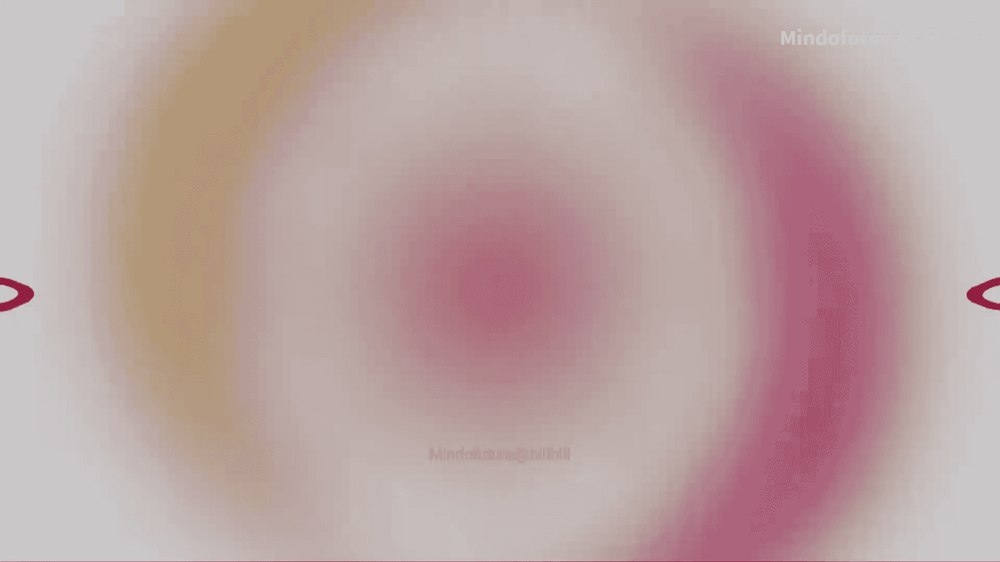
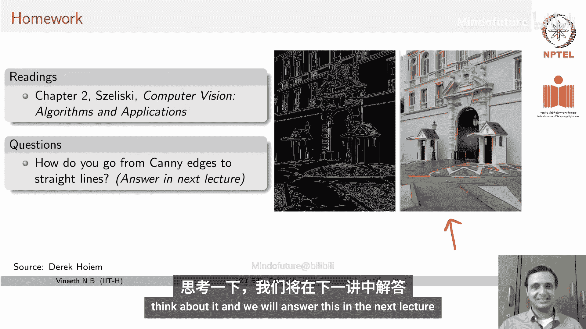

# 【NPTEL】计算机视觉的深度学习 p08 P08_边缘检测 -BV1vNWkzpEua_p8-

Moving on from the previous set of lectures， which introduced。You do basics of image processing。

We will now move to the next segment。Which is on。Understanding and extracting higher level features from images。

So we will start this with our first lecture on edge detection。

The idea of detecting edges on an image。Is about mapping the image from a 2D matrix。

To a set of lines or curves。On the event。In a sense。These curves or lines are what we call edges。

Are a more compact representation of the image。Why is this representation important？

If you see these three images and I asked you the question。What are the objects in the image？

Can you guess？It's not hard for you to say。The first image is one of a person。

 the middle image looks like one of a horse， and the last image looks like one of an aircraft。

This is a bit surprising。Because if you give such an image as input to a machine learning algorithm or to a neural network。

It's not going to be trivial for the model to be able to make these classifications the way you and I can do。

So to the human visual system， edges are extremely important to complete the picture。

And for the entire process of perception， in fact， if you see these images。

 even if the edges are taken away to some extent。We can fill in with the rest of the edges and still be able to say what objects are present in these images。

That's how important edges are in an image。So let's ask the question we have been introduced to a few concepts with images。

 we have been introduced to convolution， we've understood frequency representation of images to some extent sampling and interpolation。

 so using the ideas that we've studied so far。How do you go about and find edges and images？

The key idea is to look for strong gradients。And then do some kind of a post processing to get good looking stable edges。

So why do we see gradients？Let's try to understand that or an next slice。Firstly， before we。

Mathematically try to understand how you' are going to detect edges in the images。

 let's try to understand how edges are formed in the first place。There can be many factors。

Given an image such as what you see on the screen right now。

 edges are fundamentally some form of discontinutgrity in the image。

The discontinuity could be because of surface normals。

 for example you see on this particular pole that its cylindrical and as you go around the cylindrical the surface normal direction is changing and beyond the point there is a discontinuity in the surface normal direction which appears as an edge to the human eye。

Another option is simply a color or an appearance discontinuity。

 as you can see here that there is some discontinuity in the surface color or appearance。

 maybe while this is a black and white image you can imagine a red block below which there is a blue block。

 just that color difference is going to lead to a discontinuity。

There could also be depth based discontinuities。 if you observe observe this tower on the back。

 you can see that there is one。Poion here which is procruding out of the building and then obviously the building is behind that pre so that gap in depth between these two artifacts in your image also leads to a discontinuity and hences an edge and lastly you have an illumination discontinuity which is caused due to changes in light such as shadows for example you see here that there is a small artifact there where a portion of a shadow falls on that region and you see an edge from that particular place。

These are not the only kind of discontinuities that can cause edges。

 but these are examples of discontinutities that can cause edges。

If you look more locally at these regions， you see that where there is no edge。

 the image looks fairly smart。But where there is an edge。

 there is some kind of a transition in the image pixels in a particular direction。

 edges can be in different directions in an image and you see that there is one particular direction in which in this particular case theres a change in intensities or if you took another region of the image you can see that in that region there are many kinds of edges of the。

In different orientations。So we ideally want to be able to detect all of these in an image。

Why are edges important we did talk about this a few slides back where we said that it's very important to how the human visual system perceives the environment around us。

But even if not the human visual system， if you wanted to run a machine intelligence system。

 we talked about this a few slides ago that。Edges are important to the human visual system。

But it's not just the human visual system edges are also important for a machine based intelligence system。

 where you use edges， you can use edges to group pixels into objects or part or or parts。

 for example， edges tell you that all the region inside。

One particular area belongs to a common object， it can also help us to track important features。

Across images， it can be cues for 3D shape， or it could also help you just do interactive image editing What do we mean let's say I wanted to。

Take this building this is a building from the IA Hyyderabad campus let's say I want to take this building and I want to put snow in the background or mountains in the background so I ideally need edge information to isolate the building from the background and then be able to change the background accordingly so edges are important to inform those kinds of applications。

So we talked about images being represented in multiple ways， images can be looked at as matrices。

 images can also be looked at as functions。So when you talk about images as functions。

Edges look like very steep cliffs。What does that mean so if you add an image such as what you see on the left？

If you now， so obviously our job now is to find out where do these steep cliffs exist in the images？

So that brings us to derivatives gradients because if you need to find steep cliffs。

 that means in a very small unit change in the pixels that's going from one pixel to the next pixel or two pixels away there is a huge change in the intensity so in some sense we are saying that an edge is a place of rapid change in the image intensity function or it can effectively be measured using a derivative or a gradient。

Oh， let's see an example， so if this was your image。

 so there you have a white patch followed by a black patch and a white patch again。

So if you took one particular row of this image， just for understanding。

 if you took one particular row of this image， even in that row you have the same pattern。

 a set of white pixels then a set of black pixels and then a set of white pixels your intensity function looks something like this remember again that white has higher intensity black has lower intensity so your image actually looks something like this in the image intensity space that particular row of pixels that is indicated in red on the left side。

So if you took a derivative of。All of these values in the intensity function。

This is how the derivative would look the third column。

So there is an initial point where you have a negative derivative because the value is falling down and then there is a later point where you have an equivalent magnitude of the gradient。

 but in the opposite direction because the intensity increases at that particular point。

So here is just another example of the same setting。

 but here we are also showing you how the second derivative looks in this particular setting。

 so the second derivative remember looks like as long as the first gradient keeps going up。

It goes up until a certain point then falls off and then comes back for the second half of the gradient a second derivatives graph would look something like this we will see more examples of the second derivative for the next few slides。

Okay， now our challenge is about how do you get these derivatives so we understand that edges are important and that edges can be obtained using derivatives obed。

 but the question we have now is how do you achieve this using convolution？To do that。

 lets look at first principles definition of a derivative。

So if you had Xy directions among pixels in an image。

 and let's consider the intensity function of an image as f of X Y。So though f of x y by do x。

 we know by first principles definition is written as limit epsilon turning to0 f of x plus epsilon y minus f of xy by epsilon。

Remember， we are trying to measure the derivative with respect to x。Now， for discrete data。

 this is what it would look like for continuous data for discrete data x plus epsilon may not be defined F x plus epsilon may not be defined。

 so you define the f of x y by the x to be f of x plus 1 y minus f of xy by 1。

That would be your discrete definition for the derivative。Now， looking at these definitions。

What do you think would be the associated mask or kernel or filter？

To ensure that we get this particular gradient。Can you guess what the filter would be？

A simple answer is what you see on the right。It's exactly what this definition is。

It simply says that if you are at a particular pixel X Y。You can see。F of x plus1 y。

Minus f of x1 right by placing this pixel at this value of the filter at that particular pixel。

 this is the output that you would get by applying this filter at that particular location。Similarly。

 you can do this very get a very similar effect using this kind of a vertical filter which will give you the gradient along the y direction is this the only way to get the gradient？

Not necessarily。There are other ways of defining the gradient2 remember here on the previous slide when we said that for discrete data we obtain the gradient using this particular formula remember that this is one kind of an approximation there could be several other ways in which you could approximate the gradient for example you can say a gradient can also be written as f of x plus 1 y。

Plus f of x minus1 y。us2 F of X， Y。by two， that is also a valid approximation of gradient。

 so there are multiple ways of defining the gradient depending on how far you want to go in your neighborhood around the point at which you're completing the gradient。

Here is another example of a three cross 3 filter。I'm going to let you think carefully about what would be the derivative expansion here。

 It's not too difficult。 remember again if this was。F of x comma y。

 remember that this is going to be F of。X plus one come away。This is going to be F of。

X minus1 comma y。And。This is going to be F of。X from a y plus one and so on and so forth。

 you can define the coordinate locations for each of those values and you simply now write out what this could be as a derivative in this case you can see the derivative is being defined as。

F of x minus1。Two di why。Plus。F of x minus1， y minus1。This value comes here， this value comes here。

Plus， F of x -1， Y plus 1。Thatspons to this one。Then you will have a minus for all of these locations here and you finally divide by the overall number of locations which in this case will be9 to get your final gradient This kind of a filter is called a Sobel edge edge filter and once again this is another approximation of the gradient to get to get the edges edges in the setting。

But clearly， you see here that you are in this case。

 trying to find out the gradient along only the vertical direction。Remember。

 you're trying to give some values to the left and to the right。

 which means you'll actually find what are the edges in the vertical direction。

So what you see on the right hand side is an absolute value of the gradient。

 so we are not looking at negative or positives。Because it doesn't matter to us。

 wherever there is a sharp change is an edge， whether the intensity falls down or falls up。

 it is still an edge， so it really does not matter to us as to what is the sign of the gradient that the magnitude of the gradient of the absolute value is what matters to us here。

Here is the complementary filter for finding the horizontal edges for the Sobel filter。

Are these the only two filters， not necessarily so there are more such filters。

 there is something called the Pruit filter， there is something called the Sobel which we just saw there is also the Roberts filter which finds edges in diagonal directions。

So clearly， you can handcraft several kinds of filters to be able to find edges in different directions and obviously follow a question for us now here is。

で。How do we find edges in any direction？Do we have to convol with many different filters to be able to find edges in different directions。

 let's see that in a moment。Okay。Before we get there。

We will see a complete edge filter as we go forward。

 let's formally define a few quantities that we're going to use for the rest of this lecture。

Remember that the gradient of an image the F where f is the image。

 the intensity of different pixels is given by a topple2f by do x command2f by do gradient in the x direction and the gradient in the y direction。

And the gradient always points。In the direction of the most。

rapidid change in intensity so for example if you have the gradient to be dof by dox comma0 this tells you that there is no change in the y direction and all the change is only along the x direction which means x the image or the edge in the image would look something like this if you had the gradient to be0 comma doF by doy then there is no change along the x direction and the edge is only along the vertical direction and this is how the such an edge would look like in an image。

On the other hand， if you had an edge in a completely different random direction。

 like a diagonal direction， not aligned along the vertical axis or the horizontal axis。

 then you would have a gradient which is simply given by do。By do X by。Comman have my way。

 so there's in both the directions， there is a non zero gradient which gives you an edge in a different direction。

How do you find the orientation of the edge， we said that edges have different orientations。

Your principles from simple calculus， the orientation of the gradient is simply given by tan0 numbers of gradient along y divided by gradient along x。

Things are high school calculus results。And finally。

 the strength of the edge is given by the magnitude of the gradient that this dof by doight whole square plus dof by do whole square。

On the root gives you the magnitude of the edge in that particular location。

 So how strong is the edge is what this gives you at that particular location。

Let's again take this example of a single row in an image so let's assume now that the image is likely changed we have a black patch followed by a white patch that's what we have here and now let's take one particular row we are taking one particular row just for simplicity of understanding you could have taken the full image to just that the figures on the right would have looked more complex so we let's just take one particular row the image clearly even in that particular row thered be the first set of pixels which are black then the next set of pixels which are white rather in that particular row the image intensity function would look something like this。

First set of pixels， which are black， the next set of pixels， which are white。

If you took the gradient of such a function， we know that the derivative would look something like this。

The generator is flat in all these locations in all these locations。

 and there's a spike right in the middle when there's a change in the intensity。

So if I ask you the question， where is the edge， its simple。

 you simply say wherever the gradient has a high value。

 that's where the edge is present in the image and clearly you would have been right in this particular setting。

Unfortunately， real world images don't come as well polished as what you see in this particular setting real world images have a lot of artifacts。

 especially noisy artifacts。So we take the same image。

 but this time the image has a lot of noise let's see again。

You can see it up close there's a lot of salt and pepper noise in this particular image Now if we try to plot the image intensity。

 your image intensity would look something like this。

where you have a lot of noise and in the middle there's a big change in the intensity。

 which is where your edges and then you have a lot of noise again in the white region。

If you now took the gradient。You would observe that the gradient looks something like this remember that the gradient is measuring infiniteismal change so in all of these regions the infiniteismal change would get represented by the gradient like this and even here if you took small small steps。

gradientadient there is more or less the same kind of a gradient as in the noisy regions of the same image。

Now， how would you find the edge？ Remember， this is how real world image。 look， what do you think。

So if you simply took the gradient， you're going to be confused because even the noisy parts of the image。

Will look like they are an edge too， but clearly from the human eye。

 you can see that the edge is right in the middle。So how do you solve this problem？

The answer is something that you've already seen you first smoothen the image and then do it deduction lets see that with a concrete example so what we do now is we to smooth you've already seen things like box filter。

 Gaussian filter so on and so forth you going to use a Gaussian filter。

This is the original row of that image that we just saw on the previous slide。

You take the Gaussian filter。Convolve the original row in the image or the image with a Gaussian filter once again remember that a row in an image is a one dimensional signal so be using a one dimensional Gaussian filter here if you do it on the image this would be a two dimensional Gaussian filter remember we've already seen what a two dimensional Gaussian filter looks like。

You me usそ。one so on and so forth right we have seen that as a Gaussian filter earlier so in this case on this image it' is going to be a 1D Gaussian one dimensional Gaussian filter so we convolulve the image with that one dimensional Gaussian filter and the output would then be something like this。

So the entire row in the image is smoothened out， all the noise becomes flat。

Then even the edge gets slightly smoothened out， remember it was a sharp pitch and it's got a little smoothened out and that's what Gaussian filters achieve while they remove noise they also blur out pots the image that's what would happen here for that middle region where the edges and then you have the rest of the region to be flat to。

Now on this Gasian smooth image， you can run an edge detector by running a gradient and you would find that an edge can be found in the middle location there's more to it than what we just saw。

Remember again that we said that convolution has some nice mathematical properties that correlationation doesn't satisfy and we're going to use one of them to make our life easier。

So remember that convolution is associative。So if you assume。A gradient function of F convolution G。

And if I told you that this gradient can also be implemented as a convolution。

 which we just saw a couple of slides back with those sobel filters and other filters。

So because of the Associative property， we can write this as F convolution。

Gradent of G or gradient of F convolution G， all of them are equivalent because of properties of convolution。

Which means what I can do now is I can take the Gaussian filter。

Compute the gradient of the Gaussian filter， pre compute it and store it with me。

So you know how what Gaussian filter looks like you know how a derivative filter looks like youve seen examples of both of them so far you con the two and you will get one output filter store it with you and that filter will look something like this This is the derivative of the。

Goussian of the Gasian freedom。This given that this is the derivative of the Gaussian filter。

So which means youve already taken care of let's assume that G was the Gaussian filter and therefore has the original function function。

 so youre automatically computing precomputing go by dox of G and storing it as a signal and now all you need to do is to directly convol this function on the original signal and you'll get the output directly to be able to find the edge。

So now it becomes a one step process rather than a two step process which can save a lot of time and effort for you to compute the edge on a noisy image and remember this was possible because of the associative property of convolution which we could leverage to make things easier。

And obvious follow up question is what about the second derivative we have we have been insisting that gradients are good estimators of edges。

 what about the second derivative？You can use the second derivative also to compute the edges and this is how it would look so if you add your original signal s again here so the second derivative of Gaussian so remember in the previous slide we took the first derivative of Gaussian here so if you took the second derivative of Gaussian this is how it would look the second derivative of the Gaussian is called Lalasian of Gaussian we will see that in more detail very soon。

So the lapas of Gaussian can also be used to directly convol on the image and now you get an output something like this and this time the edge is located here。

 remember in the earlier case when we used。The gradient of the Gossim filter。

We found that the edge was somewhere。Edge was speaking here at the thousandth reading there is where the edge was speaking。

 but if you apply the lapplaceene of Gaussian you find that1 thousand00 you actually get the value to be zero。

So which means if you use the lapplian of Gaussian so an obvious question that could be there in your mind is what would the filter look like。

 we all know how the Gaussian looks like for 222211 at least one instance of a Gaussian filter。

 you can have other instances if you like depending on the size or depending on your amplitude of the Gaussian and we saw that the derivative of the Gaussian we know how to do it can take a sobel filter we can take a Gaussian filter we can convolve them how do you do this for lapplsian of Gaussian。

If you talk about that in some time， we'll actually have a tangible three cross 3 lap of glossssing filter and show how that is obtained in a few slides from now。

So now if you apply the laplaene of Gaussian filter， we find that edges now become zero crosses。

Then we took the plane first derivative。Edges were found where the gradient was high。

But if you go to the second derivative of the Gaussian。

 edges are found where you have a zero crossing。So which means there is some value that' is positive and you're transitioning to negative value the zero crossing is where an edge can be localized that's what the laplaian crossing filter。

白是冇桥。So here is a visual illustration of these different filters， this is your Gaussian filter。

 this is your derivative of Gaussian filter， I hope。

You understand this even geoally that if you differentiate the Gaussian。

 this is what you would get in terms of the derivative of Gaussian and you can also work out and check that if you differentiate this you would get the Lala of Gaussian。

 which looks somewhat like this。The laplaene of Gaussian is written as or the laplaene operator in general is written as Nala square f or grad square f。

which is do square of meh squared plus do square f by2 squared。

 and that's what we define as the lapplaceian in general that would be the lapplaceian operator in general。

So if now if you not the derivative of the Gaussian。

 remember again the derivative can be in two directions。

 you can have a derivative of the Gaussian along the x direction。

 derivative of the Gaussian along the y direction， so the derivative of Gaussian along the x direction would look like this I hope you can connect this surface to the surface red means high value bloomings low value simply a surface map or a heat map and the derivative of Gaussian along。

The wide direction would look something like this。Or from an image perspective。

 this is how a derivative of Gassian along the X direction would look along one direction would look like and this is how the derivative of Gassian along the other direction would look like。

So now if I ask you the question， which one of these finds horizontal edges and which one of these finds vertical edges。

 what do you think？If you've not got the answer already。

The second image finds horizontal imagess and the first image finds vertical edges。

 it's actually quite evident when you see the images itself。

The second image finds edges here that separate this white region from the black region。

 and the first image finds edges like this。Separating the white region from the black region。

So one of them finds the horizontal axis， one of them finds the vertical axis。

 one takeaway that you also have here is that。The image or the filter remember this is just the filter that you going to use right these images that you saw in the last row are simply masks or kernels。

So to some extent how the filter visually looks to you is what is the artifact that it will actually try to look for in the image so that's what we。

See here also on these images so if you now computed gradients you can see that you can compute the x derivative of the Gaussian you can see that you can compute the y derivative of the Gaussian now you can simply take the gradient magnitude which is root of x derivative square plus y derivative square and you will find that the gradient magnitude gives you a set of edges something like this there is a very popular image called ana image which people use to give examples of anex that gives you a first level of edges but is that all it。

Not necessarily so let's now take a closer look at one of these edges on on the image that is just on the earlier slide。

So it actually looks somewhat like this。So I could not ask the question。Where is the edge really。

 there seem to be so many pixels that are white here that an edge could be anywhere on those pixels。

But clearly， when we say we want an edge。We expect certain certain properties to be met。

 we have a certain expectations of what that edges should look like。What do they look like。

 let's first define them。So a properties of a good edge detector are。

It should firstly do good detection what does that mean it should find all the real edges in the image and ignore noise or other artifactefs if there's an edge in the image it should detect it so that's what good detection is what we are looking for。

From method for age deduction。Remember that if you don't have good detection。

 youre going to look at all noise points in the image and then keep detecting them as edges you don't want to do that thats one property that you want second thing that you want is good localization。

 which means。If the edge is in this location you also want to detect the edge in the same location。

 if you were to detect edges in the vicinity in the neighborhood and not exactly where the edges that would be called poor localization but what what we want is good localization wherever the edge was is exactly in that pixel is where you want to detect an edge you don't want to go two pixels to the left or two pixels to the right which would be poor localization and lastly we only want a single response we only want to return one point for a true edge point。

And not an entire region once again， if this was the true it。

This kind of a detection which is spread out is not very useful and we won。

To be exactly at this location for a good edge detection method。But so far。

We only know how to use the gradient to detect the edges。

 how do you solve problems such as good localization， single response， so on and so forth。

 and that's what we're going to see now。So one of the things we can do to ensure that we get a single response in a particular region is to do what is known as non maxim suppression。

And the idea is very literal， it is non maximum suppressal so if something is not a maximum suppress it。

 how do we do it if you had an edge such as this。Let's assume there was a circular kind of an edge in the match。

 and that's how the earth edge looked so clearly。You can see here that every white pixel would get detected as an edge as we just saw。

All of them would have high responses depending on what neighborhood you use to compute your gradient。

 so you may end up having many pixels corresponding to the edge which you do not want。

 you want it to be isolated。What do you do， you take a particular pixel。

You compute the orientation of the gradient at that particular pixel。

How do you compute the orientation of the gradient？

We just saw a few slides back tanonverse of gradient along y direction by gradient along x direction that gives you the orientation of the gradient at that particular pixel。

So， in this particular case the orientation of the gradient would be like this remember the orientation of the gradient would be always normal to the surface this is how the orientation of the gradient would be so which means if you are at a pixel queue and the orientation of the gradient is along a particular direction what you do is you go along that direction。

I talk better。You go along the direction of the gradient。

And then try to see if this pixel is a maximum in that direction or not for example。

 if you go along the direction of the gradient in this image。

 you want to retain only the pixel that has the highest gradient in value and make any other pixel that is not the maximum into 0。

So you just check if the pixel is a local maximum along the gradient direction， it is a maximum。

 retain its value， the edge magnitude value that youve got， if it is not a maximum。

 make the edge magnitude zero and don't treat it as an edgech。

So in this process one thing that you may have to remember is you may need when you go along the direction of the gradient of the gradient orientation。

 you may end up going to a location which is not defined on the image it could be between two pixels in those cases you may have to interpo it you can use simple linear interpolation or any simple interpolation method to be able to get what the value of the pixel of the gradient is at that location and you can then continue to rule your normal maximum suppression。

So here is an example of the same image after applying non maximum suppression。

 and you can see now that the edges have fairly thined out well and are fairly localized where the edge should be rather than have very thick edges。

Are we done yet， not exactly one more problem that we find in the set of edges here is that there are made discontinuities。

We would have ideally wanted the hat on her head to be one large edge。ButUnfortunately。

 there seem to be multiple pieces， in fact， there seem to be pieces even missing in between where we would have expected an edge。

How do we handle this？If you don't have an idea yourself。呃。

The method proposed here is called hysteris thresholding。What does that mean？

Hisster is threshold shing means that。You would have。To threshold your gradient magnitude。

 you would have two thresholds， a high threshold， and a low threshold。

These are just values that you have to set up， you give a particular value for these high threshold under low threshold。

 so now how do we use it？We say that if the gradient at a pixel is greater than high。

 right remember high gradient means it's an edge。That's what we said for derivative if the gradient at a pixel is above the heighter shown。

 its definitely an x pixel。Similarly。If the gradient at that pixel is less than a low value。

 it's definitely a non edge pixel。Those two cases are straightforward Now what happens if you have the gradient at a particular pixel to be lined between these two thresholds？

And what you say is that you consider that that particular pixel to be an edge pixel if and only if。

 remember this if stands for if and only if。That pixel is connected to an edge pixel directly or via other pixels between low and high let' us see an example。

 remember that all these pixels that are above the height thresholds are already edge pixels。

Similarly。If there was any pixel below the lot threshold short。That would be a non edge pixel。

Now for the pixels with edge intensity values lying in between these two thresholds。

 the high and low are just some numbers that you come up with for thresholds。

 so if you take one particular pixel there you check if this pixel was connected。

Directly or through a set of values to any edge pixel。If so。

 you would call that an next pixel on the other hand。If you take this pixel。

 if you now try to connect it。It does not connect any edge pixel that' is greater than high and hence this entire set of pixels would get classified also as known edge pixels。

Which means instead of threshold relying on a threshold to be able to say whether you have an edge or not。

You are now。Having two thresholds to ensure that even if you were on the boundary region。

 you could now use this approach to decide whether it should be an edge or not and that now gives more complete looking edges where the edges are completely covering the object rather rather than those broken lines。

That we saw on the earlier slide so this process of finding edges where we defined a good edge detector to have three characteristics and we try to address each of them through non-maximum suppression and hysterlicis thresholding over the last few slides this was proposed as part of a paper by a person called John Canny in 1986 and this entire methodologyology is actually called the Canny edge detector one of the most popular edge detectors that have been used in computer vision applications for decades together。

So what is the canny edge detection algorithm it is just a summary of whatever we have seen so far you filter the image with the derivative of the Gaussian remember the purpose it solves is to first smooth the image with the Gaussian and then take the derivative to get edges then you find the magnitude and orientation of the gradient。

Then you do non maximum suppression in the direction of the orientation of the gradient at every pixel。

Then you finally do linking and thresholding using hysteris。

 so you define two thresholds low and high， you use the high threshold to start edge curves and you use the low threshold to ensure that those edge curves can be continued until a little bit lower to be able to get a sense of more connected edges in the image。

Let's see an example of the canny edge detector， so here you see an original image。

 its smoothened using a Gasian filter。And here are the gradient magnitudes after applying a derivative。

And then you have the edges after doing the non maximumimum suppression。

 you can see that the edges have got thinner then you do the double thresholding which is the high thresholding so you keep only the edges edge pixels with greater than the high threshold and you remove anything lower than the low threshold then you do the hysteris。

To give the continuity of the edges in the in between regions between high and low。

 and here you have your final output。After applying all of these processes。

Here are a few more examples of applying canny edges。

 and you can actually see that for these kinds of images。

 they do a fairly good job in extracting the edges from a fairly cohesive in a fairly cohesive way。

Incross various artifacts in the image。So one of the parameters that you have with the canny edge detector is the size of the Gaussian kernel itself。

You could have various sigmas， you could have the Gaussian filter to be three cross three。

 five cross five， so on and so forth。So let's try to see what happens if you change the sigma in your Gassian。

You will notice that a large sigma detects large scale edges and small sigma detects finer edges。

Very straightforward so if you had a canny with sigma is equal to 1 you would have lots lots of small edges。

 whereas if you now in increase sigma， then you would end up finding a canny filter which has。

Only large scale edges， not final details， mainly because you've increased the variance of yourcast。

While Canny edge detector was the most popular edge detector for many decades it was a simple image crossing operation there have been other efforts that people have come up with different other methods。

 sophisticated methods to do edge detection even until recent years so let's try to visit a few of them we won't go into detail in all of them some of them may need other topics that they're going to cover in later lectures but we'll just try to visit them at a high level to give you a perspective of how edge detection can be solved using other kinds of approaches so here was a method where that was proposed by Martin and others in 2004 it's called learning to detect natural image boundaries using local brightness color and texture cues and as the title says what these group of researchers did is they took an image and they came up with the texture in the image the brightness in the image。

And the color in the image， and they end up。Giving this to a classifier。

 a machine learning based classifier， and they observe that for non boundary regions。

You have a certain set of patterns that you see whereas for boundary regions you see a sharp change in in the pixel values they simply use this idea to be to provide these texture brightness and color pixels at every value to a classifier which tells you whether there is a particular pixel is an edge or not an edge and they then find a way to combine these informations from multiple sources brightness color and texture to give their final edge detection so here is an example of how their method works so these are a bunch of different images so if you only used brightness to detect edges this is how the edges look if you only used color to detect the edges this is how it looks if you only used texture to detect the edges this is how it looks now if you combine all of them they actually find that you end up getting。

Stronger edges， this was one method that is proposed beyond the canny style of edge directions。

There has also been another method called Strd forest for fast edge detection that was proposed in 2030。

 where the idea was once again， the idea was to use machine learning based methods to be able to quickly predict whether a pixel is an edge or not。

So and the insights that they try to use is that predictions can be learned that this edges can be learned by looking at past data。

 you don't need exactly computer derivative pixel you can just learn from past data about how edge pixels look and simply apply that machine learning base classifier to a pixel in this particular image to give you to give you the outcome of whether that pixel was an edge or not and the other insight is that we want predictions for nearby pixels to be influencing each other if there are two pixels nearby it if one of them is an edge there's a good chance that the next pixel is also going to be an edge so these are two insights that they actually use。

But the way this method works is it operates at the level of patches in an image and it uses the random forest classifier to be able to tell which pixels in a patch corresponds to an edge lets see this is in a slightly more algorithmic manner so the algorithm works as you extract a bunch of different overlapping 32 cross 32 patches at three scales in an image。

What is the scale？A scale is a resolution in an image， so for example。

 if you had an image whose size was given by 64 plus 64。

If you subs sampleample it it becomes 32 cross 32， if yous sampleample it still further it becomes 16 across 16 these are three different scales of an image so you extract overlapping 32 cross 32 patches at three at multiple scales。

So and then you consider many features in each of these patches such as pixel values or pairwise differences in color or gradient magnitudes or oriented gradients。

And using these features， you build a random forest classifier based on some training data where you knew where the edges were and in each of these 32 32 patches you take a central 16 cross 16 region。

Where you're going to predict the pixel points using these random forest classifiers。So。

 and you would get。Such a prediction for the central 16 cross 16 region across many different patches。

 you simply average the predictions for each pixel across all the patches in which that pixel occurred and got a prediction。

 you simply average it out and that tells you whether that pixel was edge pixel or not an edge pixel。

For more details， you are welcome to look at this paper to understand this matter。

One other method was called crisp boundary detection using pointwise mutual information what this method does is it tries to once again use the idea that。

Pixels that are edges share some common information that's where the point by mutual information comes in so they take an image and then they plot all the pairwise coocs of pixels as a density function。

They also compute a quantity called PMmiI， which is defined as the mutual information。

In the same in the same image and then based on these quantities they come up with something called an affinity matrix which tells you how close one pixel is to another pixel in terms of how often they cooc to each other and based on that affinity matrix they use what is known as spectral clustering this is a clustering method mean if you did not know it it is completely outright at this time。

 but they use spectral clustering to be able to segment and obtain the edges in the image。Once again。

 the purpose of talking about this slide was not to give you an in depth information。

 but just to give you an idea of how edges can be found through other means。This is an example。

 their case where they so show that given these input images， their methods give fairly good edges。

 which are very similar to how human labelers give outputs for the same edges。Lastly。

 one more recent method called holistically nested edge detection。

 this is actually a deep learning based method so while we have not covered those topics yet at this time I hope that some of you have the background in deep learning so this method actually uses convolution actually uses convolutional neural networks to find edges where you can see given an input image。

These are what are known as convolutional layers。And at the end of every convolutional layer you try to predict the edges in the image and then you try to have a loss at that particular point which goes back and updates the weights in that convolutional layer and you keep doing it multiple times to help improve the performance of that convolutional neural network and your final its detection is a fusion of all of these edges in different layers。

Once again， for more details， you're welcome to look at this paper called Pollistically nested age deduction。

That concludes our discussion on edges。As readings。

You can read chapter two of the Sillikys book and they're going to leave you with one question for today's lecture。

 which is。Let's see。We had an image such as this。You know how to find the canny edges now。

 you know the methodologyology for that。How do you go from canny edges to straight lines？Remember。

 canny edges will find because you use gradient magnitude。

 canny edges will give you edges in any orientation。

But how do you find the straight lines and what the parameterization of the straight line straight line will be？

Think about it and we'll answer this in the next lecture。

