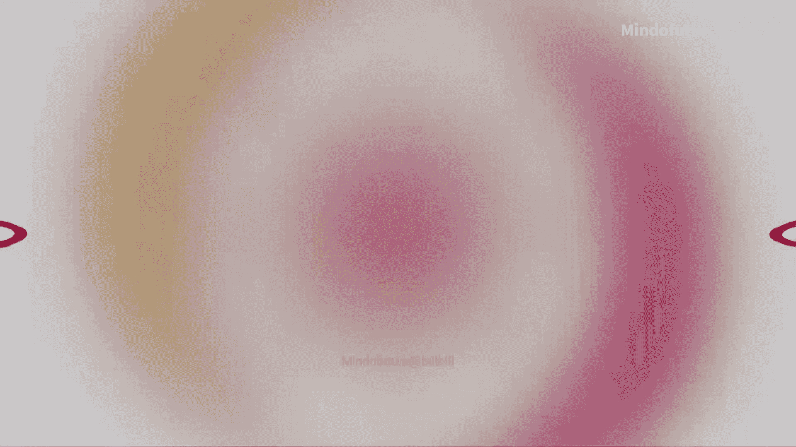
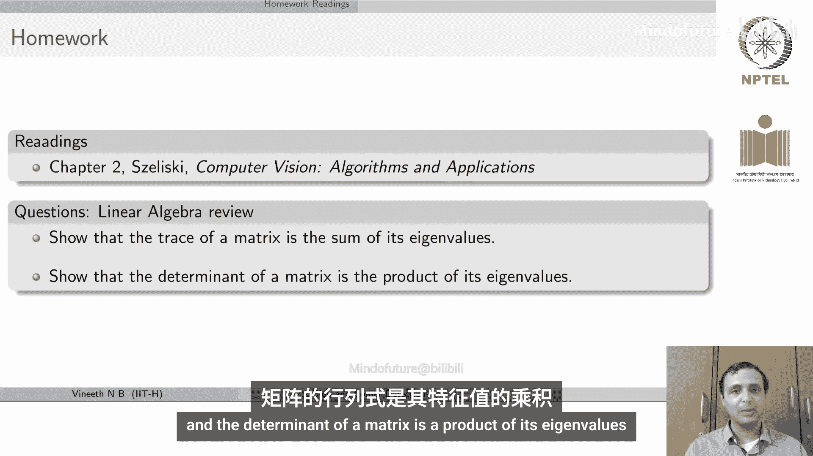

# 【NPTEL】计算机视觉的深度学习 p09 P09_从边缘到斑点和角点 -BV1vNWkzpEua_p9-

Last class。We spoke about edge detection and went into details of the canny edge detector。

And this lecture， we move a little forward and talk about other kinds of artifacts from images that are practically useful specifically。

Blobs and corners。Before we go there。We did leave one question for you at the end of the last lecture。

Hope you spend some time。Working out the solution yourself， if not。

 well briefly discuss the outline right now and wait for you to work out the details yourself。

So we talked about trying to use canny edges to get straight lines in images。How do you do this？

You first compute canny edges。In。In your image， which means you would compute your gradients in the x direction and the y direction。

 and you could also compute your thetas， which are your。Ans of each of your edges。

 which is given by tanninverse of gradient with respect to y divided by gradient with respect to x。

Now as the next step what we do is assign each edge to one of eight directions，8 is just a number。

 you could choose anything else but you assign each edge to one of eight directions so we probably combine several edges into a single bin and for each of these eight directions let's call one of those directions to a D。

We obtain what are known as edge lengths。And what are edgelets edgelets are connected components for edge pixels with directions in d minus1 d and d plus 1 so for a given so you have eight possible directions that you bin all your edge orientations into and you take one of them and connect them with edges with。

Orientation d minus1 and d plus1， so you get a set of what are known is。Eettes。

Once you compute your edge list。We then compute two quantities。

Straightness and orientation of the edgelets。And the way we go about doing this is。

Using the eigenvectors and eigenvalues of the second moment matrix of the edge pixels。

So what we do here is you have your edge pixels that belong to a particular edgelet。

So you take all of those pixels and compute such a matrix you know what the matrix is given by so if you look at the first entry here。

 the first entry here corresponds to x minus mu x mu x is the mean x dimension。

Of all of those pixels in the edge light and each x corresponds to one of those。

X coordinates of one of those edgelet pixels so you're simply computing in some sense a sense of variance with respect to the mean edge pixel along the x direction。

 Similarlyly you have a variance of the along the y direction of those edge pixels with respect to their means and you also find the covariance with respect to。

X and Y directions。So once you have this。Very similar to how principal component analysis happens。

We take the eigenvectors and eigenvalues of this second moment matrix and remember the eigenvector and eigen the eigenvector corresponding to the largest eigenvalue will give you the direction of the maximum variance among these pixels and that's what we are looking for at this time。

So we finally decide that the orientation of the edgelet is going to be given by tanverse of v1 by v0 where v1 is the larger eigenvector by larger。

 we mean the eigenvector corresponding to the larger eigenvalue remember here that m is a2 cross2 matrix。

 which means you will only have two eigenvalues at maximum。

And you're going to take the eigenvector corresponding those to the larger eigenvalue and we call that to be v1 and v is the is the other eigenvector。

So if you take a tannonverse of these two vectors， that theta will give you the direction of that overall atlet。

So in case you are finding this difficult to understand。

 please go back and read principal component analysis and you'll be able to connect that to this particular idea。

And we define straightness。To be lambda2 by lambda 1 where lambda 2 is the second largest eigenvalue and lambda 1 is the largest eigenvalue。

 so the straightness here is going to be the highest value when both the lambda 2s and lambda 1s are。

A are equal close to close to equal and once you get this quantity you just threshold the straightenness appropriately and store your line signals so it really doesn't matter whether you measure straightness as lambda 2 by lambda 1 or lambda 1 by lambda 2 you just have to ensure that you construct your threshold appropriately if you invert the straightenness ratio you just have to ensure that you threshold at a appropriate value and then。

Obtain your line segments。So here is a visual example so you can see that after applying canny you get all these edges on the left so you do get lots of edges which are fairly well connected not too noisy but not all of them correspond to straight lines many of them correspond to edges that represent the say the texture of the floor and so on and so forth but we really don't want what that when we model let's say there is an application where we really don't want it so then you use this kind of an approach to obtain which is the straight lines from your canny edges。

think more about this and you can I think knowing more about PCA could help you understand this a bit better。

Moving forward， as we said， the focus is going to be going from edges to newer artifacts such is blobs and corners。

So remember last lecture we talked about taking the lapla of Gaussian and we said。

That taking the zero crossings of the laplaian of Gaussians could give you a measure of edges in an image that was another way you could obtain edges in an image。

They are going to talk about it slightly differently now。

 so once again just to recap remember this is your Gaussian。

 this is your derivative of the Gaussian and this is your lapplian of your Gaussian where the lapplian we define as。

Grd squared f is equal to do square f by do x squared plus do square y by do x do y squared。Now。

 let's say an example of a three cross3 lapplaceian of Gaussian filter is going to look somewhat like this。

Where you have a minus4 in the center and 11，11 in its nearest neighbors and 00。

00 in its next level of nearest neighbors。But。Can you try to guess？

Why this is a relevant lapplene of Gaussian filter。

One point to notice here is an equivalent lapplaceian of Gaussian filter could also have been 0000 minus1 minus1 minus1 minus1 and4 so if you actually visualize this filter you would see that at the center there is a peak at it immediate nearest neighbors there is a minus1 there is a value that goes below underneath your zero and then there are zeros in other places so if you try to visualize this filter would be very very similar to the shape of the lapplaceian Gaussian that we just saw on the earlier slide but thats from the geo or a conceptual perspective why did we say4 why not8 why not any other number。

Once again is it goes back to approximating the gradients in some manner and we can work this out to show you how this works out so remember we are computing second derivatives here。

So do square f by doic squared can be writtenized。In approximating using first principles。

 you can say it's f of x plus 1 y plus f of x minus 1 y minus 2 f of x y。Similarly。

 you can write it out for those who are F by Dubai square。Now。

 if you try to put both of these into your lapplaceine of Gaussian equation or your lapplaceian equation in this particular case。

You would then have gra squared f is equal to。F of x plus 1 y plus f of x minus 1 y plus f of x。

 y plus 1 plus f of x， y minus1 minus4 times x y。This should straight away ring a bell for you as to why you got this kind of a filter remember at F of x y。

 the coefficient is minus4。At its neighbors x plus 1， x minus1， and similarly y plus 1 y minus1。

 the coefficient is1。So the simply came from。Taking an approximation of the gradient， remember。

 you could have other kinds of approximations of the gradient with respect to the local neighborhood you could consider。

A larger windows， one and so forth， if you do that。

 obviously the definition of the lapplian of Gaussian filter would have to be appropriately modified。

Here is another visual illustration here is the original image here is simply taking the lapplian and here is the result if you take the lapplian of Gaussian。

 remember again that lapplian of Gaussian gives you the smoothing effect which smoothens out the noise and then takes the lapplian of your original image once again remember the page is taking a filter and convolving the filter by moving it around at every point in the image and getting your output。

Now let's ask the question， so this is something that we partially saw the last thing。

So what else can Lalaino Gaussian do？Do you have ideas？

The other thing laplaian of Gaussian can do is detect blobs Why remember that a laplaian of Gaussian filter looks somewhat like this remember you could write the laplaian this way or the other way it really doesn't matter right so at the end of the day for edge detection and similar detection of other artifacts we only take the absolute value whether the output is negative or positive。

 we just take the absolute value so that would change if you had a white circle with a black hole or a black circle with a white hole we ideally do not care both of them are blobs to us and we ideally want to recognize blobs in both these cases so you could write your lapplaceian of Gaussian this way or another way where your central peak goes up on top so and the other part comes below this is similar to writing the lapplaceian of Gaussian with a minus-4 in the center and 11。

1 around or four in the center and-1 minus-1 minus-1 around。

So now if you try to visualize this as an image， so if you took a lapazine of Gaussian filter。

3 by three may be too small let's say you expand it take a larger neighborhood。

 let's say you take a7 by7 lapian of Gassian filter or 11 by 11 lapla of Gasian filter you would find that the lapplian of Gaussian filter just the filter itself remember that's also a matrix that also can be visualized as an image would look something like this。

A black blot in the middle， a white ring， which is where you have a peak and gray all all the way in other places。

You could also have an invert of this where you have white in the middle。

 a black ring and then gray all over both of these are。

Similar and by looking at the filter you can say that it's likely to detect bs in some sense con the filter can be viewed as comparing a little picture of what you want to find against all local regions in the image。

So there is a slight nuance， which is different。This does look a bit similar to template matching for which you use cross correlation。

 but in convolution you would double flip the filter and search for that across the image。

 but when your filter is symmetric it really does not matter。

Both cross correlation and convolution will be looking for the same filter。

So once once you have a lapplian of Gasian like this you can probably count sunflowers in a field or you can probably detect red blood cells in your blood test。

 any any structure with blobs across an image， clearly in this image with sunflowers there are blobs of different sizes so you would have to run a lapplin of Gaussian with different with different blob sizes to be able to capture all of those blobs in the image。

Let's now move forward to the next artifact which is very useful to extract from images for a large part extracting corners from an image was a very very important area of research in computer vision in the late 90s and early 200s probably entire 90s and early 200s so well try to describe one popular method today and let's start by asking the question suppose。

We had an image such as this。What would be interesting features that set apart this image from any other image。

 remember that if we want to do any processing， we want to be able to extract some unique elements of the image。

So what are those unique elements in this image？And you're going to say that those are going to be your corners。

 but let's try to go there。We ideally want to look for images， image regions that are unusual。

 something that sets apart that image， some that region in the image from other images。

If you have a region that is text is， for example， the blue sky。

 then that could be common across several images and it may not really be unique to that particular image。

 you may not be able to localize that region in any other image the same with a similar content。

You're ideally looking for patches with large contrast changes。

 large gradients like edges are a good example， but we will talk about why edges may not be the right artifact in a moment。

But we are either looking for some patches or some regions in the image。

 which have large contrast changes such as gradients。

But the problem with edges is edges suffer from what is known as the aperture problem。

what of problem we will just see a visual illustration on the next slide。

 but there while edges are good unique aspects of a particular image。

 they do suffer from a problem which we talk about the next slide。So。

 what we ideally are looking for are regions of the image or what were going to call corners where gradients in at least two different directions are significant。

So remember an edge。Is an artifact where you have a significant gradient in one direction。

which is going to be normal to that edge， it could be whatever direction the edge may the normal direction to that edge is going to be the orientation of that of that edge。

 but we are saying we want those points where there could be significant gradient in two directions。

What does that mean？In once。Let's take a tangible example。

 let's assume that there is an artifact such as this， this looks like some inverted V， let's say。

And we have this such an artifact and we want to find out which part of this image。

 let's assume this is the full image ignore the blue box， the blue box is for explaining it to you。

 just consider the image with just this inverted V。

We want to find out now which aspect of the image is unique to it， which can help us recognize it。

 say other times or if you view the image from other angles。

So if you consider this blue box placed here， you see that that's a flat textist region。

There' is no change in intensity in that region， so it's not going to be very useful。

 it's like the blue sky with absolutely no change， it's not going to be very useful when you try to compare this image with other images。

So if you now place the blue box on the edge part of the image。This is good。

 there is some artifactefact that's useful。But the problem is， if you move thispat here。Or here。

It would all have the same response。You would never know whether you placed your box here or here。

Or here， because all of them would have exactly the same response。

There's no difference in the local characteristics in all of these places。

So which means while edges are useful， there is something that they are lacking。

 so which means if you try to match or let's say you take a panoramic photo in your phone and you try to align to images。

 you may not know which part of the edge to align at。

We are ideally looking for placing the box at that kind of a point where there is change in two directions。

And that point could be unique to this particular image or and ideally we're looking for many such points in an image。

 but such points are the kind of points that we want to detect in an image。

How do we find such points in an image we know how to do edges now。

 but let's try to go one level further to try to see how do you find such partnerss in an image？

To do that， were going to define a quantity called autocor。As the name states， it's autocor。

 its correlation with itself。So if you're not going to use any external filter。

 you're going to take a patch image and see how it correlates with itself。What does that mean。

 Let's try to quantify that。 So we're going to define the autocor function as。

You take a patch in the image。And you compute the sum of squared differences between pixel intensities with small variations in the image patch position。

So if you had a point P in the image， let's say you place it at the center。

 that's what is going to be。PI， and if you now have。

A small delta u which is going to be the difference you're going to move that patch by a certain delta U remember P and delta u are both 2 d coordinate so even delta u will probably have a delta U and a delta v for instance instance right there are going to be two dimensions there its a vector。

Which is going to be， so you take I of P， which is the image intensity at that point pi。

Then you move that point， pi plus delta u， you move it a little bit and you see what is the image intensity at that new location and you take the sum of squared differences for all points in that particular patch so if you take a square patch。

 take every point。YouMo it a bit， so move that entire box a bit。

And then you compute pairwise distances between the same locations in the original patch and the new patch and sum demo on up this is what we define as auto correlation。

About this function W of PI w of PI is a function that tells you how much you want to give weight for each particular point in that patch。

 maybe for the central pixel you want to give more weight for a pixel at the periphery of that square of that blue square that you have。

 you may want to weight it a little lesser。So you could have a fixed weight for all points in that square。

 or you could have a Gaussian which defines WFpi where you weight the central pixel mode and the pixel is at the periphery a little lesser。

We define this as auto correlation。Now let's try to see how do you compute autocorlation and then come back to how do you compute corners using this autocorlation？

So let's look at this more deeply， let's consider a Taylor series expansion of your。

I of P plus delta U remember pi plus delta u is about taking the patch which was centered at pi and moving it by a delta U and placing it at a slightly offset location in the same image。

From Taylor series expansion， you can write the as I of P plus grad of I at Pi deelta U。

Where gra of I at PI is the image gradient at that particular location， do I add P by dox。

Com up do I at P I by do1， we now how to compute the gradient right we've already seen that so far。

Now let's write out autocor， remember the definition of autocor that we wrote on the previous slide is this one where we said autocor is w of pi into I of P plus delta u minus I of P squared。

Now， we're going to replace。I I of P plus delta u with this Taylor series expansion。

 so plugging that in here， you're going to have w of P。

This first term here gets written as I of P plus。Delta I of P， Delta U。Minus I of P。

 So just to just to explain the notations here by Dlta of U。

 we mean a vector Delta of u and say delta of V。Because as we have taken out a summation here。

 we are simply writing it as one of those delta of use inside so anyway there' is going to be a summation for Delta v which will take care of the other component oftau。

Once you have this， you can see that I of PI and I of PI gets canceled and you're left with summation over X Y w of P into do y。

 do I of P， do U whole squared。And we're going to write that as a quantity。Delta U transpose。

A matrix a into delta u okay so remember that you have this delta u square you just split it into two parts where you have one part that comes here and one part that goes here and the rest of what you have w of P into do atpi you combine that into a matrix called a。

How would a look？A would look like something like this。

 remember a is going to be a combination of w into your do I do I。

 so which means a is going to look something like this w of Ucomma V you going have remember two componentss of the summation。

IX square， IX IY， Ix Iy， Iy square， those are going to be your gradients and that is going to be your a matrix。

So we took the definition， so we defined autocorlation in a particular manner where we said we take a patch。

 move it a bit and see how the image properties change in that local region。

So we then took the definition of autocorlation， played with it a little bit。

 and then came up with an expansion which looks somewhat like this and we are now focusing on this matrix a。

So。This matrix a， so deelta u is simply the change that you imposed in the patch in the patch location。

 that's what you imposed。A is what is giving you how the gradients changed between those two patches and a w weighting factor that tells you how much you should weigh the center part of that patch versus the peripheral parts。

So since a is what defines the intensity change。We're going to consider an item decomposition of a。

 which is given by U。Lambda u transpose where lambda is going to be a diagonal matrix with lambda 1 and lambda 2 to two eigenvalues remember a is a two dimensional matrix。

 which means the maximum number of eigenvalues you can have is2。

Where a of a into Ui is equal to Lada Ui the standard eigen decomposition。Which is wonderful。

 so we once again started with autocorlation。Kim wrote it in a more different slightly different manner。

 and then now we have done an identityic composition of a。Where do we go from here？

How do we go from here to the to finding a corner？That's the question you're asking。

Think about it for a moment。 How do you think you can go from the eigenvalues of a？

To a position of a corner。Wedy。Similar to the discussion that we had at the early part of the lecture。

When both Lambda 1 and Lada2 are large。You know that。

The intensity changes in both directions at those points。

When either lambda 2 is greater than lambda much greater than lambda 1 or Lambda 1 is much greater than Lambda 2。

 it is going to be an edge because it is going to be changed only along one direction and if both Lambda 1 and Lada 2 are small you are going to say it's a flag or deur this region。

So which means we know that from the eigen decomposition of a。

 all what we are looking for is both the eigenvalues to be high and we know weve probably hit a corner。

So let's see how you actually do this inference so just another way of looking at it is so wherever there is a vertical edge or the horizontal edge youre going to have either Lada 1 greater than Lada 2 or Lada 2 greater than Lada 1 at a corner you're going to have both Lada 1 and Lada 2 to be large and in a flat region you're going to have both Lada 1 and Lada 2 to be very small。

So what do we do with this so the way we able to compute your corner this was a method given by a person called Harris and that's why it's known as the Harris corner detector it's a very popular detector that was used for several several years of course there have been lots of improvements in better methods that people have developed but this was one of the earliest corner detectors that was developed and was used for many years so the entire procedure follows something like this。

You compute gradients at each point in the image。Using that you compute your a matrix。

 you can use a weighting function， or if you don't use a weighting function。

 you just assume that youre going to consider all of them to be equal all of the patch position positions of that patch to be equal。

Then we ideal want to compute your eigenvalues and decide your coness based to the eigenvalue。

Because eigen decomposition by itself can be a costly process。

We try to do a slight slight deviation to be able to compute a coness measure so we are going to define a cornerous measure as lambda 1 into lambda 2 minus kappa times lambda 1 plus lambda 2 squared I let you work this out to show that when this entire quantities is high。

 you will know that both those lambda ones and lambda 2s are high。Work this out for yourself。

 try out different Lada ones and Lada2s and you'll see what I'm saying。

But what is interesting here is lambda 1 and Lada 2 is nothing but the determinant of a and Lada 1 plus lambda 2 is nothing but the trace of a。

Which means we can define our colonness measure as determinant of a minus some constant kappa times three square of a ka is just a constant that you have to define to get what you want to get for different images you may have to set kappa differently。

Why is this useful， you no more need to compute the eigen decomposition of a matrix。

 you only need to compute your determinant and trace which is a bit easier in computing your eigen decomposition。

Finally。You then take all points in their image whose columnness measure is greater than the threshold so you can take。

Lots of different points， probably all points compute their corners using autocorlation and then whichever is greater than a particular threshold you actually call them corners。

You can finally also perform non maximum suppression where if you find that there are many corners in a very small local neighborhood。

 you pick the one with the highest cornerous measure。

That's your non maximum suppression that we also talked about in the canny edge detector。

So this non maximum suppression will keep coming back to us at various stages in this course in various use cases。

So here is a visual illustration of the Harris corner detector。

So let's consider two images of the same object taken from different angles。

 the objects are at different forces and the illumination is also different。

Let's try to run the Harris corner detector ideally what we want is that in both these images。

 the same parts for the same corners in the doll get picked。

Why is that relevant once again if I take the example of say stitching different images in your cell phone。

 a panoramic mode or something like that we want the same points in both those objects to be located so that they can be matched and probably stitched together to get a panoramic image just as an example of an application let's see it now so here is the step of computing the cononness where you do autocorlation get your conous values。

And then you take all the high responses by using a threshold。You do non maximum suppression。

 that's why you see many of those points in the regions， you just take the most。Highest the u。

 the highest conous value， you do the nonm suppression and now you get a bunch of different points and now let's try to visualize them on the image and you can actually see。

That。If you look at say these highlighted examples。

 you can see that although those are fairly differently tilted you can get similar corners in both of these regions so you can see many other regions too。

 obviously you get a few more corners which are not there in the second image but those can be overcome at the matching phase as youll see a bit later in this course。

The focus of this particular lecture is on colony， just detecting the colonists。

 how due to the matching between the two images， we'll come back to that a bit later。

While we saw one variant of the Harris corner detector here， which was which was it was。

Developed by Harrison Stevens in 88 where we use the determinant minus kappa or alpha times your trace that's what we used that's what we used here。

 there have been other improvisations of the same method where a researcher built tricks suggested that you can use lambmbda not minus alpha lambda 1 where lambmbda not is the。

First eigenvalue or the larger eigenvalue and Lada 1 is a second eigenvalue。

A researcher Brown and a team proposed determinant of a by trace of a instead of doing the determinant of a minus Lada al find to a trace square of a。

 we said cap on two slides ago that just doesn't matter resist a constant。

So you have determinant of a by trace of a， all of these could be different ways of playing around with the same quantities to get what you want。

 all of them effectively try to measure the cornerness using the eigenvalues of your a matrix which comes from autocorlation。

Let's ask a few questions about properties of the Harris corner detector before concluding this lecture。

 the first question we are going to ask is is the Harris corner detector scale imvariant what do we mean by scale？

Remember， scale is complementary to resolution， so if you have an object。はい。20。

Which is very small in image we call that smaller scale， or if it's large， we call that larger scale。

So you could have an artifact such as this curved line here。

in a particular image or you could also have this curved line on a larger canvas。

 maybe you just took one image from close up and another image farther out。

 but it's the same image it's the same object that's being taken。So in this particular case。

 if you observe in the second image， this point would be considered a corner by the Harris corner detector。

But in the first image， if you took the same size patch to do the autocorlation。

 you would find that all of these would get categorized as edges and none of them would get categorized as corners。

Which means the Harris corner detector need not necessarily be scale invariant。

How do you make it scale invari， we'll talk about that later。

What about rotation invariant is the highest con detected rotation invariant？

It happens that it would be rotational invari so whether you have。

This particular inverted V like this or whether you rotate it and have the inverted v like this in an image。

It this particular corner will have。High change in both directions in both cases and you would detect this corner both in this image as well as this image as long as there is no change in scale。

 you would detect the same corner on both images and Harriss corner director in this particular case would be rotation ingredientvariient。

What about other kinds of invariances， what about photometric change。

 what does a photometric change mean a photometric change is an is an a fine intensity change。

And a fine intensity change means that you take your intensity at every pixel in the image。

Sca intensity by value a and maybe translated by a value B imagine that in in remember that intensity is a value lying between 0 and to 55 or if you normalize it comes to between 0 and 1 you just multiply all of those values by a scalar say a it could be less than one if you like and also add a quantity B if you like we call that as a photometric change a fine intensity change。

So in this particular case， if you notice。For only the translation。

It really does not matter you would find the corner。

 whether you increase the intensity in all places by an amount or otherwise it would still find the corner。

But about the scaling part of the intensity change by multiplying it by an a。

 it depends on the threshold that you choose。If you had a particular curve。

 any function for that matter， and you had a certain threshold。

All these points which have a certain value， remember that the points closer to that would get suppressed due to nonmax suppression。

 so you only have the peak in all of these points， so those peaks would get detected。

 but if you know scale the curve there could be newer points that get added if you scale it up in a different way there could be newer points that get added so which means。

It's perhaps invariant to translation but not necessarily invariant to scaling the intensity a couple of slides back we spoke about invariant to scale with respect to size of the artifact itself now we are talking about scaling with respect to the intensity value hope you see that these are two different things in this case you could still have a curve which is small but now you brighten it or darken it in a different way and that's what we mean as。

And photometric change in this particular context。So the homework you going have is to go ahead and continue to read your chapter 2 of the Clikys book and just for since a lot of the concepts that we used in this lecture were based on eigenvalues。

 eigenvectors， just go ahead and brush up a linear algebra。

 try to show that the trace of a matrix is the sum of its eigenvalues and the determinant of a matrix as a product of its eigenvalues。

