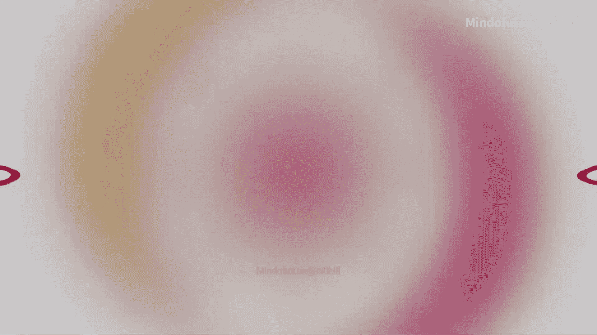
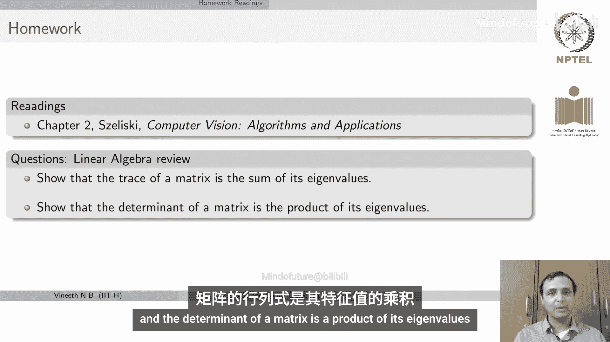

# 计算机视觉的深度学习：P09：从边缘到斑点和角点




在本节课中，我们将学习如何从图像中提取比边缘更复杂的特征，特别是**斑点**和**角点**。我们将探讨拉普拉斯高斯算子如何用于斑点检测，并深入介绍一种经典的角点检测方法——**哈里斯角点检测器**。

## 从边缘到直线

上一节我们介绍了边缘检测和Canny边缘检测器。本节中，我们来看看如何从Canny边缘中提取直线段。

以下是利用Canny边缘检测直线的基本步骤：

1.  **计算Canny边缘**：首先计算图像的梯度（Gx, Gy）和边缘方向（θ = arctan(Gy/Gx)）。
2.  **量化边缘方向**：将边缘方向量化为8个（或任意数量）方向区间。
3.  **生成边缘片段**：对于每个方向区间D，将方向在[D-1, D, D+1]区间内的连通边缘像素集合起来，形成一个“边缘片段”。
4.  **分析边缘片段**：对于每个边缘片段，计算其像素的第二矩矩阵（Second Moment Matrix）：
    ```
    M = Σ [ (x-μx)²   (x-μx)(y-μy)
           (x-μx)(y-μy)   (y-μy)² ]
    ```
    其中，(x, y)是片段内像素的坐标，(μx, μy)是这些坐标的均值。
5.  **计算直线度和方向**：对矩阵M进行特征值分解。最大的特征值对应的特征向量方向即为该片段的主方向（θ = arctan(v1/v0)）。**直线度**定义为第二大特征值与最大特征值的比值（λ2/λ1）。比值越接近1，说明片段越直。
6.  **阈值筛选**：对直线度设置阈值，保留高于阈值的片段作为检测到的直线。

通过这种方法，可以从杂乱的边缘图中筛选出有意义的直线结构。

## 拉普拉斯高斯与斑点检测

上一节我们介绍了利用拉普拉斯高斯（LoG）的零交叉进行边缘检测。本节中我们来看看LoG算子的另一个重要应用：**斑点检测**。

**拉普拉斯算子**定义为图像二阶导数的和：
```
∇²f = ∂²f/∂x² + ∂²f/∂y²
```
在实践中，我们常使用**拉普拉斯高斯（LoG）**，即先对图像进行高斯平滑，再应用拉普拉斯算子，以抑制噪声。

一个近似的3x3离散LoG滤波器核如下所示：
```
[ 0,  1,  0 ]
[ 1, -4,  1 ]
[ 0,  1,  0 ]
```
这个核的由来是对二阶导数进行离散近似（如`∂²f/∂x² ≈ f(x+1,y) + f(x-1,y) - 2f(x,y)`），并将x和y方向的近似相加得到。

LoG滤波器核本身具有一个中心暗（或亮）区域，周围环绕着一个亮（或暗）环的形状。这使它类似于一个“斑点”模板。因此，当LoG滤波器与图像中类似斑点的区域（如向日葵花盘、血细胞）卷积时，会产生强烈的响应。

为了检测不同尺寸的斑点，需要使用不同尺度（σ值）的LoG滤波器对图像进行处理。

## 角点检测的动机

边缘是图像中重要的特征，但它存在**孔径问题**：沿着边缘方向移动一个小窗口，窗口内的图像内容看起来几乎没有变化，这使得精确定位边缘上的某个特定点变得困难。

我们真正需要的是图像中那些在**至少两个正交方向上都有显著灰度变化**的点，这样的点被称为**角点**。角点具有更好的局部唯一性，对于图像匹配、全景拼接等任务至关重要。

## 哈里斯角点检测器

为了找到角点，我们需要一种方法来量化图像局部窗口在各个方向上的变化程度。哈里斯角点检测器使用**自相关函数**来实现这一点。

### 自相关函数

对于图像中点`p`的一个小窗口，将其移动一个小位移`(Δu, Δv)`，计算窗口内像素的加权平方差之和：
```
E(Δu, Δv) = Σ w(x,y) * [ I(x+Δu, y+Δv) - I(x,y) ]²
```
其中，`w(x,y)`是窗口函数（如高斯权重），`I(x,y)`是像素强度。

### 公式推导与简化

对`I(x+Δu, y+Δv)`进行一阶泰勒展开：
```
I(x+Δu, y+Δv) ≈ I(x,y) + [Ix, Iy] * [Δu, Δv]ᵀ
```
其中`Ix`和`Iy`分别是x和y方向的图像梯度。

将展开式代入自相关函数，经过推导和简化，可以得到如下近似表达式：
```
E(Δu, Δv) ≈ [Δu, Δv] * M * [Δu, Δv]ᵀ
```
其中，**结构张量M**（或自相关矩阵）为：
```
M = Σ w(x,y) * [ Ix²,   IxIy
                 IxIy,   Iy² ]
```

### 利用特征值判断角点

矩阵`M`揭示了该局部窗口的灰度变化特性。对`M`进行特征值分解（`M = U Λ Uᵀ`），得到两个特征值λ1和λ2（λ1 ≥ λ2）。它们代表了该区域两个主方向上的变化强度：

*   **λ1和λ2都小**：区域灰度平坦，无特征。
*   **λ1大，λ2小**：区域在一个方向变化显著，是**边缘**。
*   **λ1和λ2都大**：区域在两个方向变化都显著，是**角点**。

### 角点响应函数

直接计算特征值开销较大。哈里斯提出使用以下**角点响应函数R**：
```
R = det(M) - k * (trace(M))²
```
其中：
*   `det(M) = λ1 * λ2` （矩阵的行列式）
*   `trace(M) = λ1 + λ2` （矩阵的迹）
*   `k` 是一个经验常数，通常取0.04~0.06。

`R`的值：
*   在平坦区域很小。
*   在边缘区域为负值。
*   在角点区域为大的正值。

### 检测步骤

以下是哈里斯角点检测的完整步骤：

1.  计算图像每个像素在x和y方向的梯度（`Ix`, `Iy`）。
2.  计算每一点的梯度乘积（`Ix²`, `Iy²`, `IxIy`）。
3.  使用高斯窗口（权重`w(x,y)`）对`Ix²`, `Iy²`, `IxIy`进行加权求和，得到每个像素点的矩阵`M`。
4.  计算每个像素点的角点响应值`R`。
5.  设定一个阈值，筛选出`R`大于该阈值的点作为角点候选。
6.  在候选点上应用**非极大值抑制**，只保留局部邻域内`R`值最大的点作为最终角点。

### 哈里斯角点检测器的性质

*   **旋转不变性**：由于基于梯度，检测结果具有旋转不变性。
*   **尺度不变性**：不具备尺度不变性。物体尺度变化会影响检测结果。
*   **光度变化**：对光照的加法变化（平移）具有部分不变性；对乘法变化（缩放）的鲁棒性取决于阈值设置。

## 总结



本节课中我们一起学习了如何从图像中提取更高级的特征。我们首先回顾了如何从Canny边缘中提取直线段。接着，探讨了拉普拉斯高斯算子在**斑点检测**中的应用。最后，我们深入介绍了**哈里斯角点检测器**的原理，它通过分析图像局部窗口的自相关矩阵（结构张量）的特征值，来识别在多个方向上灰度变化显著的角点。角点是许多计算机视觉任务（如图像匹配、三维重建、目标跟踪）的基石。