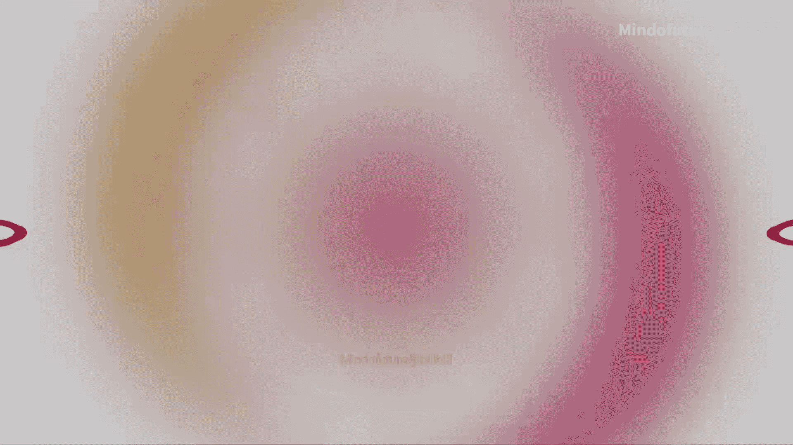
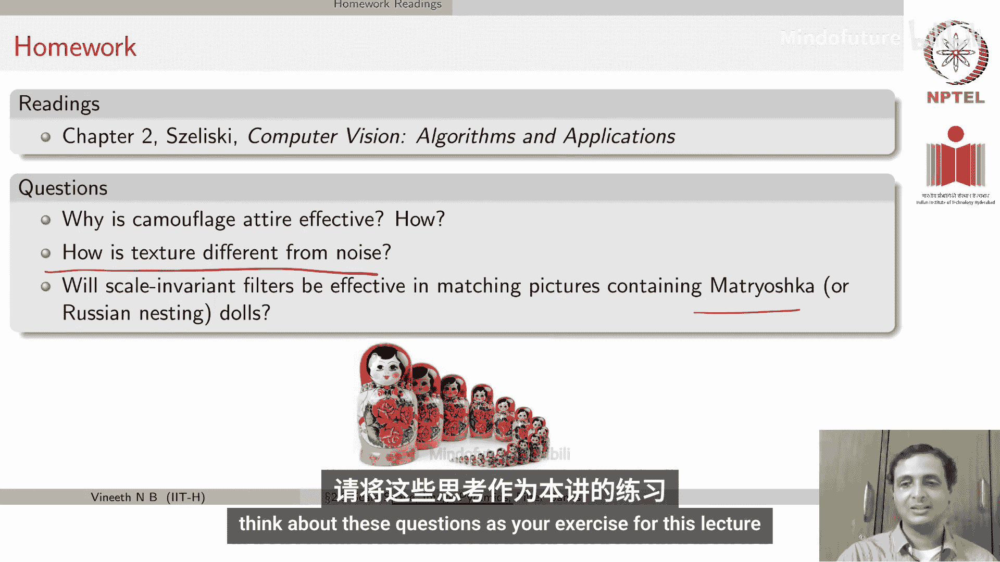

# 【NPTEL】计算机视觉的深度学习 p10 P10_尺度空间、图像金字塔和滤波器组 -BV1vNWkzpEua_p10-

Moving on from the last lecture。We get into scale space， image pyramids and filter bins in this one。

If you recall one of the limitations of the highest corner detector。

That we stated the last time was that it's not scale invariant。That is。

What would have been a corner in an image？Could have been an edge in another image。

 which is zoomed in。Let's try to quickly recall this before we move forward。Once again。

An application where you would want to detect key points or corners is when you have two different images or even more number of images。

 lets say we want to stitch these images together， this is typically called image mos or this panorama building。

So let's say we have these two images here which correspond to the same scene from two different locations。

We really do not know the camera of movement。Between these two images。

But we want to stitch these two images。How do we go about it？

We typically detect key points in each of these images independently。How do we do that？

An example would be the highest corner detector He run the highest corner detector on image1。

We run the Harris corner detector on image 2。And then we match which key point or set of key points in image one matches which set of key points in image two。

How we do the matching， we'll talk about it a little later in this course。

 but our focus now is on finding those key points。And one method that he spoke for finding those key points is the Harrisriscon detective。

We said that in the highest corner detector， we build something called the autocorlation matrix。

and then take an eigentacomposition of the autocorlation matrix and then we we said that when lambda 1 and lambda 2。

 which are the two eigenvalues of your autocorlation matrix a。Are small。

 then it means that the region is flat。 there's no change。

When one of the eigenvalues is much greater than the other。We say it's an edge。

And when both the eigenvalues are large， it corresponds that that particular patch has a lot of changes in multiple directions and we call such a point a corner and that's for our methodology for coming up with the Harris corner detector。

But some observations that we made towards the end。

Is that the Harris corner detector is the rotation invariant。

But the Harris corner detector is not necessarily scale invariant。Which means？

What is a corner in one image？Need not be a con。In another image， which is zoomed in。

Where it could seem just like an edge。So， were ideal looking for。A setting where。

We can analyze both these image artifacts in different scales and be able to match them at the right scale。

 and that's the way we would make the highest k detector scale invariant。Before we go there。

Let's try to ask。How can we independently select interest points in each image such that the detections are repeatable across different scales。

 so which means？There are two images at different scales when we say scales they are zoomed in differently one of them is zoomed in a lot。

 one of them is say zoomed out we ideally want to be able to detect a key point in both these images remember that if you take the path size to be the same in both these cases in one of those images which is zoomed in a key point images look like an edge and you zoom in a lot。

How do we count this？A simple approach could be that we extract features at a variety of scales。

By using， say， multiple resolutions in a pyramid。And then we match features at the same level。

That could be one of the simplest things that we can do。Where do you think this will actually work？

If you thought carefully， you would find that as long as you match features at the same level。

The properties of the Harrisconner director will only be compared at the same scale。

But to be scale imvariient， we ideally need to compare the Harris cornerness measure。

Recall the hardest commonest measure。At a different scale in one image and the detect highest con is measured at a different scale in the next image。

So how do we do that？So what we try to do now is to extract features that are stable in both location and scale。

And we're going to try to describe how we're going to do that over the next few minutes。

So if you have two images。Notice again that we have two images now which definitely differ in scale in one of them this inside artifact these are paintings in one of them is inside artifact is quite small and then we are zooming into that artifact on the right image。

We now ideally want to find a corner which is indicated by the yellow cross there。

We want to find the same corner in both these images irrespective of these scale differences。

How do we go ahead and do that right so we want to find the function F， which gives you。

A maximum at both x and sigma where sigma is denoted as the scale of the image in this context。

And the way we want to do go about doing it is。B。Compute your scale signature in this case。

 it could be the highest con as measure at that particular point for a particular scale。

And let's say that particular point has a particular Harriscon as measure。

 which is plotted on the graph。We then change the scale in our case。

 a simple way to change the scale is simply to take a larger。Patch for your autocorition window。

So if you take a larger patch for your autocorrelation window and now take your Harris cononness measure you are going to take you are going to get a slightly different value for the Harris cononness measure so remember in the x axis we are measuring scale so weve changed the scale which is the size of your autocorrelation window and we now get a different cononness measure。

And you do this for different scales， which means you again take a different path size。

 compute the colonous measure for that path size。 remember again that from our definition of our Harris colononous measure。

 the autocor。Ma would change if the size of your patch changes。

 remember again that we did a summation over all the pixels and that will change now when the size of your patch changes。

So we do this work。More skillss。More scales and you see that you would get such a graph and you do this for multiple scales。

So the takeaway from this graph is that we seem to get be getting the maximum coous measure or the maximum coronous response at a particular scale。

 which is going to be important to us。At that particular scale is when the coronist measure is the highest for that particular key point in that given image。

So how do we take this forward？We now take。Another image， so in this case。

 as I said that's the maximum， that's what we're showing in this particular slide。

Now we take another image， which is the one on the right。

 which is a zoomed in version and perhaps theres a slight rotation too of the first image and now we again at the first scale compute the colonist measure。

At the second scale， compute the currentist measure and we repeat this process for all the different scales that we considered for the first image。

And as we keep doing this， we are going to get another graph for the second image。

Where the peak now is at a different scale。The peak now is at a different scale。

 which is denoted by that particular value。So which means now we've made some progress we've been able to find。

What would be the cornness measure， the maximum coronness measure for a particular point both in location and scale。

 so location would be the coordinate of that center of that patch and scale would be the scale at which we got the maximum Coronness measure。

One question。That we ask ourselves now as， is there a better way to implement this？

And the answer to that。Is to use what are known as image pyramids。

Instead of changing your path size in each of your images。

 you fix your path size across any images you may encounter。

 but change your image size by doing a Gaussian， you mean。

Recall our discussion of Gaussian pyramid when we spoke about interpolation and frequencies。Remember。

 a Gaussian pyramid is constructed by taking an image。Goussianming the image。

 then subsampling the image and repeating this process again and again。

So we do the same thing now and keep the path size same and construct a Gaussian pyramid。

Keep in mind。That when you can start your Gossian impairment pyramid。

It need not always be reduced by half each time you can also reduce your sizes by。

 say three fourth or by any other fraction by using interpolation methods。

When we consider an image pyramid， there are。Several kinds of pyramids that you can construct and use in practice。

So the Gaussian pyramid is what we've seen before， which is what the top part of this diagram shows。

which is about taking the original image， let's call it G1。

 then you smooth the image and then downs sampleample it and then get a G2， then you again smooth G2。

 downs sampleample it， get a G3 and you keep repeating this process。

There is also another way of getting another kind of a pyramid called a lapplaceian pyramid。

Which is obtained by。You take G1， which is your original image once you get your G2。

 which is your smoothened and down sampleled image， you again upsample G2 and again smoothen it。Now。

 when you compute G1 minus G2， that gives you a quantity called L1。

The reason why we call L1 a lapplian pyramid is。Because。

A lapplaceian can be written as a difference of two Gaussians。

Why so let's try to see it a little illustratively at this time。

So recall the lapplian filter that we discussed in the last lecture。

 a lapplian filter could be drawn as something。Like this。哎。This was one way of drawing it。

 remember we could also have drawn it the other way。Where you have it as something like this。

So both are lapplace impairments， depending on whether your central value is negative or positive。

If you see purely from a graph perspective， this is a 1 d lapplian。

 if you purely see from a graph perspective， such a lapplian can be written as the difference of one Gaussian。

 which is say wide。Let's call that Gaussian sayson cursive G1 and say another Gaussian which is narrow。

 let's call it Gaussian G2 when you subtract G2 from G1 you actually get a shape which is similar to the lastssian。

Clearly。You'll have to choose the variance for G1 and G2 appropriately to get the kind of laplaian that you're looking for。

And because in this particular example， G1 minus the smooth up sampleamp version of G2 turns out to be a difference of Gaussians。

It effectively will turn out to be some kind of a lapplian， which is why we call it a lapplian。

And you can repeat the lapplaceene for every successive。

Lower resolution representation in your gausian impairmentyraid and get multiple。

L2s and L3 so on and so forth to get also get a laplastian pyramid for different applications。

 you may want to use a Gaussian pyramid or a lapplian pyramid。

 but where do you use image pyramids in practice？In multiple applications。

 you could use it for compression。Because you may want to just transmit a low resolution version of the original image and send some other information through other means and be able to reconstruct a higher resolution from the low resolution image。

You could use。And which permit for object detection。How and why。

You could use it by doing a scale search。And then doing some features。

 what we mean here is you could look for an object firstly in a low resolution part of the pyramid。

And once you find the region of the image， where do you get？呃The object。

Then you go into the next higher resolution， search in that region a bit more carefully。

 find where the object is， and then you can keep repeating this in higher resolutions。

You can also use an image pyramid for stable interestest points。

 which is what we have been discussing so far。Another application of image pyramids could be registration。

In registration。Is the process of aligning key points from two different images？

How do you use image pyramids in registration？You can do what is known as Co to find image registration。

Where you start by constructing a pyramid for each image that you have。

 so you have a coursearse level， a medium level and a fine level。

And you first compute this Gaussian pyramid。And then align features at the course pyramid level。

 just at this level to start with。The start with。Once you do that。

 you then continue continue successively aligning with finer pyramids by only searching smaller ranges for that finalr match。

Moving on from image pyramids， we'll go to the third topic that we are covering in this lecture。

 which is the notion of textures， which is closely connected and built upon the other concepts that we are covering now。

What are textures to start with？Nextextures。Are regular are or stochastic patterns that are caused by bumps。

 grooves and or markings， the way we literally call it。Texecttures。

So if these textures give us some information about the spatial arrangement of colors or intensities in an image on the right side。

 you see that textures can give you an an idea of materials textures can give you an idea of the orientation textures can also give you an idea of the scale that you're dealing with so textures contain significant information to be able to make higher level decisions。

Or predictions from images。It's also important to keep in mind that even if you had a single image。

Let's say you obtained a high level statistic， such as。

The histogram of an image contains 50% white pixels and 50% black pixels。In this scenario。

 we could have images of multiple kinds， three samples are what you see on the slide。

 you could have the image to be something like this。

You could have the image to be something like this。

Or you could have the image to be something like this。In all these three cases。

The histogram contains 50% white and 50% black。The textures are vastly different。

So it's not only important to get global statistics。

It's also important to get local texture information to be able to understand what is in images。

So how do we actually represent textures？Let me let you think for a moment。So far。

 we have seen edges。We have seen corners。We have seen corners at different scales。

How do we represent textures？The answer is you put together whatever you've seen so far and how do we put them together？

We compute responses of blobs and edges at different orientations and scales。

And that is one way of getting textures， so the way we process an image is we record simple statistics such as mean and standard deviation of absolute filtered responses。

Often， image。And then we could take the vectors of filter responses at each pixel。

And cluster them to be able to represent your textures， there are multiple ways of doing this。

 but that could be the general process of capturing the textures and images we will see a couple of examples of how texture can be captured in an image。

A simple way to do this is by what are known as filter banks。Filter banks are as the word says。

 a bank of filters， we are not going to use just a sobel filter or a Harriscon detector。

or is the Laplian to compute blobs， you are going to use a set of different filters。

 a bank of different filters and what do each of these filters do each of these filters can be viewed as what are known as band pass filters。

This goes back to our discussion on extracting low frequency components and high frequency components in images。

Band pass filters are filters that allow a certain band of frequencies to pass through and get as output when you involve a filter with the image。

So remember we have seen examples of filters that have that extract high frequency components edge detection。

 we can also do the opposite to get low frequency components by doing gaussian smooth。

At this point by band pass filters， we are saying that we want only certain set of frequencies to pass through。

And we could use a bank of such filters to be able to separate the input signal into multiple components。

 each one carrying a certain subband of your original signal in the image and that。

Can be used to represent the texture in very much。Here is a visual illustration。

 so you process an image with different filters， so you see here eight different filters that you can come up with。

This is your input image。 So you convolve each filter on。The image with the image。

 and these are responses that you get。Then you convol each of those filters with the input image。

As you can see。Each of these outputs capture different aspects of the texture or the content in that butterfly。

 and they all put together give you a sense of what is the texture in the image。

We will talk about a more concrete example， which are known as Geor filters。

Gab filters are a very popular set of band pass filters。At a certain level。

 they are known to mimic or mimic how the human visual system works。

 but they allow a certain band of frequencies and reject the others。

The way Gipo filters work is intuitiveably， they can be seen as a combination of a Gassim filter and a sinusoidal filter。

So here is an example of a sinusoidal filter。of a certain orientation here is an example of a Gaussian filter if you convolve a Gaussian filter and a sinusso filter。

 you would get something like this。The imagine superimposing your sinusoid on your Gaussian。

 you would get something like this。Mathematically speaking， a 2D GiO filter can be written as。

You have an xy， you have a lambda theta si sigma and gamma。

 we' will talk about each of them in a moment and it' is given by inverse exponent of minus x prime square plus gamma square y prime square by 2 sigma square。

E over I I represents your complex number 2 pi x prime by lambda plussi you talk about each of those quantities。

 we are not going to derive this in this particular course that may be outside the scope。

But in this particular formula x prime is x cos theta plus y cos theta we' will talk about what theta is theta is the orientation of the normal to the parallel stripes of the gior we saw that the sinusoid could be oriented in a particular direction and that is given by theta so x prime is x cos theta plus y sine theta y prime is minus x sine theta plus y co theta。

Lambda is the wavelength of your sinusoidal component remember your sinusoid has a wavelength and a frequency。

So your Lada wavelength psi is the phase offset of your sinusoidal function。

 once again recall our discussion on image frequencies earlier。

Sigma is the standard deviation of your Gaussian envelope。

And gamma is a spatial aspect ratio and specifies the electricity of the support of your Geba function。

 so you want to elongate it。All of them can be controlled in this particular context you can have instead of having a circular Gaussian。

 you can use the camerama parameter to be able to control the elliptical nature of your Gibo response function。

So this is a 2D Giabt filter as you can see it gives you an idea of certain textures so here is a filter bank of Gibo filters so this has 16 Giabt filters at an orientation of 11。

25 which means if your first filter has an orientation of 0 your next filter will be 11。25。

The next filter would be 22。5 so on and so forth， and you can see the GeBbo filter being rotated。

And you now have an entire bank of Giba filters。You can know。Take an image。

And convul each of these filters with the image and you will get。

16 different responses of the image to these 16 different filters。As you can see here。

Each of these responses capture a certain aspect of your original image。In case of a circle。

 this simply seems to highlight a different perspective to the circle。

 but when you have more complex textures， each of these responses captures a certain dimension of that texture。

Ptting these together gives us an overall response of the image to different set of orientation and frequencies。

There has also been another popular set of filter banks called steerable filter banks steerable filters are a class of oriented filters that can be expressed as a linear combination of a set of basis filters。

 for example。If you have an isotropic Gaussian filter， e of minus x square plus y square。

 you can define a scable filter as。You have G1 cos theta。Plus， G190 sine theta。Where。

G1 theta is the first derivative of G。At a certain angle theta。For example。

 if you have an original image。You can now consider G1 along the y axis to be the derivative at a particular angle。

You can consider G1 of 15 degrees to be the derivative at a different angle and so on and so forth。

So now you can construct combinations of these two of these different。

Images to construct an overall response that you that you have so each of them is a steerable filter where you can control the angle at which you are getting your response So this is another Giard filter banks was one example that could be used to extract textures from images Stable filter banks are another example that could be used to extract textures from。

Here is an example， another illustration of steerable filter blanks， where you can take。

Say a band pass filter。B0 as you can see this band pass filter allows a certain set of frequencies to pass through another band pass filter B1 B2 so on and so forth。

 you can have a low pass filter so on and so forth。

 Now you can combine the responses of an image to all these kinds of filters and store some statistics at each pixel So remember you can get a value at each pixel you can store the mean and standard deviation you can cluster。

 you can do various things with those values that you get at each pixel across the filter bank responses to the filter banks and be able to get。

ARepresentation for your text。That concludes this lecture。

Please do continue to read chapter2 in Celsky's book。

Some interesting questions for you to take away now， which we may not really answer。

 but it's something for you to think about is。From the discussions we've had in this lecture。

Why is a camouflaged attire effective？Think about it。Obviously it connects to our lecture。

 so think carefully on what we discussed and how you can extend it to understanding how a camouflaged attire works。

Another question to ask here is how is texture？Different from say a salt and pepper noise a salt and pepper noise could also look like a texture。

 so how is a texture different from a salt and pepper noise something for you to think about and read to understand。

And a last question is will scale invariant filters be effective in matching pictures containing thematoriosshka's dolls。

 or I think we also have equis in India nesting dolls？

Can scale andvari filters be able to match pictures across these walls？

Think about these questions as your exercise for。This lecture。

