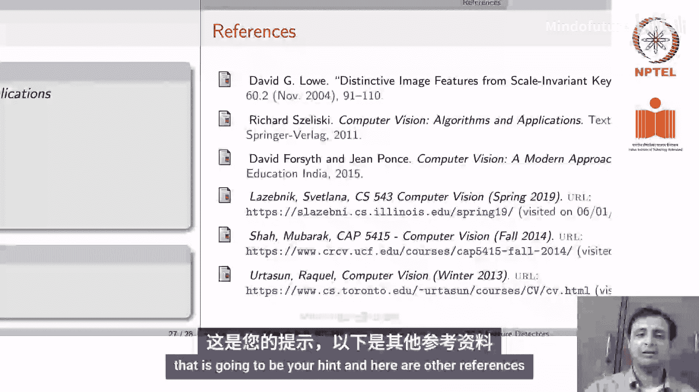

# 【NPTEL】计算机视觉的深度学习 p11 P11_特征检测器 - SIFT及其变体 -BV1vNWkzpEua_p11-

Last lecture。We saw。F the bankss。Image the image。And also a scale invariant Harriscon detector。

Well now move on to。One of the most significant feature detectors that have been developed in computer vision known as the scale invariant feature transform or Saft。

SF was developed by a person David Low from University of British Columbia。

 it was developed way back in the late 90s， but by the time it was formally published。

 it was close to 2004。To this date， it has over， I think 56，000 or 57，000 citations。

That speaks of the impact that it has had on the community over the last decade and a half。

The main objective of sift。Is to transform image data。Into scale invariant key point coordinates。

 so once again， very similar to Harris corner detector。Our goal is to extract key points from images。

But we're going to go one step further now。In addition to detecting those key points in the images。

We also want to find an effective way of describing those key points。

A simple way of describing key points that we've seen so far is Xcoma Y。

 which is the coordinate location of that key point。

 maybe you can add a scale just such as a sigma that we saw in the previous lecture。

But now with Sift， we' are going to talk about a full fledged feature descriptor that describes the local characteristics around that particular。

シフト。Is fundamental to many core vision problems and applications including recognition。

 motion tracking， multi view geometry， so on and so forth。For many years。

 until deep learning became popular， Sft was extensively used for simple object recognition in images。

As I just mentioned。In Si image content is transformed to local feature coordinates。

That are ideally invariant to translation， rotation， scale and shear， so for example， once again。

Two images of the same object taken from different angles， different poses。

 perhaps different illuminations， but we ideally want to ensure that the same key points are detected in both images irrespective of variations in translation。

 irrespective of variations in rotation， irrespective of changes in scale， as well as shear。

 shear is a perspective transformation。SF consists of four steps and we'll go through each of them individually。

But before we cover them。I should mention that Sift is an excellent engineering effort。Each step has。

A properper motivation as to why it was developed and what。Part of the objective， did it help。

 Si said。I will highly advise you to read the Sift paper just to understand how a beautiful engineering paper in computer vision has been written。

The first step in sift。Is to do what is known as scale space extreme detection。

 this is very similar to the scale variant scale invariant Harriscon detector。

 although there is a little bit more than that which Ill clarify in some time。

The second step is about key point localization。Once you have found a key point。

 can we try to find out exactly where is the key point。

 I mean is it maybe half a pixel a little further， so on and so forth？Could be in location。

 could be in scale2。どちて？Is to determine the orientation of that key point。

 there is a reason why we are going to try to determine the orientation of that key point。

We're going to try to use the local image gradients around that key point。To assign the orientation。

And we ideally want to preserve the orientation scale。And location for each feature。Finally。

 as I mentioned， we're going to talk about how do you describe those scheme？

Those key points in terms of local information about that key point once again we are going to use some information from the gradients。

 but we want to develop a representation for that key point。

 which is invariant to a lot of transformations。Why do we need a representation？

Remember that we said that if you want to match two images and stitch them together。

 we need to compare key points in first image to key points in the second image。

Having a representation allows you to compare otherwise you would not be able to compare just coordinate locations because they may be very different in the two images。

So the first step as I just said， is scale space extremere detection and the way Sift implements this is to firstly construct what is known as a scale space。

A scale space， as shown in the diagram here， is simply。Taking an image， convolving it with a Gassian。

That's one image， then convolving it with。K times sigma so you have another Gaussian with K times sigma that's another image。

 but the size of the image stays the same it may only be more blurry。Then you have。

A convolution with a Gassian with K square sigma once again the size of the image remains the same we are not subsampling at this time。

 simply making it more blurred depending on what you choose to be。

All these images form what is known as one octave。So you're going to have many such images in one octave depending on the values of k and how many images you wanted。

In the next step， you construct your second octave。

Where the ideal goal would be to subsample the image and then repeat the same process that you had for your first octave。

Instead of doing a subampling and repeating the same process。You can also do simply。

A Gaussian convolution with two sigma。Remember， that will make it wider so you can simply do a Garssian convolution with two sigma and that gives you a similar effect。

As constructing。A second octave of subsampled images remember when you take Gaussian2 sigma your spread is going to be wider of the Gaussian so you're going to blur out more pixels and probably consider more pixels that are further out which is what would have happened if you had subsampled and then down a Gasian with。

With sigma as the standard deviation。To be able to detect the extreer amongst these Gaussians。

We ideally want to use the idea of lapplaceians。Remember again。

 if you recall a lapplene as an edge detector。We said。That unlike an edge detector like Sobel。

 where you get high intensities wherever there is an edge。So a lapplian。

You get an edge whenever there is a zero crossing。Please go and go back and refresh your lecture on laplaian we said whenever the laplaian assumes a zero value and its surrounded by some intensities you can assume that there is an edge information there so we ideally want to use a laplaian to be able to obtain。

The information of corners and edges in the image。But remember。

 we spoke about it last lecture that a lapplaceian can be implemented as a difference of Gaussians。

See which means？The all these Gaussians that you have in the first octave remember one of those images would have been G of sigma。

 one of them G of K sigma， G of K square sigma so on and so forth。

 those are the filters you would have ideally conveed your input image with each of those filters。

Now you simply take the difference between successive Gaussians。

On the images in the octave and you will get a set of difference of Gaussian images。

 which remembered is very similar to the lapplaceian of those original images。

So you construct these difference of Gaussian images in each octave separately。

Were going to write that as。D of x Y sigma is equal to i hat of x Y sigma minus I hat of x Y k sigma where I hat is the convolution of a Gaussian with the appropriate sigma with the original image。

Wch is writing mathematically whatever we describe so far。

Now to find the scale space exreer detection。What we're going to do is for。Every pixel。

 so let's say you take that crossed pixel。In the image on the right。

You take a three by three neighborhood around that point in its own image。

And then you take a three cross 3 neighborhood in the image on the next higher scale and a three cross 3 neighborhood at the same location in the next lower scale。

With this， you will have a set of total 27 pixels and nine pixels on the top on the higher scale。

 nine pixels on the bottom scale and nine pixels in the appropriate scale。

 including the pixel at the center。So you have all of these pixels given to you。

And what you do now is you compare a pixel with all of the 26 pixels in and around it。

So that's going to be around it in terms of location， spatial as well as around it in terms of scale。

 the next higher scale and the next lower scale。And then。You select a pixel。

With if it is larger or smaller then all of the 26 pixels around it。

 so you select both the minimum and the maximum of all of those 27 pixels in a spatial and scale neighborhood。

That's why we call this scale space extremereer detection。

 so we are trying to detect extreer in both scale。And space。That's your first step。So。

 we detect interesting points invariant to scale and orientation to a certain extent using DOg or difference of Gaussians。

 remember again， the difference of Gaussians is an approximation of a lapplaceian of Gaussian。

Just one clarification here。Last time we said the difference of Gaussian is an approximation of the Lalaian。

Corrected to lapplaceian of Gaussian， difference of Gaussian is an approximation to the lapplaceian of Gaussian。

The next step is key point localization。We ideally want to see if we have found the exact point where we have the extreme。

 the maximum and the minimum。To do this。We could look at。

This difference of Gaussian function B as any other function。

And if we knew that our detected extremeer were at these blue points。

 which are known as a detected exer here， we ideally want to find these red points where the minimum and the maximum is actually achieved。

So it means that minimum and maximum could be achieved in between two coordinate locations or in between。

Two scales that we considered。In the experiments so far。How do we find this。

 the way we find this is we are going to consider a Taylor series expansion。Given an sn。

 which is given by。X not y not sigma not。And then delta s。

 which is given by Dlta x delta y delta sigma， so s not is the minimum or maximum。

coordinateorinate and scale location scale and coordinate location that we already have found in the earlier step in step1。

 and deelta x， delta y and delta sigma is what we want to find to find out where the exact extreme is achieved。

So we write out your traditional Ter series expansion。whichch is given by B in our case。

 that's the difference of Gaussian output S not plus deta s。Is not equal to it is approximate。

Because we're not considering the higher order terms here。Approximately d of S0 plus。

The first derivative into delta s plus half delta is transpose second derivative delta s and higher orderal。

Now to find out where this exactly attains the minima。

 we ideally have to differentiate this steoc series expansion with respect to。

S or delta S in this particular case and solve for deelta S。So we say that our solution for dels。

 which we。Benot as S hat is going to be given by this is a simple derivative which is differentiate this with respect s the first terms derivative will go to 0 second derivative remember the gradient is evaluated at s not so that would be a constant with respect delta s so you would be left with if you differentiate this Taylor series expansion you will end up having。

Dodie by door De。No。The S。Plus。Those square be。By do is square delta S。Is equal to zero。

And when you solve for Delta S。The solution is what we do by S hat youre going to have do square d by dos square inverse do d by dos it comes from simple differentiation of。

Yourtail is expansion。So and how do we solve this？We can compute your second derivative and first derivative simply by finite differences remember you can take to compute the first derivative in both space and scale you can simply do finite differences with the next locations on the left next locations on the right or the higher locations on the scale and so on and so forth simple finite differences the way we talked about computing gradients with respect to edges exactly the same way this can be computed and we can solve for。

Delta S， which gives us delta x， delta y delta sigma， where the actual exreer is achieved。

 so now we exactly know where the extre is achieved。So this could help us localize better。

Once we do this， we also do one more step。We also want to now remove all points which have low contrast。

And all points， which are edge points because of their edge points。

 they are not useful corners as we already talked about it last lecture。

How do we remove low contrast points？We remove low contrast points by。

Simply saying that if B at S hat， which is that new location is smaller than a certain value 0。03。

If that value is small， you are going to say that it has the difference of Gaussian output there is very small。

 assuming of course that your image values have been normalized in a certain range。

 you are going to say that the value is too small and we can actually reject it and not consider those points for future processing。

How do you remove？Edge points though。The should ring a bell using a very similar approach like the highest con。

However， David Low in Sift takes a slightly different approach and uses a hessian of your D。

 which is your difference of glosssian output again instead of using an autocorre。

So there have been other people who have also extended the hard corner detector to use corners based on the hessian Sift uses that kind of an approach where the hessian of D。

 which can also be looked at as the curvatures。The hesian effectively second derivative effectively captures the curvas。

 so the hesian， which is your pairwise second derivative matrix。

Gives you an idea of curvatures in different directions or the changes in different sharp changes in different directions。

 so the eigenvalues of the Hessian are also good estimates to understand corners。

So very similar to the Harriscon detector。CF proposes using the HessN。

Computing its largest and smaller eigenvalue， which are denoted by alpha and beta。

Then you once again compute your trace and determinant of your hessian matrix。

 very similar to how we did it for the Harris bond detector。And then we evaluate different。

Rss with respect to praise and determinant。So you could write your your trace is going to be alpha plus beta。

 your determinant is going to be alpha to beta， so your trace by trace square by determinant is going to be alpha plus beta whole square。

By alpha beta， which can be written as r beta plus beta by r beta square where r is written as。

So you got that where r is written as alpha by beta。Using this approach。

 the tray square by determinant can be written as r plus1 square by r。

And the final way we remove edges is by noting that this quantity now is going to be minimum when r is equal to 1 because when r is equal to 1。

 we know that alpha and beta are close to each other。Are equally high。

 which is what we want to find your corner points。So the Cif proposes that you reject the key point if trace of hessian square by determinant of h is greater than the threshold because you want it to be close to one。

 so if it' is greater than the threshold， you simply reject the key point。

The original sift paper uses r as equal to 10 in this particular case。

 the threshold to be 10 in this particular case。So at the end of the step two。

 we have determined the exact location and scale at every extreme point。

And we have also selected some of these key points based on stability by eliminating low contrast key points as well as edge points。

Now coming to the next step。Which is on estimating the orientation of these keys。

Let's first start by asking。Why do we really need the orientation？The answer is simple。

We want to help it。Get rotation in variance by getting a sense of orientation。

 and that would become clear when we describe how we are going to do it。

So we use the scale of the point to choose the correct image。

 remember now that every key point is denoted as x y sigma。

Where x and y are the coordinate locations and sigma is the scale at which it was found to be a key point very similar to the scale invariant Paris detector where the final。

Cornerous measure is highest at a particular scale here again a corner point or a key point is defined by x y and sigma。

 so you use the scale of the point to choose an appropriate Gaussian and you con that Gaussian with your input image to get an image called I hat。

Now you compute the gradient magnitude and orientation using a simple finite differences method。

For the i hat image， so you would have M of every point。

 which is your gradient magnitude at every point， which would be given by。

Simply your root of gradient in x direction square plus root of plus gradient in y direction square that is going to be a magnitude of the gradient。

 similarly your orientation of the gradient at that location is going to be tanverse of the y gradient by the x gradient。

Okay。At the end of this step， we would have a magnitude and an orientation for every point in your image。

 including the points that you have identified so far。Now， what do we do？

Now what we are going to do is you take a certain region around the key point。

 you're not going to rely only on the magnitude and orientation of the key point alone because we wanted to capture the local characteristics。

 not just the characteristics at the point。You take a region around the key point， a certain window。

 say four cross5 cross 5 window whatever that may be and you consider the orientations of all the points。

 the magnitudes and the orientations of all the points in the neighborhood around the key point。

And you construct a histogram out of the orientations of all of these points。

This histogram in the sift paper has 36 bins with 10 degrees per bit so you have an orientation angle depending on what the orientation angle is so if you had an orientation angle of 185 degrees you would put it in the 180 to 90 bit so every bin is 10 degrees and you have 360 degrees so you have 46 bins。

The shiftft paper also recommends a few heuristics to improve performance here to say that the histogram entries are weighted also by the gradient magnitude if the gradient magnitude is high。

That weight in the histogram in a particular bin is is increased and if the gradient magnitude slope。

 that weight in the bin for that point is reduced。And it also has a Gaussian function with sigma equal to 1。

5 times the scale of the key point， so if you are at a key point。

You place a Gaussian on top of the key point。And then you with a certain sigma。

 and then you look at and that sigma has given us 1。5 times the scale of the key point itself。

And then you look at if a particular point in the neighborhood that you are considering is farther away。

 then it contributes lesser to the histogram and if a certain point is closer to the key point。

 it contributes more to the histogram。These were some heuristics that we used to improve performance。

And once you construct this histogram after these heuristics。The peak。

 whichever bin had the highest number of votes in the orientation。

 is considered as the peak of that particular key point。Once again， keep in mind here。

Although we call it the peak of that key point， the peak is decided by the local characteristics of the key point rather than the point alone。

The shift work also suggests to introduce additional key points at the same location if there is another peak in the histogram。

 which is at the 80% value of the original peak if there were other such peaks。

Then you introduce another key point in the same location with a different orientation。

So it's possible to have two key points at the same location with a different orientation。

 which gets more robust results。嗯。Here are some visual illustrations of how this works。

 here is an input image。The first step is about capturing the exreer of the difference of Gausss。

So you can see here that each point also has an arrow。

 the arrow denotes the orientation of the key point and the length of the arrow denotes the magnitude of the gradient at that key point so you can the base of those arrows are the actual or the actual key points so this is your first exreer detection step。

So then after doing a low contrast threshold， these 832 DOg Xreer。Lower down to about 729。

 you eliminate key points， which have。Lower than a threshold in terms of contrast。

Then we also do the testing ratio based on hessian to eliminate edge like artifacts。

And then your key points come down from 729 to 537。

 so you're pruning out pruning out noisy key points that may not be really of value。

And as we already said。The arrows that you saw were the orientations that you obtained using your step3。

Now we go to the last step。Which is about finding a way to describe that key point。

So far we are from the key point where found the scale equis the key point exists。

 we also have an orientation for the key point the question is how do we describe the key point？

So to do this。We are once again going to use the gradient information in the local neighborhood around the key point。

So we take a 16 cross 16 window around the detected key point。So where with this image。

 this image shows an eight cross8 window， but for just for your illustrative purposes。

 but the actual method suggests to take a 16 cross 16 window around the key point。So， you take your。

8ight cross 8 or a 16 cross 16 window， and then you divide that 16 cross 16 window into quadrants of four cross4 each。

So for eight cross eight window， you will have four such quadrants。For a 16 cross 16 window。

 you would have 16 such quadrants where each quadrant was four cross foot。

Inside each of those quadrants。You construct a histogram of the orientations of points inside that touch。

And align it along eight pins。So instead of aligning along 36 bins。

 this time we are going to do more cosal alignment and align it only along eight bends。

 this is what CF proposes。So you would have。Once again， just to remind in an eight cross 8 window。

 you would have four such histograms， but in a 16 cross 16 window， you would have 16 such histograms。

So each histogram has eight orientations because you have eight。

 eight bins there and every point in the neighborhood in that four cross four patch contributes to one of the bins in the histogram。

Similar to Hobi from the orientation here also we use heurtistics such as down weighting the gradients by a Gaussian fall of function。

 so within a particular neighborhood if there was a point further out that contributes a little lesser to the histogram。

And a point closer contributes more to the histogram。Just to clarify。On the image on the right。

 this is just another way of。Representing a histogram。 Just keep in mind that the same。

Diagram could also have been drawn something like this。With ins， as I said。

So the length here denotes the strength of the bin in the histogram。So in each four by four quarant。

 you compute your gradient orientation Instagram using eight orientation bins。Once you do this。

You're going to have totally 16。Histograms each with eight values。This set of 16 into 8。

 which is 128。becomes your raw version of a sift descriptive。

 so this is how you're going to describe that key point just by the gradient orientations of the neighborhood around that key point。

To reduce effects of any contrast or local changes， this 1。

8 dimensional vector is normalized to unit length。Further to ensure that the descriptor can be robust to other kinds of illumination variations the values are also clipped to 02 and the resulting vector is once again renormalized unit length so you don't consider very small values you clip it to point2 and once again normalize it this is you could consider this as a step of removing outliers something very low which is want to clip it and then renormalize it to the ocean length these are heuristics that the paper recommends to get better performance。

Let's see a few examples。So here you can see a couple of tourist images of a popular monument。

And you can see these background。valuealues here， which are the key points detected by sift in this image and if you actually compare even on the second image where the significant rotation。

 perhaps almost a monitor evening change we detect similar key points in both these settings。

So it's an extraordinarily robust feature detector。

It handles up to about 60 degrees of changes in notation。It can also handle。

A good amount of changes in illumination and it's also pretty fast and efficient can run in real time there's a lot of code available for people willing wanting to use sift。

And Cft， as I already mentioned， has been used in many vision applications since it was initially proposed in the early 2000s。

Here is another challenging example of images from the Mars rover and we ideally want to see this is a practical application where when the Mars rover takes images of different scenes since there' is no human there。

 it would be good to understand which scenes actually match which each other so that we know which part of Mars is the rover currently going on。

 but then because the scales and the angles may be different in these images matching becomes a little hard。

So this particular example， although these two images look very， very different。

A shift matching between these two images。Finds some features which actually have very similar descriptors in these two images。

Now you could match these two images to say where the rover was with respect to broader scene on the landscape。

Here are more examples。So sift is fairly invariant to geot transformations such as scale translation and rotation。

It's also reasonably invariant to photo transformations such as changing in colorfuseue because we largely rely on gradients more than the pixel intensity itself。

One of the popular applications that SiIF can be used for as we started the last lecture with is image stitching where you find Sift key points in both of these images and then match descriptors and find out which key point has gone to from image one has gone to which key point in image2 and once you find these matching key points you can solve for a system of equations to find the transformation between two images and once you find the transformation between two images you can stitch them together to make a panorama this part of it we will talk about a little later when we talk about image matching。

So here's an example you detect feature points in both images then you find out using the descriptors that you get from sift remember every key point is going to be represented by a 1。

8 dimensional vector in case of sift and you try to see match。

The 128 dimensional vector here with the 18 dimensional vector here， if the vectors match。

 you know that that key point matches with that key point in the second in。Once you do that。

 you can align the images and place them one or the other。If you want to know more about SiFft。

 there are plenty of resources online。David Low has an excellent paper as I already mentioned。

 please do read the paper， there are also Python tutorials。

 the Wikipedia entry is also fairly informative as well as an open sift library。

Before we conclude this lecture we are also going to look at variants of sift that have been developed。

 at least a few variants that have been developed since sift was developed one of the most popular improvements on sift is known as surf。

Stands for speeded up robust features。And what Ser does is takes the pipeline of sift so you could now write the pipeline of sift as。

Construct the scale space。Take difference of Gaussians。Locate the DOG Xtreer。Find the s pixelixel。呃。

Localizations of those key points。Then filter the edges and low contrast responses。

 assign key point orientations。Build key point descriptors and then use those features for whatever we want。

 That's the pipeline that we just finished discussing。

So one of the improvements that surf comes up with on top of sift is instead of using difference of Gaussians and finding the extreer。

They use what are known as box filters， these are also known as Ha filters。

 we'll talk about them next on the next slide。But these are also known as box filters。

 box filters are filters such as these。Where。You can have a filter where one part of it is white。

 another part black then another part white。You could do this in various combinations。

 you could do a checkerboard kind of an effect， you could do it with。

You could increase the number of blacks and whites。

 you could have the blacks two times whites three times or you could flip it。

 all of those combinations are typically called box filters and they together form what are known as her waveletths。

You're not going to go to waveletths here， but you could look at wavelets as a generalization of a Fourier basis。

So we use the ha waveletths， which are your ha filters such as these to get key point orientations。

So that's one difference of surf and that allows surf to be very good at handling blur and rotation variations。

So surf is not as good a shiftft on invariance to illumination and viewpoint changes though。

 but it handles blur and rotations fairly well。Importantly。

 surf is almost three times faster than sift because of these changes theres a particular reason for that。

Using Har filters can make computations significantly faster。

 I'm going to leave that to you as a homework question。

 please do read up why using hardwarelets can make computations faster。

A hint for you is to read up something called integrated images。

There's also another variant of sift called mops， mops stands for multi scale oriented patches descriptor。

In this case， the patch that you have。Around the key point is rotated according to its dominant gradient orientation。

And then you compute your histogram and the descriptor。Why is this useful？

By rotating the patch to its dominant gradient orientation。

You are ensuring that all key points have a canonical orientation。

 which is same so if you rotate it a particular artifact。

In image one and image two because the orientations would be different。When you canononicize them。

 they both would end up getting the same descriptive in both of these cases that's the idea with a multi scale oriented patch descriptive。

Finally， there's also an approach called gradient localized location orientation histogram or GLH。

Which is a variant of shiftft that uses a log polar winning structure instead of using quadrants。

This particular approach， so as you can see here， has about 17 spatial bins and has about 16 orientation bins where in each concentric circle there are eight of them。

 so you have 16 orientation bins。Instead of sift where you had eight orientation bins in the final step。

So because of this。The representation here becomes 272 dimensional。

 it has 17 spatial winds and 16 orientation bins， so 17 and 16。

272 dimensional and to make it computationally efficient this method then uses principal component analysis to reduce the 2272 dimensional descriptor to a 128 dimensional descriptor which is actually used for as the descriptor using this particular method。

That concludes this lecture。Please read section 3。5 of Celleski's book for more information on surff。

There are open CV Python tutorials as well as an entry on Wikipedia， which is informative again。

Please also look at other links on respective slides to be able to understand further。

A couple of questions to take away other than why ourvelets are fast to compute is which descriptor performs better。

 sift or mos， think about it。Why is Cif descriptor better than the highest con detector？Yeah。

The answers to these questions are in the lectures itself， that's going to be your hint。

And here are other references to take away。

