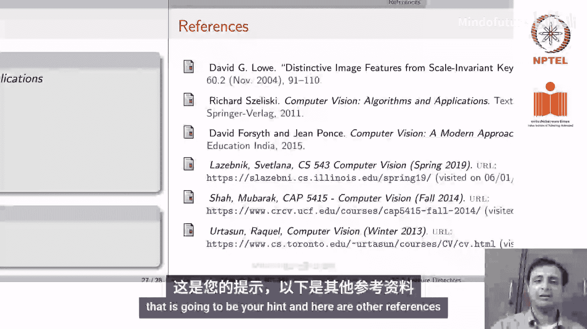

# 计算机视觉的深度学习：P11：特征检测器 - SIFT及其变体 🧠

在本节课中，我们将要学习计算机视觉领域一个里程碑式的特征检测器——尺度不变特征变换（SIFT）。我们将详细探讨其工作原理、四个核心步骤，并了解其后续的一些重要变体。

## 概述

上一讲我们介绍了图像滤波和尺度不变的Harris角点检测器。本节我们将深入探讨SIFT，它不仅能够检测图像中的关键点，还能为这些关键点生成鲁棒的描述符，使其对平移、旋转、缩放和剪切等变换具有不变性。

---

## 什么是SIFT？🎯

SIFT由英属哥伦比亚大学的David Lowe在20世纪90年代末开发，并于2004年正式发表。其主要目标是将图像数据转换为**尺度不变的关键点坐标**及其**描述符**。SIFT对于识别、运动跟踪、多视图几何等核心视觉问题至关重要。

SIFT旨在提取对**平移、旋转、缩放和剪切**（透视变换）都理想不变的关键点。例如，同一物体在不同角度、姿态或光照下拍摄的两张图像，SIFT应能检测出相同的关键点。

SIFT的实现包含四个主要步骤，每一步都有其明确的工程动机。

---

## 第一步：尺度空间极值检测 🔍

这一步的目标是在不同尺度下检测图像中的极值点（极大值和极小值），类似于尺度不变的Harris检测器，但方法更为精细。

SIFT首先构建一个**尺度空间**。具体做法是：对原始图像使用不同标准差σ的高斯核进行卷积，生成一系列模糊程度递增但尺寸相同的图像，这些图像构成一个**八度**。接着，通过下采样或使用更大σ的高斯核，构建下一个八度的图像。

为了检测极值点，SIFT使用**高斯差分**来近似**高斯拉普拉斯算子**。高斯差分图像`D(x, y, σ)`的计算公式如下：

`D(x, y, σ) = L(x, y, kσ) - L(x, y, σ)`

其中，`L(x, y, σ)`是原始图像与标准差为σ的高斯核卷积后的结果。

**尺度空间极值检测**的过程是：对于尺度空间中的每一个像素点，将其与**同一尺度相邻的8个像素**、**上一尺度相邻的9个像素**以及**下一尺度相邻的9个像素**，共计26个像素进行比较。如果该像素的`D`值是这27个像素中的最大值或最小值，则将其标记为一个候选关键点。这样，我们就在**空间**和**尺度**两个维度上检测到了极值点。

---

## 第二步：关键点定位 📍

在第一步中，我们检测到的极值点可能位于离散的像素和尺度上。第二步的目标是进行**亚像素级精确定位**，并剔除不稳定的点（如低对比度点和边缘点）。

我们通过**泰勒级数展开**来精确定位极值点。设候选关键点的位置和尺度为 `s₀ = (x₀, y₀, σ₀)`，我们希望找到偏移量 `Δs = (Δx, Δy, Δσ)`，使得极值点位于 `s₀ + Δs` 处。

对高斯差分函数`D`在`s₀`处进行泰勒展开，并令其导数为零，可以求解出`Δs`。公式如下：

`Δŝ = - (∂²D/∂s²)⁻¹ * (∂D/∂s)`

其中，一阶和二阶导数可以通过有限差分法计算。求解出的`Δŝ`给出了极值点的精确位置。

**剔除低对比度点**：计算精确定位后的`D(s₀ + Δŝ)`值。如果该值的绝对值小于一个阈值（例如0.03），则认为该关键点对比度太低，予以剔除。

**剔除边缘点**：SIFT使用**Hessian矩阵**来区分角点和边缘。计算`D`在关键点处的Hessian矩阵`H`，其特征值`α`和`β`反映了该点的曲率。对于角点，`α`和`β`都较大且数值相近。通过计算比值 `r = α/β`，并检查下式是否成立来剔除边缘点：

`Tr(H)² / Det(H) < (r_threshold + 1)² / r_threshold`

原论文中`r_threshold`设为10。如果上述比值大于阈值，则判定该点为边缘点，予以剔除。

经过第二步，我们得到了精确位置、尺度稳定且具有角点特性的关键点。

---

## 第三步：关键点方向分配 🧭

为了使描述符具有旋转不变性，我们需要为每个关键点分配一个主方向。

1.  **选择尺度**：使用关键点所在的尺度`σ`，选择对应的高斯模糊图像`L(x, y, σ)`。
2.  **计算梯度**：在关键点邻域内（通常取半径为`3*1.5σ`的区域），计算每个像素的梯度幅值`m(x, y)`和方向`θ(x, y)`：
    *   `m(x, y) = sqrt( (L(x+1, y) - L(x-1, y))² + (L(x, y+1) - L(x, y-1))² )`
    *   `θ(x, y) = atan2( L(x, y+1) - L(x, y-1), L(x+1, y) - L(x-1, y) )`
3.  **生成方向直方图**：创建一个36 bin的直方图（每10度一个bin），统计邻域内所有像素的梯度方向。统计时，每个像素的投票权重由其**梯度幅值**和**高斯加权函数**（中心在关键点，σ=1.5σ）共同决定。离关键点越近的像素，权重越大。
4.  **确定主方向**：直方图的峰值方向即被指定为该关键点的主方向。如果存在另一个达到主峰值80%能量的峰值方向，则会在此位置创建另一个具有不同方向的关键点。

通过这一步，每个关键点都拥有了一个基于局部图像结构的方向。

---

## 第四步：生成关键点描述符 🗂️

最后一步是为每个关键点生成一个独特的、具有不变性的描述向量。

1.  **确定描述区域**：以关键点为中心，取一个`16x16`的像素区域。
2.  **划分子区域**：将这个`16x16`的区域划分为`4x4`共16个子区域。
3.  **计算子区域方向直方图**：在每个`4x4`的子区域内，计算一个8 bin的梯度方向直方图（每45度一个bin）。同样，每个像素的贡献由其梯度幅值和高斯加权函数决定。
4.  **形成描述向量**：将16个子区域的8维直方图连接起来，得到一个`16 * 8 = 128`维的向量，这就是原始的SIFT描述符。
5.  **归一化与修剪**：为了增强对光照变化的鲁棒性：
    *   首先，将128维向量归一化为单位长度。
    *   然后，将向量中每个维度的值限制在`[0, 0.2]`的范围内（修剪异常大的值）。
    *   最后，再次将向量归一化为单位长度。

最终得到的这个128维向量就是SIFT描述符，它紧凑地编码了关键点邻域的梯度方向分布信息。

---

## SIFT的应用与性能 🌟

SIFT描述符具有出色的性能：
*   **不变性**：对尺度、旋转、平移、适度视角变化和光照变化具有很好的鲁棒性。
*   **应用广泛**：被用于图像拼接、物体识别、运动跟踪、3D重建等。
*   **图像拼接示例**：在两幅图像中分别检测SIFT关键点并计算描述符，然后通过匹配描述符找到对应点对，进而计算图像间的变换矩阵，最终将图像对齐拼接成全景图。

---

## SIFT的变体 🔄

自SIFT提出以来，出现了多种改进版本，以下是其中几个重要的变体：

**1. SURF（加速稳健特征）**
SURF旨在提高SIFT的计算速度。其核心改进包括：
*   使用**盒式滤波器**来近似高斯拉普拉斯算子，利用**积分图像**技术可以极快地计算这些滤波器的响应。
*   在描述符生成步骤也进行了优化。
*   结果：SURF的速度比SIFT快数倍，对模糊和旋转有很好的处理能力，但在光照和视角不变性上略逊于SIFT。

**2. MOPS（多尺度定向块描述符）**
MOPS的核心思想是**规范化方向**。
*   在计算描述符之前，先将关键点周围的图像块**旋转到其主梯度方向**。
*   这使得所有关键点的描述符都在一个规范化的方向上计算，增强了旋转不变性。

**3. GLOH（梯度位置方向直方图）**
GLOH是SIFT描述符的一种扩展。
*   它使用**对数极坐标网格**（同心圆和扇形划分）来代替SIFT的笛卡尔坐标网格划分区域。
*   这通常会产生一个更高维度的描述符（例如272维），然后使用**主成分分析**将其降维到128维以供使用。
*   在某些情况下，GLOH比SIFT具有更好的辨别力。

---

## 总结与资源 📚

本节课我们一起学习了SIFT特征检测器。我们从其四个核心步骤——尺度空间极值检测、关键点精确定位、方向分配和描述符生成——深入了解了其工作原理。SIFT通过巧妙的工程设计和数学工具，实现了对多种图像变换的鲁棒性，成为计算机视觉史上最具影响力的算法之一。我们还简要了解了SURF、MOPS和GLOH等后续变体及其改进思路。

**延伸阅读与资源**：
*   **原始论文**：David Lowe的SIFT论文是必读的经典。
*   **教科书**：参阅Szeliski的《Computer Vision: Algorithms and Applications》第3.5节。
*   **代码实现**：OpenCV库提供了SIFT和SURF的实现，并有丰富的Python教程。
*   **在线资源**：Wikipedia上关于SIFT和SURF的条目信息详实。

通过理解SIFT，我们不仅掌握了一个强大的工具，也领略了将数学洞察与工程实践相结合来解决复杂视觉问题的典范。