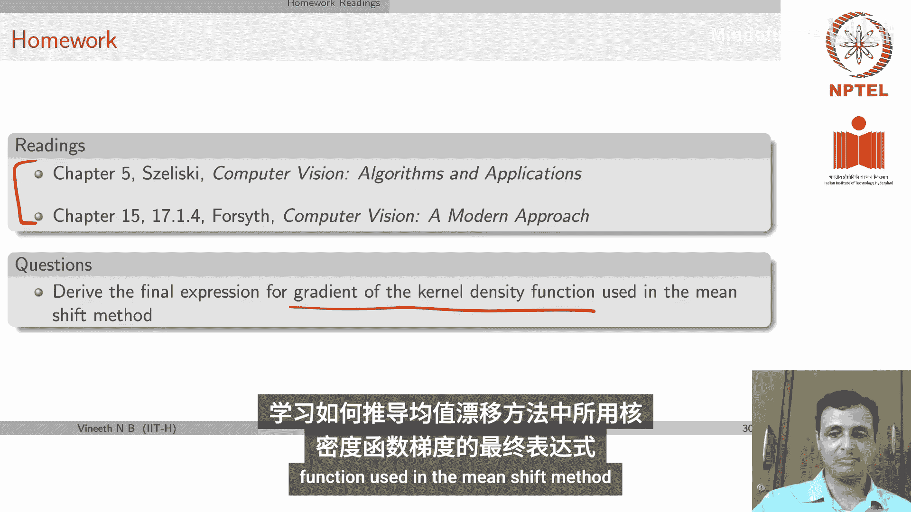

# 【NPTEL】计算机视觉的深度学习 p12 P12_图像分割 -BV1vNWkzpEua_p12-

Last lecture。We spoke about feature extractors and feature descriptors。In particular。

We spoke about sift and its variance。Before we go to other kinds of features。

We'll take a slight deour and talk about another important task in processing of images。

Which is image segmentation。Human vision has been studied extensively from several perspectives。

And one of the perspectives of human perception has been based on what is known as the jestile theory。

 which emerged almost 100 years ago， which had this fundamental principle that the whole is greater than the sum of its parts。

And one of the important cornerstones of this theory was the idea of grouping。

To understand human vision。So this is a very popular optical illusion。 It's known as the。

Mular layerar illusion， which asks。A viewer as to which of these horizontal lines is longer。

And because of the human perceptions。Bias towards viewing things as a group。

And not the individual confidence， the illusion actually arises here and makes one line look longer than the other。

 while the horizontal lines are exactly the same length in both of these images。

So gestal theory proposes various factors in images which can result in grouping。So on one hand。

 you could have proximity to be a reason。When there are objects or artifacts in the image。

 which are simply close to each other and these groups lie in different parts of the image。

 that could result in one kind of a grouping。Or it could just be the similarity of the objects themselves。

 Some objects are hollow circles， some objects are filled circles。

 and just because these objects are different。They get grouped differently when we perceive this image。

Other factors could be。Pallism， if there are groups of lines that have similar properties in terms of parallelism。

 we end up grouping them or another option could also be just symmetry。

Just seeing artifacts in the symmetric sense。Makes us group them in one particular manner。Further。

 you could also have similarity of a different kind。

You could have a common fate in terms of these arrows telling you where these dots are going so in the second example here all these dots are model is lying in a straight line。

But the arrows。Let us group them differently so in a sense of where they're going to go along the direction of the arrows。

Gives the human visual system a cue to how they should be grouped。

Or it could be purely because of a common region that was already marked as a circle。

 it could be due to continuity of artifacts， it could be due to closure of artifacts。

 as you can see there are many factors that result in human perception viewing things as groups。結構。

And。Gar theory is fairly descriptive， it lays down various different rules and principles that could lead to grouping when humans perceive images。

However， these rules by themselves are not clearly defined enough to become algorithms。

So you really cannot take the rule directly and implement a pseudocode for that tool that could help you find。

 say groups in an image。So for the rest of this lecture。

 we' are going to talk about that task called image segmentation where we try to group similar pixels into different groups。

 you could call this akin to clustering where you group different pixels into their own clusters。

So a significant part of this lecture is taken from David Foawst's book and Celsky's books and we will share these references at the end。

One of the oldest methods for image segmentation is known as watershed segmentation。

 this was developed way back in 1979。And image segmentation， remember， is the task of。

Groing pixels in an image。 So that's the task that we're looking for。

The watershed segmentation method segments an image into what are known as catchment basins or regions。

It goes along with the name， that's why it's called watershed segmentation that will become clearer in the next slide。

So you can view any grayscale image。As a 3D topological surface， so for example。

 if you have this grayscale image， very similar to how we viewed an image as a function way back in one of the earlier lectures。

So you can view an image as a 3D topological surface。Where the whiteness peaks at these。

Bevel locations and the whiteness subsides in other locations and the dark areas are where you have black pixels in the original image。

What watershed segmentation tries to do is to segment regions， segment the image into regions。

With a conceptual idea of rainwater flow flowing into the same lake。

 so you're going to create a methodology where you're going to assume that you're going to flood water into your image and wherever you have catchment basin in the image imagine this 3D topographic representation of the original image。

Wherever you have water stagntic， those groups of pixels form segments。

Let's see this in a bit more detail。So you identify various local minima in your image remember local minima as simply values where are pixel locations where your image intensity value is low remember again that image intensity can lie between 0 and 255 or0 and1 if you normalize the values in the image so you pick in you take certain neighborhoods say whatever5 by5 parts or seven by7 parts whatever that may be and using that process you find out local minima that lie across the image。

And you flood the landscape from local minima and prevent merging of water from different minima。

 so which means you would start with a local minima and slowly keep expanding which is equivalent into flooding here until you go to a point which is reachable in the same number of pixels from other local minima so that's where the boundary between these two regions would like。

So this results， this simple process results， there's nothing very fancy about this other than what I just mentioned。

 so this process results in partitioning the image into catchment basins and the watershed lines。

Remember， this method was proposed in the late 70s and it was used for many years to segment images into various partss。

It was generally applied on image gradients rather than the image itself。

 just to give you a visual example， so the original image is this one。

We ideally want to group the pixels。So you first take a gradient image now you know how to take a gradient image you run an edge filter on the on the original image。

 so now the watersheds of your gradient image are given in your bottom left image and you finally refine and get your segmentation output and put it back on the ocean image in the last image。

A simple method but works rather effectively， however， it does have some limitations。

If there is a lot of noise and irre irregularities in the image， for example。

 let's say you have a heavily textured image， so you can imagine a lot of undulations in the texture of the image。

 or if there is noise in the image， youre going to end up with something like this。

Because there are going to be lot of catchments。So now trying to flood those areas will lead you to many watershed lines which separate many different regions resulting in what is known as oversation。

So keeping this in mind， watershed segmentation is typically used as part of an interactive system where a user points out a few different centers in the image。

And then the algorithm floods from those centers alone not worrying about other centers that that could be in the image。

 so this idea can help overcome the limitation of over segmentmentation if you'd like to know more you can read chapter 5。

2。1 in Cellesky's book this is one of the earliest methods since then there have been many methods that people have developed。

And one could broadly categorize methods into two kinds。Region splitting and region merging。

In region splitting methods， as the name suggests， the idea is to start with the image and then keep splitting into finer and finer regions。

 You'll see one example of this method a little later in this lecture。The other kind。

 which is a bit more popular， are what are known as region merging methods。

Where you start with a pixel as a region and keep merging similar pixels and forming regions and you can keep going forward all the way to the complete image。

So here is an example of。An image which has been merged into groups of pixels。

Groups of pixels are also sometimes called super pixels。

And this is sometimes generally used as a preproing step for higher level segmentation algorithms。

One of the popular methods to do image segmentation was。

Graph based segmentation which was proposed in the early 2000s by Felen Schwab and Hatan Loher。

They propose a graph based segmentation algorithm。Which used。This similarity is between regions。

To find out which regions to merge in a given iteration。

So if you consider an image as a graph G with vertices V and edges E。

 so you have a set of vertices and a set of edges and the pixels form your vertices initially and edges are defined between adjacent pixels。

So we define a pixel to pixel dissimilarity metric， for example。

 this could be based on the intensity values in these two pixels you could also define this using more sophisticated mechanisms by probably taking a neighborhood and taking oriented gradients and so on and so forth。

 but whatever be that measure you have a pixel to pixel dissimilarity metric which is defined as w of E which is the weight of that edge joining those two pixels on which we are defining the dissimilarity where edges e is given by v1 v2 where v1 and v2 are two pixels for example this dissimilarity metric could be the intensity differences between the N8 neighbors of both these pixels when you say N8 neighbors you take a three cross three neighborhood and excluding the central pixel you will have eight different neighbors you are calling that as N8 neighbors so you take two different pixels。

Take their anynate neighbors and find their intensity differences that could be one way of computing W of E。

同。Once W of E is defined。The method defines a quantity called internal difference for every region C initially remember the region C would just be a pixel but in future iterations a region could be a collection of pixels。

The internal difference is defined as the largest edge weight in the region's minimum spanning tree。

Which means if you have a bunch of different pixels。You find the minimal spanning tree。

Of the bunch of pixels that you have。Now you take the largest edge weight in the minimum spanning three。

We're going to define that as internal difference to some extent。

 that's going to be the largest edge weight in that region。It's just a simplified way of saying that。

That's one point we're going to define。Another quantity we are going to define is called minimum internal difference。

Minimum internal difference is given by if you had two regions C 1 and C2。

 the minimum internal difference between these two regions is given by minimum of。

The internal difference of c1 plus tau of c1 where tau of c1 is。Some manually chosen penalty。

So I'll explain that in a moment， and then the second quantity is。

The internal difference of C2 and tau of C2 so tau of c1 and tau of c2 could just be say the number of pixels that you have in the region maybe normalized based on that or so on and so forth you have a quantity and you take a minimum of both these quantities so you have region one for whom you define its internal difference plus some penalty。

regionion C2 whose internal difference and its corresponding penalty and you take the minimum of these two。

Once you have this。For any two adjacent regions which have at least one edge connecting any of their vertices。

 we define a quantity called diff of c1 c2 which is given by the minimum weight edge connecting these two regions so for example you consider all edges v1 v2 such that V1 come from regions c1 and v2 come from regions c2 so all edges between those two regions and you take the minimum weight of the edges that connect these two regions。

With this quantity is defined。The method。Defins a preddicate D。For any two regions。

 C1 and C2 pass if。Dif of sea and seaod。Is greater than。

The minimum internal difference between c1 and C2， then you say it is true。

 otherwise you say it is false。This illustration should help you understand this a bit better。

 remember， di is the minimum edge weight between two regions。Whereas minimum internal difference。

Is a minimum internal difference within each of these between C1 and C2， whichever is the minimum。

So if the difference。Between the two regions is greater than the minimum internal difference。

You do not want to do anything。If it's the other way。Regions would be merged。

if this reddicate turns out to be false。You know that diff is equal or lesser than minimum internal difference。

 which means C2 is as close to c1 as the farthest separated pixels in C1。

 so you may as well merge C1 and C2。That's the main idea with this particular method。

So to summarize this algorithm merges any two regions whose difference is smaller than the minimum internal difference of these two regions。

Here is an example of how this works using the M8 pixel neighborhood。

So you can see that the results are fairly good， the different。Players get separated reasonably well。

 parts of the body get separated reasonably well。If you are more interested， please look at Chapt 5。

2。4 in Cs case's book。The next method were going to look at is another popular method called probabilistic aggregation。

 which was proposed by Al Eal in 2007。This method is again。

 a region merging algorithm and it is a probabilistic approach， as the name suggests。

And it uses two different cues。Intensity values for the gray level values as well as some texture content of the specific regions in the image。

So initially， the method considers each pixel as a region。And then you assign a me likelihood PIJ。

So for every two pixels， I and J， there's a likelihood Pj which says。

 how likely are these two pixels to merge？And how do you assign that PIJ based on their intensity and texture similarities。

 we are not going to go into each of those details。

 I will point you to the reference if youre interested in knowing how exactly it's implemented you can look at the paper for those details but it's broadly based on intensity you know how to compute intensity by now you know how to compute texture we talked about it the last time so the PIJ is based on intensity and texture similarities between the two pixels。

Now given a graph in a particular iteration， let's say its at the s minus1 iteration。

 the graph is given by a set of vertic is vs minus1 and Es minus1。

 so the graph of the next iteration Gs where you hope to merge a few regions is is obtained by。

You consider a subset of C note C from vs minus1。And you merge nodes or regions。

If they are strongly coupled to regions in sea。So what you would do here is you would consider those pixels。

 so which means you would say。That if you took a subset of notess in。VS minus1。

 whichever other nodes， right we we would ideally consider other nodes which are in vS。-1。-0。

So those would be the other pixels in Vs minus1， you consider those pixels。And for which of pixels。

 you have。The summation of PI J Jacobb belonging to C。

Divided by summation J belonging to vS minus 1 minus CPj when this ratio is greater than a threshold。

 you know that there are certain pixels that are quite likely to merge as the pixels in in the region see itself。

So if this ratio is greater than the threshold， which the paper recommends to set to point2。

 then you merge those regions。And once you merge those regions。

You propagate those assignments to the final level children。

 which would be the property of any region merging algorithm。

 and you do this cosing process recursively。Here is an example of how probabilistic aggregation works in practice。

So this is an image taken from Celleski's book so you can see here that image A is the original gray level pixelel grid so it's a 5 by5 image so you can see the interpixel couplings in B image so a thick edge means a stronger coupling a thin edge means a weaker couplings so you can see that the pixels that are white are strongly coupled to each other because of the intensity similarity。

Then in image C， you perform one level of coarsning where you combine edges that are close to other edges that you would take one particular pixel and you start which would be C then you would take the other vS minus1 minus C of all the other pixels in vs minus1 minus C and then you would try to find out which of them has a higher probability of merging based on intensity similarity and texture similarity again。

And then you keep repeating this process， you can see that after two levels of cosing。

 you get a fairly good estimate of different regions in the image。Moving。

 we go to another popular method known as mean shift segmentation。

This method is a different approach and it uses a mode finding technique。

Based on non parametric density estimation。So non parametricic density estimation is a standard procedure that people in machine learning use to estimate the density of any given set of observations。

So the feature vectors of each pixel in the image are assumed to be some samples from some unknown probability distribution。

And be able to estimate the probability density function of。Of the image。

And find its modes remember in some sense， the modes would be like what we had for the watershed segmentation。

 although in that case we did a minimum now we are going to talk about a maximum。

And then the image is finally segmented once you identify the modes in the image。

 the image is segmented pixel voice。By considering every set of pixels which climb to the same mode as a consistent segment。

 we will describe this for the next few slides。So let's consider an example image。

 as you can see here， so it's a fairly real world image。On the right。

You see the representation of the image so we talked about color spaces in week one。

 so one of the color spaces that is popularly discussed is known as the L star U star V star or the LUV color space。

 so this is simply for simplicity a plot of only the L star U star features of this image just for simplicity of plotting。

So in this feature space， we ideally want to find out what are the modes of the overall distribution of the intensities in the L star star space。

So how do you find the modes of such a distribution？If you recall your studies in machine learning。

 you would recall that one of the popular approaches to estimate。

The probability density function of modes would be through kernel density estimation。

So we are going to use the same method here to be able to estimate what is the PDF and what are the modes of the distribution of intensities in a particular space。

 while we have taken example as the LUV space， you could do such a mode finding in any other space for that matter or two。

Just for simplicity we are going to consider a one dimensional example。

 so remember once again that this is a one dimensional signal which can be extrapolated to image as a 2D signal。

So the baby would。Estimate this function is。We would convolve the data。

 Let's assume that you have observations given by these。Impuls here。

 so you can see those vertical lines， those are your observations that are given。

 so you would estimate your density function F， which is what we want to estimate。

By convolving your data， your observations。With some kernel of width H。

 let's assume that you have a kernel K， so you could。

Do it as a falling of function where H is the width and you have x minus X to be your function。

 your projecttic function that you're falling off over。

So convolving your observations with this kernel will give you an estimate of what is your original f function that your observations were coming from。

What do we do with this？So to find the modes， meanshift segmentation uses a gradient ascent method with multiple restarts。

Why S， Because we want to find the maximum of。Or the modes of that probability distribution。

So we start with some guess why not for a local maximum which could just be any point。

 remember we are going to perform gradient ascent which is an iterative procedure。

 so you start with some point and at every at every iteration you add some constant times the gradient to the previous estimate and you update your estimate again and again and again。

So you have a guess why not， which could be any random point X I。

So we calculate the density or the gradient of the density estimate f of x we just talked about how f ofx is computed using that kernel how do you choose that kernel we' will talk about it in a moment so you have the gradient of the density estimate f ofx at y not and we take an ascent step in that direction so the gradient is going to be given by something like this。

Smation X minus X， G of。This quantity where G is nothing but k prime or the derivative of the kernel k。

It is written of simple delators。So the gradient of the density function can actually be written slightly differently。

You can write the gradient again。 Let's see the previous slide。

 So this was the gradient that we just had X minus x into G of。

X minus Xxi norm square square by head square where G is k prime minus k prime or the gradient of co。

So we got to show that this can actually be written slightly differently where the gradient can be written as summation G capital G of x minus Xi but capital G of x minus Xxi is simply the same small G that we saw on the previous slide into Mx where Mx is like a。

A weighted contribution of the x values that you're considering in this particular computation。

So Xi into g of x minus Xi divided by sum of all G of x minus Xs。

Why is this a correct way of writing from the previous slide？Don't leave you for homework。

 it's not too difficult to find this out， try to work it out stepwise and you'll actually get the answer。

So this vector m of x， which corresponds to the gradient， is also known as the mean shifter。

It's the difference between x， sorry if you I didn't point you to this minus x here。

 but its the main shift is the difference between x and the gradient weighted mean of the neighbors around x x is where you place the filter and x minus x i's are the values in the range of that filter and you do convolution very similar to hobiock convolution earlier in this case we are only talking about 1 d convolution for simplicity。

So the vector M of x is the mean shift， the difference between x and the gradient weighted mean of the neighbors around things。

And once you get your mean shift， which is also your gradient in this particular case。

subject to a scal of multiple， then your next iteration in your gradient decent。

 your gradient ascent， youre going to say yk plus 1 is equal to yk plus m of yk。

It can also be written。这。Remember， you'll just have Yk and expert get canceled because that's where you're placing Yk at this point in time and you'll be left only with m of Yk as the quantity。

 which will become Yk plus。Which will become Yk plus1。

And you keep doing this process iteratively and you would finally reach the mode of the distribution and then you would find out。

All the neighboring points which by climbing would lead to this mode， will form one segment。

Other points which by climbing would reach to other modes， would go to those segments。Clearly。

 this method relies on selecting a suitable kernel width in addition to the kernel itself。

 you use a quadratic kernel here what width you choose is also important and will impact the final result and that is chosen empirically。

In the above description， the approach seemed to be color based， we took it in the LUV space。

You can also consider other kinds of features。Other kinds of feature spaces to find the modes in。

More interested， please look at chapter 5。3。2 in Cski's book。One more method。

 which is not a region merging method， but a region splitting method is normalized cups for segmentation once again a very popular method。

Was used for many years。One second， a graph based method， but a different approach。In this case。

A graph representing pixels in an image is successively split into parts it is not about merging this time it's about splitting how do you split it。

You marked edge weights between pixels。Based on their similarity， so if two pixels are very similar。

 maybe they have similar intensities， you give them a high edge weight and if two pixels are further apart in their similarity you give them low weight so here is an example of such a graph that' is constructed。

So the goal of this would be to find the mint cut。You are not going to work out the entire math here if you're interested you can look at the references and learn more about it。

 but you try to find the min cut which is going to give you。Two different regions as shown here and。

Those edges， when you remove， you get the corresponding to segments。

 which is your original objective。The main cut is defined as some of all weights being cut。

So you consider two sets A and B， two sets of vertices。

And for all I belonging to a and J belonging to B， you add up those edge weights。Wherever you got。

 get。For which choice of A and B， you get a minimum cut value that is the cut that you're going to choose to divide the graph。

Two segments。So clearly， as you can observe here， this method only divides two segments at a time。

 so if you want more segments you will have to do this more and more times or probably use other heuristics if you wanted to combine them later into fewer segments。

But one of the problems with using the min cut is that it can also result in trivial solutions。

Why so？ can you think about it？Why does this main cut problem？Result in。Dviewe solutions。

The answer is very simple when a consists of， say only one pixel。And B consists of， say。

 another region of pixels。This summation may be restricted to a smaller set and hence may have a smaller value when you sum all of them up。

Wwhich means mink cut could favor regions where there is only one pixel on one side which may not be which may simply be an outlier and may not really form a good segmentation for the image。

How do you overcome this problem， this problem is overcome by a method called normalized cut。

 which improves the main cut problem。And the normalizedized cut is defined by。Cut off a B。

By Association of A。Plus， cut of A B by Association of A。You' see a moment what they are。

Association is defined again as some of all the weights in A and B。

Where association of AV is given by。Association of A A。Plus， association of A B。

It's the sum of all of the weeks。And now what you have done by doing this association of AV and association of BV is to ensure that the denominator contains the number of pixels。

So in each of these in each of these regions， so if there was only one pixel in one region。

 remember that one of these quantities will become very high as against another region which had many more pixels where the denominator will pull down the window。

This ensures that you don't get trivial solutions such as what you saw in Min cut。

 but you get more useful solutions。なす。So the normalized cut happens to be an NP complete problem but there are approximate solutions to solve this slightly more involved。

 but you can look at the paper called normalized cut and image segmentations if you are interested in how the method is actually implemented。

That this is the overall formulation。Here is an example of how normalized cuts works。

 so this is the input image and you can see the various different regions get that get segmented。

Using normalized cuts in。Over the iterations of the metal。

There have been many other methods for image segmentation too。

 such as simply using gamingms clustering， there have also been methods based on Marov random fields and conditional random fields and many more。

If you want to have a detailed understanding please read chapter 5 of Cliky's book there are more references at the end of this lecture too but the question that were going to ask now is do we really need all of these segmentation methods so think the entire course is based on deep learning for computer vision aren't there deep learning methods that can segment images today do you really need all of this。

It is a valid question for many tasks today you do not need these methods the purpose of covering these topics is to give you a context of computer vision in the pre deep learning era。

 but some of these methods have also been used in the deep learning era。

For those of you who are a little bit more aware about these areas。

The earlier methods of deep learning that were used for detection of objects。

 which means given an image you try to find an object and draw the bounding box as to where in the image that object lies that is the task of detection and there could be multiple instances of objects or multiple objects in an image。

For the initial methods of deep learningning for object detection。

 it was these kinds of segmentation methods were actually used to generate what were known as regional proposals where the objects could lie。

As I said， one of the first R CNN which is a region CNN word that was used for object detection used the min cut segmentation method known as CPMC constrain parametric min cuts to generate region proposals for foreground segments we will talk about this in detail when we come to that section of the schools。

But that's the reason why image segmentation is useful for you to know at this time。

Segmentation can also go beyond images into videos。If you go into videos。

 the principles for the methods are very similar， although there's a third dimension that comes into the picture。

 but the kind of tasks that one wants to solve in videos is say shot boundary detection。

 which is an important problem in video segmentation where you have to divide an entire video into shots remember that if there's a very long video and you want to understand the video let's say you have a movie and you want to be able to understand the movie by automatically passing the video in the movie。

 you first have to divide the entire movie into shots。

 and then try to analyze each shot for understanding the scene。

 understanding the character's so on and so forth。So that's an important task in video segmentation。

Another important task with videos is what is known as motion segmentation。

Where you may want to isolate the motion in the video of an object so you could be wanting to isolate a person running。

 for example， there's a football game and you want to track a person moving with the ball from one end of the field to the other end of the field or you may want to track a car。

 so on and so forth。So for further information on this。

 please look at chapters 15 and 17 of the David Foce's book in the references。

That concludes this lecture which gives you an overview of how image segmentation methods were used in the pre deep learning era。

 some of them as I said， were used actually even with deep learning methods although not as much at this time。

 but for more readings please do read these references given here and recall we left one derivation as homework for you。

 go back and see how to derive the final expression for the gradient of the kernel density function used in the mainshift method。

你 some的分。