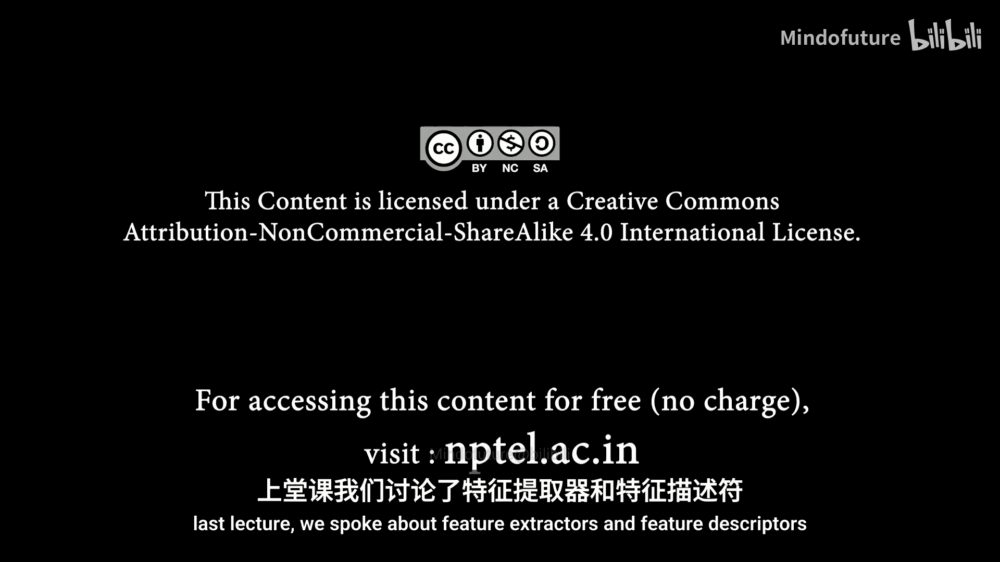
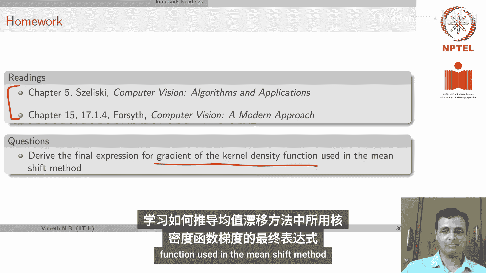

# 计算机视觉的深度学习：P12：图像分割 🖼️

在本节课中，我们将要学习图像分割。图像分割是计算机视觉中的一项重要任务，其目标是将图像中的像素分组，形成有意义的区域或对象。我们将从人类视觉的格式塔理论出发，介绍几种经典的图像分割算法，包括分水岭算法、基于图的算法、概率聚合、均值漂移以及归一化割等。

## 格式塔理论与分组原则

上一讲我们讨论了特征提取器和特征描述符。在深入其他特征之前，我们将稍微绕道，探讨图像处理中的另一个重要任务——图像分割。

人类视觉从多个角度被广泛研究，其中一个视角基于近一百年前出现的**格式塔理论**。该理论的核心原则是“整体大于部分之和”，其重要基石之一是**分组**的概念，用于理解人类视觉。

以下是一些导致人类视觉分组的图像因素：
*   **邻近性**：图像中彼此靠近的物体或元素容易被归为一组。
*   **相似性**：具有相似属性（如空心圆与实心圆）的物体容易被归为一组。
*   **平行性**：具有平行属性的线条组容易被归为一组。
*   **对称性**：具有对称性的元素容易被归为一组。
*   **共同命运**：具有相同运动趋势的元素（如箭头方向）容易被归为一组。
*   **共同区域**：位于同一封闭区域内的元素容易被归为一组。
*   **连续性**：具有连续性的元素容易被归为一组。
*   **闭合性**：倾向于被感知为完整图形的元素容易被归为一组。

格式塔理论相当具有描述性，但它提出的规则本身不足以直接转化为算法。因此，本讲其余部分将专注于**图像分割**任务，即尝试将相似的像素分组到不同的集合中，这类似于聚类分析。

## 分水岭分割 🌊

一种最古老的图像分割方法被称为**分水岭分割**，于1979年提出。

该方法将图像分割成所谓的**集水盆地**或区域。我们可以将任何灰度图像视为一个三维地形表面，其中亮度值代表海拔高度。分水岭分割的概念是模拟雨水流动：从图像的局部最小值（低洼处）开始“注水”，让水逐渐漫延，并防止来自不同最小值的水域合并。当来自不同集水盆地的水即将相遇时，就形成了分水岭线，这些线将图像分割成不同的区域。

在实践中，该方法通常应用于图像的**梯度图**而非原图，以获得更好的边缘信息。以下是基本步骤：
1.  计算原图的梯度图（例如使用边缘滤波器）。
2.  在梯度图上应用分水岭算法，得到初始分割。
3.  对分割结果进行细化，并映射回原图。

然而，分水岭算法有一个主要限制：如果图像存在大量噪声或纹理（导致许多小的局部最小值），会产生**过分割**，即分割出过多无意义的小区域。为了克服这一点，分水岭分割常作为交互式系统的一部分使用，用户手动指定一些初始点（标记），算法仅从这些点开始漫延。

## 基于图的分割 📊

图像分割方法大致可分为两类：**区域分裂**和**区域合并**。区域分裂方法从整个图像开始，不断将其分裂成更细的区域。区域合并方法则从每个像素作为一个区域开始，不断合并相似的区域。

一种流行的区域合并方法是**基于图的分割算法**，由 Felzenszwalb 和 Huttenlocher 在21世纪初提出。

该算法将图像视为一个图 **G = (V, E)**，其中：
*   **V** 是顶点集合，每个顶点代表一个像素。
*   **E** 是边集合，连接相邻的像素（如8邻域）。

每条边 **e** 有一个权重 **w(e)**，代表所连接两个像素的**不相似度**。一个简单的定义是两像素的强度差。

算法核心是比较两个区域 **C1** 和 **C2** 之间的差异，决定是否合并。它定义了三个关键量：
1.  **区域内部差异 Int(C)**：定义为区域 **C** 的最小生成树中的最大边权重。它衡量区域内部的连贯性。
    *   `Int(C) = max_{e ∈ MST(C)} w(e)`
2.  **区域间差异 Diff(C1, C2)**：定义为连接区域 **C1** 和 **C2** 的所有边中的最小权重。它衡量两个区域边界处的相似度。
    *   `Diff(C1, C2) = min_{v_i∈C1, v_j∈C2, (v_i,v_j)∈E} w((v_i, v_j))`
3.  **最小内部差异 MInt(C1, C2)**：定义为两个区域内部差异加上一个与区域大小相关的惩罚项 **τ(C)** 后的最小值。**τ(C)** 通常设为 `k / |C|`，其中 `|C|` 是区域中像素的数量，`k` 是一个常数参数。
    *   `MInt(C1, C2) = min( Int(C1) + τ(C1), Int(C2) + τ(C2) )`

**合并判断谓词 D** 定义如下：如果 `Diff(C1, C2) > MInt(C1, C2)`，则不应合并（谓词为真）；否则应合并（谓词为假）。

**算法思想**：如果连接两个区域的最小边权重（区域间差异）小于或等于这两个区域各自内部“最不一致”的程度（最小内部差异），那么这两个区域内部的差异已经和它们之间的差异一样大了，因此应该合并。

该算法能有效地将图像分割成感知上一致的区域。

## 概率聚合 🎲

另一种区域合并算法是**概率聚合**，由 Alpert 等人在2007年提出。这是一种概率方法，同时利用像素的**强度**和**纹理**信息。

算法开始时，每个像素自成一个区域。它为每对像素 **(i, j)** 分配一个合并似然度 **p(i, j)**，该值基于它们的强度和纹理相似度计算。

在每次迭代中，算法处理当前图 **G_{s-1} = (V_{s-1}, E_{s-1})**。对于 **V_{s-1}** 中的一个节点子集 **C**，算法考虑其他节点。对于每个其他节点 **j**，计算其与 **C** 内节点的连接强度比率：

`∑_{i∈C} p(i, j) / ∑_{i∈V_{s-1}\C} p(i, j)`

如果这个比率大于一个阈值（如0.2），则认为节点 **j** 与区域 **C** 强耦合，并将其合并到 **C** 中。这个过程递归进行，不断合并区域并更新图结构，直到满足停止条件。最终，图像被分割成几个大的超像素区域。

## 均值漂移分割 📈

**均值漂移分割**采用了一种不同的方法，它基于**非参数密度估计**的**模式寻找**技术。

该方法假设图像中每个像素的特征向量（例如在LUV颜色空间中的值）是来自某个未知概率分布的样本。目标是估计这个分布的概率密度函数（PDF），并找到其**模式**（密度峰值）。然后，将通过梯度上升收敛到同一模式的所有像素归为同一个分割区域。

**核心步骤**：
1.  **密度估计**：使用**核密度估计**。对于每个数据点（像素特征）**x_i**，放置一个核函数（如高斯核）**K( (x - x_i)/h )**，其中 **h** 是带宽参数。整个密度函数 **f(x)** 是所有核函数的和。
    *   `f(x) = (1/(n h^d)) ∑_{i=1}^{n} K( (x - x_i)/h )`，其中 `n` 是样本数，`d` 是特征维度。
2.  **模式寻找（均值漂移迭代）**：为了找到密度函数的模式，使用梯度上升法。梯度 **∇f(x)** 可以推导并重写，引入一个称为**均值漂移向量 M(x)** 的量。
    *   `M(x) = [∑_{i=1}^{n} x_i * g( ||(x - x_i)/h||^2 )] / [∑_{i=1}^{n} g( ||(x - x_i)/h||^2 )] - x`
    *   其中 `g(·)` 是核函数 `K(·)` 的导数（对于高斯核，`g` 也是高斯形状）。
3.  **迭代更新**：从初始点 **y_0**（可以是随机像素特征）开始，不断沿均值漂移向量方向移动：
    *   `y_{k+1} = y_k + M(y_k)`
    *   实际上，上式可简化为 `y_{k+1} = [∑ x_i * g( ||(y_k - x_i)/h||^2 )] / [∑ g( ||(y_k - x_i)/h||^2 )]`，即计算当前点邻域内样本的加权均值。
4.  **收敛与分配**：迭代直到 **y_k** 收敛（即 **M(y_k)** 接近零）。收敛点即为一个密度模式。所有从不同起点出发，通过均值漂移迭代最终收敛到同一模式的像素，被分配为同一个分割区域。

该方法的效果严重依赖于核函数类型和带宽参数 **h** 的选择。

## 归一化割 ✂️

最后，我们看一个基于**区域分裂**的经典方法——**归一化割**。这是一种基于图的方法，但目标是递归地将图分裂成两部分。

首先，构建一个图，其中节点是像素，连接节点的边权重 **w(i, j)** 表示像素 **i** 和 **j** 的相似度（相似度越高，权重越大）。分割的目标是找到图的一个切割，将节点分成不相交的两组 **A** 和 **B**。

一个直观的想法是寻找**最小割**，即移除后能使图分离的边的总权重最小：
*   `cut(A, B) = ∑_{i∈A, j∈B} w(i, j)`

然而，最小割倾向于切割出非常小的、孤立的像素集（离群点），因为这样需要移除的边很少，总权重很低。这通常不是我们期望的有意义分割。

**归一化割**通过引入**关联度**的概念来解决这个问题。关联度衡量了一个组内部以及该组与整个图其他部分的连接紧密程度：
*   `assoc(A, V) = ∑_{i∈A, j∈V} w(i, j)`，即组A中所有节点与图中所有节点的边权重之和。
*   类似地定义 `assoc(B, V)`。

**归一化割**的定义为：
*   `Ncut(A, B) = cut(A, B) / assoc(A, V) + cut(A, B) / assoc(B, V)`

通过除以关联度，归一化割惩罚了切割出小区域的行为，因为小区域的 `assoc` 值会很小，导致 `Ncut` 值变大。因此，优化 `Ncut` 倾向于产生在规模上相对平衡、且组内连接紧密的分割。

求解归一化割是一个NP难问题，但可以通过广义特征值分解等松弛技术得到近似解。该算法能有效地将图像分割成多个有意义的区域。

## 总结与深度学习时代的关联

本节课我们一起学习了多种经典的图像分割方法，包括分水岭分割、基于图的分割、概率聚合、均值漂移分割和归一化割。这些方法代表了深度学习时代之前计算机视觉领域的重要成果。

一个合理的问题是：在深度学习主导的今天，我们是否还需要这些方法？对于许多任务，直接使用深度学习分割网络（如FCN、U-Net、Mask R-CNN）可能更有效。然而，学习这些经典方法仍有其价值：
1.  **提供历史背景**：理解计算机视觉的发展脉络。
2.  **用于特定环节**：一些经典方法在深度学习流程中仍有应用。例如，早期的目标检测模型（如R-CNN）就使用了选择性搜索或像**约束参数最小割（CPMC）** 这样的分割方法来生成可能包含物体的**区域提议**，然后再用卷积神经网络对这些区域进行分类和精修。
3.  **视频分割基础**：分割的概念可以扩展到视频，用于**镜头边界检测**或**运动分割**等任务。

总之，图像分割是计算机视觉的基础任务，经典算法揭示了解决该问题的不同思路，其中一些思想至今仍影响着现代方法的设计。对于希望深入理解计算机视觉的学习者，掌握这些基础知识至关重要。