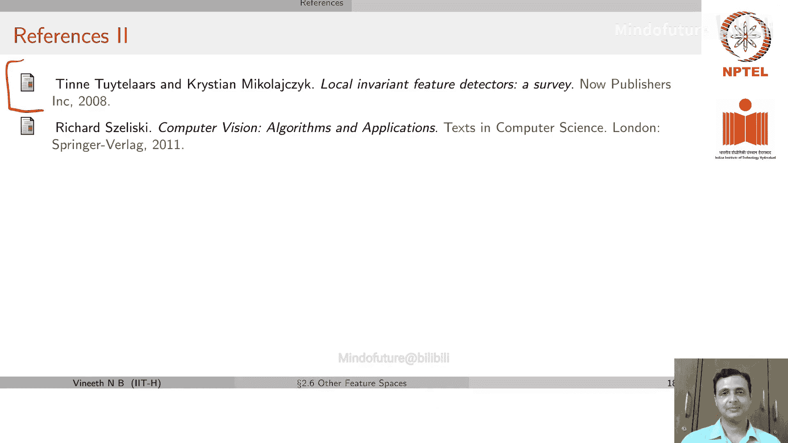

# 【NPTEL】计算机视觉的深度学习 p13 P13_其他特征空间 -BV1vNWkzpEua_p13-

We started this week by talking about edges。Then we went from edges。TheBs。Coners。And then。

 talked about。Different a few varieties of corner detectors and talked about an important corner detector called sift。

Talked about the feature descriptor。Of how you describe your corner as a vector。

And then last lecture， we also talked about image segmentation。

Now we are also going to talk about other kinds of feature spaces that people worked on in computer vision before deep learning came into the picture。

That's going to be the focus of this lecture。One of the other important features。

Representations that was developed。Was known as shape context。Ship context was about。

Taking a pixel and placing and getting a lot polar representation of the neighborhood around the pixel using this kind of a representation。

It's kind of for presentation。So you define a coordinate system in two dimensions。

That's paraized by logarithmic distance from the origin。

 which is the pixel at which you're trying to get the representation as well as the angle。

So for each point。That you consider。Youd come count the number of points in each lot polar bin around that particular pixel。

So you would so if this log pull our representation， you can see that data perhaps。

Something like one， two， three， and four regions in terms of angular distance in terms of log distance。

And then 12 wins in terms of the angles themselves。So as you can see。

 there's more precision for nearby points。Very similar to the Gassian canal where you give more weighttage to nearby points and then more flexibility for farther points around that pixel where we are considering the representation。

To some extent。This method， this representation is translation and scale invariate。

 depending on the size of the neighborhood you take。Let's study this in a bit more detail。

 so let's consider two different。Images。So now if you consider this pixel， so there are。

 if you cannot see carefully， this is a circle。This is a triangle， and this is a rombus。

So if you can see here， you can give and。The first one。Is。The representation of the circle。

 the second one is the representation of the rhbus。

 and the third one is the representation of the triangle。 How did these representations come。

There are five bins in terms of log R or the log radial distance and 12 bins in terms of your theta or your angles around the center。

So， you can see here that the circle and the rhs have very similar representations。

 so one could consider these two points as correspondence points between these two representations or these two images of a。

And when do we say two points are in correspondence。

 we say two points in are in correspondence if they minimize a value of Cj。

 the CJ INj being two pixels that you are trying to measure and CJ is defined as。

Summation over k H IK minus HJK whole square by H IK plus HJK and H IK and HJK are。

The histogram locations in the I around the8 pixel and in the representation around the Jh pixel H is the histogram of the number of pixels in each of those bins around the eighth pixel and H similarly for the Jth pixel H of k would correspond to the count in one of those bins and what is small K or capital K capital K is the total number of bins so for H of k would be the count in one of those bins So when would Cj get minimized。

When the numerator is0 or the histograms exactly match。

Or when the histograms are fairly close to each other， you would ensure that。

These values will turn out to be low the denominator ensures that you' are also considering the number of pixels considered while evaluating this very similar to how he spoke about in normalized cut and then cut。

The deminator helps in normalizing based on the number of pixels that you're considering for your studies。

So once you get these correspondence points between two images based on the representation。

 you could then do a one to one matching sequentially between these points between these correspondence points and when a distance is less less than a threshold this kind of an approach was used to check for a shape match not just a point match but matching shapes between two different images that's the reason it was called a shape context。

Another feature space or important method that was proposed is known as the MSEI or the maximally stable externalal regions。

This was a method for block detection。Based on watershed segmentation。

 so we just saw segmentation in the previous lecture using one of those methods。

 which is simple watershed segmentation。That method is used to come up with a method for MSER or maximally stable external regions and how does this work you identify regions in an image that stay nearly the same as you keep wearinging a threshold。

Let's describe this。So you would ideally sweep the threshold of an intensity going from white to black。

or black to white and in each step you are simply thresholding based on that particular intensity value so if you have an intensity of 75 everything about that is white and everything below that is black a simple thresholding operation then you extract connected components within that threshold image。

And the final region descriptors serve as the features。

Let's see this more clearly with some illustrations。

So let's say we start thresholding the images about a particular intensity level G。

 so which means you considered a threshold G and everything about that is considered to be white and everything below that is considered to be black so you threshold bind threshold your image based on the threshold G。

Clearly， when you threshold youre going to see a bunch of blobs or collections of pixels appear。

 they are going to be cohesive regions that appear together when you threshold so and as you increase the value or decrease the value of G whatever it be in this case if you say decrease the value of G。

Newer regions would start appearing if you decrease the value of G。

 you are now giving a lower threshold for considering the regions to be white and the rest of them to be black。

 so there will be more regions that start appearing with white pixel values in the threshold image。

And if you increase G， things would start quavalesing。

And these regions that get developed as you keep changing G values can be depicted in a tree like structure。

 its very similar to region merging and region splitting as you reduce G some regions may merge as you increase G regions may split based on their intensity values。

So now what do you do with this？So the regions at a particular G level be denoted as r1 g to r2 r2 RN G。

 lets say there are small in regions each corresponding to one particular threshold G。Where。

The cardinality of RIG denotes the total number of pixels in one of those regions RIG。

Then we define a quantitysi。Which is given by。Carinality of Rj G minus delta。Minus cardinality of RK。

 another region， g plus delta by R。RJ and RK are parents and children of R of that corresponding region at slightly different thresholds。

 g minus delta and G plus delta。Let's try to study this a bit more carefully。

 remember again that RIG is one of the regions that you are considering at the threshold value G。Now。

 if you subtract a little value， g minus delta。Then you would get a parent region which is perhaps larger than R remember when you subtract the threshold。

 the region would get the white region would probably get bigger so you're going to have a parent region R which is defined at G minus delta and at G plus delta if you increase the threshold the region may get smaller the white region may get smaller you're going to define there as a child and that's defined by R and if this quantity psi which is the difference between Rj and R is below a user defined threshold you would call those regions to be maximally stable exreal regions remember if it is smaller than than a threshold it simply means that there is almost no change between the parent and the child if there is a lot of change then you probably need to expand a little bit further。

Before calling it a stable or an exal region。Here is a visual illustration。

So this is the input image， as you can see， it has some characters in it。

And when you set your threshold to be 75， assuming again that you use 8 bits to represent a pixel。

 so values between 0 to 55， you see the region is not very clearly defined。

But when you go to G is equal to 10，5， you see regions getting slightly more well defined。

And you can see that at 135。There are few changes but not much at 165， very minor changes。

 not much again at 195 almost no change at 225 things again start going to black because thresholdho is very high。

So you could now represent that as a tree where you start with the region。

 those that region becomes two regions at。Lel G is equal to 105。

And region 2 becomes region 4 and region 8 at level g is equal to 135 and so on and so forth to build the rest of the three so finally as you can see at level g is equal to 195 you have two regions one with the k and the other with an r。

Which is what you are originally looking for。 So this gives you one way of separating different regions。

 So this is not exactly a corner detector， but another method to separate regions。

So another way we said that it could also be used as a block detector and here is an example for doing block detection using maximally stable ex regions。

So given this input image， if you go from white to black or black to white， the top two row depict。

 when you go from white to black and the bottom two rows depict when you go from black to white。

 if you go from white to black， you start with a high threshold。And then you decrease the threshold。

 more regions in black start showing up， you decrease the threshold。

 more regions in black start showing up and regions start merging and you're finally left with as even as you change the threshold when regions don't change。

 you know that that's actually a stable blob representation of your ocean element。Remember。

 when you see it from black to white you are going to look at it in terms of merging。

 so you're going to say that when it' is black basically there' is no region you slightly increase certain regions start showing up and as you keep increasing the threshold this way and then go up to the third row you can see more stable regions showing as you go forward。

So this is another approach to find out blobs or regions in an image called maximally stable exreal regions。

Another famous method， you probably have already been exposed to this then we talked about sift。

But this method was also independently developed to be able to detect humans in images。

 is known as histograms of oriented gradients or popularly known as harm or HoG。

 so this originally was proposed in a paper that was used for human detection in different kinds of images。

So let's say you had a portion of an image or an image containing a human。

So at each location where the window is applied you compute gradients。

 remember computing gradients is simply an edge detector， whatever age detector you want to choose。

And then you divide the entire gradient image into a uniformly spaced grid。

And then for every two cross to block in this grid。You compute your orientations of the gradients。

 very similar to how we talked about it for sift。You would have say multiple orientations。

 let's say you define eight different orientations。

 you see how many pixels in that block had orientations of gradients in certain bins and you bind them to get a histogram for each two cross2 block and you do this over overlapping two cross two blocks which gives you the histograms that you see on this image on every grid sector so you can see here that each of these。

Each of these is just a different way of drawing a histogram remember again。

 if you recall something like this。wa just another way of drawing a histogram with eight bins in eight directions where the length of the arrow denotes the frequency count in each of those bins this is just another way of presenting that or this could be another way for presenting the gradient orientations and testinging get in the histogram。

So the histogram of oriented gradientance was shown to be very effective for detecting humans in an image in the mid 2000s。

And this was also improved upon to give what is known as pyraidal hog。

 a P hog where in every every step。You divided the image into parts。

And constructed a heG representation for each part individually and then concatenated all of them to form a representation。

When you do this， you divide an image into 2 L cross 2L cells at each pyramid level L， so if L was 1。

 you would divide it into cross the entire image into a two cross2 cells4 cells， or if L was 2。

 you would divide it into four cross4， so on and so forth。Now for each of these cells。

You extract HoOG descriptors just the way we spoke about on the previous slide。

And then you concatenate the HOGs at different pyramid levels to give an entire histogram of oriented radiance a representation。

So as you can see this can be done in several ways。

 you would get a histogram of oriented gradients for each cell and concatenate all of them and then you would get a histogram of oriented gradiented l is equal to0 l is equal to 1 and you can concatenate all of this also to get your final representation。

So this method was shown to capture spatial relationships between， say， objects。

A little bit better than HOG， which doesn't do this at a pyramid levels。

Another popular method which was extensively used for face images in particular， human faces。

Was known as local binary patterns， Local binary patterns had an interesting idea。

Where given an image。For every pixel you take， for example。

 a three cross3 neighborhood around a pixel， so this is the IT Hyderabad logo。

 so you consider a pixel and a three cross3 neighborhood around the pixel right down the intensity values of those pixels now with respect to the central pixel you decide if each of the other pixels around it where lower or higher if it is lower you would set a zero if it is equal or higher you can set it to one。

That now gives you a binary pattern around the central pixel。

Once you define a canonical representation， which means you say Ill start at the top left and then go in a circular manner。

 you can define a binary representation for this particular pixel。So once again。

 I' will repeat that so you define a binary representation based on how each pixel is related to the central pixel's intensity。

So now this value is now 15 in decimal and you replace that pixel's value with 15。

Other values around it would similarly be obtained by doing an LBP position at that particular pixel and so on and so forth。

Now， what do you do with this new LBP representation？Before we go there。

 you can also define neighborhoods in multiple ways。

We said you would take a three by three neighborhood and take the eight pixels around it。

That may not be always the case you can vary two different parameters here。

 you can define your radius R， you can also define the number of neighbors p so you can have a particular radius where you want to compute your local binary pattern width that may not be the immediate neighbor it can be a radius of 4。

5 pixels around the central pixel and you can also define how many neighbors you want at that radius so you could define p is equal to 8 the number of neighbors is 8 and r is equal to 2 as you can see that's the example that you see on this particular image Similarlyly you could have a closer neighbor R is equal to 1 but the number of neighbors to be same p is equal to 8 Similarlyly you could have at r is equal to2 you could increase the number of neighbors and make it p is equal to 12 and at r is equal to3 further out you could still have well neighbors。

Once you define the neighbors， if these neighbors lie in between two pixels。

You can use biar interpolation to get those values。So once you define R and P based on those values。

 you get a binary pattern around the central pixel。

 you write that out in a circular manner as a binary number convert it into decimal and replace the central pixel with that particular value。

What do you do with that？So once you get an LPP result which is your LPP intensity for each pixel。

 remember the previous process that we talked about in the earlier slide gives you one decimal for each pixel around which you considered the neighborhood so you could now construct such an image for every pixel you could repeat the same thing and construct such an LBP image。

Once you do this， you divide the LBP result into regions or grids。

 and once again you can get a histogram of each region。

 the number of pixels in each region in this particular case。

And concatenate all of them to be able to get a single representation for the region or an entire image。

In this case， you are not considering the gradients， it's simply the histogram。

 but you could also improve LBP to consider gradients in each cell so on and so forth。

 there have been several improvements of LBP or local binary patterns that have considered these kinds of variations。

So here is a quick summary of various feature detectors we have seen some of them。

We may not have the scope to see all of them， but you are welcome to look at the source of this particular table to understand more features。

 but you can view all features in terms of whether they are corner detectors。Block detectors。

 or do they help in finding regions？Whether they are rotation invariant， skill invariant。

A fine ingredientvariant。How repeatable are they， remember repeatability is about ensuring that if you found a particular pixel to be a corner in a particular image。

If you have the same image taken from a different angle in another picture or same scene taken as a picture in another angle。

 that corner should also be detected as a corner in the second image。This is known as repeatability。

How good is the localization accuracy remember we talked about localization accuracy even for the canny edge director where we said is the point exactly where it should be or is it a few pixels？

Away from the actual corridor that we know。How robust is the method to noise and how fast is the method。

 So these are various parameters in which using which you can evaluate the goodness of the methods that we have discussed so far。

 So the Harris corner detector， let's take a few of them and just go over them。

 The Harris is a corner detector。It is rotation invariant as we have seen。

 not necessarily scale or a fine invariant as we already saw， its fairly repeatable。

It's reasonably good with localization accuracy， robustness as well as efficiency let's take another one let's consider surf which is an improvement over sift that we saw a couple of lectures back。

which is a corner detector or a blocklob detector， it can be used either way it is rotation invariant and scale invariant that is the purpose of sift and surf to be scale invariant it is in the name of si itself。

And it's also fairly repeatable。Fairly accurate in terms of localization。

 robustness and is extremely efficient。 We know we saw that surf is almost three times as fast as sift。

So you can similarly look at say MSER， which is the one that we just saw a few slides ago。

 is a region detector which is reasonably rotation invariant， scale invariant and a fine invariant。

 and its also is repeatable accurate in terms of localization， robustness and efficiency。

More details of other feature detectors。Please look at this in the references and you can look at the paper to get a more detailed survey of other feature extracters。

Why are we not discussing each of these？Is what we're going to talk about next。Which is。

A lot of representations of images that used to be used in the pre deep learning era have are no longer relevant because of the success of deep learning in extracting features that are extremelyly good for various computer vision tasks。

Remember when we talked about the history of deep learning， we said that in the mid-1960s。

 Marvin Minsky started out with a summer project to be able to solve the problem of computer vision。

 but many decades later， deep learning has been able to significantly make that progress at this time。

So the homework for this is going to be reading chapters 4。1。1 and 4。1。

2 if you're further interested about other feature detectors。Please do read some of these links。

 as well as some of these references。In particular。

This reference gives an overview of various different feature detectors if you're interested。

