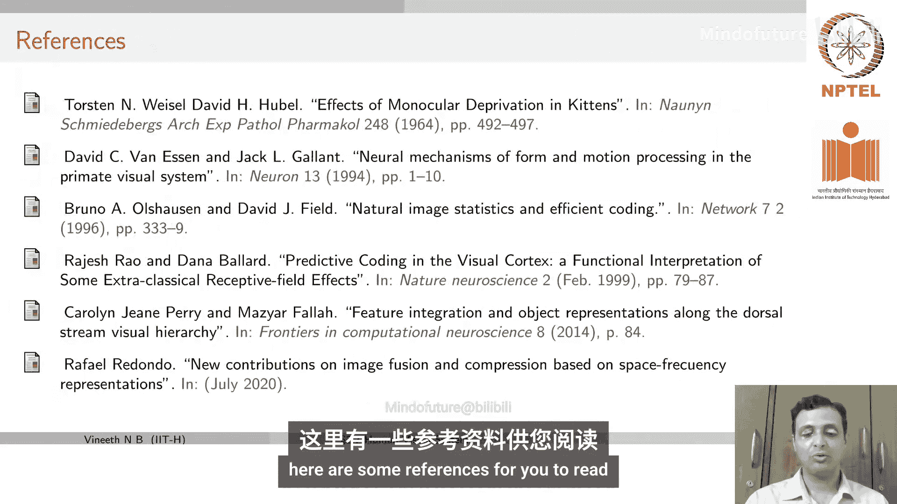

# 【NPTEL】计算机视觉的深度学习 p14 P14_人类视觉系统 -BV1vNWkzpEua_p14-

For the last lecture of this week。You're going to look at whatever you've seen from a very different perspective。

Of the human visual system。So， we saw that。Processing images。Can be done。To achieve several tasks。

Such as extract edges， extract blobs， corners， key points。Extract representations around key points。

 segment images， so on and so forth。For many decades。

These were used extensively in computer vision applications。In particular。

 one of the topics that we covered in the lectures， which was。

A bank of filters using a Gebbor filter bank or steerable filters was about using multiple different filters in different orientations and scales to extract content out of images。

To some extent， we will see now how this approach is similar to how the human visual system processes images。

It's not exactly an imitation， but there are similarities in how。

These methods were used to process images versus how things happen in the human visual system。

So to complete that， let's look at a slightly detailed view of the human visual system。To start with。

An acknowledgecledment。Most of this lecture slides are taken from Professor Rajra's slides at University of Washington。

 so unde stated explicitly， the image sources are also the same。

So the human visual system can be summarized in this diagram there's a lot more detail than what you see in this diagram here but。

What you see here is the eye and the retina and your the scene around you is here around。

Aro the human and the left which will feel and the right which will feel fall on both the eyes and then you can see that the right eye goes to the left part of the brain。

 which is drawn in the blue color here and。Similarly。

 the input to the left eye goes to the right part of the brain drawn in red color shape。

The primary visual cortex is located at the back。And there are other components that the human visual system passes through。

 such as the pvinar nucleus， LGN or the lateral genulate nucleus， superior collicululus。

 optic radiation， so on and so forth。So if you observe carefully here among all the inputs that come in through the retina。

 most of it go to the visual cortex。But theres a slight deviation of some content here。

Which goes into the superior collicculus。And the superior Callicculus is what is responsible。

For feedback to moving the eye， so the superior colcus is what perhaps tells you to move your eyeballs to see something to get a better understanding so on and so forth。

 while the visual cortex is what gives us understanding and perception of the scene around this itself。

Let's see this in a bit more detail。To start once again。

 we talked about this in an earlier lecture too that light visible to the human eye is restricted to one part of the electromagnetic spectrum。

which goes from somewhere roughly between say a little less than 400 nanometers。

 a little over 700 nanometers going from violet to red。

 obviously the radiations that you have to the left of violet are called ultraviolet and the radiations that you have to the right of red are calledfr infr red so this is known to us。

So if you ask us。Why is it thatI receives only this light spectrum the most？

It seems to be that as we have evolved， our vision appears to be optimized for receiving the most abundant spectral radiance of our star。

 the sun。So in this particular case， in this graph on top， you see the energy of。

Of the various components in electromag spectrum。You can see that the sun's energy peaks in the visible spectrum and then falls off over the rest of the electrom electromagnetic radiation and so that is potentially a reason for why。

Our eyes seem to have got used to that spectrum as the most useful spectrum from a vision perspective。

So， the retina itself。Which is the sensor of our human visual pathway。

Consists of photorecepts and also does a lot of image filtering before it passes on information to the next phase of the human visual pathway。

So if this was a retina and a light fell from left to right here。

 so the back of the retina is blown up on the right side so you can see that a bit more closer。

So at the far end it consists of of course epithelial cells and just before the epithelial cells。

 the retina consists of what known as rods and cons， which remain heard of。

 but before falling before the photons fall on the rods and cons。

 there are many other cells too such as what known as ganglions， bipolar cells so on and so forth。

 which the information passes through before reaching the rods and cons。

So each of the rods and cones have specific properties。The rods are sensitive to intensity。

 but not color and why are they called rods and cones their shape， as you can see here。

The rods are shaped like this。And the cones are shaped phoically。

So the rods are sensitive to intensity but are not sensitive to color。

 so they in some sense get a blurred image of what is happening around us。

And cones are sensitive to color， they form sharp images and require many more photons to observe。

 absorb the information。Cones typically form three different types in the in humans。

 each of these cones are sensitive to specific wavelengths and what are these wavelengths。

So you have a set of cones that respond very well to blue color。

 a set of cones that respond very well to green color。

 a set of cones that respond very well to red color clearly rods are somewhere in between where they are not color sensitive but just are sensitive to the intensity of the photons falling on the retina。

This should also explain the RGb aspect of color that we choose because that seems to be where our cones are peaking in the vi spectrum。

So this also explains why a person could be colorblind， so for example。

 if a person does not have green cones， the person may not be able to say green color in the bone on。

So before the image the photons reach the ros and cones。

 there are what are known as gangandlion cells or other cells in the retina。

 which typically operate in what is known as an exitatory manner or an inhibitory manner。

So in this diagram that you see on the slide。Plus， denotes an exitatory reaction。

And minus denotes an inhibitive。有。So cells are organized this way where there is a central cell is which gets excited when a photon falls on it。

And there are a set of cells around it that get suppressed when the photon falls on it。

So what happens？Remember at the end of the day we will see this as they go through this lecture that even the eye access image filters and that's the reason we are talking about it now having discussed image filters。

 edges， features so on and so forth it's perhaps the right time to be able to relate what we have discussed so far to how things happen in the visual human visual system one key difference between whatever we have studied so far to what we are going to talk about in the human visual system is that the human visual system does spatial temporal filtering it's not only spatial filters which is largely what we' have seen so far in this course but it also does filtering over time then talk about this a bit more detail in the next few slides。

Before we go there。As we were saying， arrangements of cells in the retina have components of excitatory and inhibitory elements to them。

 so there could be an excitatory cell flanked by inhibitory cells on either side。

So when a spot of light shines on that when a photon or the spot of light shines on the central cell。

 so when the light is on you can see here these are just a set of impulses。

 remember that at the end of the day the human brain or these cells release chemicals or spikes of electricity as you can see which are known as action potentials。

So each of this is a spike and the the light is turned on， there seems to be and。

Exitatory reaction because the light is at the at the excitatory part。

 those photons follow the excitatory part of the cell。On the other hand。

 if the light is on and the part falls on the inhibitory part of the cells。

You actually see that there is no response or spikes from the cells because those cells which are inhibitory。

 even when photons from them follow them， they actually suppress and do not throw out any potential。

This idea of innovative and exitatory is extremelyly key to how our human visual system works。

So there are two kinds the earlier kind is where we saw the excitatory to be in the middle so it's called on center of surround cell you also have the converse where you have an off center and an arm surround cell in which case you have an inhibitory。

Sell in the middle。And then an excitatory around it flanked on either either side in this case。

 when the photon or the light is on and the photon falls on the middle cell。

Your action potentials or your spikes stop for some time。 this So this particular。

A set of spikes are spikes that you get over time so whenever so the light was on for that duration that you see there so that graph is a graph over time going from left to right so when the light was on you can see that there is no spike that comes out of that particular cells。

Whereas when in this case， when the light is in the region outside the inhibitory cell。

 those are the excitatory cells and you can actually see that they throw a bunch of different spikes。

So this idea of of center and on center where there are cells that inhibit and cells that excite are。

Important components of how our visual system works。As I just mentioned the human visual systems。

 the visual system is a spatial temporal filter， so theres a filter on a spatial site which largely resembles a bb detector or a lapplian of Gaussian for a large extent so it could be either way so you could have a lapplian of Gaussian remember the other way which can peak in the other direction so you could look at for a large part they seem to resemblesem the lapplaceian of Gaussians。

But as I was just mentioning， there is also a temporal filter which acts something like this graph here。

What does this graph mean？When the light is highest， you get the highest response。After that。

 you actually get a negative response before stabilizing。

Which means remember again that in the human visual system it is a spatial temporal filter。

 so when you have an photon that shines or you have an edge that falls on you。

 youre first going to detect the edge， then for a small few milliseconds the reaction is going to be the opposite。

In terms of time， and then you revert back to a stable state。

 so that's what the temporal filter does。Where can you see it taking effect。

 Why do you think this happens Here is an example for that。If you have seen this optical pollution。

 which is a common one。What do you think you see at the center， black dots are the intersections。

 black dots are white dots。This should explained to you what's happening there。

So if you see a white dot， when you move your eye from that， remember。

 the response over time is to go back to the other side and make it look like a black dot before you recover and find out it's a white dot。

And that's the reason such an illusion happens is because of how the temporal filter in the human visual system works。

Another effect that you may have seen popularly is in what is known as color operant processing so in this particular case if you see a lot of these examples these are also visual illusions optical illusions but can you may have seen this as many other settings when you focus on some very strong colors you typically have a negative after image so you focus on the yellow and quickly move around you may find that to be a blue color and you get a negative after image which again correspond to the temporal filter that we are talking about where you get an opposite response over time before stabilizing to an equilibrium。

As we mentioned in the human visual system pathway。You also have a component called LGN。

 which lies somewhere in between。LGN also has very similar centers around and on of。

Structured to the cells in that particular region， which means there are a set of cells。

While one cell could be inhibitory， it may be surrounded by excitatory cells and the vice versa in that same region。

 so you have combinations of both kinds of cells which together lead to perception the way we see things。

Originally the LGN or the lateral genulate nucleus was considered to be more a relay system that takes the input from the retina and passes it to the visual cortex。

 but it's now understood to receive a lot of feedback from various parts of the brain which also come back into the LGN to make it get a more holistic picture of the scene so there are other feedback that come in to make it get the perception that it actually sees。

So the visual cortex or the V1 cortex lies at the far and the far end and let's talk about the visual pathway a bit more detail in the next few slides。

In the visual cortex， the webon cortex， we go back and recall the history of computer vision that we talked about last week where we said that there were two researchers Hubel and Wesel who were the first to characterize the Webon receptorceptive fields by recording from a cat viewing simi from a screen。

 we also talked about them receiving the Nobel Prize in 1981 for this for this work。

And one of their largest contributions。Was to show that the we cortex has two kinds of cells。

Simple cells。That simply detect oriented bars and edges， for example， you can see a bar detector。

 a bar is simply a white region flanked by two black regions or otherwise and an edge detector is the edge detector that we already know those are simple cells。

While complex cells may be invaried into position， but they are sensitive to orientation So if you have。

Certain orientations of edges， the complex cells are what pick up those kinds of orientations in their structure。

The corticle cells actually end up computing derivatives remember again that spatial derivative is orientation sensitive so you get depending on who you place your filter youre going to detect different orientations of edges in your in your image so if you had。

Such an edge in your in the scene that fell on your ice。

 the spatial receptor field would look something like this。

 which is a derivative in space and the derivative in time as we already said。

 would peak and then fall off to the other extreme and then gradually go further。To some extent。

 the spatial derivative and this temporal derivative look similar， but just the tempative temp the。

Time derivative or the temporal derivative leads to illusions based on time when they are looking at an image。

So also some of these cortical cells have direction selectivity as we said the complex cells respond to specific orientations and the oriented derivative can actually be in an Xt space rather than just an x space so for example with all the edge detectors that we saw so far。

 we saw that you could have an edge detector that detects a vertical edge。

An edge detector that detects an horizontal edge or an edge detector that detects an edge with a certain orientation。

But because the brain is processing information in three dimensions， X， Y， and T。

You could also have an edge that's moving， for example。

 you could have a vertical edge that's actually moving。 That's what you see here， So you have。

A right word moving edge， but as you keep moving the edge from left to right。

 you now have a cuoid of space x and y and time t and you would notice that because over time the edges moving from left to right remember again that from unlike the simple cases that we saw so far with filters and masks。

The human visual system is responding to stimuli the change over time it not a still image but a changing image so the human eye has to adapt to those changes in the image too so then it appears that over t youre going to have an edge in a different direction because the edge is actually moving from one part of the image to the other part of the image so in xt dimension。

Your this particular cortical cell will end up having an edge along this direction so where t comes from the movement in one direction an x edge is the edge that it actually remember there is a vertical edge so youre going to have change along the x direction and you have change along the t direction because its also moving edge so an oriented derivative now need not be just in xy space。

which is what weve seen so far， but it can be in Xt space， YT space， so on and so forth。

 so remember that the concept of an oriented edge detector is very different in the human visual system because of the concept of time。

Why is oriented filters important so even from the human visual system perspective。

People have shown that given natural images， and let's say we had to learn independent filters。

Whose linear combination would best represent natural images。

 it can be shown that the optimal set of such filters are actually oriented filters and are localized to different regions of the image。

Another way of saying this is。A natural image simply becomes a positive response to a filter bank with several orientations and each of these filters placed at different regions in the image。

This should perhaps connect you to the discussion that we had with filter banks and Gebbbar wavelets and Gebbar filters and sustainable filters so on and so forth。

 so even at that time we mentioned that Gebbbar filters are known to be little similar to how the visual system human visual system performs and this should perhaps give you the context of why we made that stable。

Also at the visual cortex， the final processing also has two pathways called the doawal and ventral pathways in the visual cortex。

So the do cell pathway is responsible for where information so which part of the scene in front of you are you seeing what youre seeing and the vental pathway is corresponds to the what information or what object are you seeing in front of you so each of these parts lead to different。

Aspects of perception that we see in the scene among us。So the what pathway so is what you see here。

 the what pathway goes from the V1 cortex to the v2 cortex to the V4 cortex to a couple of regions called the T O and T if we are not going to get into this today there are going to be references at the end of this lecture if you'd like to know more about this but those are different parts of the brain as you can see here。

Which finally lead to understanding what the object is。And as you go from each of these regions。

As you go from the V1 cortex to the V2 cortex to the V4 cortex to T U and T。

 each region captures higher abstractions of the information around us。

Remember again that if rods and cones and other early processing in the human visual system are only responding to edges and textures。

 there has to be later layers in the human visual system that make us understand the scene around us。

 maybe a table， a desk， a wall， a water bottle， so on， and so forth。

So the V4 gets higher levels of abstraction， the TO gets even higher levels of abstraction。

 and this is put together as you go deeper and deeper。On the other hand。

 the where pathway you go from v1 to v2 to regions called MST Mt and what is known as。

The posterior parietal cortex。So these cells respond to more and more complex forms of motion and spatial relationships and that's where the where pathway comes into the picture while the what pathway takes。

Different features and puts them at higher levels of abstraction。

 the where pathway responds to more complex forms of motion and spatial relationships。So in fact。

 it is shown that if there is damage to the right parietal cortex。

 it could lead to a condition called spatial hemi neglect。Where a patient which is considered。

A disability。Where a patient cannot see one side of themselves all the time。

 so once again that relates to the where pathway。 So if one part of the parietal cortex is damaged they really cannot see one side of the。

The scene around them and the patient behaves as as if that left field does not exist at all。

 so there have been some experiments that have been conducted where people have asked so these are eye movements that have track on the screen and you can see that the patient is only focusing on the right part of the screen or in another case where a patient is asked to draw a clock the patient ends up drawing only the right side of the clock and does not draw or a left side of the clock these are ways in which this condition is diagnosed。

And the condition is known as hepat spatial henelect or hemispatial neglect。

So to summarize the visual processing hierarchy， so you go from the retina to the LGN to the V1 cortex and from the V1 cortex there are two pathways。

 the where pathway and the what pathway where the。What pathway goes from v1 to v2 to v4 where v1 gives you a certain set of attributes in your image。

 low level attributes in your image V2 puts things together and gets things like edges， borders。

 colors and so on and so forth。V4 gets angles， curvatures， kinetic contours。

 motion and so on and so forth， and TO gets simple shapes and T gets the complex body parts or perceives the world around us as we see it the wear pathway you go from V1 to V2 to empty which detects things like spatial frequency。

 temporal frequency， local and global motion so on and so forth。

MSD gets even higher levels of abstraction in terms of movements such as contractions， rotations。

 translation， optical flow on and so forth， and finally you have a multimodal integration and a better understanding of the wave pathway and the parietal regions。

This was primarily intended to give you a parallel between what weve been discussing so far and how the human visual system perceives if you're further interested theres a nice summary of whatever we were discussed so far in the lecture notes of Dr。

 Ahijuda at UCI on visual perception and if you are further interested there are many more links on the slide which you can read to understand more and the lectures of Dr。

 Rajra from whom these slides were borrowed is also there as one of these links if you want to read more。

Here are some references。所 do。

