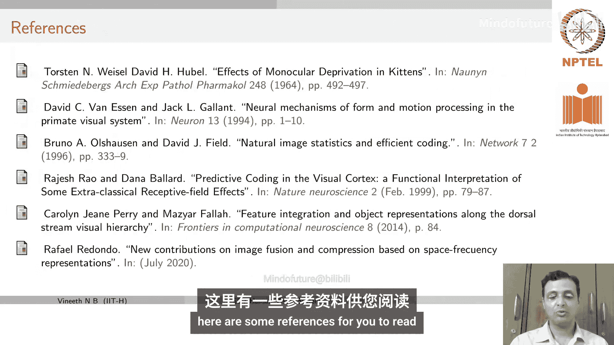

# 深度学习计算机视觉：P14：人类视觉系统 👁️

在本节课中，我们将从人类视觉系统的角度，重新审视之前学习过的图像处理概念。我们将探讨计算机视觉中使用的技术（如滤波器组）与人类视觉处理机制之间的相似之处，并深入了解人眼和大脑如何协同工作以感知世界。

## 概述

在之前的课程中，我们学习了如何处理图像以完成多种任务，例如提取边缘、斑点、角点和关键点，以及分割图像等。这些方法在计算机视觉领域被广泛应用了数十年。特别是，我们曾介绍过使用Gabor滤波器组或可操纵滤波器组，通过不同方向和尺度的多个滤波器从图像中提取内容。现在，我们将看到这种方法在某种程度上与人类视觉系统处理图像的方式相似。虽然并非完全模仿，但在处理图像的方法与人类视觉系统的工作方式之间存在相似性。

为了深入理解这一点，让我们更详细地了解人类视觉系统。

## 人类视觉系统概览

下图概括了人类视觉系统。虽然实际细节远比图中所示复杂，但我们可以从中了解基本流程。

如图所示，人眼接收周围场景的信息。来自右眼的信息传递到大脑左侧（图中蓝色部分），而来自左眼的信息则传递到大脑右侧（图中红色部分）。初级视觉皮层位于大脑后部。视觉信息在到达视觉皮层前，会经过其他结构，如丘脑枕、外侧膝状体、上丘和视辐射等。

仔细观察可以发现，大部分来自视网膜的输入都流向视觉皮层。但有一小部分信息会分流到上丘。上丘负责反馈以控制眼球运动，例如指示眼球转动以获得更好的视野。而视觉皮层则负责我们对周围场景的理解和感知。

## 可见光谱与视网膜

首先，我们需要了解人眼可见的光谱范围。正如之前课程提到的，人眼可见光仅限于电磁波谱的一部分，波长大约在400纳米到700纳米之间，从紫色到红色。波长小于紫光的是紫外线，大于红光的是红外线。

那么，为什么人眼主要接收这个光谱范围的光呢？原因可能在于，随着人类的进化，我们的视觉似乎被优化为接收我们恒星——太阳——最丰富的光谱辐射。在上方的图表中，你可以看到太阳的能量在可见光谱段达到峰值，然后在电磁波谱的其他部分逐渐减弱。这可能是为什么我们的眼睛似乎已经适应了从视觉角度来看最有用的光谱。

视网膜是我们人类视觉通路的传感器。它包含感光细胞，并在将信息传递给下一阶段之前进行大量的图像滤波处理。

下图展示了视网膜的结构。光线从左向右照射到视网膜上，右侧放大了视网膜的背面结构。

在最远端是上皮细胞。在感光细胞（视杆细胞和视锥细胞）之前，光子会经过许多其他细胞，如神经节细胞、双极细胞等。视杆细胞和视锥细胞各有特定属性。视杆细胞对强度敏感，但对颜色不敏感。它们之所以被称为“杆”和“锥”，是因为它们的形状不同。视杆细胞呈杆状，视锥细胞呈锥状。

视杆细胞对强度敏感，能获取周围环境的模糊图像。视锥细胞对颜色敏感，能形成清晰的图像，但需要更多的光子来吸收信息。人类通常有三种类型的视锥细胞，每种对特定波长敏感：一种对蓝色响应良好，一种对绿色响应良好，一种对红色响应良好。视杆细胞则位于中间，对颜色不敏感，只对视网膜上光子的强度敏感。

这也解释了为什么我们选择RGB颜色模型，因为这似乎是我们视锥细胞在可见光谱中响应峰值的位置。同时，这也解释了色盲的原因。例如，如果一个人没有绿色视锥细胞，他可能就无法识别绿色。

## 视网膜中的兴奋与抑制

在光子到达视杆和视锥细胞之前，视网膜中还存在神经节细胞等其他细胞，它们通常以兴奋或抑制的方式工作。

在下图中，加号（+）表示兴奋反应，减号（-）表示抑制反应。

细胞以这种方式组织：中央细胞在光子照射时会兴奋，而围绕它的一组细胞在光子照射时会被抑制。

那么会发生什么？请记住，随着本课程的深入，我们将看到眼睛也进行图像滤波。这就是为什么在讨论了图像滤波器、边缘、特征等内容后，现在是时候将我们所学与人类视觉系统的工作方式联系起来。

我们目前所学与人类视觉系统的一个关键区别在于，人类视觉系统进行的是**空时滤波**。它不仅进行空间滤波（这是我们本课程迄今为止主要看到的），还进行时间上的滤波。我们将在接下来的幻灯片中更详细地讨论这一点。

正如我们所说，视网膜中的细胞排列具有兴奋和抑制成分。因此，可能有一个兴奋细胞，两侧被抑制细胞包围。

当一束光照射到中央细胞时，如果光落在细胞的兴奋部分，你会看到兴奋反应，因为光子激发了细胞的兴奋部分。另一方面，如果光落在细胞的抑制部分，你实际上会看到细胞没有反应或产生电脉冲，因为这些抑制细胞即使被光子照射，也会被抑制而不产生任何电位。

这种兴奋和抑制的概念对人类视觉系统的工作方式至关重要。

有两种类型：我们之前看到的是兴奋在中央，称为**中心兴奋-周边抑制细胞**。你也有相反的类型，即**中心抑制-周边兴奋细胞**，在这种情况下，中央是抑制细胞，两侧是兴奋细胞。在这种情况下，当光子或光照射到中央细胞时，你的动作电位或电脉冲会停止一段时间。因此，这组脉冲是随时间产生的。当光照射时，你可以看到该特定细胞没有产生脉冲。而在这种情况下，当光落在抑制细胞区域之外时，那些是兴奋细胞，你实际上可以看到它们产生了一系列不同的脉冲。

因此，这种中心抑制和中心兴奋的概念，即存在抑制细胞和兴奋细胞，是我们视觉系统工作方式的重要组成部分。

## 空时滤波与视觉错觉

正如刚才提到的，人类视觉系统是一个空时滤波器。在空间上，它有一个滤波器，很大程度上类似于边缘检测器或高斯拉普拉斯算子。它可以是任何一种方式，所以你可以有一个高斯拉普拉斯算子（记住另一种方式可以朝另一个方向达到峰值）。在很大程度上，它们似乎类似于高斯拉普拉斯算子。

但正如刚才提到的，还有一个时间滤波器，其作用类似于下图。

这个图是什么意思？当光最强时，你得到最强的响应。之后，在稳定之前，你实际上会得到一个负响应。

请再次记住，在人类视觉系统中，它是一个空时滤波器。所以，当你有一束光子照射或一个边缘落在你身上时，你首先会检测到边缘，然后在几毫秒内，反应会是相反的（在时间上），然后你恢复到稳定状态。这就是时间滤波器的作用。

你可以在哪里看到它的效果？你认为为什么会发生这种情况？这里有一个例子。

如果你见过这种常见的光学错觉（例如赫尔曼网格错觉），你认为在交叉点中心看到的是黑点还是白点？这应该向你解释那里发生了什么。

如果你看到一个白点，当你的眼睛从那里移开时，请记住，随时间的反应是回到另一边，使其看起来像一个黑点，然后你才恢复并发现它是一个白点。这种错觉发生的原因就是人类视觉系统中时间滤波器的工作方式。

你可能见过的另一个效应是颜色拮抗处理。在这种情况下，如果你看到很多这样的例子（这些也是视觉错觉），当你专注于一些非常强烈的颜色时，你通常会有负后像。例如，你专注于黄色，然后快速移动视线，你可能会发现它变成了蓝色，你得到了一个负后像。这再次对应于我们正在讨论的时间滤波器，你在稳定到平衡之前，会随时间得到相反的反应。

## 外侧膝状体与视觉皮层

正如我们在人类视觉系统通路中提到的，你还有一个称为**外侧膝状体**的组件，它位于中间某处。LGN中的细胞也具有非常相似的中心-周边结构，这意味着存在一组细胞，其中一个细胞可能是抑制性的，它可能被兴奋性细胞包围，反之亦然。因此，你拥有两种细胞的组合，它们共同导致了我们看待事物的感知方式。

最初，LGN被认为更像是一个中继系统，将输入从视网膜传递到视觉皮层。但现在人们理解到，它接收来自大脑各个部分的许多反馈，这些反馈也返回到LGN，使其获得更全面的场景感知。因此，还有其他反馈进入，使其获得实际看到的感知。

视觉皮层或V1皮层位于最远端。让我们在接下来的幻灯片中更详细地讨论视觉通路。

## 视觉皮层：简单细胞与复杂细胞

在视觉皮层，我们回顾一下上周讨论的计算机视觉历史，我们提到有两位研究人员Hubel和Wiesel，他们首次通过记录猫观看屏幕时的反应，描述了视觉皮层的感受野。我们还提到他们因此获得了1981年的诺贝尔奖。

他们最大的贡献之一是表明视觉皮层有两种细胞。

*   **简单细胞**：简单地检测定向的条状和边缘。例如，你可以看到一个条状检测器（条状只是两侧被黑色区域包围的白色区域，反之亦然）和一个我们已经知道的边缘检测器。这些都是简单细胞。
*   **复杂细胞**：可能对位置不变，但对方向敏感。因此，如果你有某些方向的边缘，复杂细胞就会在其结构中拾取这些方向。

皮层细胞最终会计算导数。请再次记住，空间导数对方向敏感。因此，根据你放置滤波器的位置，你将在图像中检测到不同方向的边缘。因此，如果你的场景中有这样一个边缘落在你的眼睛上，空间感受野看起来会像这样，这是空间导数。而时间导数，正如我们已经说过的，会达到峰值，然后下降到另一个极端，然后逐渐进一步变化。

在某种程度上，空间导数和这个时间导数看起来相似，但时间导数会导致基于时间的错觉，当人们看图像时。

## 方向选择性与时空滤波

此外，正如我们所说，一些皮层细胞具有方向选择性。复杂细胞对特定方向做出反应，而定向导数实际上可以在Xt空间（空间-时间）中，而不仅仅是在X空间（空间）中。

例如，到目前为止我们看到的所有边缘检测器，我们看到你可以有一个检测垂直边缘的边缘检测器，一个检测水平边缘的边缘检测器，或者一个检测特定方向边缘的边缘检测器。

但由于大脑在三个维度（X、Y和T）上处理信息，你也可以有一个移动的边缘。例如，你可以有一个实际上正在移动的垂直边缘。这就是你在这里看到的。你有一个向右移动的边缘。但当你从左到右不断移动边缘时，你现在有了空间X、Y和时间T的立方体，你会注意到，因为随着时间的推移，边缘从左向右移动。请再次记住，与我们迄今为止看到的滤波器和掩模的简单情况不同，人类视觉系统对随时间变化的刺激做出反应。它不是静止图像，而是变化的图像。因此，人眼也必须适应图像中的这些变化。因此，在T维度上，你将有一个不同方向的边缘，因为边缘实际上从图像的一部分移动到另一部分。所以在Xt维度上，你这个特定的皮层细胞最终会有一个沿这个方向的边缘。其中T来自一个方向的运动，X边缘是它实际记住的垂直边缘。所以你将沿着X方向发生变化，并且沿着T方向发生变化，因为它也是一个移动的边缘。

因此，定向导数现在不一定只是在XY空间（这是我们迄今为止看到的），它可以在Xt空间、YT空间等中。所以请记住，由于时间的概念，定向边缘检测器的概念在人类视觉系统中是非常不同的。

## 定向滤波器的重要性与自然图像

为什么定向滤波器如此重要？即使从人类视觉系统的角度来看，人们已经表明，给定自然图像，假设我们必须学习一组独立的滤波器，其线性组合能最好地表示自然图像，可以证明，这样一组最优的滤波器实际上是定向滤波器，并且定位于图像的不同区域。

另一种说法是，自然图像简单地变成了对具有多个方向的滤波器组的正响应，每个滤波器放置在图像的不同区域。

这或许应该将你与我们之前关于滤波器组、Gabor小波、Gabor滤波器和可操纵滤波器等的讨论联系起来。因此，即使在那个时候，我们也提到Gabor滤波器已知与人类视觉系统的执行方式有些相似，这或许应该让你明白我们为什么做出那个陈述的背景。

## 视觉皮层通路：什么与哪里

同样在视觉皮层，最终处理还有两条通路，称为视觉皮层中的**背侧通路**和**腹侧通路**。

背侧通路负责“哪里”信息，即你看到的是你面前场景的哪个部分。腹侧通路对应于“什么”信息，即你在面前看到的是什么物体。这些部分中的每一个都导致我们在场景中看到的不同感知方面。

因此，“什么”通路如图所示，从V1皮层到V2皮层，再到V4皮层，最后到几个称为TEO和TE的区域。我们今天不会深入探讨这一点，如果你想了解更多，本讲座末尾会有参考文献。但如图所示，这些是大脑的不同部分，最终导致理解物体是什么。

当你从这些区域中的每一个区域前进时，从V1皮层到V2皮层，再到V4皮层，再到TEO和TE，每个区域都捕获了我们周围信息的更高层次的抽象。

请再次记住，如果视杆细胞、视锥细胞和人类视觉系统中的其他早期处理只对边缘和纹理做出反应，那么人类视觉系统中必须有更深的层次让我们理解周围的场景，可能是一张桌子、一张书桌、一堵墙、一个水瓶等等。

因此，V4获得更高层次的抽象，TEO获得甚至更高层次的抽象，并且随着你越来越深入，这些被整合在一起。

另一方面，“哪里”通路你从V1到V2，再到称为MST、MT和**后顶叶皮层**的区域。这些细胞对更复杂形式的运动和空间关系做出反应，这就是“哪里”通路发挥作用的地方。而“什么”通路获取不同的特征并将它们置于更高层次的抽象，“哪里”通路则对更复杂形式的运动和空间关系做出反应。

事实上，研究表明，如果右顶叶皮层受损，可能导致一种称为**空间忽视症**的状况。这是一种残疾，患者始终无法看到自己的一侧。所以再次强调，这与“哪里”通路有关。因此，如果顶叶皮层的一部分受损，他们真的无法看到周围场景的一侧，患者的行为就好像那个左侧视野根本不存在一样。所以已经进行了一些实验，人们要求（这些是在屏幕上跟踪的眼球运动），你可以看到患者只关注屏幕的右侧。或者在另一个案例中，要求患者画一个时钟，患者最终只画了时钟的右侧，而没有画或画了时钟的左侧。这些是诊断这种状况的方法。这种状况被称为半侧空间忽视。

## 视觉处理层次总结

总结视觉处理层次结构，你从视网膜到LGN，再到V1皮层，从V1皮层有两条通路：“哪里”通路和“什么”通路。

*   “什么”通路从V1到V2到V4，其中V1为你提供图像中的某些属性（低层属性），V2将事物组合在一起并获得诸如边缘、边界、颜色等。V4获得角度、曲率、运动轮廓、运动等，TEO获得简单形状，TE获得复杂的身体部位或感知我们周围的世界。
*   “哪里”通路你从V1到V2到MT，MT检测诸如空间频率、时间频率、局部和全局运动等。MST获得甚至更高层次的抽象，在运动方面，如收缩、旋转、平移、光流等，最后你有多模态整合和对“哪里”通路以及顶叶区域的更好理解。

## 总结

本节课中，我们一起学习了人类视觉系统的基本工作原理，并将其与计算机视觉中的图像处理技术进行了对比。我们了解到：

1.  人类视觉系统是一个复杂的空时滤波系统，不仅处理空间信息，还处理时间信息。
2.  视网膜中的感光细胞（视杆和视锥）以及细胞间的兴奋-抑制机制，构成了早期视觉处理的基础，类似于图像处理中的边缘检测。
3.  视觉皮层中的简单细胞和复杂细胞分别负责检测基本特征（如定向边缘）和更抽象的模式。
4.  视觉信息在脑中通过背侧通路（“哪里”通路）和腹侧通路（“什么”通路）进行并行处理，分别负责空间定位和物体识别。
5.  计算机视觉中使用的定向滤波器组（如Gabor滤波器）在原理上与人类视觉系统处理自然图像的方式有相似之处。

本节课旨在为你建立迄今为止我们所讨论内容与人类视觉系统感知方式之间的平行关系。如果你对此进一步感兴趣，可以参考课程中提供的参考文献进行深入学习。