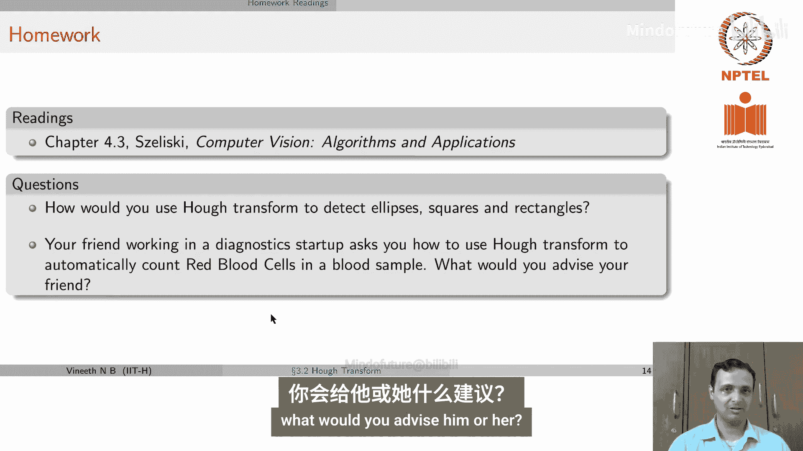

# 【NPTEL】计算机视觉的深度学习 p16 P16_霍夫变换 -BV1vNWkzpEua_p16-

The next topic。That we're going to talk about in trying to match shapes。

Or any other templates on an image。Is the method known as half transform。Once again。

 this lecture slides are also based on the excellent lectures of Professor Yni at IRarren。

 as well as the lectures of Professor Mobaraksha at the University of Central Florida。

We've already seen。A couple of line fitting methods。We saw these squares fit。And then we saw Rasack。

The question that we're going to ask now is what do you do if there are multiple lines？

Placed in a particular orientation or placed in a particular configuration in an image。

It could be multiple lines。It could be a polygon， it could be a circle then how do you deal with fitting a shape onto the set of data points that you have and that's what we're going to talk about now when we go to half transform。

This method dates back to the early 60s by Huff who filed the US patent for this。

 but since then there have been many efforts that have translated this into what we see today in the early 70s the HF transform was used for detecting of lines and curves then in the early 80s there was a method that came that was called generalized Huff transform and well see all of these over the next few slides。

Let's start with a simple equation of a line in Cartesian coordinates。

 which we all know is y is equal to Mx plus C。Where we say that M is the slope and C is the y incent。

You could just play with the terms of the equation a little bit and then write this as。

C is equal to minus x into M plus y。知得。We now live in anvoice em space。Where。Ex。

And a C interpret a C intercept y define the line in that space。

So we were originally the xy space where M defined the slope and C defined the y in descent。

We could just rearrange these terms slightly to now go to an m space where minus x becomes the slope and y becomes the C intersect。

In this kind of a context。Every point。In M capacity C in that space。

Becomes the equation of a line in the x Y space。 Remember for every choice of M and C。

 you will get the equation of a line as we see here。

And every point in the xy space similarly would become the equation of a line in the MC space。

There is a dual correspondence between these two spaces。So what do we do with this？

We know that to fit any model we need a certain number of samples， for example to fit a line。

 we need two samples if it was any other model if you were fitting a square or a circle we need a different number of points to fit a line you may need two points let's start with that example。

But even if you had just one point instead of two points。

 you know that it could belong to a certain family of lines。

It gives you some partial information about the line equation itself。

So what we can ask every point in your x， Y space to do is to vote for certain configurations of M and C in case we are talking about a line。

It's a。Every point can vote for what configuration of M C would have resulted in this point being at that particular location。

And then you collect votes for all such points and then try to see consensus and wherever there is the majority vote。

 you are going to say that that is the equation of the line that I'm looking for。

Let's elaborate on this and go through slowly。Before we go forward。

We spoke about the Carsian coordinates of the previous slide。Unfortunately。

 the CAteian formulation can be problematic for vertical lines。Can你 say why。

When you have a vertical line， your slope is unbounded。

It becomes difficult to represent such a line in your MC space because M has to be infinity。So。

 in such a scenario， it may be wiser to use a slightly different parameterization。

 the polar parameterization， which is written in terms of rh and theta where rh is the distance of the line from origin。

And theta is the angle made by the normal to the x axis。ほ。

You can also write a row as x co theta plus y theta p s theta。

 this is a standard polar polar parameterization that' is used going through guarddihi coordinates to polar coordinates。

We know now that in this space row is bounded， at least lower bounded by 0 and theta lies between 0 and 36 we know that these quantities are bounded。

 which makes it slightly easier to work with。So every point in your original space。

 in your Cartesian space， x Y。Whats。For many points in your parameter space。

So if you had a certain line， certain point x1 in your original Cartesian space for the moment we are going to talk about this method generally in terms of a Cartesian space and fitting a line or fitting a circle and so on and so forth a little later in this lecture we will talk about how do you use this images if you have already sensed what's coming we are trying to find out how do you use half transform to match lines or circles or any other shape in an image that's the goal of this of this lecture or the method discussed in this lecture but before we go to an image which is going to solve generally about Cartesian coordinates so if you have a point X1 in the X Y space you know that there are a family of lines that can pass through x1。

And each of those lines has a correspondent m comm C it's go to have a slope and a y inter inter set and all of them will result to corresponding points in the MC space or the R theta space if you go to the log polar space。

 youll have a slightly different mode， they will correspond to a point here in the R theta space。

So for every point， x y can vote for many points in your parameter space， which that。

That particular x x1 point would have been lying on。

So each line through this point x1 y1 is a vote for a point in a parameter space that satisfies row is equal to x1 cos theta plus y 1 sine theta。

 let's see a few examples here is another line that passes through x1 and that would vote for a different point in the parameter space it says here。

Here is another line that passes through x1。That would work for a different point in the parameter space。

Remember， the parameter space now is defined in a polar parameterization。

And you keep repeating this for several lines that could have passed through x1 and all of them get votes in the parameter space。

Similarly， you could have another point x2 in your original space through which you would have another set of lines that can pass in your original Cartian space and each of those lines would may vote for a different parameterization in your parameter space you can see that again here it several examples for several lines that pass through x2 you get several votes in the parameter space。

Let's try to recount this through an algorithm。So you have your data X。

You have a set of quantized parameters theta min to theta max， for example。

 if you take your polar parameterization you may not want to vote for every angle between 0 and 360 you may want to divide 0 to 36 to 10 degree bins and have 36 possible theta values that's what we mean by a quantized parameter here。

You also initialize an accumulated array， which is simply a frequency count。

 it's simply a frequency count of wordss， you can look at it that way。

So for every point x y in your Caressian space。We try to see for theta belonging to theta。

 you have 10 possible thetas。If you write out， the rh is equal to x cos theta plus y side be theta。

We try to see for each set of model parameters consistent with the sample。

 so which row and which the theta would align with this particular x y that we have taken you increment the a for that theta and room。

So imagine the accumulator being a 2 d matrix defined by theta values on one axis and row values on the other axis。

 which could also be quantized you could quantize distance into distance of say certain number of units。

And whichever row and theta we know corresponds to this x and y that we have。

 you go to that row and theta and。In each of these cases。

 you could check for consistency and increment that cell in the accumulator matrix by one。

And you keep doing this for every Xy point that's given to you。

 those are a set of points that are given to you and you keep accumulating and at the end you do a non- maximumaxum suppression in a so if you have many different bins that have a high vote you do a non- maximumum local non maximumimum suppression to see which bin has the really highest pointss and you define that theta and row to be corresponding to the model that corresponds to that directly has a bearing on the data in your x matrixs。

This gives you a way of estimating the theta and row or in Carteian coordinates finding the equation of the line corresponding to this this set of points that are given to you this is as you can see this is very similar to a least square fit but doing it in a slightly different way they are still trying to fit a line to a set of points that is given to us but we are doing it using the half voting approach。

Okay， now， as I promised， here is an example from an image perspective， let's say we have an image。

And those the image has several lines and we find want to find the equations of those lines that could be several applications where this may be required。

 let's say for instance that you're trying to take images of a computer chip and try to find out say how those lines are aligned on a computer chip or so on and so forth you want to find the equations of those lines。

So using the same approach that we just talked about on the earlier slide you assume a certain parameterization。

 you ask for each point to vote to which parameterization may have generated in that particular point and you end up getting votes over your accumulator 2D matrix which is say row and theta so you can see here that you have a bunch of votes that spread across many different。

Accumulator bins， we said the accumulator is a matrix with pro and theta。

Now you do a non maximum suppression to maintain only the local minima in your accumulator。

And once you do this local maxima， you find that there are。4 maxa here。

 which corresponds to four values。Or four parameterizations of lines。

 which are the four lines that you actually have in your poison image。

And those are the points that we're voting for each of those accumative win。This way。

 you can find out the equations of those lines as well as which points in the original image correspond to those equations。

To be able to extract that shape in that image。So you can actually find equations of lines。

Any image given to you using this approach？Let's make this a bit harder now。

 let's say we want to now find circles in an image。We did talk about block detection earlier。

 but when now we want to exactly find the circle with its radius and center and be able to parameterize it perfectly。

So circle fitting is very similar to line fitting and that' is going to be the fitting that you are looking for x minus x not square plus y minus y not square plus r square is equal to 0。

What should be the dimensions of the accumulator for line， the accumulator was a 2 d matrix。

What would be the dimension of the accumulator for circle fitting？

It would be a 3 d3 dimensional accumulator where you have x do y not which corresponds to the center of the circle and r which corresponds to the radius of the circle those are the three votes that each point is going to be voting for。

So the way since we have three possibilities here， one option is to fix one of the parameters and generally you fix the radius and then look for the rest。

 ask every point to vote for just the center and then you can keep going around going in a roundrobin manner to ensure that every point workss for all three parameters at the end。

So you keep incrementing the accumulator for every vote that a point makes to each of these values and at the end you do a local maxima in a and this way you can actually estimate the parameterization of the circle that you are looking for。

Here is a visual illustration。where given a set of coins in an image you can actually now find out where those coins lie and what is the what is the radius of that coin by first extracting edges so in this you have to first extract edges and then be able to use those edge information to be able to find the exact parameterizations of the circles when I say parameterizations。

 I mean define the centers and radii of each of those circles that you have。

You you need not stop with just lines of circles， you can obviously do this for any other shape as long as you can parameterize any shape in an analytical manner。

 you can give a set of equations to define a shape。

All you have to do is take a point in your personal image and ask you to vote for what would be the parameters of a polygon that that point belongs to or lies on and then you just count which parameterization got the higher spots amongst all the possibilities in your parameter space and simply define that to be the polygon or any shape that you' are looking for。

But what if you are looking for a shape that has no analytical description， for example。

 on this slide， you see this irregular shape which has no analytical distribution which has no analytical definition。

How do you estimate， how do you find such shapes in an image we do assume that the shape is given to us。

So you do know that that this is the shape that you are looking for in a given image and it could be of different sizes。

 could be rotated in different ways， could be scaled， all of those transformations are possible。

But we want to find where in the image it lies The only thing we know is that this shape in this particular case may not have an analytical definition。

 you cannot write it as an equation。What do you do in this particular case？

You define a reference point in the shape you could define， for example， an x not y not。

As a reference point in that shape。And now every edge point of this shape can be defined with respect to that reference point。

 so every every point here say x y。Has has a certain length from your reference point x y and a certain angle with respect to the reference point x y as an example x y0 could be the centroid of that object that you are looking for。

 but it need not be the centroid， it could be any reference point。

So once you have a centroid or any other reference point for each edge point that you have。

 so remember again that given a new image you have to first do an edge detection to get the edge points。

 then for each edge point。You compute what is the distance to the centroid you would first do this for the template object that you have before you run it on any new image this is when you when you know that this is the shape you are looking for。

 you define a reference point for each edge point in this particular shape。

 you compute a distance to the centroid which is R and an edge orientation fire。

And then you create something called an R table。And what the R table says is that for a given edge orientation 51。

What are all the possibilities， What are all the points that could have a certain。

RadiI with the same orientation with respect to the reference point。Similarly。

 for another point with another orientation phi 2 let's say Phi 2 is this particular edge point that has a certain radius with respect to the reference point。

 similarly this there could be another point with the same angle which would have a certain radius r21 there could be a third point with the same angle the same edge orientation and that could have a radius r23 and you create an r table which connects these orientations and these distances to the centroid or the reference point。

So once you've built this R table， what do we do？Here is the algorithm of what is known as generalized half transform so you have your data you are given your R table which you've already built from the shape that was given to you remember once again the shape is defined for you not defined is given to you It's not well defined mathematically is given to you using that shape you construct something called the R table and you also construct an accumulator array for how many your dimensions you have to estimate so if that reference point has two coordinates。

 you have the two coordinates to vote for otherwise you may have other parameters to if you allow your shape to change in multiple ways you could have other dimensions in your accumulator for which also the points can vote in this particular case to keep it simple let's assume that the shape is going to be the same just that the shape could be placed anywhere in the image no scaling no rotation that's assume that that's the scenario here so the only thing that you are trying to find is where would the centroid of that。

Oject。So you have an accumulator array， which is of two dimensions going from x c min to xc maxax cmen and c max are the maximum values of that the centralroid can assume index in the x axis。

 similarly y cmen to yc max and you initialize the accumulator every cell of the accumulator to0。

 then for every point，For every R5 I in your R table。

You try to write if your centroid can be written as this x plus R cos phi plus this y plus R cos5。

If you can write your sendroid。With respect to this given X Y using this particular formula。

 you would。Increase the accumulator for that particular cent。

And you would keep doing this for various different centroid possibilities where your centroid possibilities will come from Xcmen to Xc max and Ycmen to yc max where you discretize your possibilities of the centroid and you create an accumulator array。

Thats that's the way you would do it and at the end you would get a set of values。

 a set of frequency counts as to what each XY voted for and you do a nonmimum suppression to find the local maxma and that's going to give you the final x C YC which correspond to this new set of points that are given you you。

Speaking in terms of images， once again， let's assume that this is the shape that you're looking for。

As I said， we assume in this example here that we are only looking for this shape as is no scale change no rotation change。

 so which means the only thing that can change is the center of the object could be on different parts so that's why were voting only for where the center is。

And。Each so given a new image， you run an edge detector and for each edge point let it vote for where the centroid would be and wherever you get the maximum votes for the centroid is where your centroid potentially could be。

You could use this kind of an approach to say find a car in an image。

If you knew a car has a particular shape。You define that shape。

You now ask every you run an edge detector on a new image and then ask each head point on the edge to work for where the center of the car is and based on that you can you can probably trace where the car is located in the given image so you could use such an approach even for object detection。

Again， within certain changes in your shapes in the possibilities of the shape。

 if a car's pose completely changes obviously this kind of an approach will not work in that scenario。

 so it works only with certain tolerance to summarize the h transform it is an effective approach for detection of shapes。

Objects including say multiple， even if there are multiple cars you can probably find all of them。

 you could have multiple maximma in where edges work for the centroids of the cars and each of them may be different instances of a car in a given image。

 so you can also do use this for detection of multiple instances of object in an image。

The advantages of the H transform is that it deals with occlusion fairly well because it's a voting procedure if。

As long as the number of votes is high， it does not matter if certain votes went wrong。

 so even if a certain part of the object was occluded。

 it can work obviously if a significant part of the object is occluded it will not work。

It's also robust to noise for the same reason because you only need to look at a certain set of pixels and as long as they vote for。

A majority as a majority， you're going to get your shape or object in the image。

The problem here is it can be computationally expensive because of the depending on how you quantize your parameter space。

 remember that every point has to cast a vote for different possibilities in your parameter space which can be time consuming and setting your parameters and quantizing them may not be easy for different kinds of shapes for line circle and a few welldefined shapes it may be straightforward for certain other shapes this may not be easy or quantizing them may not give very accurate answers。

 those are some limitations to work with you。Here is the visualization of the car example。

 so you have a model image。And there are some key points with respect to a reference point at the center of the image。

So you record the coordinates relative to the reference point in the model image。

And for every test image。You look for the same configuration of the key points with respect to the centroid of the object。

So in these particular cases， the car is inverted， but when the test image is of the same configuration as the original object。

You would find a match in this particular scenario。Here is one more example。

 so if you considered your model image to be the Eiffel tower and here is a test image which is also the Eel tower taken in a different scale on a different day with different lighting conditions。

You then have your。Accumulator。After you find your model image points in your original image and your test image。

 you have your accumulator that votes for the centroid of the object with respect to various key points in that object。

You considered a local maxima。You'll see very clearly here that the local maxima is somewhere in the middle。

And based on that。You vote for where the Eiffel tower is located in the test image。

The homework for this lecture is Cha 4。3 of Cellesky's book and a couple of questions for you to think about。

How would you use h transform to detect ellipses squares and rectangles try to work out what the paraizations or the analytical forms of each of these shapes is and try to find out how the accumulator array would look in each of each of these cases that should help you address these problems and a real world use use case let's assume your friend working in a diagnostic startup asks you how to count the number of red blood cells in a blood sample automatically so you have a blood sample you want an automated way to count the number of red blood cells。

Using H transform。What would you advise him for？

Something for you to think about and hear the references。

