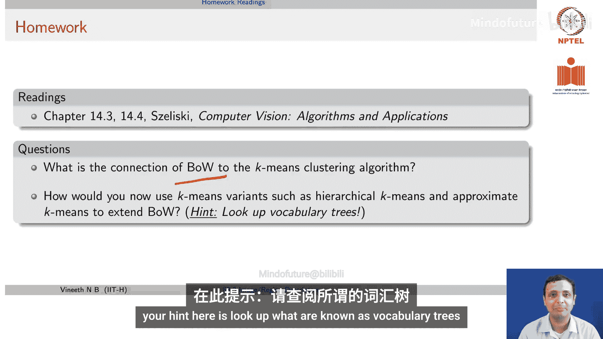

# 【NPTEL】计算机视觉的深度学习 p17 P17_从点到图像 - 词袋和VLAD表示 -BV1vNWkzpEua_p17-

Moving on from the previous lecture。We will now talk about how you describe entire images。Sofi。

We spoke about how to obtain deors for certain key points in images。

 which could be in several multiples in each image。

How do you aggregate these descriptors to obtain a single descriptor for an image？

And why do we need this？We talked about image panorama stitching where you try to match key points。

 you may now want to match images themselves， for example， in image search or retrieval。

 or even to perform image classification as we will see when we go through these slides。

In this lecture， we will focus on two specific kinds of descriptors。

 the bag of words descriptor and another extension of it known as the VA descriptor。Once again。

 the lecture slides are based on Professor Yni's lectures at InRN。

So we have spoken about so far obtaining key points from two different views of the same scene or object。

You have two different views， you extract key points in both of these views。

 you get descriptors of key points in both of these views， and you match them。

And perhaps try to match the geometry of the configuration between them using methods such as Rasack or have transpo。

 so on and so forth。But the question that we are asking here is what if we want to match different instances of an object the object is no more the same in the earlier slide it was the same object from different viewpoints now the object could be completely different in this case it is a helicopter but completely two different helicopters。

They're not the same object itself。Then how do you match or how do you search， for example。

 image or imagine your Google image search where use you're going to search for helicopter kind of images so you post an image and ask the system to retrieve similar images for you。

How do you do this is what we're going to talk about now the main observation here is that rigid transformations may not work here。

So far， if you only wanted to match。Two different objects or scenes taken from different perspectives。

 you could consider one to be a rigid transformation of the other。

 You could try to estimate your a parameters， your rotation parameters or your translation parameters。

 but when these are completely two different instances of an object。

 it may not be a rigid transformation at all。So ideally what we want to do is now to see if we can completely discard geometry itself because it's normal going to be a rigid transformation。

 can we completely discard the idea of geometry， try to match images in some other way beyond geometry and then maybe later using other methods we'll try to bring back certain elements of geometry little loosely into the mix。

So our first attempt towards getting image level descriptors is a method known as bag of words。

 an old method has been used a lot in text before， but let's try to see how do we use this in images。

So we're going to start with a set of samples， a set of data points。

Then you form a vocabulary of those data points， what do we mean by vocabulary a set of common words that exist across images and finally based on the vocabulary。

 we are going to get a histogram which is simply a frequency count of words in a certain document in our case visual words in a certain image let's try to describe that in more detail so if you had text information your samples would simply be different sentences。

Your vocabulary would be the words that occur in these sentences。

 all the possible words that you have occurring in your sentences。And finally。

 for each of these sentences， you would come up with a histogram of how many occurrences of a particular word in your vocabulary happened in this particular sentence。

So for each of your sentences， you can look up a vocabulary or a dictionary and try to see how many times each word in the vocabulary or dictionary occurred in this particular sentence。

Let's try to draw a parallel to images now。Let's say you have three different images in this particular case。

So you form a vocabulary。So what does a vocabulary mean for images in text， it's perhaps simple。

 it's all the words that occur in your documents。But if you had images。

 what would be your vocabulary？So the way we are going to define vocabulary is very simple again。

 you take different parts of each of these images。그룹럽 them together。

And see which of them correspond to something common， for example， it could be possible that。

There are six kinds of visual words that occur in the first image， which all look similar。

 maybe they may look similar in color， in texture or in any other appearance of the representation you choose。

Similarly， the second image has itous set of visual words and the third image has a set of visual words once again。

 we define visual words as extracting several parts from an image。

 so if you have a set of images you extract parts from all of those images and then try to pull them in some way and then group them and say these parts in the image。

 have to seem to have similar properties and I'm going to group them into one particular word。

We'll see this a little bit more clearly for the next few slides and once you get these visual words similar to text。

 you have a histogram of。How many times each of these visual words occurred in a given image that histogram is what is drawn here for each of these three images。

Let's see a more real world example to understand this a bit better。Before we go there。

 what could be uses of bag of words， it could be used for image retrieval as well as image classification as we just spoke。

 why， because this is a way to represent an entire image as a single vector。

Let's see this using a more tangible example。Here is an example of an image。

And let's assume that this is the query image。And here is an image from a dataset set so you could imagine that the dataset images are your entire repository of images that you have and the query image is like Google image search where you put up this image and youre asking for a search engine to retrieve all images similar to this image for example you could upload a CA image on any search engine and ask the search engine to retrieve similar CA images。

 a very similar example here。Let's assume that there is a 15th image in your dataset image which has an occurrence of the similar structure now let's see what would happen earlier and how we would change things now。

Earlier， we would take key points in each of these images。

Descriptors around these key points in each of these images and try to do a pairwise matching between the descriptors in both of these images and this is obviously a time takingking process because if you had many key points。

 many descriptors in each image， you would ideally have to do a pairwise matching between every number in the first image versus every number in the reference image this can get computationally expensive。

If you had another image， you would have to repeat the same process for as many times between the query image and the second reference image and so on and so forth for all reference images。

So how do we want to resolve this problem？So what we are going to say now is that if there were descriptors that were similar。

 that would match between the two images。Instead of matching them pairwise between the query image and reference image。

Let's try to assume that similar descriptors will anyway correspond to similar representations in that representation space in a certain metric。

 let's say the Euclidean me right so a group of visual words or regions that are similar to each other would probably have similar representations and they all group together in the representation space。

Similarly， for those regions marked with blue and the regions mark with， right？

They are similar and they will probably match in their representation space。 How do we use this？

So what we would say now is that so this is just to say that how these representations match again。

 so what we would do now is to come up with the representation a common representation for all similar descriptors how do we do that we could simply take your entire repository of images or training images。

Take visual words from them which are common to each other and simply obtain their meanme。

In that space， that becomes the visual word corresponding to all of those visual words in in the repository of images or training images。

 so you would do this process offline before the retrieval process starts so you could you could construct your visual words offline and keep them stored and ready when your search process actually begins。

So these visual words are only stored。Given a query image。

 you take the descriptors corresponding to the key points in your query image。

 and now you simply match them with the visual word。

 which represents the mean of similar visual words in your reference images。

 You don't need to do pairwise matching with every descriptor in your reference word anymore。

 You would have a set of visual words that are common across your repository of images。

 you only need to match with them now to be able to get your answer。

This makes this process very feasible to do， as well as very effective。

There's no pairwise matching required and your visual words now act as a proxy for your descriptors in your repository。

Now let's see this in more。A more well definedfined way。

 so let's imagine that your image now is represented by vector Z belonging to R part K where k is the size of the codebook or the number of visual words that you choose which would be a parameter that a user would set for a particular data set。

Each element of Z， which is Z I， is represented as W I and I where WI is a fixed weight per visual word。

 you can choose to assign a weight if you don't have a weight， they could just have uniform weights。

And NI is the number of occurrences of that particular word in this query image。

I'll repeat that so WI is a weight per visual word which is optional and N is the number of occurrences of that word in this inch。

So given a set of n images in your repository in your reference images。

 which are represented by Rk cross n by a capital Z and R cross cross n。

 remember they are going to be K visual words and n such images for each image you would have a K dimensional vector so and then n such images becomes K cross n and for a query image you would simply compare the similarities between your query images vector representation so which is going to count the number of visual words in the query image。

And the number of visual words in each of the reference images。

 you simply take a dot product or a cosine distance between these two and you get a set of scores。

 you sort order your scores in descending order and that gives you the best match followed by the next best match。

 so on and so forth。Note here that when we take a cosine distance based on say dot product。

 remember here what we are doing as a dot product in Z transpose Q is you would take every column of Z which would correspond to one specific image and you're taking an individual dot product of that reference image with this query image queue。

 the second reference image with the query imageq， so on and so forth。

And whichever has the highest dot product， that image is what you would recommend as the closest match to your query image。

Just to point out to you a more general observation that。If you take a dot product。

 it is similar to measuring Euclidean distance， the similarity that you measure using a dot product or a cosine distance cosine similarity is complementary to the use of Euclidean distance y because Z minus Q whole square。

Tun norm can also be written as2 into 1 minus z transpose cube。Work it out as homework。

 So which means。Something closer as cosine similarity。Will have a low Euclidean distance。

 a high cosine similarity will be a low Euclidean distance。

 so in some sense these two metrics of comparing similarities or distances are complementary。

An important observation here is when K is much， much greater than P。

 where P is the number of features per image on average。 Remember， K is the number of。

Visual words that you have in your codebook， which would be user defined。

 And P is the average number of features that we have in a given image。

 we saw with with examples like sift that that could be several hundreds。

If k is much much greater than p， then Z and Q are going to be sparse。

Why if you have thousand visual words and say0 in each image。

 then obviously there are going to be quite a few at least 900 in a given image that will have zero count because those visual words do not exist in this image remember K is the number of visual words and p is the number of features in a given image So if case much。

 much greater than P both Z and Q are going to be sparse。

So to make the computation more effective here。Rather than check whether a word is in a given image。

 which is what you would typically do you check for every word in a given image。

 but then the entire image could be a very sparse representation of the possible set of words。

We can invert this problem and check which images contain a particular word。

 and we will see now that this can be a more effective way to compute similarity in this scenario。

 Let's see this a bit more intuitively。So let's imagine now that you have a query image。

Wwhich has visual words 54， 67 and 72 these are your visual words remember you have a bunch of visual words and every image has a certain number of occurrences of each of these visual words let's assume now that you have just one occurrence of visual words 5467 and 72 in a given query image 5467 and 72 are just a random numbers you could have taken any other numbers is just to explain。

Now， if you have a repository of images that you want to retrieve from。

 let's say they are given by a set of numbers in your dataset。So you now try to draw this out。

So you look at each of these images， let's see the 15th image in your repository had the 72nd word。

The 60，7th7 word and 54th word whereas the 13th image has only the 67th word。

 the 17th image has only the 72nd word， the 19th image image has the 67th and the 54th word and so on and so forth。

Now what do you do？So you take one of these visual words。Which was occurring in your query image。

 and you try to see。Which of your query images also had that particular visual word and you add a count for that particular image。

Okay。Similarly， 19 would get count of one。21 would get count of one4 these images so you're trying to see。

You are now trying to compare which of these repository images contain the same word which is there in your query image。

Similarly， you would do this for the 67th word。And you will get an increase in count for these two images。

 but no increase in and an increase in count for 13th and 21st。And sorry， 21st， we just had a green。

 there's no increase in count， but the 13th image has an increase in count now。Similarly。

 you would do this for the red visual word or the 7 secondnd visual word and at this time the 15th image gets one more count。

 the 17th image gets a new count added here and the 22nd image gets a new count added here。😊。

So it's evident from this that the 15th image has the highest count with respect to the query image and you now rank order。

All your repository images based on a short list with respect to these visual words。

 So you'll find that the 15th image has the best match。

 The second best match is the 19th image with two common visual words。

And you can repeat this process to be able to get your best match from your repository of images。

 and this would be known as the image retrieval problem。

Let's try to ask how you would extend back of words to classification now we talked about retrieval but we now want to classify a given image as belonging to a particular scene。

 for example， in the previous image that we saw maybe that building has a particular name and there are many monuments that you have and you want to classify an image as belonging to a particular monument。

 so you want to treat this now as a classification problem。How do you adapt this for classification？

The way you would do it is once again you represent an image by a vector Z belonging to R Partque where K is number of the visual words very similar to Hawaiiwei did it for a retrieval problem。

 but once you do this now you can use a classifier to be able to classify these the frequency of visual words of every image now becomes a vector representation of a set of visual words。

 a histogram of visual words and you would have a set of similar images in your training data which would have also had a class label associated with them because remember classification is a supervised learning problem。

So now you could just use a classifier such as say nave base or support vector machines or any other classifier for that matter。

 if you're using nave base， you would estimate the maximum posterior probability of a class C。

 given an image that assuming features are independent assuming the presence or the count of each visual word is independent。

 you would simply run a nave base classifier in this particular scenario。

Remember navebase would become a linear classifier， you could do this using a support vector machine。

 you could use an appropriate kernel function in a support vector machine to perform the classification or for that matter you could use any other classifier。

An extension of the back of words is known as the vector of locally aggregated descriptors or V la。

 Its very similar to bag of words with a small difference but a significant difference back of words as we just saw would give you a scalar frequency of how many times a particular visual word which is obtained by clustering。

A lot of regions in your training images or repository of images。

 how many times each of those visual words occurred in a query image so in some sense this gives you limited information。

 you do not have geometry here or you do not have what were the exact regions in your query image you are going to map them anyway to a common visual word which is the average of similar visual words in your repository。

In VA instead what you do is you again have visual words all that remains the same。

 but now you have instead of a scalar frequency you have a vector per visual words which looks at how far each of these features in your query image。

A from the visual word， so you have a visual word which you would have obtained by clustering groups of features in your training images。

Now， given a new feature in your query image。You look for how far that is from the visual word you would get a residual vector。

Similarly， you take another feature that's mapped to the same visual word and see how far that is with respect to the visual word and you add up all the residuals and you would get one vector residual。

 which is the sum of all residuals that get mapped to the visual word。

That corresponds to this visual word。 So it's not a scale of frequency anymore。

 It's a vector of how far other features that map to this visual word are in each dimension。

This gives you a little bit more information that could be more effective。

 let's see this a bit more clearly if we had a bag of words。Representation， given a color image。

 which is a  three channel RGB input， you first convert it to gray scale。

You could adapt back of words to color2， were just taking a simpler example here。

So once you have that， you get a set of say， thousand features and you convert that。

 say to one dimensional， if you add 000 key points。

 you convert that to 128 dimensional sift descriptors for each of those thousand0 key points。

Then you do an elementwise encoding to say100 visual words， let's assume you had 100 visual words。

 you take each of those thousand features and map them to 100 visual words。

 so you would have k such visual words and you would end up counting them counting the occurrences of each of those thousand features in with respect to one of these100 visual words。

 you would get a set of frequencies。Then you could do a global sumpo and an L2 normalization of that final histogram vector to get your final bag of words a representation。

On the other hand， with V light。You would do the same。

 you would convert the three channel RGB input into a one channel gray scale。

 you would once again get thousand0 features in your query image。

 convert that to 128 dimensional representations for each of those thousand features。

You would again assign each of those thousand features to one of k visual words。

 but this is where the difference comes that youre now not going to get a scalar representation or a histogram。

 you're going to get a residual vector for each of those K visual words， which means。

This now is going to be a 128 cross k into K rather representation rather than a K dimensional representation because for each visual word。

 you're going to see for all the features that got mapped or all the key points that got mapped to a particular visual word what was the residual for each dimension。

 for each of those 128 dimensions。And finally， you would get a 128 into k representation which you would L normalize and use for practice L to normalize is simply to ensure that the vector becomes a unit norm L norm to be 1 and thats the V La descriptor。

To conclude this lecture， please read chapter 14。3 and 14。4 of Celsky's book。

And something for you to think about at the end of this lecture is。

How is bag of words connected to the K means clustering Algoto？We already， I think。

 spoke about it briefly during the lecture， but think about it and answer this more carefully。😊。

Assuming you understood that bag of words is connected to Can clustering。

How are extensions of kine clustering such as hierarchical k means clustering or approximate k means clustering relevant for the bag of wordss problem？

Your hint here is look up what are known as vocabulary trees。

And here are some references for this lecture。