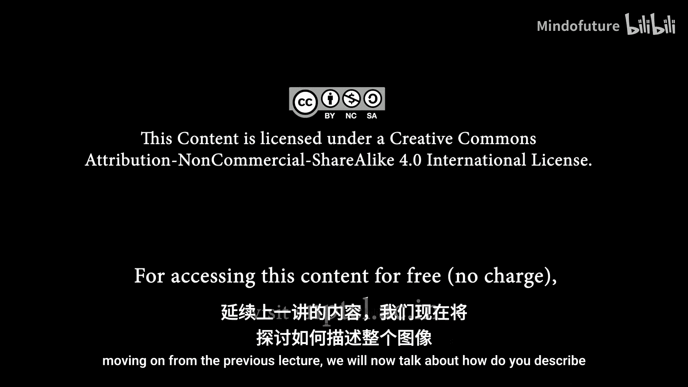
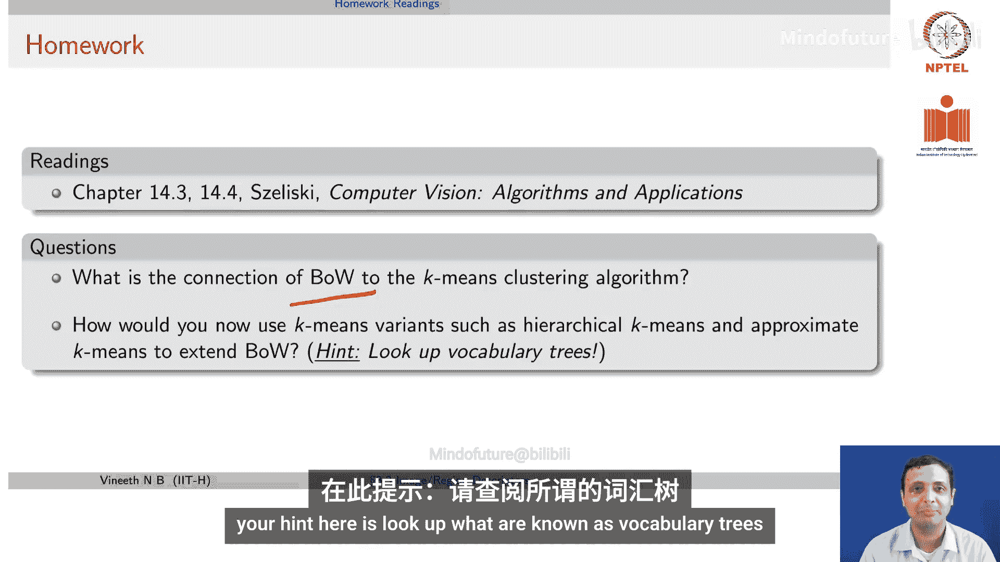

# 计算机视觉的深度学习：P17：从点到图像 - 词袋和VLAD表示

## 概述

在本节课中，我们将学习如何为整张图像生成一个单一的描述符。我们将重点介绍两种经典的图像级描述符：词袋模型及其扩展——VLAD描述符。这些方法使我们能够超越关键点匹配，实现图像检索和分类等任务。

上一讲我们讨论了如何获取图像中特定关键点的描述符。这些描述符在每张图像中可能有多个。现在，我们将探讨如何聚合这些描述符，从而为整张图像获得一个单一的描述符。

为什么需要这个功能？我们之前讨论过全景图像拼接，其中需要匹配关键点。现在，我们可能希望直接匹配图像本身，例如在图像搜索或检索中，甚至在我们浏览这些幻灯片时将看到的图像分类任务中。

## 从关键点匹配到图像匹配

到目前为止，我们已经讨论了从同一场景或物体的两个不同视角获取关键点。你从两个视角提取关键点，获取它们的描述符，并进行匹配。或许还可以使用RANSAC或单应性变换等方法来匹配它们之间的几何配置。

但我们现在要问的问题是：如果我们想匹配物体的不同实例呢？在之前的幻灯片中，物体是同一个，只是视角不同。现在，物体可能完全不同，例如，这是两架完全不同的直升机，它们不是同一个物体。那么，如何进行匹配或搜索？例如，在谷歌图片搜索中，你上传一张图片，要求系统为你检索相似的图片。这就是我们现在要讨论的内容。

这里的主要观察是，刚性变换可能在这里不起作用。之前，如果你只想匹配从不同视角拍摄的同一物体或场景，你可以将其中一个视为另一个的刚性变换，并尝试估计旋转或平移参数。但当面对的是物体的两个完全不同的实例时，它可能根本就不是一个刚性变换。

因此，理想情况下，我们现在要做的是看看是否可以完全抛弃几何信息，因为通常不会存在刚性变换。我们能否完全抛弃几何概念，尝试以超越几何的其他方式来匹配图像？也许稍后我们可以使用其他方法，将几何的某些元素松散地重新引入。

## 词袋模型简介

我们获取图像级描述符的首次尝试是一种称为“词袋”的方法。这是一个古老的方法，在文本领域已被广泛使用。让我们看看如何在图像中使用它。

我们将从一组样本或数据点开始。然后，我们为这些数据点形成一个词汇表。词汇表是什么意思？它是一组在图像间共有的“词”。最后，基于这个词汇表，我们将得到一个直方图，它简单地统计了某个文档（在我们的案例中是某张图像）中“词”的出现频率。

让我们更详细地描述一下。如果你有文本信息，你的样本就是不同的句子。你的词汇表就是这些句子中出现的所有可能的词。最后，对于每个句子，你会统计词汇表中每个词在这个特定句子中出现了多少次，从而形成一个直方图。

现在，让我们尝试将其与图像进行类比。假设在这个特定情况下，你有三张不同的图像。你形成一个词汇表。那么，对于图像来说，词汇表意味着什么？在文本中，它很简单，就是你的文档中出现的所有词。但对于图像，你的词汇表会是什么？

我们定义词汇表的方式同样很简单：你从每张图像中提取不同的部分，将它们分组，并找出哪些部分对应着某些共同的东西。例如，第一张图像中可能有六种看起来相似的视觉词，它们可能在颜色、纹理或你选择的任何其他外观表示上相似。同样，第二张和第三张图像也有一组视觉词。我们将视觉词定义为从图像中提取的多个部分。因此，如果你有一组图像，你从所有这些图像中提取部分，然后以某种方式将它们汇集起来，进行分组，并说图像中的这些部分似乎具有相似的属性，我将把它们归为一个特定的“词”。

一旦你得到了这些视觉词，类似于文本，你就可以得到一张直方图，显示每个视觉词在给定图像中出现了多少次。这个直方图就是为这三张图像中的每一张绘制的。

## 词袋模型的应用与优势

让我们看一个更真实的例子来更好地理解这一点。在我们深入之前，词袋模型有什么用途？它可以用于图像检索以及我们刚刚提到的图像分类。为什么？因为这是一种将整张图像表示为单个向量的方法。

这里有一个更具体的例子。假设这是一张查询图像。这里有一张来自数据集的图像。你可以想象数据集图像是你的整个图像库，而查询图像就像谷歌图片搜索，你上传这张图像并要求搜索引擎检索所有类似的图像。例如，你可以上传一张猫的图像到任何搜索引擎，并要求搜索引擎检索类似的猫的图像，这是一个非常相似的例子。

假设在你的数据集图像中，第15张图像出现了类似的结构。现在让我们看看之前会发生什么，以及我们现在将如何改变做法。

之前，我们会提取每张图像中的关键点，获取这些关键点周围的描述符，并尝试在两个图像的描述符之间进行成对匹配。这显然是一个耗时的过程，因为如果你有很多关键点，每张图像有很多描述符，你理想情况下需要在第一张图像的每个描述符与参考图像的每个描述符之间进行成对匹配，这在计算上可能非常昂贵。如果你有另一张图像，你必须在查询图像和第二张参考图像之间重复相同的过程，依此类推，处理所有参考图像。

那么，我们如何解决这个问题呢？我们现在要说的是，如果存在相似的描述符，它们会在两幅图像之间匹配。与其在查询图像和参考图像之间进行成对匹配，不如让我们假设相似的描述符无论如何都会在表示空间的某个度量（比如欧几里得距离）中对应相似的表示。因此，一组彼此相似的视觉词或区域可能在表示空间中聚集在一起。

我们如何利用这一点呢？我们现在要做的是为所有相似的描述符提出一个共同的表示。我们如何做到这一点？我们可以简单地获取你的整个图像库或训练图像，从中提取彼此共有的视觉词，并简单地计算它们在那个空间中的平均值。这个平均值就成为图像库或训练图像中所有这些视觉词对应的视觉词。

因此，你可以在检索过程开始之前离线完成这个过程。你可以离线构建你的视觉词，并在搜索过程实际开始时将它们存储并准备好。这些视觉词是预先存储好的。给定一张查询图像，你提取查询图像中关键点对应的描述符，现在你只需将它们与代表参考图像中相似视觉词平均值的视觉词进行匹配。你不再需要与参考图像中的每个描述符进行成对匹配。你将拥有一组在你的图像库中共有的视觉词，现在你只需要与它们匹配就能得到答案。这使得这个过程非常可行且高效。不需要成对匹配，你的视觉词现在充当了你图像库中描述符的代理。

## 词袋模型的数学表示

现在让我们以更明确的方式来看待这一点。假设你的图像现在由一个属于 **R^K** 的向量 **Z** 表示，其中 **K** 是你选择的码本大小或视觉词数量，这将是用户为特定数据集设置的参数。

**Z** 的每个元素 **Z_i** 表示为 **W_i * N_i**，其中 **W_i** 是每个视觉词的固定权重（你可以选择分配权重，如果没有权重，它们可以只是均匀权重），而 **N_i** 是该特定词在查询图像中出现的次数。

给定你的参考图像库中的 **n** 张图像，它们由一个 **K x n** 的大写矩阵 **Z** 表示。记住，将有 **K** 个视觉词和 **n** 张这样的图像。对于每张图像，你将有一个 **K** 维向量，因此 **n** 张图像就变成了 **K x n** 矩阵。对于查询图像，你只需比较查询图像的向量表示（即查询图像中视觉词的计数）与每张参考图像中视觉词的计数。你只需取这两者之间的点积或余弦距离，得到一组分数，然后按降序对分数进行排序，这就给出了最佳匹配，其次是次佳匹配，依此类推。

请注意，当我们基于点积计算余弦距离时，我们实际上是在计算 **Z^T * q**，其中 **q** 是查询向量。你会取 **Z** 的每一列（对应一张特定的参考图像），并分别计算该参考图像与查询图像 **q** 的点积。点积最高的图像就是你推荐为与查询图像最接近的匹配。

需要指出一个更普遍的观察结果：如果你取点积，它类似于测量欧几里得距离。使用点积或余弦相似度测量的相似性与使用欧几里得距离是互补的，因为 **||Z - q||^2** 也可以写成 **2 * (1 - Z^T * q)**。你可以将其作为作业推导。这意味着，余弦相似度高的，欧几里得距离就低。因此，在某种意义上，这两种比较相似性或距离的度量是互补的。

这里的一个重要观察是：当 **K** 远大于 **P** 时，其中 **P** 是每张图像的平均特征数（记住，**K** 是码本中的视觉词数量，由用户定义；**P** 是给定图像中的平均特征数，例如使用SIFT时可能有数百个），那么 **Z** 和 **q** 将是稀疏的。为什么？如果你有1000个视觉词，而每张图像中只有100个特征，那么显然，在一张给定的图像中，至少会有大约900个视觉词的计数为零，因为这些视觉词在这张图像中不存在。

为了使计算更有效，我们可以反转这个问题：不是检查一个词是否在一张给定的图像中（这是你通常会做的，检查给定图像中的每个词，但整个图像可能是可能词集的一个非常稀疏的表示），而是检查哪些图像包含一个特定的词。我们现在将看到，在这种情况下，这可以是一种更有效的计算相似度的方法。

## 倒排索引加速检索

让我们更直观地看看这一点。假设你现在有一张查询图像，它有视觉词54、67和72。这些是你的视觉词。记住，你有一堆视觉词，每张图像都有这些视觉词的一定出现次数。现在假设在给定的查询图像中，视觉词54、67和72各出现一次。54、67和72只是随机数字，你可以取任何其他数字，这只是为了解释。

现在，如果你有一个你想从中检索的图像库，假设它们由数据集中的一组数字给出。你现在尝试画出这个。你查看这些图像中的每一张，假设你的库中的第15张图像有第72个词、第67个词和第54个词，而第13张图像只有第67个词，第17张图像只有第72个词，第19张图像有第67个和第54个词，依此类推。

现在你做什么？你取查询图像中出现的一个视觉词，尝试查看你的查询图像中哪些图像也有那个特定的视觉词，并为那张图像增加一个计数。类似地，你会为第67个词和第72个词做同样的事情。最终，第15张图像的计数最高。你现在根据这些视觉词对库中的所有图像进行排序，会发现第15张图像是最佳匹配，第二佳匹配是第19张图像（有两个共同的视觉词）。你可以重复这个过程，从你的图像库中获得最佳匹配，这被称为图像检索问题。

## 从检索到分类

现在让我们尝试探讨如何将词袋模型扩展到分类。我们讨论了检索，但现在我们想将给定的图像分类为属于特定场景。例如，在我们之前看到的图像中，也许那座建筑有一个特定的名字，你有很多纪念碑，你想将一张图像分类为属于特定的纪念碑。因此，你现在想将其视为一个分类问题。如何为此进行调整？

你这样做的方式是：再次将图像表示为一个属于 **R^K** 的向量 **Z**，其中 **K** 是视觉词的数量，这与我们为检索问题所做的非常相似。但是，一旦你做到了这一点，你现在就可以使用分类器来对这些视觉词的频率进行分类。现在，每张图像的视觉词频率变成了视觉词集合的向量表示，即视觉词的直方图。你将在训练数据中有一组类似的图像，它们也会有一个与之关联的类别标签，因为记住，分类是一个监督学习问题。

因此，你现在可以使用一个分类器，比如朴素贝叶斯或支持向量机，或任何其他分类器。如果你使用朴素贝叶斯，你将估计给定图像下类别 **C** 的最大后验概率，假设特征是独立的，假设每个视觉词的出现或计数是独立的，你只需在这个特定场景中运行朴素贝叶斯分类器。记住，朴素贝叶斯会变成一个线性分类器。你也可以使用支持向量机，在支持向量机中使用适当的内核函数来执行分类，或者就此而言，你可以使用任何其他分类器。

## VLAD：词袋模型的扩展

词袋模型的一个扩展被称为局部聚合描述符向量。它与词袋模型非常相似，但有一个微小而重要的区别。正如我们刚才看到的，词袋模型会给你一个标量频率，统计通过聚类训练图像或图像库中大量区域得到的特定视觉词在查询图像中出现了多少次。从某种意义上说，这给你的信息有限，这里没有几何信息，或者你不知道查询图像中的确切区域是什么，你无论如何都会将它们映射到一个共同的视觉词，即你库中相似视觉词的平均值。

在VLAD中，你所做的是：你同样有视觉词，这部分保持不变。但现在，你不是得到一个标量频率，而是每个视觉词对应一个向量，这个向量查看查询图像中的每个特征与该视觉词的距离。你有一个通过聚类训练图像中的特征组得到的视觉词。现在，给定查询图像中的一个新特征，你查看它与视觉词的距离，你会得到一个残差向量。类似地，你取另一个映射到同一视觉词的特征，查看它与视觉词的距离，并将所有残差相加，你会得到一个残差向量，它是映射到该视觉词的所有残差之和。这对应于此视觉词。因此，它不再是一个标量频率，而是一个向量，表示映射到此视觉词的其他特征在每个维度上有多远。这给了你多一点的信息，可能更有效。

让我们更清楚地看看这一点。如果我们有一个词袋表示，给定一张三通道RGB输入的彩色图像，你首先将其转换为灰度图。你可以将词袋模型适配到彩色，但这里我们举一个更简单的例子。一旦你有了灰度图，你得到一组，比如说，1000个特征，并将它们转换为128维的SIFT描述符。然后，你进行逐元素编码，比如编码到100个视觉词。你取这1000个特征中的每一个，并将它们映射到100个视觉词。你将得到K个这样的视觉词，并最终统计这1000个特征中每一个相对于这100个视觉词之一出现的次数，得到一组频率。然后，你可以对该最终的直方图向量进行全局求和和L2归一化，以获得最终的词袋表示。

另一方面，对于VLAD，你会做同样的事情：将三通道RGB输入转换为单通道灰度图，再次在查询图像中获得1000个特征，将每个特征转换为128维表示。你再次将这1000个特征中的每一个分配给K个视觉词之一。但这就是区别所在：你现在不会得到一个标量表示或直方图，而是会为这K个视觉词中的每一个得到一个残差向量。这意味着，现在这将是一个 **128 x K** 的表示，而不是一个K维表示，因为对于每个视觉词，你将查看映射到特定视觉词的所有特征或关键点，每个128维度的残差是多少。最后，你将得到一个 **128 x K** 的表示，你会对其进行L2归一化并用于实践。L2归一化只是为了确保向量成为单位范数（L2范数为1），这就是VLAD描述符。

## 总结

在本节课中，我们一起学习了如何为整张图像生成描述符。我们从关键点匹配的局限性出发，引入了词袋模型，它通过统计视觉词的出现频率，将图像表示为一个固定长度的向量，从而实现了高效的图像检索和分类。我们还探讨了词袋模型的数学表示和通过倒排索引加速检索的过程。最后，我们介绍了词袋模型的扩展——VLAD描述符，它通过聚合特征与视觉词之间的残差向量，提供了更丰富的图像表示信息。

## 延伸阅读与思考

作为本节课的结束，请阅读Szeliski教材的第14.3和14.4章。

供你在本课结束时思考的是：词袋模型与K均值聚类算法有何联系？我们已经在讲座中简要提到了它，但请更仔细地思考并回答这个问题。

假设你理解了词袋模型与K均值聚类的联系，那么K均值聚类的扩展，如层次K均值聚类或近似K均值聚类，与词袋问题有何相关性？你的提示是：查找所谓的“词汇树”。

以下是本讲的参考文献。