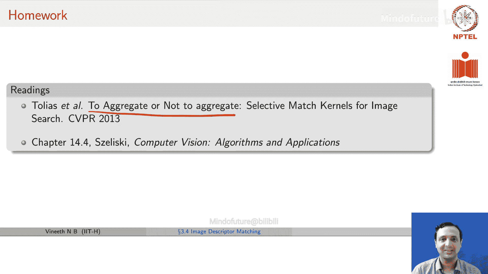

# 【NPTEL】计算机视觉的深度学习 p18 P18_图像描述符匹配 -BV1vNWkzpEua_p18-

Last lecture。We spoke about。Describing images。Using the back of Boys approach or the VA approach。

We will now take this forward and show how these disruptscriptors can be used for matching between images。

Before we go there once again an acknowledgement that these slides are taken from the excellent lectures of Professor Avaus at Inriaar N。

We also left behind one question。From last time， which is since bag of words is inherently dependent on K meanss to define its cluster centers。

Can we consider extensions of cas to improve how bag of words performs？

So one specific example could be hierarchical camins。

 which is an extension of kmin means clustering algorithm where the cluster centers are organized in a hierarchical manner。

 starting from a root node， all the way till a set of leaf nodes。

So it happens that this has been explored for a bag of words too using a method known as vocabulary3 in way back in 2006。

And what this method does is to take hierarchical ks and build a final partition tree。

And now your image descriptors descend from each from the root to one of the leaves in each level of the tree。

So， you have。呃。A bunch of cluster centers that you put together from all of the visual words that you have from different images。

 recall that in back of words， when you build your cluster centers。

 you pull all the images in your data together， you take all the features。

 the descriptors around the features clustered in using a method。And then you take those clusters as。

As your what are known as codebook centers to which each key point is assigned。

Your image is finally represented as X， which is one of the elements in your image。

In the descript of your image is given by Wi into N Wi is the weight of that particular node in the tree and NI is the number of key points assigned to that particular cluster center。

clusterluster Android in the tree。So one evident thing here is it's difficult to know how Wy is given a value one could argue that perhaps for levels down in the tree。

 you must have a higher weight because they are a better match。

 one could also argue otherwise depending on a particular setting where a high level match is perhaps more important than a lower level match。

 it depends on the application depends on what is important in a particular context。

 so which is a constraint of this method that there is no principled way of defining Wy although you could come up with some heuristics on top of the method。

The data is again searched using inverted file indices just the way we saw it in bag of words。

And fundamentally there is an issue here which is that distortion is often minimized only locally。

 for example， around a particular clusterentroid， so any error that you make or any differences between images are only local with respect to that particular cluster centroid distortion is not measured on a global sense。

It's all with respect to each cluster centroid across the occurrence of each cluster centroid in each match across two images that you're matching。

Thats how hierarchical caines can be extended for bag of words。

 so one could also consider other extensions of caine and be able to use them in such methods to be able to describe images。

Let's now talk about how do you match descriptors from two different images in a more principle manner。

Before we go there， let's try to assess what do we know so far？

One of the simplest methods that we have explored so far is nearest neighbor matching where you have one image。

 which is a set of feature points， another image， which is a set of another feature points。

 at this time we are not talking about any bag of words aggregation。

 it's simply a set of features in one image one image and a set of features in the other image。

We use each feature in a set and its corresponding descriptor。

To independently index into a feature from the second set。

 we simply do a nearest neighbor matching based on the descriptor of the feature in each of these images。

Can you think of what could be a limitation of such an approach？

An inherent limitation of this approach is that you could be ignoring useful information of coence。

So it's possible that there could be one image where there could be multiple instances of the same feature。

 think of say spots in a leopard or strikes in a zebra or so on and so forth。And you may be mapping。

The the single feature in one image took multiple different features in the other image。

 because they all look similar。 For example， a spot on a leopard room one image could get mapped to multiple spots on a leopard in a second image。

You ideally would not want to have want this to happen。

 You would want each spot on a leopard to get mapped to do one spot on the leopard in the other image and another spot to get mapped to another spot and so on and so forth。

 are the example that you see on the slide here， which is a giant panda， which again。

 has some features which repeat in its structure which could get mapped to the same instance in the second image。

Which is what you see illustrably here。 This would be the ideal setting where each feature gets mapped the same to an independent feature in the second image。

 and this could be another scenario where two different instances of the same feature get mapped to the same feature on the second image。

 which is not desirable。This could lead to some problems when you use the nearest neighbor matching approach。

We've also seen the bag of words matching upward so far。

Any glaring limitation that you see of this approach？哦。

An evident limitation is that the back of words approach is limited to a full image matching。

 not a partial matching。Because you're going to be looking at a histogram of the occurrences of a cluster synroid in image one versus such a histogram for。

Image2， you would say two images match。Only when the complete histograms are fairly close to each other。

So if only a part of the second image matches the first image。

 these histograms will not match and you will not get a good match in this kind of a setting。

So in other words， you could say the bag of words isn't all all matching。

But we ideally want some sense of a one to word matching of one part of the image matching with another part so that we can still match some images。

 which could be partially close to one another。 Ideally speaking。

 the nearest neighbour matching was a one to matching approach， but it has its own limitations。

Now let's try to generalize how you can do this descriptor matching using a method that you would have seen in machine learning。

 which is kernels you may have heard about kernels in support vector machines。

 so we are going to use a similar idea here to be able to generalize matching between descriptors。

Recall that even in support vector machines or for that matter。

 any other machine learning algorithm were wherekens can be used。

Curs are a sense of similarity between two data points。

 it's the same principle that's being used here also。To be able to do that。

 lets define the settings so far， so you have an image described by n descriptors let's say。

 so x is an image given by x1 x2 till xm where each of these is of is a D dimensional vector。

Remember， this could just be the cluster centroids or could be individual features。

And looking at the bag of words example。These descriptors are typically quantized using k means clustering。

 or for that matter， any other clustering method， they are quantized， which means。

You simply don't take all the features in an image。

 you try to see which cluster center they belong to and only have a count in that particular cluster center as a representation of that particular feature or that particular cluster center。

This quantization function is given by Q， which takes us from R power D to a subset of C of R power D。

 where C is called as a code book。Wwhich is given by C1 to Ck。

 so there are K possible cluster androids， which as I just mentioned。

 you get by doing a k means clustering on the features from all images。And in a single image。

 you try to see you use a quantizer function， which takes you from every feature to one of these cluster enroids。

 which is nearest of it。This is the setting now let's try to define the kernel。

So the kernel now is given by given to images X and y。The matching kernel K of x comma y is given by。

Gmma of x into gamma of y。Which， as we will see soon， our normalization functions。

 we'll see why we need this in a moment。Into summation over all the cluster centers that you have。

M of X， C， Y， C。Where M is the within cell matching function。

 so it's the M is the matching kernel function that you're talking about。

And that happens for each the occurrences of each cluster centroid in one image and the occurrences of that cluster centroid and a second image。

 So we still have to define what MS， we will see a few examples of that as we go forward。

So the gamma of x and gamma of y。Is required here because you do not want to be biased by the presence of number of features in a given image。

 For example， it's possible that you may detect， say 1000 features in one image and just 200 in the other。

 If you simply did a summation， you would always be biased by an image that has a lot of features because the count would go up and which may not really be a perfect match。

 So the gamma of x and gamma of y are normalization functions where you can divide by the total number of features in the image so that the matching is not biased by the simply the number of features in an image。

Now let's try to see a few examples of how M would look in examples that you've seen so far so if you take to the back of words matching。

Back of words matching is in a way a cosine similarity between the cluster centers and the two images you could define that whatever you have seen in back of word similarity so far can be defined by a matching kernel which is given by。

You take。X C， which is one of your codebook elements or your cluster Androidroids。

 and you count how many occurrences of that is there in image X。

 how many occurrences is there in image Y and you simply add them on。Rather。

 for one particular codebook entry 3 C3， if you had 10 such features in image X that corresponded to C3 and three such features in image Y that corresponded to C3。

 the corresponding matching current is simply 10 into 3 here which becomes 30。

 they simply count that over a double summation。So that's simply a bag of words model youre going to respect remember that the normalization function。

 as I said， would take care of normalizing by the total number of features in the in the image itself。

 but this is what M is defined as。You could extend this to another approach known as hamming embedding for matching where。

If you assume that each descriptor can be binized in some way， for example。

 you could take a descriptor and simply say that anything greater than a threshold is 1 and anything less than a threshold is 0。

 you could binize any descriptor for that matter。Then you compute your matching kernel as it's。

 again， similar to your。ABack of words kernel。 The only difference now is。

Youre only going to count the number of instances where the hamming distance between B。

 X and B Y is going to be less than a threshold。This is simply your humming embedding。

So them hedge is the humming distance between the two binary vectors and tau is a threshold that you have to specify to be able to get a matching kernel in this particular setting。

You can also define VAD matching in the same framework remember again that VAD is similar to bag of words the only difference is you do not count how many features belong to a codebook element or a cluster center。

You rather obtain all the features that belong to a codebook element or a cluster center and rather count the residual vectors。

Recall again， in Vla， you have。A cluster center， for example。

 you could have two stars two cluster centers， you have a set of features that are closest to this particular cluster center。

You have another set of features which are closest。To this particular cluster center。

So you take the difference between them which is going to be a residual vector and you add up all the residual vectors that belong to one particular cluster center and that becomes a representation for this cluster center and similarly you would do this for other cluster centers。

Now， if this was the representation， how do you do the matching kernel so the matching kernel is given by the entire representation of image X is going to be。

A set or an entire vector represented by v of xc1， xc2， xc3， v of xc K。That's going to be。

The representations corresponding to each of your codebook elements。

And your matching kernel is now given by。V of X C transpose v of Yc。

 which is an inner product between the representation for the。Seth code book entry。

In x and the Se codebook entry in Y。But this is simple to expand because v of Xc is a summation over all the x's that belong to that particular code entry and their corresponding residuals。

 so you expand v of Xc using a summation similarly a v of YC using its summation and you now have the new matching kernel as a summation over all the elements or all the features that belong to that codebook entry in image X。

And the summation over white for the same。For the same codebook entry and inside you not have R of x in a product r of y so the residuals。

How they are aligned with each other rather， so if you try to understand the intuition here。

 you're trying to say that if you have a cluster center， say C3 in image X。

 the same cluster center C3 in image Y。Let's say you have。

Three features in image belonging to this cluster center。

 similarly say three features belonging to this cluster center in image wide。

You're going to take one of these residuals and see how the other residual matches with this residual。

If the two residual match， you're going to get a high matching score rather if even how the features were。

Configured around that cluster center， match between the two images， it's a better match。

A more general way of combining all of these ideas was known as the aggregated selective match kernel or ASNK。

 which combines a few ideas that youve seen so far。

 it combines the nonlinear selective function that we saw with handbing and bidding we'll see that in a moment and also it combines ideas from VL。

So the way this method works is you take V La， which is what you see as the argument inside。

And you normalize the VLD vectors， which is what you define as v hat。

 so v hat if you see at the bottom of this slide， is given by v of Xc divided by norm of v of Xc effectively you're trying to make the VLD vector。

 which is some of all residuals into a unit norm vector。

And you've now taken enough product between the wheel a。

 very similar to what we saw on the previous slide。Because this is an inner product。

 the output of this is going to be a scalr。Now you use a nonlinear selective function。

 sigma sub alphapha of this scalar to get your final matching function。What is this sigma alpha。

 the sigma alpha is defined as for any input U sigma alpha is defined as。

Sine of u into the absolute value of U power alpha。If u is greater than a threshold tau， remember。

 the inner product is a measure of similarity。Higher the value， the better for you。

 so if u is greater than a threshold you may want to weigh things a bit more which you can control using alpha and if you is less than a threshold it is0 very similar to the havingm distance we said that if the humm distance was less than a threshold。

We count it more， if not we won't count it， this is a very similar idea。

 although we use Vla vectors for achieving the same goal。So you can see here that。If。Alpha is one。

 This is just U itself。If alpha is1。Sign of U into absolute value of U will be U itself。

Let's see a few illustrations of this idea to make this clearer。So this is。

A few illustrations of different choices of alpha and tau values so on the top left here you see alpha is equal to 1 which as we just said which is u itself you're really not it's simply the dot product of the normalized v vector and tau in this case is0 so anything greater than zero you're going to consider that as u itself to be the as the score to be u itself。

So you can see here in this case yellow corresponds to say zero similarity and red corresponds to maximum similarity per image pair。

 so there are a few features that do not match at all and there are a few features that match very well and all of them are shown in the top left image。

If you see the the top right， you can see here again， alpha is equal to 1， but tau is equal to 0。25。

 You can see now that a lot of the yellows have come down。 you are now saying that。

That score view must be at least 0 to5 for us to consider that to be a match。

And you see now that many of these false matches disappear because anything any low score is now disregarded。

The bottom row shows an example where alpha is equal to 3 where you see again when alpha is equal to 3。

 and remember that because you are normalizing your wheel at vectors。

 alpha being high is going to reduce the value because u is going to be a value lying between 0 and 1。

Because you have normalized vectors， it's likely to be a value between0 and1。

So if alpha which is the exponent of u is high， the values are going to go even smaller and that's what you see here on the left where you see that some of these reds have disappeared because they have gone closer to0 and on the right you see a similar thing where when alpha is equal to 3 and tau is equal to 0。

25 again you get a few more yellows which could be smaller values at this point in time because the exponent u exponent alpha which is 3 here may have reduced the values because u lies between 0 and 1。

So you can see here that larger selectivity。Downwards false correspondences。

 which is what we see here with tabu is  equal to 0。25 on on both the images on the right。

And this entire approach replaces the hard thresholding that we have in havingming embedding and gives a different way of going about a similar approach。

Here is another illustration of results after applying the ASMK method where you see here that。

Each of these colors in these different images correspond to the same visual word right it's so the green of the yellow or the blue is the same visual word occurring in different images。

 So you can see here that if you take any particular example， for example。

 if you take say the pink or the red， you would see that the pink or the red visual word corresponds to some corner or some pointed corner in each of these images。

All of these kernels can be generalized into efficient match kernels where you could define this kernel as some continuous function copper of Xchema wide and avoid using any ch books for that matter at all。

Because codebooks can be computationally intensive to compute and then compute the residualos and so on and so forth。

 you could directly impose a kernel function between the individual features in one image and the individual features in the other image。

Once again， very similar to how kernel functions were used in support vector machines or other machine learning algorithms which had the kernel component to it。

Ideally， you would want this cup of Xchema y can be decomposed into an inner product of phi of x transpose phi of y where phi is the representation of each feature in a different space。

Then you would have your final kappa to be some normalization of x into the summation of all of your representations of x for each of these for all your features。

 transpose a similar aggregation for y。This is a generalization of these methods that we've seen so far。

That concludes this lecture。So for more readings， this particular paper to aggregate or not to aggregate summarizes these kernels very well。

Please do read through it when you get a moment and Cha 14。

4 from Celsky's book would be your other reference from this lecture。

