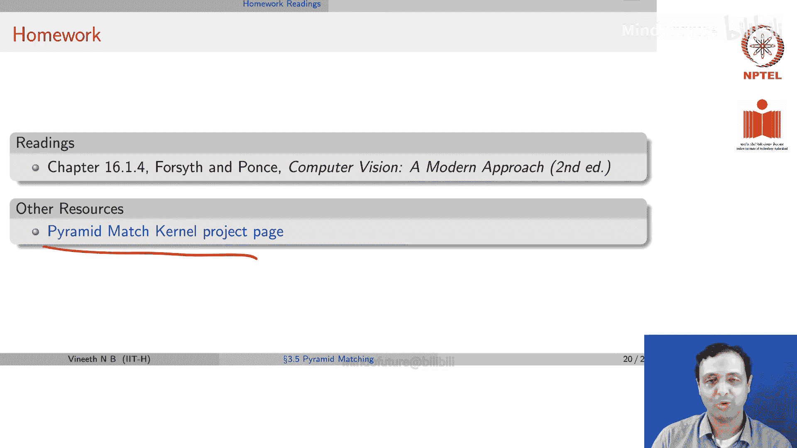

# 【NPTEL】计算机视觉的深度学习 p19 P19_金字塔匹配 -BV1vNWkzpEua_p19-

Continuing with the previous lecture。Will now go from。Matching kernels。

To matching kernels for image pyramids， for example。

 having a multiy resolution pyramid of images and being able to use that idea to develop matching kernels。

The slides are once again borrowed from the lectures of Professor Aus at Inria Ren。

Descriptive matching， as we just saw in the earlier lecture， can be given by。You have。X。

And similar YC for the features that belong to a particular visual word in images X and image Y。

Then a matching kernel for something like bag of words。

Could be given by summation over the same cluster androids just counting the number of features belonging to it。

 you could also include some weighting factor for each of these summations if required。

And a more general form that we saw last time was what you see below here。

 which is k of x commma y is equal to gamma of x into gamma of y normalization functions into a summation over all the codebook elements Wc is a weight that appear introducing which we can choose to use or not and M of x C by C where M is the matching function。

Now we'll talk about going beyond single level matching and matching at the level of pyramids。

And we'll describe a seminal work in this context known as pyramid match colors。

So pyramid matching is an efficient method that maps。Unordered feature sets。

 which is what each each image is each image is an unordered set of features。

We are going to convert that into multi resolution histograms and then do matching。

Using weighted multi resolution histograms。So we ideally can start with the finest resolution histogram cell where a maed pair first appears。

 and then we keep merging histograms as we go up the pyramid in this particular context。

And the work has a very nice interpretation where it can be shown that it approximates。

A similarity in a partial matching setting where if you had only a partial set of features in one image。

 match a set of features in another image。Pyramid match kernel approximates that optimal partial matching between those two images。

For more details， I would also recommend you to read this paper called Trait Match kernelner。

 it's written very well and explain some of these ideas in detail if you are interested in knowing more。

Let's start with defining our histogram intersection because we're going to define histograms in both images。

 obviously we're going to define them at multiple levels。

 but let's first talk about how do you match histograms in this context。

So if you had two histograms x and y of b bins each。

 so let's say this is x and this is y both are histograms the b bins each。

 we define the histogram intersection as。Minimum of。X I Yi。

 one element of the histogram in both of these images。And sum these up over all the beons。

So you take the first bin of histogram， the first bin of the second one， take the minimum value。

Take the minimum value of the next bin in the histogram and add them all。

That's what we define as the histogram intersection。Interestingly， you can show that this。

Notion of histogram intersection， which we define as Kappa subhi。Has a relation to L1 distance。

 we are not going to prove it here， but probably leave it as an exercise for you to look at。

 you can see that the L1 distance between two vectors x and y can be given by。Eban norm of x。Plus。

 L norm of y。Minus two times the histogram intersection。tryry it out for yourself。

 take a few take a couple of examples of X and Y you naturally see that it holdss in practice please try proving this also if you can。

This is an interesting exercise for you to work out。

 but you can show that this histogram distance is。Related to the L1 distance。

 remember L1 distance is the sort of absolute values of that vector。

Let's come back to the pyramid match， Cor now。So we said that the pyramid Mat kernel does awaited sum of histogram intersections at different levels of two images and it approximates optimal pairwise matching。

So we first conceptually talk about it and then we'll give a concrete example and go how its done So if you had these two images of the same object from different poses。

 different view angles，You could have once again have you extract key points and those key points could be these lying in R part D。

 so those are the features that are lying in R part D。

 you have a similar set of features lying in R partD for the second image。

So you know you have that entire feature space that you divide into a grid for instance。

 and now you're going to count how many of the features in one image occur in each of that grid of the feature space that's going to define a histogram。

 you match the histogram at that level， then collapse the grid。

And merge regions in your grid in R partD， in your D dimensional vector。

 assuming these size of the descriptor corresponding to the feature， you match at that level。

 so on and so forth。And one intuition here is you want to give a higher weight to matches at a final level and a lower weight to matches at a higher level where the histogram bins may be merged。

Well give a concrete example， and walk over this idea。

Let's consider now that you have a set of features and unaued set of features in an image X。

 which is given by these blue points。A similar unordered set of features in image Y given by the red points。

So remember these are points， these are descriptors of those features lying in R partB and you're going to bend them into a very fine bin of features in that space。

 so it's possible that。This blue point was lying in this bin。

 this blue point was lying in this bin and so on and so forth。

 you're just spinning that entire Rpar B region into different bins and you're placing each key point occurring in each image into one of those bins based on the descriptive values。

Now you have 1 d points it's xy。On grid of size1， we going to call it size one。

 this is the finest resolution。So now we define histograms。

So your level zero histograms are going to be。This particular bin in your RD grid has one feature。

This particular bin in R part D in x has one feature， this particular。边。

In our party has one feature in imageix and one feature in image Y， so on and so forth。

 So you can construct your histogram。 Obviously， it's possible that you could have one more feature here of why in the same bin。

 But at the first level， we create these bins in such a way。

 or we you can always define bins at a very fine level。

 that you create these bins in such a way that there's only one feature in each of the bins。

 We obviously merge these as we go to be able to combine them in a more effective manner。

So based on these histograms， when you try to match them， remember。

 our histogram intersection is going to be the min of each element。

So you're going to be left with the intersection， which is simply one value here for this bin and one value here for this bin。

All of the other bins have one of the elements in x or y to be 0， which means they'll get。です。

So you have two matches now between images x and y， and you're going to weight them by a value1。

So your total similarity score now is going to be 2 into one， which is 2。

Now we are going to merge your histograms。 Or， if you had say about。20 histogram bins。

 you need to merge every consecutive of every contiguous one and make them into 10 bins and now you see that it's possible that there are two features in image X that belong to the same bin。

And so on and so forth。So now we construct what are known as level 1 histograms where we count the number of features in each of these merged bins in image X and image Y。

 you see that there are two occurrences of features in this bin similarly there are two occurrences of features in this bin in image X but image Y has just one features still in each bin so based on that we build the histogram for image X build the histogram for image y and now you compute the intersection of these two histograms and you find that there are four matches。

But you do not count all the four matches。 you count how many new matches are added。

 So we are only going to look at how many new matches are added by matching these histograms。

 which is going to be we had two matches earlier。 We have four matches now。

 the new matches would be two。So now you consider those new matches。You weigh them by half。

Y half remember a match at a closerst level is given lesser weight than a match at a final level because a final level match means a closer match。

So you take these two new matches， weight them by half and now your similarity score becomes2 into one from the earlier slide plus2 into half。

 which is totally going to be three。Now we continue this process。You know。

Make your histogram bins just five in number， which means the number of features that you're going to have in each bin is going to increase。

 you can have now say three features in this bin in imageics， so on and so forth。Once again。

 you can get the histogram for x， the histogram for y， you compute the intersection。

 which is now going to give you the number of matches to be 1 plus 2 plus 2 which is going to be 5。

 but you already had four matches in the previous level so the number of new matches is going to be just one。

It new matches here。It's going to be just one。So the similarity score now is going to be given by two into1 plus2 into half。

 which was from the earlier two slides plus one weighted by one fourth because you are reducing the weight even further when you go to an even higher course level。

So your total similarities score is 2 plus2 and half plus one and a quarter， which is going to be 3。

25。So let's try to put this together so given a set X which consists of n different features each belonging to art part D。

 let's assume that the distances of those elements range between1 and D。

 this just helps us build your bins for constructing the histogram once you know the maximum distance between elements。

You can play around with your histogram bins to define them accordingly。

So we're going to define Xi as a histogram of x in R part D on a regular grid of side length2 power I。

 so we start with histogram at level 1， histogram at level0， level 2， so on and so forth。

Technically speaking， youre going to start I at -1， but at -1 there are no matches。

 it is purely for mathematical convenience as we will see in a moment and then we keep building the number of histogram levels until log D where remember D use the maximum distances between the elements。

So now given two images with descriptors X and y。We're going to define formally the pyramid match as。

K delta X Y is given by once again， your normalization functions。

Sumation I going from0 to L L being the total number of levels that you very going to build。

And for each level， youre going to weight it by1 by two power i when i is equald to0。

 the weight is 1 and I is equal to 1， the weight is half， so on and so forth。

 which we just saw in the examples on the previous slides。And at each level。

 you're going to count the number of new matches。The first term counts the number of matches at this level。

 the second term counts the matches at the previous level。

 and you're going to keep building that so at each point this is going to refer to the number of new pairs matched。

So， this。Difference。Can also be written the summation of differences rather can also be written it would if you expand this you would get a telescopic sum because you would have an I equal put 0。

 you would have  one by2 power 0 in 2。Kappa H I x 0， y 0 minus Kappa H I x-1 y -1。

 which you ignore That term is something that you ignore。

 Then you would have plus one by two into Ka of。X1 y 1 minus Kappa x0 y 0。

 So the x0 y0 terms will be common between these two elements， which will keep getting telescope。

 So if you put them all together， you would find that the telescopic sum can be written as1 by two power L into kappa of Xl Y L。

 which will be at the highest level。Plus。All of the other terms will get。 So， for example。

 let's take one particular example。 if you take I is equal to。1。

And I is equal to 2 as I is equal to1， you're going to have one by 2。

For simplicity which is going to it Ka， Kappa x 1， y 1。Minus kappa x，0， y 0。And at is equal to two。

 you're going to have one by4。Ka， x，2， y 2。Minus Kpa x 1， Y1。So this。Half into Ka x1。

 y1 and quarter into Ka x1， y1 will get subtracted and you'll be left with quarter into Ka x1， Y 1。

 And that's what you're writing it out here。 So which means x1， y 1 would have。

Only quarter left because one of them will get canceled。

 so you will be left with one by two power i plus  one。搞部 x为系。Okay， sos just a simplification of the。

The telescopic sum that we see in the above equation。

So this is just a mathematical representation of the example that we just saw over the last few slides。

Now， it can be shown that this。K delta function that which is defined actually happens to be a positive definite kernel。

 remember again， if you recall your discussion of kernels in support vector machines and machine learning。

 you will recall that a positive definite kernel has benefits。Because it satisfies the me' ser。

 the computational efficiency increases if your kernel satisfies this property。

Let's see how that holds here。Recall now that k delta is written as a weighted sum of Kappa H items with non negative coefficients。

 what are those non negative coefficients，1 by2 power I those are non negative coefficients and then you have a weighted sum of different。

Ka H terms this is the terms that we are referring to that's what Kta is or if you look at either of these equations it simply await weighted sum of Ka H is and。

We also know that each of these Kappa Hs， which is your histogram intersections。

 is simply a min of values in each bin。So it's a summation of mins。

Now we know that men can be written as a dot product。

How if you had a number three and if you had a number 5。I can write three as I put 1，1。

1 for the first three values and then 0，0，0，0，0， assuming I can go up to value 8， Similarlyly for5。

 I have ones in the first five indices followed by three zeros。

 Now the min of these two values which is three is simply a dot product between these two binary vectors。

Which means I cant write min as a do product and the rest of it now would fall nicely because。

A sum of that you would have been to be a dot product。

The sum of mid terms can also be written that way and a weighted sum of。

Such Ka H items with non negative coefficients can also be written this way。

 which means you can write your entire。K data as a positive， definite color。

In case there are parts that are not clear to you， please go ahead and reach read the pyramid match kernelel paper to be able to get a better sense of this。

So one question here is we just said here that min can be written as a dot product。

By writing out each of the numbers。That you have there in this form right if you wrote out each of those numbers in this particular form。

 then men becomes a dot product so you could ask me the question。

You simply extrapolated the dot product to sum of mid terms。

 and then some of the mid terms to sum of Kappa H items with non negative coefficients and concluded that its positive definite。

Then what would be the representation of the elements on which k delta is a positive color。

 what would be that embedding for min the embedding was writing it out in this manner writing each number out simply as an enumerator in an enumerative way。

 what would be the corresponding embedding。on which k delta becomes a positive of kernel to know what the embedding is。

 let's try to analyze this a bit more carefully so if you had two images x and y。4。

Convenience let's assume that x has a lesser number of features than image y。

 remember both of them are unordered set of features， it could be the other way to。

 this is without laws of generality in that case it could just be flipped but otherwise you can assume that one is less than the other in terms of cardinality of features。

And let's define a function pi that takes us from image X to image Y in such a way that pi is1 to one。

 which means for every feature in image X， you find the closest feature in image Y。In that case。

 the optimal pairwise matching would be given by。You take a feature from image X。

 you find the corresponding closest feature in image y。

You take the El distance between these two features。

And you're going to find the pi of the function that takes you from image x to image y。

 which gives you the least。W whichch sorry， which maximizes the reciprocal of this distance。

 Remember reciprocal of the distance is going to give you a sense of similarity because it's the reciprocal。

 you want to find the function pi， which gives you the maximum such distance。

For those of you who are a bit more familiar with distance metrics。

 you would find that such a representation is similar to what is known as the Earth Mo's distance。

 which is given by。Minimum over pi x minus pi X L1 nu。

Remember that this is a distance metric while this representation of optimal pairwise matching is a similarity measure。

 which is why you have a max here and you have a min here。

 remember that distance and similarity are complementary ideas。If one is high。

 the other should be low， so on and so forth。So it happens that defining x the way we did where we defined in terms of grid locations and histograms and so on and so forth and taking a one norm between those intersections actually gives us the embedding for more details of this this could be a bit mathematically in but for more details of this please see this particular paper called fast image retrieval via embeddings but the core idea that you want to take away from here is that。

The pyramid match kernel defines a positive definite kernel， which makes it。

Efficient because we know that a positive different kernel that satisfies the muscles theorem has a certain benefit in computations using the kernel trick and also that the embedding that corresponds to the kernel comes from。

Can be related to the element distance between these x values and this particular paper describes this in more detail。

And remember that once again， pyramid match kernel is a similarity measure as any other kernel functions。

 and it does not penalize。Fluutter， except for the normalization。

By that what we mean is it's possible that many features could be congregated in a certain section of your entire RD space and youre not going to penalize it because that would just increase the histogram intersection count in a particular bin or so on and so forth there is no penalization for that the only penalization that you could have is the normalization factor that you may be having。

Here。In your kernel definition。One could extend this instead of dividing R part D into a uniform grid where you count how many features are lying in each of that R part D grid。

 you could also cluster。All your features and now do it based on a vocabulary。

So you could construct your entire histogram based on until now in the method that we discussed。

 the histograms need not have been based on a vocabulary they could have just been dividing your entire RRPB into several bins。

Andm counting how many features occurred in each of those grids。

 but you could also consider clustering them clustering your key points into a vocabulary and then building your bins based on those cluster centers。

 this would simply be an extension of the method that we have so far where we would replace the regular grid with say hierarchical or non hierarchical vocabulary cells。

And compared to the vocabulary earlier at the beginning of the last lecture。

 we talked about how hierarchical kines can be used in Bible wordss。

And we said that one of the concerns there is there is no principal way of giving weights to each level in the tree now in pyramid match kernel we actually have a principal way which is given by one by two power I。

Even here， the approximation quality can suffer at high dimensions simply because of the curse of dimensionality and how distance get distorted in higher dimensions。

One could extend this idea of Peryramid Mat kernel to do a pure spatial matching approach。

So far we talked about dividing you take all the features from different images and you divide entire RD。

 which is the de dimensional descriptors for the features into grids and then build histograms。

But you could also build these histograms on your image space。In this context， what you would do is。

 let's say you have in an image such as this where a person is performing a certain action。

 you could divide the image into four parts into 16 parts and so on and so forth。

 and you have two different images Now you can do matching based on histograms。

 how many points belong to this bin， how many points belong to the top right bin， so on and so forth。

Clearly in this approach， you are only considering the coordinate locations of the features。

 you are not considering the descriptor or the appearance of how that feature looks at all。

 but this approach could be used in trying to match say a person's position or how different a person's position was with respect to an earlier position so on and and so forth。

 So this can be used but has its own limitations because in this case。

 you're simply counting how many the histograms turn out to be in the spatial in its space。

 dividing the image into parts rather than taking the descriptor of the key point and doing the histogram in the descriptor space So youre only considering。

Coordinates here for the geometry of the points in the image rather than how each of those key points appears。

You could also combine these ideas to perform what is known as spatial pyramid matching。

 This was an extension of the pyramid match kernel in this context， what you can do is。

You have a level0 again， very similar to permit match kernels。Where you take a set of vocabulary。

 you cluster all your features into a vocabulary and then you count how many points belong to each of these cluster centers and you would get say histogram bins such as these。

Now you divide your image into four parts and now similarly get a histogram bin for each of these visual words。

For each of these segments。For the top left segment you would once again get a histogram of three bins。

 for the bottom right segment， you would get a histogram of three bins， so on and so forth。

 so the three bins come from the vocabulary guided pyramid magical where instead of dividing your descriptor space into uniform bins。

 you built a cluster centers similar to bag of words and then you count the number of features belonging to each of those visual words。

You can once again divide the image even further now you're going to get even higher number of histogram bins corresponding to each of these locations。

So in this case， your kernel is going to be， you have your pyramid match kernel but you are now going to do that for each part of the image and add them all up so the pyramid match kernel still exists for each part of the image and then you keep doing this or different parts of the image。

So one could look at it as a joint appearance geometry histogram。

So Per Mat kernel was a pure appearance histogram because you were building the histograms in the descriptor space。

We saw an example of how pyramid matching kernels can be brought to spatial matching。

 which was a pure geometry histogram and spatial pyramid matching brings these two together to create what are known as appearance geometry histograms。

So these are robust to deformation， not completely invariant to transformations。

 but fairly robust to deformation by simply the process that you're defining where you are considering the appearance as well as where each of these features occur in a given image。

 which was not there in the pyramid match kernel at all。So this can be used for。

Global scene classification where a different organization of objects should not distort your final。

あゃった。A last method that you'll talk about in this lecture is half p matching。

 which is clearly an extension to half voting， if you recall。So in this method， the idea is。

Remember that in typical pyramid matching， you would take a set of features and match them to features from another image。

And you could do this in a fast manner by using image pyramids。

 if you recall discussions in earlier lectures， where you first do matching at a course level。

Then do finer matching at a deeper level of the pyramid and so on and so forth。

So you could have a bunch of correspondences。Which you get from matching at the level of key points and what we're going to do now is work with these correspondences instead of。

Two sets of unorored features， So you have a set of correspondences that you already get by doing fast pyramid matching。

And remember， the central idea of half voting is。Each of your correspondences votes for a particular transformation or you have a hypothesis of transformation based on say rotation angle or scale or translation and each of these correspondences votes for a particular hypothesis and we are now going to build histograms in that transformation space let's see an example here。

 you could assume that a local feature P in image P。Has certain。

scale orientation and translation to it position to it in this particular case。

 so which is given by this transformation matrix， remember that this transformation matrix is just a different way of writing what we saw earlier where we saw you have a cost theta。

A sine theta。Minus R sine theta。搞 datata。Bx。地位。001。

 which constitutes an a fine transformation where r is a scale thetas the orientation and p X and T Y r positions。

 So this is just a concise way of writing such a matrix so these two zeros correspond to this zero vector here one is there。

For mathematical simplicity and then this SPp correspond to the scale and orientation of that point p which can be written as a two cluster matrix and this vector t of p corresponds to the position of that particular point in the image。

Assuming this is how a local feature is given to us。

Then a correspondence between a pair of features P and P and Q and Q can be given by。Fc is given S。

Fq into F P inverse。Remember Fp is1 point p representation。

 similarly fq would be the point Q's representation in imageHq and corresponding the correspondence between these two points is given by SCRC PC01 once again this boils down to your rotation and scale matrix coming here。

Your translation Tx TY coming here and your 001 now Tx TY are not just the coordinates they how much you moved from the coordinatedator image X or point P to the coordinate queue in image Q and similarly the scale in the rotation tells you what is the transformation how much did you rotate to go from image P to image Q and how much did you zoom in or zoom out to go from image P to image Q。

So Tc so we are not going to go deeper into this， but just to complete this discussion this Tc can be written as Tq which is the coordinate location of Q minus SC RRC Tp Why is that so tq is the position in of Q in image Q Tp is the position of。

Point P in MHP and SCRCs。How did you rotate P and how did you zoom P to get to a point in image Q and the difference between those two locations is going to be the actual translation Tc。

Similarly， you can define the relative zoom in or zoom out to be the scale in divided by the scale in P and the rotation similarly to be given as Rq into Rp inverse。

 or the angle is given by the orientation and image of point Q in image  Q minus theta of P。

 the orientation of P and P。This is our correspondence is given so now let's come back to half pyramid matching。

 so which means the transformation can be given by a 4D vector。P of c， which has px and Ty， S of c。

 the scaling factor and the theta of c， which is the orientation of the rotation difference。

So we're going to define one more thing before we go into the half permityram matching where if you had two correspondences。

Pq and p prime Q prime， we say that these two corresponds are conflicting。

If either p is equal to p prime or Q is equal to Q prime。

 or rather if two points from imagep match to the same point in imageq or one point from imagep matches to two points in imageQ。

 you cause its correspondence to be conflicting。You're going to see how to use this。

Let me go to the next slide， so let's see how the Huff pramid matching actually works。

So you have a set of correspondences now which are laid out in your 4D space。

 remember each correspondence as Tx， T Y， S and theta。

 So in this 4D space you're going to have each of these correspondences laid out now you should be able to draw similarity to the pyramid match kernel because now you're going to be doing all your pyramid matching in this 4D transformation space and that's why we call it half pyramid matching。

So each correspondence C is weighted by some W of c based on some say visual word。

 you can choose to use this or you can do it， you can have a uniform weight if you choose。Then。

At level zero， which is the first level of matching， remember where you have very granular bins。

If there are conflicting correspondences in the same bin， you're going to erase them。 for example。

 you see that C7 and C8 have。Two different points from image P matching to the same point in image Q。

 So we're going to remove one of them。 So C7 is removed in this case and you retain only C 8。

Now in each of these bins。In this pyramid， remember this this binning now is in the transformation space again。

 that 4D space of translation scale and rotation， so in each of these bin B。

With say N correspondences， so for example， this when you have two correspondences。

 this when you have three correspondences。So each correspondence groups with two others right in this case there are three。

 so each correspondence groups with three others。And your weight。

At level zero is going to be one very similar to how we did it for pyramid match gun。

So now if you see here。You see that。You have the similarities scores now， which is given by。

You have for C1 which is here， you have two new points on two new correspondences that it gets combined with。

 so you put the score to be2 for C2 similarly you have two new correspondences so you put the score2 for C3 you have two for c4 you have just one new correspondence in addition to c4 in that bin so you put a win1 for c5 you have one new correspondences in that bin so you put a1 so1 and so forth。

 so you see that for c6， c7， c8 and C9 there are no new correspondences。

You assume now that C9 belongs to the。Next bin so it doesn't correspond there okay so that's what you're going to count that here so you have those are the similarities scores that you're going to have for this level。

So when you go to the next level， you merge those bins， now you're left with just a two cross to7。

Griing of that transformation space。Once again now you're going to erase all conflicting correspondences once again here you see that in this bin that C7 and C8 are matching to the same point。

 so you're going to remove one of them c7 again。Now， in each of these bins。

 you count the number of new correspondences that you have。

So C1 now has four correspondences of which。2 it already got counted in the previous level。

 so it has two new correspondences now， which is what you're going to define for C1 Similarlyly C2 has two new correspondences C3 has two new correspondences C4 had one new correspondence in the previous level and4 now it has which means it has three new correspondences so that's the three that you see here Similarlyly C5 has three。

And so on， and so forth。And the weight for this level is half。In both these levels。

You do not count C6 because C 6 had a conflict and it was already counted as part of C5。

 those two points， so you do not count C6 as a correspondence in this level。

 so which means only C 9 is left alone in this bin and hence has no new correspondences in La group and does not contribute to any new counts。

Now when you go to the next level。Where you combine everything into a single bin， you now see that。

Each of these corresponds gets newer。Gets newer correspondences once again conflicting correspondences are erased。

 so you have C6 which is erased similarly C7， which is erased and now you see that C1。Has。

Already had four correspondences and it' is going to get two new correspondences。

 which is why you get2 here， Similarlyly C2 will get two new correspondences。

 C3 will get two new correspondences， C4 C5 will also get two new correspondences and C8 C9 now get 6 new correspondences each because they were they didn't have any correspondences in previous bins。

But the weight for each of these correspondences since it's at a higher coal level。

 is going to be one by four。So now your final similarity scores can be given by。

2 plus half into2 plus quarter into2 into any weight that you want to give for that particular correspondence w of c1。

 you can always choose to give a uniform value for WC1 to WC5 or WC9 so that that weight does not matter or you can choose to give some weights for a given application。

But this is how adding up all of these gives you the similarity scores for each of these correspondences。

And now you try to see which of these gives you the highest density because that's what half votinging is all about where we try to look for regions where the density is maximized in transformation space。

And then that gives you an effective match， that final bin or translation scale and rotation value is the final match between those two points in these two images。

So half pyramid matching is linear in number of correspondences。

 which means it makes things easier and like pyramid match where you may have to match several sets of points。

 you're only talking about correspondences now assuming that points have already been matched。

So there's no need to count in layers here， every correspondence can just vote and you can just take which over one has the highest density。

And it's robust deformations and multiple matching surfaces。

And reasonably invariant to transformations because of the way of quoting proceeds。

But one important limitation here is that it only applies to same instance matching。

 so once again if you had say a bird in an image and two such birds in the second image。

 you would not be able to do a matching because one bird could have matched to any of these two birds in the second image which means the transformations could be very different and one of those could cause a problem for you in your final result。

Your homework book for this lecture is Cha 16。1。4 in Fceit and Po's book and the Pyramid Match kernel has also has a nice project page with more details with results with code。

With the link to the paper too， if you are interested in knowing any more about these methods。

