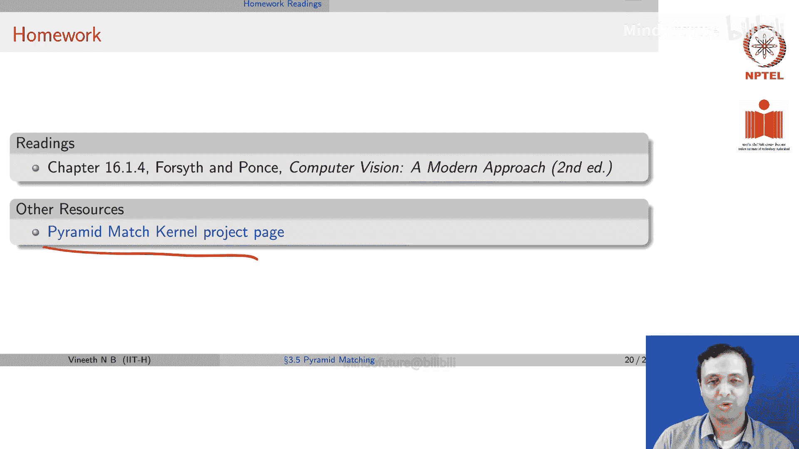

# 计算机视觉的深度学习：P19：金字塔匹配 🔺

在本节课中，我们将学习如何将匹配核（Matching Kernels）的思想扩展到图像金字塔（Image Pyramids）中，从而构建多分辨率图像匹配核。我们将重点介绍一种开创性的方法——金字塔匹配核（Pyramid Match Kernel），并探讨其扩展，如空间金字塔匹配（Spatial Pyramid Matching）和霍夫金字塔匹配（Hough Pyramid Matching）。

## 从匹配核到金字塔匹配核

上一节我们介绍了描述符匹配和匹配核的基本概念。本节中，我们来看看如何将匹配核应用于多分辨率图像金字塔。

匹配核的一种通用形式可以表示为：
`k(x, y) = γ(x) * γ(y) * Σ_c [w_c * M(x_c, y_c)]`
其中，`γ` 是归一化函数，`w_c` 是权重，`M` 是匹配函数。

金字塔匹配是一种高效的方法，它将无序的特征集合（每张图像即一个无序特征集）转换为多分辨率直方图，然后使用加权的多分辨率直方图进行匹配。其核心思想是：从最精细分辨率的直方图单元开始匹配首次出现的特征对，然后随着金字塔层级的上升，不断合并直方图。

## 直方图交集

在深入金字塔匹配之前，我们需要理解直方图交集（Histogram Intersection）的概念。

假设有两个直方图 `x` 和 `y`，每个都有 `b` 个区间（bin）。直方图交集 `κ_HI` 定义为每个区间中最小值的总和：
`κ_HI(x, y) = Σ_i min(x_i, y_i)`
其中，`i` 遍历所有区间。

有趣的是，直方图交集与 L1 距离（曼哈顿距离）存在关联。L1 距离可以表示为：
`||x - y||_1 = ||x||_1 + ||y||_1 - 2 * κ_HI(x, y)`
你可以尝试用几个例子验证这个关系，并思考其证明。

## 金字塔匹配核详解

金字塔匹配核通过对两幅图像在不同层级上的直方图交集进行加权求和，来近似最优的成对匹配。其直观理解是：在更精细层级上匹配的特征应获得更高的权重。

让我们通过一个具体例子来理解这个过程。假设有两幅图像 `X` 和 `Y`，其特征点（蓝色和红色点）分布在特征空间 `R^D` 中。

以下是构建金字塔匹配核的步骤：

1.  **层级 0（最精细）**：将特征空间划分为非常精细的网格（bin），使得每个 bin 内最多只有一个特征。计算 `X` 和 `Y` 在该层级上的直方图交集。假设我们得到 2 个匹配。权重为 `1/2^0 = 1`。相似性得分：`2 * 1 = 2`。
2.  **层级 1**：将相邻的 bin 两两合并，形成更粗的网格。重新计算 `X` 和 `Y` 在该层级上的直方图交集。假设现在有 4 个匹配。但只计算**新增**的匹配数：`4 - 2 = 2`。权重为 `1/2^1 = 1/2`。更新相似性得分：`2 + 2 * (1/2) = 3`。
3.  **层级 2**：继续合并 bin。计算新的直方图交集。假设有 5 个匹配。新增匹配：`5 - 4 = 1`。权重为 `1/2^2 = 1/4`。最终相似性得分：`3 + 1 * (1/4) = 3.25`。

形式上，给定特征集 `X` 和 `Y`，金字塔匹配核 `K_Δ` 定义为：
`K_Δ(X, Y) = Σ_{i=0}^{L} (1 / 2^i) * [κ_HI(H_i(X), H_i(Y)) - κ_HI(H_{i-1}(X), H_{i-1}(Y))]`
其中，`H_i` 表示在边长为 `2^i` 的规则网格上构建的直方图，`L` 是总层数。括号内的差值计算了该层级新增的匹配数。

这个表达式可以简化为一个伸缩和（telescoping sum）：
`K_Δ(X, Y) = (1 / 2^L) * κ_HI(H_L(X), H_L(Y)) + Σ_{i=0}^{L-1} (1 / 2^{i+1}) * κ_HI(H_i(X), H_i(Y))`

## 正定核性质

金字塔匹配核 `K_Δ` 是一个正定核（Positive Definite Kernel）。这是因为：

1.  它是多个 `κ_HI` 项的加权和，且权重 `1/2^i` 非负。
2.  每个 `κ_HI` 项是直方图交集中 `min` 操作的和。
3.  `min(a, b)` 可以表示为两个二进制向量的点积（例如，`min(3,5)=3` 可以表示为向量 `[1,1,1,0,0]` 和 `[1,1,1,1,1,0,0,0]` 的点积）。
4.  因此，`κ_HI` 可以表示为点积，其加权和也保持点积形式，满足正定核的定义。

正定核的性质使得该核函数在计算上更高效，并能利用核技巧（Kernel Trick）。

## 扩展与应用

金字塔匹配核的思想可以扩展到不同场景。

**1. 基于词汇表的扩展**
原始的直方图是在特征描述子空间 `R^D` 上均匀划分网格。我们可以改为使用聚类方法（如 K-Means）生成视觉词汇表（Visual Vocabulary），然后基于词汇表中心来构建直方图区间。这类似于词袋模型，但结合了金字塔的多分辨率思想。

**2. 空间金字塔匹配**
原始的“金字塔匹配核”主要关注特征的外观（描述子）。我们也可以仅在图像空间（坐标）上构建金字塔直方图，进行纯几何匹配。而**空间金字塔匹配**则将两者结合：
*   首先，像词袋模型一样，根据外观将特征聚类到视觉词汇。
*   然后，在图像空间上划分网格（如 1x1, 2x2, 4x4）。
*   对于每个空间网格，计算其内部特征在不同视觉词汇上的直方图。
*   最终，将所有空间网格、所有金字塔层级上的直方图交集加权求和。
这种方法同时考虑了特征的外观和几何位置，对物体形变更加鲁棒，常用于全局场景分类。

**3. 霍夫金字塔匹配**
霍夫金字塔匹配是霍夫投票（Hough Voting）思想与金字塔匹配的结合。其流程如下：
*   **输入**：通过快速金字塔匹配或其他方法得到的两幅图像间的一组特征对应关系（Correspondences）。
*   **参数化**：每个对应关系 `c` 可以定义一个变换假设，通常用一个 4 维向量表示：平移 `(T_x, T_y)`、尺度 `s` 和旋转 `θ`。
*   **构建金字塔**：在这个 4 维变换参数空间中构建金字塔。
*   **投票与消歧**：
    *   在最精细层级，每个对应关系根据其变换参数落入特定的 bin。
    *   如果同一个 bin 内存在**冲突的**对应关系（例如，图像 A 中两个点匹配到图像 B 中同一个点），则移除其中一个。
    *   在每个 bin 内，对应关系相互“组队”，其得分为该 bin 内（新增的）对应关系数量。
    *   权重随层级变粗而降低（`1/2^i`）。
*   **寻找峰值**：将所有层级的加权得分累加到每个对应关系上。最终，在变换参数空间中，得分密度最高的区域对应的变换，即为两幅图像之间最可能的匹配。

霍夫金字塔匹配的优点是计算复杂度与对应关系数量呈线性关系，并且对形变和多重匹配面具有鲁棒性。但其主要局限在于通常适用于**相同实例**的匹配。

## 总结

本节课我们一起学习了金字塔匹配的核心思想及其多种变体。

*   **金字塔匹配核**通过在多分辨率直方图上计算加权的交集，高效地近似了特征集之间的最优部分匹配，并且是一个正定核。
*   **空间金字塔匹配**通过联合外观（视觉词汇）和几何（图像空间网格）信息，增强了匹配对形变的鲁棒性。
*   **霍夫金字塔匹配**将金字塔思想应用于霍夫投票框架，在变换参数空间中进行多分辨率密度估计，以寻找最优的图像间变换。

这些方法为在无序特征集合上进行高效、鲁棒的相似性度量提供了强大的工具。