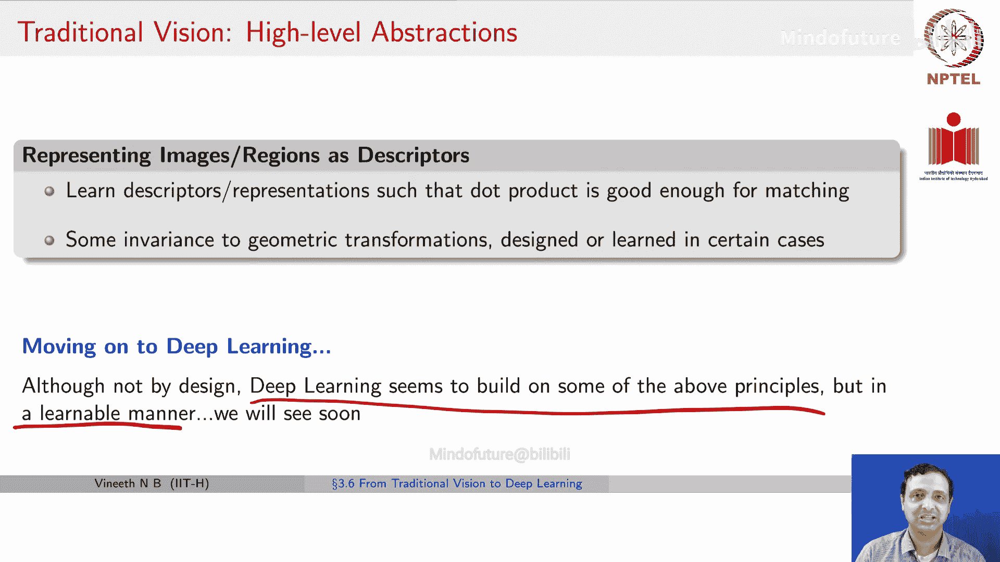

# 【NPTEL】计算机视觉的深度学习 p20 P20_从传统视觉到深度学习 -BV1vNWkzpEua_p20-

To complete this week's lecture。We you just summarize some of the things that we've seen so far。

As well be transitioning to deep learning from the next week。

What we have seen so far is a bree summary of。Work in computer vision that took two to three decades。

 So we've covered a few topics， but we've covered， we have not covered several more。

An important topic that we've probably missed is part based approaches so on and so forth。

 hopefully we'll be able to cover that in a future course。

But we've try to summarize the learnings that we've had so far。

 which will perhaps help us in transitioning to going to deep learning for computer vision。

 So one of the things that we learned so far is that。Convolution is a very unique operation。

 it linear shift in variant， it has useful properties such as commutivity， associivity。

 it distributes over additions and so on and so forth。

 so it's very unique in its processing of signals。It forms the basis of image。Openations。

It also forms the basis of neural networks， which is the ones that are used for in computer vision。

 most commonly are known as convolutional neural networks。

So convolution still remains used to this day even as part of deep learning。

We have also seen that the common pipeline in traditional vision tasks is given by。

We typically extract。Some key points or interest points and images could be edges。

Or could be key points that have significant change in more than one direction。

And we then extract descriptors out of these key points。

 this was a common theme if you saw over the last week of lectures at least。

Then we also saw an idea of trying to use banks of filters such as steerable filters or Gibbbar filters to be able to get multiple responses from a single image and then concatenate them to be able to do any further。

Task or processing。We also saw that these descriptors are useful for tasks such as retrieval。

 matching or classification。If you had to abstract out the understanding that we had so far。

 it is about the fact that each of these methods that we spoke about went from low level image understanding。

To aggregation of descriptors at a higher level。So we use banks of filters to capture responses at different scales and orientations。

 sustainable filters， give our filters， so on and so forth。Then there were histograms。

 which could be considered as doing some form of encoding because youre trying to quantize different key points into a similar scale or even doing some kind of pooling of features to a common clusterentroid or a common codebook element。

So one could see that there are some similarities here between how this processing was happening to how the processing happens in the human visual system。

 we at least briefly talked about it about the various levels of the human visual system。

 which also bears a similarity of trying to get different kinds of responses at different orientations and scales of the input visual and then trying to assimilate and aggregate them over different levels in the human visual system。

So there is a similarity here， although it was not by design， perhaps it was about solving tasks。

For computer vision， but there is a similarity about trying to get some low level features。

 probably features of different kinds but different scales and orientations because choosing only one feature can be limiting for certain applications so you want to use a bank of different responses and then combine them and be able to assimilate them for further information。

Another important thing that we also learned over the last few weeks is that there are applications。

For which local features are more important。The entire image may not be important。

 it may be important for certain tasks such as image level matching。

Maybe an image level search on one of your search engines。

 or there could be tasks for which only the local features are important， for example。

 a certain key point or you want to find a correspondence between partially matching images so on and so forth。

 so it depends on the task， stereopsisis about detecting depth and images。

If you want to estimate motion or if you want to recognize an instance of an object rather than just recognize a class in an image。

 it depends as to whether a local region matters or the full image matters。

We also saw that encoding using methods such as bag of words can make your image representation sparse。

 for example， it's possible that if you had to say 10 cluster centers in your k means for bag of words。

 it's possible that one of your images in your dataset set may have had only features belonging to three of those cluster centers。

 the remaining seven cluster centers had no occurrence in that particular image， which means。

Your image would have a histogram where for three of those bins。

 you would have some frequency counts， but rest of the seven bins will have a zero count。

That leads to a sparse representation where there are lots of zeros for that particular image。

 so encoding can result in that kind of a representation for an image。

And an important takeaway here is that a lot of operators that detect local features or even global representations of images for that matter can be viewed as performing convolution to get some estimate of features because to detect your key points。

 you need convolution is the key operation that you are relying on。

And then that's followed by some kind of a competition。 So for example， be it the cluster centers。

 So each of the cluster centers is trying to win votes of different features that correspond to that cluster center and one of them wins。

 So there seems to be some kind of competition or pulling of。

Of the result of the convolution operation， which leads to the next step or a higher level understanding or description of the image。

So， we also find that。The goal so far has been to learn descriptors and representations that make it easy for us to match。

You don't want to spend too much time on matching， of course we use some intelligence in coming up with matching kernels and so on and so forth。

 but the key idea is to be able to describe key points。

 describe images in such a way that a simple dot product or simple matching kernels can be used to be able to match images or parts of images or regions in images。

These kinds of descriptors。Or have some invariance to geo transformations， a certain scale。

 a certain rotation， certain translation， but in certain cases that's designed in the algorithm in certain other cases。

 they may have to be learned through other means。This is a brief summary of the topics that we've seen so far put into an abstract manner。

 put into a concise sexing manner。But what we're going to conclude with here is to show that。

We're going to move to deep learning， as I just mentioned。Although not by design。

Deep learning seems to be building upon some of these principles。

 Some of these will become clearer when we start。Discussing these deep learning approaches。

 but we see that the idea of trying to detect low level responses on of images to different kinds of filters and then aggregating them and building higher level abstractions and then going to a point of。

A task where the last representation becomes very simple for a task seems to be very simple。

 very similar to an idea that。Deep neural networks also seem to use for solving vision tasks。

 although this may not have been by design， it seems to be similar in the overall structure。

But a key difference between all of these methods that we've seen so far and what we're going to see with deep learning over the next remaining weeks of this course is that in deep learning。

 all of this is done in a learnable manner rather than we having to decide which key point should I use。

 should I use sift or should I use self Which descriptor should I use。

 Should I use oriented gradients or should I use GLh should I use local binary patterns。

 All of these become design decisions that sometimes become difficult。

 because they may depend on the task， and there is there was no complete knowledge on which kind of a descriptor could be used for which kind of a task。

 for example， for face recognition would local binary patterns be always the choice of a feature or could something else be used This kind of complete understanding of which method to use for which task was not very well known and。

Deep neural networks have， in some sense， changed the game there by。

Doing by simulating a similar pipeline， but the entire pipeline is purely learned for a given task at hand。

We will see more of this soon as we go into the next few weeks of lectures on deep neural networks and how they are applied in computer vision。

