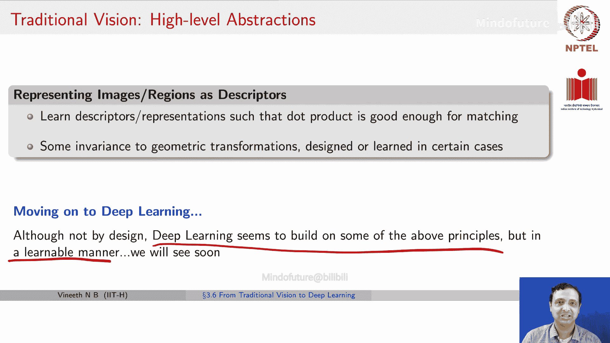

# 计算机视觉的深度学习：P20：从传统视觉到深度学习

在本节课中，我们将总结迄今为止所学的知识，并探讨如何从传统计算机视觉方法过渡到深度学习。我们将回顾核心概念，并理解深度学习如何构建在这些传统思想之上。

## 概述

本节课程将总结前几周关于传统计算机视觉的学习内容。我们回顾了卷积、特征提取、描述符编码等关键概念，并探讨了它们与即将学习的深度学习之间的联系。

## 传统计算机视觉方法总结

我们已学习的内容是对计算机视觉领域过去二三十年工作的简要总结。我们涵盖了一些主题，但也遗漏了其他重要主题，例如基于部件的方法。希望能在未来的课程中涵盖这些内容。我们尝试总结目前所学，这将有助于我们向计算机视觉的深度学习过渡。

### 卷积的核心地位

我们学到的一点是，卷积是一种非常独特的运算。它是线性移不变的，并具有一些有用的性质，如交换律、结合律以及对加法的分配律等。因此，它在信号处理中非常独特。它构成了图像操作的基础，也构成了神经网络的基础。在计算机视觉中最常用的神经网络被称为**卷积神经网络**。因此，卷积至今仍在使用，即使是作为深度学习的一部分。

### 传统视觉任务流程

我们还看到，传统视觉任务中的常见流程如下：我们通常从图像中提取一些关键点或兴趣点，这些点可以是边缘，也可以是在多个方向上具有显著变化的关键点。然后，我们从这些关键点中提取描述符。这至少是过去一周讲座中的一个共同主题。

### 滤波器组与特征聚合

我们还看到了使用滤波器组（如可操纵滤波器或Gabor滤波器）的想法，以便从单个图像获得多个响应，然后将它们连接起来以进行进一步的任务或处理。我们看到这些描述符对于检索、匹配或分类等任务很有用。

### 从低层到高层的抽象

如果抽象出我们目前的理解，那就是关于我们讨论的每种方法都从低层图像理解过渡到高层描述符的聚合。我们使用滤波器组来捕获不同尺度和方向上的响应。然后有直方图，它可以被视为进行某种形式的编码，因为你试图将不同的关键点量化到相似的尺度，甚至将特征池化到共同的聚类中心或码本元素。

因此，我们可以看到，这种处理方式与人类视觉系统中的处理方式有一些相似之处。我们至少简要讨论了人类视觉系统的各个层次，它也表现出相似性：试图在输入视觉的不同方向和尺度上获得不同类型的响应，然后在人类视觉系统的不同层次上尝试同化和聚合它们。

这里存在相似性，尽管可能并非有意设计。也许是为了解决计算机视觉的任务，但在尝试获取一些低层特征（可能是不同种类、不同尺度和方向的特征）方面存在相似性，因为仅选择一个特征可能对某些应用有限制，所以你想使用一组不同的响应，然后组合它们，并能够同化它们以获取更多信息。

### 局部特征与全局特征

我们在过去几周学到的另一个重要点是，有些应用更重视局部特征。整个图像可能并不重要，它可能只对某些任务（如图像级匹配）重要。例如，在搜索引擎上进行图像级搜索。或者，有些任务可能只对局部特征重要，例如，某个关键点，或者你想在部分匹配的图像之间找到对应关系，等等。因此，这取决于任务。立体视觉是关于检测图像深度的。如果你想估计运动，或者想识别图像中对象的实例而不仅仅是类别，那么局部区域重要还是整个图像重要，取决于具体情况。

### 编码与稀疏表示

我们还看到，使用词袋等方法进行编码可以使你的图像表示变得稀疏。例如，假设在你的词袋K均值聚类中有10个聚类中心，你的数据集中某张图像可能只有属于其中三个聚类中心的特征，其余七个聚类中心在该特定图像中没有出现。这意味着你的图像将有一个直方图，其中三个箱子会有一些频率计数，但其余七个箱子的计数为零。这导致了一种稀疏表示，即该特定图像有很多零值。因此，编码可以导致图像产生这种表示。

### 卷积与竞争机制

这里的一个重要启示是，许多检测局部特征甚至图像全局表示的操作符都可以被视为执行卷积以获得某些特征估计，因为要检测关键点，卷积是你所依赖的关键操作。然后，这之后是某种形式的竞争。例如，无论是聚类中心，每个聚类中心都试图赢得对应其特征的投票，其中一个会胜出。因此，似乎存在某种竞争或对卷积操作结果的池化，这导致了下一步或对图像更高层次的理解或描述。

### 描述符的目标

我们还发现，迄今为止的目标是学习描述符和表示，使我们更容易进行匹配。你不想在匹配上花费太多时间，当然我们在设计匹配核等方面使用了一些智能方法，但关键思想是能够描述关键点，描述图像，使得简单的点积或简单的匹配核可以用来匹配图像或图像的部分或区域。这类描述符对几何变换（如特定尺度、旋转、平移）具有一定的不变性，但在某些情况下，这是算法中设计的，在其他情况下，它们可能必须通过其他方式学习。

这是对我们迄今为止所见主题的简要总结，以抽象、简洁的方式呈现。

## 向深度学习的过渡

我们将在这里总结并表明，正如刚才提到的，我们将转向深度学习。尽管并非有意设计，但深度学习似乎建立在其中一些原则之上。当我们开始讨论这些深度学习方法时，其中一些将变得更加清晰。但我们看到，尝试检测图像对不同滤波器的低层响应，然后聚合它们并构建更高层次的抽象，最后达到一个任务的点，使得最后的表示对任务来说变得非常简单，这个想法似乎与深度神经网络用于解决视觉任务的想法非常相似。尽管这可能并非有意设计，但在整体结构上似乎是相似的。

### 传统方法与深度学习的关键区别

但是，我们迄今为止看到的所有方法与在本课程剩余几周将要看到的深度学习之间的一个关键区别在于：在深度学习中，所有这些都是以可学习的方式完成的，而不是由我们决定应该使用哪个关键点、应该使用SIFT还是SURF、应该使用哪个描述符、应该使用定向梯度还是GLH、应该使用局部二值模式。所有这些都变成了设计决策，有时变得很困难，因为它们可能取决于任务，并且对于哪种描述符可用于哪种任务没有完全的知识。例如，对于人脸识别，局部二值模式是否总是特征的选择，还是可以使用其他东西？对于哪种任务使用哪种方法的这种完整理解并不是非常清楚。

在某种意义上，深度神经网络通过模拟一个类似的流程，但整个流程纯粹是为手头的给定任务而学习的，从而改变了游戏规则。

随着我们进入未来几周关于深度神经网络及其在计算机视觉中应用的讲座，我们将看到更多这方面的内容。

## 总结

本节课中，我们一起回顾了传统计算机视觉的核心概念，包括卷积运算、特征提取与描述符、编码方法以及从低层到高层的特征聚合流程。我们看到了这些方法与人类视觉系统及深度学习思想之间的潜在联系。最重要的是，我们明确了传统方法与深度学习的关键区别：后者通过端到端的学习，自动优化从特征提取到最终任务的所有步骤，从而减少了对手工设计特征的依赖。这为我们接下来深入学习计算机视觉中的深度学习奠定了重要的认知基础。

