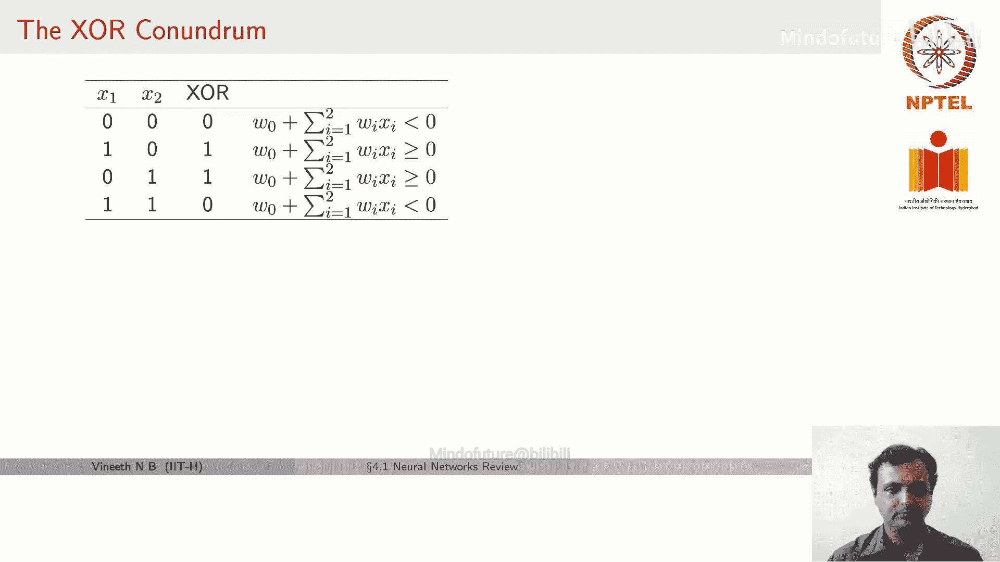

# 深度学习计算机视觉：P21：神经网络回顾 - 第一部分

## 概述

在本节课中，我们将回顾神经网络的基础知识。我们将从神经网络的历史开始，介绍其早期模型，并深入探讨感知机及其学习算法的工作原理。这对于理解后续的深度学习概念至关重要。

## 神经网络简史 📜

在之前的课程中，我们重点介绍了深度学习出现之前计算机视觉的研究与实践。深度学习彻底改变了当今计算机视觉的实现方式。虽然在此之前，计算机视觉领域已有多个维度的努力，但希望之前的几节课能让你对这些努力有所了解，其中一些在与深度学习结合后至今仍然相关。

接下来，我们的课程将聚焦于深度学习及其在计算机视觉中的应用。我们将以第一讲作为神经网络的回顾开始。对于之前学习过深度学习或神经网络课程的同学，这可能是一次复习；但即使没有相关背景，本课程也将涵盖所有入门内容。

需要说明的是，本讲大部分内容基于Mitesh Khapra在IIT Madras关于深度学习的优秀讲座。

神经网络的历史或许比计算本身的历史还要悠久。它始于20世纪40年代初，当时两位研究人员McCulloch和Pitts致力于开发人脑的计算模型，并利用该模型模拟逻辑门等简单功能。

随后在20世纪40年代，心理学家Donald Hebb提出了至今仍在使用的“赫布学习”理论。赫布学习指出，在人脑中，两个同步激活的神经元之间的连接会随时间增强；而两个很少同步激活的神经元之间的连接则会随时间减弱。

20世纪50年代，Frank Rosenblatt提出了第一个神经网络模型，称为“感知机”。感知机是最简单的神经网络，它包含一层神经元，接收一组输入，通过一组权重进行处理，然后输出一个经过阈值处理的最终决策。Rosenblatt还提出了一种学习算法来获取这个简单神经网络中的权重。

20世纪60年代初，Widrow和Hoff改进了这一学习规则，称为“Widrow-Hoff学习规则”或“Delta学习规则”。这为我们今天仍在使用的算法奠定了基础。

然而，Rosenblatt声称这种感知机可以处理任何二元分类问题。Minsky和Papert在当时的研究中，以异或门为例反驳了这一说法，因为异或门显然无法被简单的感知机分离。这导致了20世纪70年代神经网络的衰落。

20世纪80年代，随着1980年Neocognitron（通常被认为是卷积神经网络的第一个版本）的发展，以及1986年Rumelhart、Hinton和Williams提出的突破性算法——反向传播（至今仍在使用），人们对神经网络的兴趣再次复兴。

在20世纪80年代末至90年代中期，卷积神经网络等神经网络变体得到发展，并被应用于各种场景。当时一个流行的应用是手写数字识别问题，即今天所知的MNIST数据集。卷积神经网络是当时在该数据集上性能领先的模型之一。

在90年代中期，支持向量机（SVM）出现，它拥有优雅的理论支持，并在这些应用上表现出色。在90年代中期到21世纪头十年的大部分时间里，机器学习应用主要由今天被称为传统机器学习算法的模型主导，如支持向量机、Boosting、Bagging及其变体、决策树等。

21世纪中期，Geoffrey Hinton和Ruslan Salakhutdinov提出了一种分层特征学习算法，也称为无监督预训练。他们证明，用此方法初始化深度神经网络的权重，可以使神经网络获得超越其他方法的显著优势。这为随后的深度学习革命播下了种子。

此后，人们不断努力改进深度神经网络的训练方法。当时，神经网络无法训练很多层，这是一个主要限制。这一努力最终在2012年达到高潮，Alex Krizhevsky开发的AlexNet赢得了ImageNet挑战赛。ImageNet挑战赛是一个包含约1000个类别、超过一百万张图像的数据集。AlexNet以显著优势击败了所有竞争对手，引起了整个计算机视觉界的关注。自那时起，ImageNet挑战赛每年的获胜者都是深度神经网络。不仅在ImageNet上，视觉领域的其他基准挑战赛也大多由深度神经网络主导，这开启了深度神经网络的黄金时代。

## McCulloch-Pitts神经元模型 🧠

McCulloch（神经科学家）和Pitts（逻辑学家）在1943年提出了一个简单的神经元计算模型。该模型的工作方式如下：有一个函数 **G** 用于聚合一组输入（当时都是二进制输入），以及一个函数 **F** 基于聚合结果做出决策。

当时的输入被认为是兴奋性的（1）或抑制性的（0或-1，取决于对二进制数的编码选择）。因此，函数 **G** 表示为对所有兴奋性输入的求和。

最终输出 **y** 由 **F(G(x))** 给出，其中向量 **x** 表示输入空间的不同维度。当 **G(x)** 大于阈值 **θ** 时，输出为1；当 **G(x)** 小于阈值 **θ** 时，输出为0。如右图所示：有一组 **n** 个输入，它们全部进入函数 **G** 进行聚合，然后函数 **F** 基于预设阈值 **θ** 对 **G** 的结果进行处理，从而决定最终的二进制输出值。

以下是如何使用McCulloch-Pitts神经元模型模拟不同逻辑门的几个例子。

*   **基本McCulloch-Pitts神经元**：这是模型的基本形式。
*   **作为“与”门的神经元**：输入为 **x1, x2, x3**，聚合后，阈值设为3。这意味着，只有当所有三个输入都为1时，该神经元的输出才为1，因为此时才会超过阈值3。这是一个“与”门的简单例子。
*   **作为“或”门的神经元**：类似地，可以使用类似的方法模拟“或”函数，此时阈值设为1。如果 **x1, x2, x3** 中任意一个为1，这个阈值条件就会满足，输出为1。
*   **作为“非”门的神经元**：对于“非”函数，神经元设置略有不同。请注意，这里的输入符号表示它们是抑制性输入，而非兴奋性输入。这意味着如果其中一个输入为“开”，输出肯定为0。可以清楚地看到，只要这里的阈值大于0，就会得到“非”门。类似地，“非”函数是另一种设置，只有一个抑制性输入，如果将阈值设为零，则输出为1，模拟了“非”门。

可以看到，完全可以使用McCulloch-Pitts神经元模拟大多数逻辑函数。事实上，可以证明，虽然不是单个McCulloch-Pitts神经元，但由McCulloch-Pitts神经元组成的**前馈网络**可以计算任何布尔函数 **F**，该函数将 **n** 维布尔输入映射到一维布尔输出。从机器学习的角度来看，这意味着只要输入和输出都是二进制的，就可以解决 **n** 维输入的二元分类问题。早期的研究还表明，递归McCulloch-Pitts网络实际上可以模拟任何确定性有限自动机。

## 感知机模型与学习算法 🤖

正如几分钟前提到的，心理学家Frank Rosenblatt在1958年提出了感知机模型。Minsky和Papert在60年代末仔细分析了该模型，并得出结论：它在某些情况下无法工作。但在深入探讨之前，我们先介绍什么是感知机。

感知机是McCulloch-Pitts神经元的推广。现在，输入不再局限于布尔值，可以是任何实数值。此外，每个输入都由一组权重值 **W1** 到 **WN** 进行加权。

从数学上看，感知机如下所示：函数 **G**（与McCulloch-Pitts神经元中的相同）接收一个 **n** 维输入向量 **x**。同样，这可以是任何数据中的任何 **n** 维。例如，你可能在看一份患者记录，并想判断患者是否有患癌症的风险，那么每个属性可能是患者的血型、年龄等，现在可以是任何实数值，而不仅仅是二进制值。函数 **G** 的输出是 **W** 和输入向量 **X** 的内积，即 **WᵀX**。最终输出同样是 **F(G(x))**，当 **G(x)** 大于阈值时为1，否则为0。可以看到，这是McCulloch-Pitts神经元的推广，输入可以超越布尔值，并且有权重与输入相乘。

感知机更常见的写法是索引从0开始，而不是从1开始。这样做是为了将阈值作为方程本身的一部分。现在，求和从 **i = 0** 到 **n**，其中 **x₀** 始终为常数1。今天，这通常被称为**偏置**。

如果将感知机视为对一条直线的建模，直线的方程可以写成 **WᵀX + b = 0**，其中 **W** 和 **X** 可以是特定维度的向量。**b** 就是我们所说的权重 **w₀**，它与常数值1相乘。现在，这个偏置项被纳入一个从 **i = 0** 到 **n** 的公共求和中，其中 **w₀** 被表示为 **-θ**，而对应于 **w₀** 的 **x₀** 始终为1。为什么这样做？这样做的原因是，现在你的输出 **y**（即 **F(G(x))**）将在 **G(x)** 大于等于0时为1，在 **G(x)** 小于0时为0。之前我们用的是阈值 **θ** 而不是0，现在我们将 **θ** 纳入方程左侧的 **G(x)** 内部，即把 **-θ** 写成 **w₀**（因为 **x₀ = 1**）。这是书写感知机更被接受的约定。

现在，让我们看看感知机的权重是如何学习的。你有一组权重 **w₀** 到 **wₙ**，一组输入 **1**（对应于权重 **w₀**）和 **x₁** 到 **xₙ**。假设你有一组标记为1的输入，我们称之为正类 **P**；另一组标记为0的输入，我们称之为负类 **N**。

以下是感知机学习算法的步骤：

1.  随机初始化权重向量 **W**。
2.  循环执行以下步骤，直到收敛：
    *   从 **P** 或 **N** 中随机选取一个数据点 **x**。
    *   如果 **x** 属于正类 **P**，但当前感知机的输出 **WᵀX < 0**（我们希望它 ≥ 0），那么将 **x** 加到 **W** 上：**W_new = W + x**。
    *   如果 **x** 属于负类 **N**，但当前感知机的输出 **WᵀX ≥ 0**（我们希望它 < 0），那么从 **W** 中减去 **x**：**W_new = W - x**。
    *   如果 **x** 属于 **P** 且 **WᵀX ≥ 0**，或者 **x** 属于 **N** 且 **WᵀX < 0**，则保持 **W** 不变。
3.  收敛条件是：对于所有来自 **P** 的数据点，感知机输出 ≥ 0；对于所有来自 **N** 的数据点，感知机输出 < 0。

但为什么这样做有效？为什么将 **x** 加到 **W** 上就构成了一种学习过程，并且能提高 **W** 的质量？让我们更仔细地看看。

如前所述，感知机是对一条直线的建模，因为它的方程本质上是 **WᵀX = 0**（偏置已包含在内）。这条直线将输入空间分成两个半空间：满足 **WᵀX < 0** 的半空间和满足 **WᵀX ≥ 0** 的半空间。直线上的每个点都满足 **WᵀX = 0**。根据几何知识，权重向量 **W** 总是垂直于这条直线。

对于一个属于正类 **P** 的点，我们希望感知机正确分类它，即输出 **WᵀX ≥ 0**。这意味着该点与权重向量 **W** 之间的夹角应小于90度。如果对于一个属于 **P** 的点，有 **WᵀX < 0**，则意味着夹角大于90度，这不是我们想要的。我们通过将 **x** 加到 **W** 上来改变 **W**，使新的夹角变小。

让我们看看为什么添加 **x** 有效。设 **W_new = W + x**。新旧夹角余弦的关系可以推导如下：
**cos(α_new) ∝ W_newᵀx = (W + x)ᵀx = Wᵀx + xᵀx**
由于 **xᵀx** 是一个正数（向量与自身的内积），因此 **cos(α_new) > cos(α)**，这意味着新的夹角 **α_new** 小于旧的夹角 **α**。这正是我们想要的：对于误分类的正类点，减小其与权重向量的夹角。

类似地，可以分析误分类的负类点的情况，你会发现减去 **x** 会使夹角增大，从而使其输出变为负值。

这应该能让你相信，感知机学习算法在每次迭代中都会不断改进权重向量 **W**。至于它何时收敛，我们只知道它会不断改进。但能否达到最终解，我们尚未在此给出形式化证明。可以证明，只要原始数据点可以用一条直线分离成 **P** 和 **N** 两类，随着迭代次数增加，该算法最终会找到一个解。

## 总结

本节课我们一起回顾了神经网络的早期历史，从McCulloch-Pitts神经元模型开始，到感知机及其学习算法。我们了解了感知机如何作为线性分类器工作，以及其权重更新规则背后的几何直觉。这是理解现代深度神经网络的重要基础。在下一节中，我们将探讨感知机的局限性以及更复杂的神经网络模型是如何发展起来的。