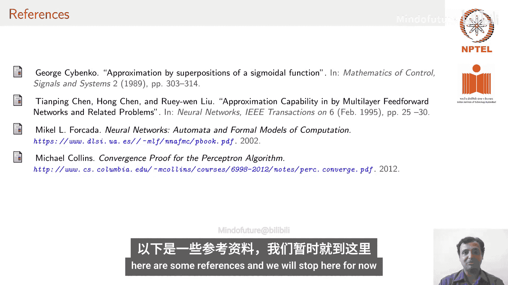

# 【NPTEL】计算机视觉的深度学习 p22 P22_神经网络回顾 - 第二部分 -BV1vNWkzpEua_p22-

Okay， we said that。Although rose and black proposed。The Perceptron。

 Minsky and Pa later showed that the perceptron is limited to only a certain kind of data configurations that does not work for data configurations beyond those kinds。

And the example they used was the exotic。Let's try to understand that we know that the ground truth of the ex gate。

 the truthth table for the exhaust gate is given by something like this。

 where if one of the inputs is one， you get a1， otherwise is0。So from a perspective perspective。

 what we would want is in the first scenario we would want your Wxi to be less than zero because we want the output to be0。

 similarly these two cases we would want it to be greater than our equal to zero and in the last case we want it to be less than zero again。

So let's analyze this， let's take the first equation which says w not plus w1 into0。

 which comes from here plus w2 into zero， which comes from here。WeI want it to be less than zero。

 which is what we want the perceptron to do， which means w n has to be less than zero。Similarly。

 from the second。Line of the to table you have w n plus w1 do 1 plus w2 at 0。

 which are the inputs in the second line， we want back to be greater than or equal to 0。

 which means w1 is greater than minus w0 so since w n is less than0。

 w1 would be a positive quantity greater than the absolute value of w0。Similarly， the third。

Ling into the root table would similarly get you W2 to be greater than negative Wn。

And the final line would show that w n plus w1 plus w2 should be less than0。

 or W1 plus w2 must be less than minus w n。It's quite clear here that because W1 and W2 will be positive。

W1 plus w2 cannot be less than minus w0 because we know that individually each of them are greater than minus w0。

 which itself is a negative number。W n by itself is a negative number。

 so minus w0 will be a positive number。So we can see a contradiction in these criteria here。

 and that should clearly show you why a personron cannot solve the absorber problem。

Also visually speaking。You have the exact problem to be represented as。You want these two elements。

 which are01 and1 zero to have a label to be one。And you have these two elements， 0。

0 and 11 to have a label to be zero。 as we said， a perceptron simply embodies a line。

And if you draw a line here， you're going to get this element from。And if you draw a line here。

 you're going to get to this element prompt and exorgate cannot be solved by a linear model。

So as you can see， it's impossible to draw light with separate static points from the blue points here。

And that leads us to the concept of a multi layerer perceptron。

A multiaire per from as the figure shows。Does is not restricted unlike a puzzleron to only a input layer and an output layer。

 but also has the convenience of including a hidden layer of neurons。

The number of neurons in this hidden layer is a design decision so here is an example of how multilayer perceptron can be used to solve the z problem this is just one weight configuration that can solve the z problem there could be other weight configurations that may solve or may not solve the z problem all that we are trying to say here is that there is at least one weight configuration with a multilayer perceptron that can solve the z problem let's look at this example so you have the weights denoted on each of these connecting edges here and you also have the bias given to be minus1 so with these values given to us let' see if let's take a couple of cases from the tooth table and work out that this indeed gives a solution so if you have zero0 as input。

You're going to get 0 into2 plus 0 into minus1 plus minus1 Z1 would get an input minus1 since it's a perceptron and its input is negative。

 it would give an output to be 0， you would get exactly the same output for Z2。

 you would get a minus1 and its output to be0。Which means you're going to have。What y gets as0。

 which we can assume that only value is greater than zero is the threshold is0 and only value greater than0 gives you a onex output and you would get now because the output at y is0 you would now get。

The output to be 0。 Let's take the second case now and see how that works out for for this particular scenario。

 So let's consider your input now to be 0 and 1。So if that be the case。

 you know Z1 is going to get a0 and a minus1 and a minus1， which would turn out to be minus2。

 which means the output would be 0 unless see what Z2 would get Z2 would get a0 and a two and a minus1。

 which would be1， which means the output of。Zta will be1。

 which means you're going to get an output of two here plus 2 into1 plus 2 to0。

 which corresponds to a1。You could hold a similar thing with hold for the third row。

 third double1 comm 0， let's rather work out the last one now just to be sure about this again。

 so let's consider1，1 when we have1，1 you're going have two minus1 minus1 which is0 which means0。

 similarly you would have a two a minus1 a minus1 coming from bias a0， a00 and a0。

put this out if this was fast， and you will notice that this is a valid solution for theux。

You can in fact， show that any Boolean function of n inputs can be represented exactly by a network of perceptrons containing one hidden layer with two power n perceptrons and one output layer containing one perceptron。

So if you have a hidden layer， rather a multi layer perscept pro。

 and you have two power n perscept prongs in that hidden layer。

 you can represent any boolean function of M input。How do you prove this？

We are not going to formally prove it， but informally， it's fairly simple because。

Every case that you have can be represented as one neuron in your hidden player。

 remember if you have any inputs。Assuming you're talking about Boolean functions。

 there are two power end combinations and you can ensure that the right per pro clicks for each of those combinations so you can come with the weight configuration that ensures that each of those two power end percent pros in the middle layer corresponds to one combination of n inputs which automatically will give you your solution。

 it's fairly straightforward to see it in fourier case。

But one thing to keep in mind here is while we say that any boolean function can be implemented by a hidden layer with two power and perceptrons。

 this is sufficient but not necessary， which means you could solve a problem with less than two power and your stool。

 for example， which is now solve a problem， which we solved with a hidden layer with。

Just two kilo neuronss。Ideally according to what we said in the next slide we should have needed two power2 or four neurons but that's not the case。

 and that's the reason why we say that a network of two power n plus1 plus one for the bias is not necessary when it is sufficient you can make two you can probably find solutions with even lesser but you can definitely find a solution with two power n neurons or perceptrons in a hidden rate。

Why does this necessary insufficiency matter？The reason is as n increases。

 the number of perceptrons in the hidden layers increases exponential to power。

 so your multilayer perceptron can become too computationally intensive to train or to even just to take a forward pass through。

So you don't want that always to be too completelyly intensive。

 you ideally want to find the multi layerer per sepro solution that has least number of neurons in your hidden layer。

Now， let's ask the question， what do we do if we want to go beyond binary inputs and outputs。

 We only spoke about Booleion inputs。 We did say that percepts could handle。Inputs beyond binary。

 but are there any relationships that we understand？

The previous result that we showed was only that a multi perceptron with two power m hidden neurons can solve any boolean function what if that function was not boolean can we use the same perceptron model to represent such functions。

The answer is。We need something called activation functions。Why activation functions。

 we'll see that in a moment。So far we noticed that a perceptron only fires when the weighted sum of its inputs is greater than the threshold minus w do or which was0。

Which was Stephen， sorry， which was Stephen。So this thresholdworthing logic can become very harsh at times。

 for example， if your minus w not was 0。5。Even 049 and 0。51， which are very close to each other。

 will end up doing very different results because one of them。

It's below the threshold and one of them is about the threshold。

Which means your thresholding function is a step function where you have a sudden change in your output。

 even with a very small change in your input。Typically this behavior does not occur in the real world。

 but even in this case， the behavior is not a characteristic of the problem。

 it is more the characteristic of using a step function as a thresholding function。

And we all know that in the real world， you generally expect a smoother decision function such as the one shown in red here as you go from one value to another value。

 you do not want it to jump up， you do not want the output of the to be 1。

 suddenly when the value goes from 0。49 to 0。5 or 0。499 to 0。5。How do we handle this？

The way we handle this is to introduce what are known as activation functions， which。

Aim to replace the threshold function that you have with more smoother functions。

And one early example， which was used for several decades。

 is known as the sigmoid activation function and a perceptron or a neuron that uses a sigmoid activation function is known as a sigmoid neuron。

You ideally could use any logistic function， any logistic function which has a shaped of such as this。

To obtain a smooth output function than a step function， the one that we are particularly。

What I talk about here is the sigoidoid Lo function， which is given by given a input W X。

Which can be expanded this way。The sigmoid function computes one by one plus e power minus that。

That's your s sigmoid function， which in a graph form has this particular shape。Clearly here。

 you no more have a sharp transition at a threshold。

 but a smooth transition that goes as your input keeps changing。Also。

 your output now is no longer just binaryl， it's not just zero or1。

 but your output now can be any value lying between0 and 1。

 which would potentially be interpreted as a probability of the output。

 which means if you used a sigmoid activation function on the neuron in your output later。

It would give you a value between 0 and1 which can associate a probability with whether a point belongs to the positive class or a negative class。

 so if your output was 0。5， you would perhaps not 0。5， let's take another example， let's say 0。6。

 you would say that assuming your inputs are say patient records。

 you would say that this patient has a 60% risk of say suffering from cancer or。我我这个搞诉你我。

Thiss particular good scenario。More importantly， unlike the step function， this function is smooth。

 it's continuous at minus w0， which is your threshold。

 it is continuous there has no discontinuities and is also in differential。Why is this important。

 we will see very soon it being defiable is extremely important for how we will to train these kinds of networks。

There are other popular activation functions。We briefly review them here。

 but we cover them in detail in a later lecture this week。

 but a sigmoid activation function which is said is given by assuming your input is Z is one by one plus E a Z and H as we know is the hyperbolic tangent which is given by that formula there there's also an activation function called the rectified linear unit。

 which if you see here is the blue line。Whi is the blue line on this particular graph。

 which is given by if your input is Z， the output is max of zero comm Z so if your input，Is negative。

 it would give you zero， if your input is positive， it will give you the value itself。

That's a very very popular activation function， there is also a variant of the yellow activation function called the leaky yellow which does not make this zero but keeps this a very small value and we will see each of these the design for each of these a little later this week。

A more general variant of the L activation function is known as the exponential linear unit or L。

 which is simply a smooth form of the yellowlu or the leaky yellow activation function。

 which is given by alpha into e power z minus1 commmaZ max of that where alpha is the number greater than0。

 and you can see the L activation function in the purple color on this particular。

On this particular look。We will see these activation functions a bit later in detail。

 but all that we are trying to tell here is that the activation function is important for us to understand how well multi percent prompts can model non binaryary data。

No bullion data。And that's where the representation power。

 the study of the representation power of multilayer perceptrons。

 MLP stands for multi layerer perceptrons comes in。A very well studied。

 very well cited theorem is known as the universal approximation Theorem。

 which states that a multilayer network of sigmoid neurons with a single hidden layer can be used to approximate any continuous function to any desired precision。

This is a fairly strong statement。You're saying that if you give any continuousous function。

We can use a simple multilayer perceptron sigmoid neurons and one hidden layer to approximate that continuous function。

You're not going to formally prove it here if you're interested these papers cited here。

Are good pointers to the proof？There's also a very nice visual explanation of the universal approximation Theem in chapter4 of Michael News's online book on。

Buildural networks and decline。So your homework for this lecture is try to solve ZR using a multilayer perceptron with four hidden units。

 come up with your own weights and solve ZR using a multilayer percept pro of four hidden units。

 this should also help you understand the theorem that we spoke about about how anybuoolean function can be represented。

By multiair per from with。To power in hidden units this should also help you get an intuition of that for further readings please also feel free to refer to Me Kara's original lecture slides which are on the website linked here there are other good resources deep learning book which is publicly available on a website called deep learningningbook。

org is a general resource that we will point to for various parts of this course Chapt 6 is a good introduction to multilayer percent pro。

There is also the Stanford CS231 M course， which is also a good course whose notes are also relevant here。

There is also the Stanford UFM deal tutorialium and a very nice introduction to neural networks by Ro Royer。

Here are some references。And we stop you for that。

