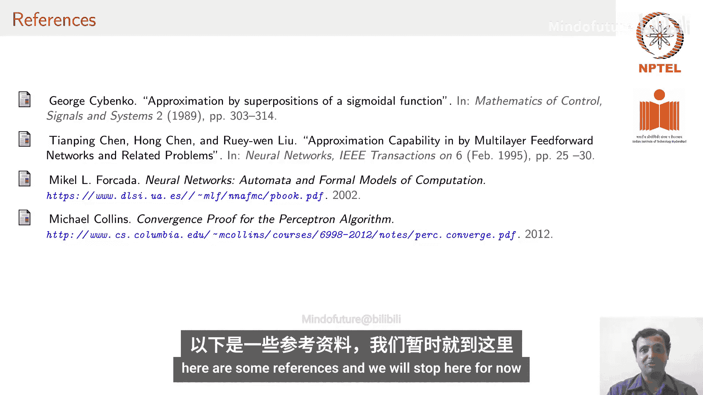

# 深度学习计算机视觉：P22：神经网络回顾 - 第二部分

在本节课中，我们将继续回顾神经网络的基础知识。我们将深入探讨单层感知机的局限性，特别是它无法解决异或问题。然后，我们将介绍多层感知机如何克服这一限制，并引入激活函数的概念，使神经网络能够处理更复杂的非线性和非二进制数据。最后，我们会简要介绍通用近似定理，了解神经网络的强大表示能力。

## 感知机的局限性：异或问题

上一节我们介绍了感知机的基本原理。本节中我们来看看感知机的一个关键局限性。

Minsky和Papert指出，感知机只能处理特定类型的数据分布，对于超出这些类型的数据配置则无能为力。他们使用的例子是异或门。

异或门的真值表如下所示：当且仅当一个输入为1时，输出为1，否则输出为0。从感知机的角度，我们希望：
*   当输入为 (0,0) 时，加权和 `w0 + w1*0 + w2*0` 小于0，以输出0。这意味着 `w0 < 0`。
*   当输入为 (0,1) 时，加权和 `w0 + w1*0 + w2*1` 大于等于0，以输出1。这意味着 `w2 > -w0`。
*   当输入为 (1,0) 时，加权和 `w0 + w1*1 + w2*0` 大于等于0，以输出1。这意味着 `w1 > -w0`。
*   当输入为 (1,1) 时，加权和 `w0 + w1*1 + w2*1` 小于0，以输出0。这意味着 `w1 + w2 < -w0`。

这里存在矛盾。因为 `w1` 和 `w2` 都大于 `-w0`（一个正数），所以 `w1 + w2` 不可能小于 `-w0`。这清楚地说明了为什么单个感知机无法解决异或问题。

从视觉上看，异或问题可以表示为：我们希望将点 (0,1) 和 (1,0)（标签为1）与点 (0,0) 和 (1,1)（标签为0）分开。感知机构成一条直线。你无法画出一条直线将这两类点完美分开。

## 解决方案：多层感知机

既然单层感知机无法解决异或问题，本节我们来看看如何通过增加网络层数来解决它。

多层感知机不像感知机那样仅限于输入层和输出层，它还可以包含一个或多个隐藏层。隐藏层中神经元的数量是一个设计决策。

以下是一个使用多层感知机解决异或问题的权重配置示例。存在其他可能解决（或不解决）此问题的权重配置，我们这里想说明的是，至少存在一种多层感知机的权重配置可以解决异或问题。

让我们分析这个例子。每条连接边上的数字表示权重，偏置为-1。给定这些值，我们可以验证几个真值表的情况。

以下是验证过程：
*   **输入 (0,0)**：神经元Z1的输入为 `0*2 + 0*(-1) + (-1) = -1`，输出为0。神经元Z2的输入为 `0*(-1) + 0*2 + (-1) = -1`，输出为0。输出神经元Y的输入为 `0*2 + 0*2 + (-1) = -1`，输出为0。符合预期。
*   **输入 (0,1)**：神经元Z1的输入为 `0*2 + 1*(-1) + (-1) = -2`，输出为0。神经元Z2的输入为 `0*(-1) + 1*2 + (-1) = 1`，输出为1。输出神经元Y的输入为 `0*2 + 1*2 + (-1) = 1`，输出为1。符合预期。
*   **输入 (1,0)**：通过类似计算，可得输出为1。
*   **输入 (1,1)**：神经元Z1的输入为 `1*2 + 1*(-1) + (-1) = 0`，输出为0。神经元Z2的输入为 `1*(-1) + 1*2 + (-1) = 0`，输出为0。输出神经元Y的输入为 `0*2 + 0*2 + (-1) = -1`，输出为0。符合预期。

因此，这是一个有效的异或问题解决方案。

事实上，可以证明，任何具有n个输入的布尔函数都可以由一个包含一个隐藏层（有 `2^n` 个感知机）和一个输出层（有一个感知机）的感知机网络精确表示。证明思路是：对于n个输入的 `2^n` 种可能组合，你可以在隐藏层中配置 `2^n` 个感知机，使每个感知机对应一种输入组合，从而确保输出正确。

但需要注意，`2^n` 个隐藏神经元是**充分但非必要**的条件。例如，我们刚刚用2个隐藏神经元就解决了异或问题（理论上 `2^2=4` 个才足够）。这意味着你有可能用更少的神经元找到解决方案，但用 `2^n` 个神经元肯定能找到。

为什么这个“非必要性”很重要？因为随着n增大，隐藏层神经元数量呈指数增长（`2^n`），这会使多层感知机的训练甚至前向传播计算量变得非常大。因此，我们理想的目标是找到具有最少隐藏神经元的解决方案。

## 超越二进制：激活函数

上一节我们讨论了布尔输入。本节我们来看看如何处理更一般的输入和输出。

之前的结论仅针对布尔函数。如果函数不是布尔型的，我们还能用相同的感知机模型来表示吗？答案是：我们需要引入**激活函数**。

到目前为止，我们注意到感知机仅在输入的加权和大于阈值（`-w0`）时才“激活”。这种阈值逻辑有时可能过于严苛。例如，如果阈值是0.5，那么输入0.49和0.51虽然非常接近，却会产生截然不同的输出（0和1）。这意味着阈值函数是一个阶跃函数，输入微小的变化会导致输出突变。在现实世界中，这种行为通常不是问题本身的特性，而是使用阶跃函数作为阈值函数的特性。我们通常期望一个更平滑的决策函数。

我们通过引入**激活函数**来处理这个问题，旨在用更平滑的函数替换阈值函数。

一个早期的例子是**Sigmoid激活函数**，使用它的神经元称为Sigmoid神经元。你可以使用任何具有S形曲线的逻辑函数来获得比阶跃函数更平滑的输出。这里我们特指Sigmoid逻辑函数。

给定输入 `z = w·x + b`，Sigmoid函数计算为：
`σ(z) = 1 / (1 + e^{-z})`

其图形呈S形。这里不再有阈值处的尖锐过渡，而是随着输入变化而平滑过渡。此外，输出不再是二进制的0或1，而是介于0和1之间的任何值，这可以解释为输出的概率。例如，如果你在输出层使用Sigmoid激活函数，它会给出一个0到1之间的值，可以关联到某个点属于正类或负类的概率。

更重要的是，与阶跃函数不同，Sigmoid函数是平滑、连续的，并且是**可微的**。可微性对于我们接下来如何训练这类网络至关重要。

## 其他流行的激活函数

除了Sigmoid，还有其他流行的激活函数。我们在此简要回顾，后续课程会详细讲解。

以下是几种常见的激活函数：
*   **Sigmoid**：`σ(z) = 1 / (1 + e^{-z})`
*   **双曲正切 (Tanh)**：`tanh(z) = (e^{z} - e^{-z}) / (e^{z} + e^{-z})`
*   **线性整流单元 (ReLU)**：`ReLU(z) = max(0, z)`。如果输入为负，输出0；如果输入为正，输出原值。这是非常流行的激活函数。
*   **渗漏线性整流单元 (Leaky ReLU)**：ReLU的一个变体，当输入为负时，输出一个很小的值（如 `0.01z`），而不是0。
*   **指数线性单元 (ELU)**：ReLU或Leaky ReLU的一种更通用的平滑形式，公式为 `ELU(z) = { α(e^{z} - 1), if z < 0; z, if z >= 0 }`，其中α > 0。

激活函数对于理解多层感知机如何有效建模非二进制数据至关重要。

## 表示能力：通用近似定理

现在我们来探讨多层感知机的表示能力。一个被广泛研究和引用的定理是**通用近似定理**。

该定理指出，具有单个隐藏层的Sigmoid神经元多层网络，可以用来以任意所需的精度近似任何连续函数。这是一个相当强的陈述。它意味着对于任何连续函数，我们都可以使用一个简单的、具有单隐藏层的Sigmoid神经元多层感知机来近似它。

这里不进行正式证明。如果你感兴趣，可以查阅引用的论文。Michael Nielsen的在线书籍《神经网络与深度学习》第4章也提供了该定理的直观解释。

## 总结与作业

本节课中，我们一起学习了感知机在解决异或问题上的局限性，并了解了多层感知机如何通过引入隐藏层来克服这一限制。我们还介绍了激活函数（特别是Sigmoid函数）的重要性，它使神经元能够产生平滑、可微且具有概率解释的输出。最后，我们提到了通用近似定理，它揭示了具有单隐藏层的神经网络强大的函数近似能力。

**你的作业**：尝试使用一个具有4个隐藏单元的多层感知机来解决异或问题，并设计你自己的权重。这将帮助你理解我们之前提到的定理：任何布尔函数都可以用具有 `2^n` 个隐藏单元的多层感知机表示。

**延伸阅读**：
*   本课程网站上Me Kara的原始讲义幻灯片。
*   公开书籍《深度学习》（deeplearningbook.org），第6章是多层感知机的良好入门。
*   斯坦福大学CS231n课程的相关笔记。
*   斯坦福大学UFLDL教程。
*   Ro Royer的神经网络简介。

