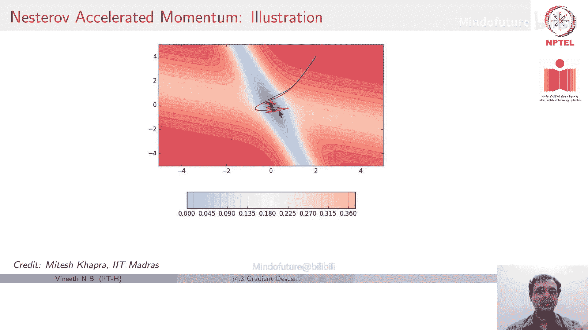

# 【NPTEL】计算机视觉的深度学习 p25 P25_梯度下降及其变体 - 第一部分 -BV1vNWkzpEua_p25-

We've so far seen an introduction to neural networks。

And how one can train forward or a feed forward neural network or a multiierer perceptron using back propagation and gradient descent。

We'll now move on to understanding the challenges of training such a neural network using gradient descent。

And propose variants and adaptations that could be useful in improving the effectiveness of training neural networks using gradient diss。

We'll start with a brief review of gradient descent。As we already said。

 gradient descent is an optimization algorithm that's used to find the minima of any differentiable function remember again that the loss function that we use to train a neural network means square error is what we use so far。

 but even if we use any other loss function that function has to be differentiable。

Please don't worry， if you're not aware of what other loss functions to use。

 we will see plenty of them as we go through the rest of this course。

And when we use gradient descent。And eat them。Parameterters are pushed in the negative direction of the gradient of a cost function or error function or loss function。

 whatever we choose to call it。And the parameter update rule is given by the new parameters are the old parameters minus alpha。

 which is your learning rate of step size times， the change in the parameters。

And we saw this visualization also in the last lecture。Where if you have a simple convex function。

You have。And if you consider a point to the left of the minimum， say this blue point here。

The gradient there is negative。So when you go in the negative direction of that。

 you're going to be going towards the positive side or the right side。

 which will take you towards the minimum if you know start at this point here on the right side。

The gradient there is positive， so the negative gradient we call the opposite direction。

 which will once again be towards your minimum。And this is a visual illustration of how gradient descent can be used to minimize any objective function。

Keep in mind here that this example of a function， this black curve here is a convex function。

 so you are going to have an exercise at the end of this lecture to know what convex functions are and we will discuss them a little bit later if you're not aware。

But for the moment， let's go ahead and try to understand how we can improve uranium descent。

Here is the gradient decent algorithm you're given a learning grade。You have some initial parameters。

 theta T。And a training data DTR。As long as the stopping criterion is not met。

You initialize your parameter updates。And for each point in your training data set。

You compute your gradient using back propagation of the loss function with respect to each of your parameters and you aggregate your gradients in your delta theta。

Variable once again， just to remind you， deelta theta denotes the change in variables。

Grad L denotes the gradient， please note the difference in notation since they can look similar at first。

Then finally you apply your update and theta t plus1， which is your parameters at the next time step。

 is equal to parameters at the current time step minus alpha times1 by cardinality of DTR。

 which is the number of data points that you have in your training data set。In took de theta。

How long do you train this？Until your gradient becomes。0。

Each of these for loops here is typically called one epoch。

 one epoch corresponds to one full iteration over your cleaning data set。

 so we compute the gradients across an epoch， average all your gradients and then update your parameters。

 that's the simple summary of gradient sec。Now let's move on to understanding what is known as the error surface of neural networks。

The error surface of neural networks is simply a plot of。

All your parameters of the neural network versus the corresponding cost value or the loss function value that you have。

From now on， when we say rates， you dont assume that it also encompasses bias assessing them。

 so just please assume it that way。So if you see this undated surface in this slide。

 each point there is one particular weight configuration which means one value assigned to each weight and the corresponding loss that was incurred when you propagate all your training data points through that weight configuration remember for every training data point you would forward propagated you get an output you would get a loss next training data point forward propagated an output and a loss now you averaged all of these losses that's going to be your overall loss for that weight configuration before you update further。

This is an at surfaceface。Which can be very complex。Modern neural networks that are used in practice。

 especially in computer vision。Have millions of parameters， a very popular network known as Alexnet。

 which once again well see later has close to 60 million parameters。 This one is ReNe。

 which again has millions of parameters， which means although we see it in。3 dimensional space here。

This kind of an error surface actually exists in a 60 million dimensional。Space。

 so you can imagine the complexity that's going to be there on that particular surface。

And the goal when you train a neural network is to start somewhere on the surface。

 which means you could be starting at any one particular point。

 remember that's the random initialization of the bases and your gradient descent has to take you to the minimum。

Clearly， you can see here that。This is a very non convex surface， it's not a single bowel like shape。

 it's a non convex surface with lots of indulations。

 so it's not a trivial task to be able to traverse this surface。

One of the major problems when you have a non convex objective function is that you're going to have many local minimum。

Which means the solution that you finally converge to。After applying gradient descent。

I's going to depend on where you start， depending on where you start。

 that going to decide which local minimum you're going to converge to why so？

Because when you hit one of this local minima， your gradient is going to be zero and your gradient decent algorithm will dominate。

Which means it's going to be extremely important to know where to start。

 and unfortunately when we start training a neural network。

 we do not understand the complexity of the error surfaceing world。

Why we saw one such visualization in the previous slide。

It's not possible to understand where your initialization could be or where the actual local minima could be and so on and so forth in a very high dimensional space。

 while there have been such efforts to visualize these inner surfaces。

 it's not good enough for us to use that for visualizing and training directly。Which means training。

To find a suitable local minima is still an important challenge here。Similarly。

 you could also have what I' known as saddle pointss。

Sary points are as you all know from high school calculus are critical points again。

 which means the gradient is zero， but it is minima along a set of dimensions and maxima along another set of dimensions for us dimensions in this context are weights were talking about the dimension of that error surface and remember error surface is a plot between weights and the cost function。

So here is an example of a simple saddle function or a saddle point。So you have here。

This is a point which is a minima along this dimension and a maxima along the other dimension。

Why does this matter to us once again because the gradient is zero at a saddle point？

If if gradient descent converges to saddle point， you' are going to end your training right there and a saddle point may not be the ideal solution because it is a maximum allowing certain dimensions and you may want to reach a better minima which can give you a better neural network solution that you can use in practice。

Another important observation which was made in this particular work called identifyingdent and Ating the saddle point problem in high dimensionmenal nonconx optimization。

Was that as you go to higher and higher dimensional spaces。

 which means as your network becomes more and more complex， more and more weights。

Then your local cinemama。Wwhich would be more prevalent in low dimensional spaces。

 keep getting replaced by sa points as the dimension9 increases。

Why so a simple intuition for that is？If your dimension of your error surface or the dimension of your weights is going to be。

 say，1 million。Let's say you found a critical point。Maybe that critical point is a minimum for 999。

999 dimensions or weights， but there could be still that one dimension where it ends up becoming a maximum。

And when you have a very large dimensional space， it's more probable that there are some points。

 there are some dimensions where that particular weight configuration could be a maximum。

That's a simple inition for why saddle points proliferate as you go to higher and higher dimensions。

Let's see a simple gradient decenttraversal example to understand an issue before we go there just to explain what's happening here。

 this is a plot of the error surface as you can see red is a high value。

 blue is a low value so what this plot is showing you is it's taking one value of w， one value of B。

 it's a very simple neural network and this Z axis here plots the。🤧Cls the editor。

So you can see here that there are certain points where the error is high and certain points where the error is low and its the surface looks like a carpet。

Okay， so now let just before we consistently understand this， which is the local minima here。

 where would you want your neural network to converge？As the deepest blue color。

 because that's where your error is lease。So let's now initialize。

From a random point on this error surface and see what gradient descent does。Watch carefully。

You see now on the top surface， you see red plots， on the bottom surface， you see black spots going。

What's not。That the updates are slow and then after sometime the updates pick up speed。And finally。

 you converge to that blue mini that you are looking for。Did you notice something interesting？Yes。😊。

There were some points in the travisal of the gradient descent， of gradient descent。

When the traveral became slow and there were certain points when traversal became fast。

Let's keep this in mind when we go forward with the discussion。Let's look at the same error again。

But let's initialize at a different point and now see what happened。Okay。

 were going to initialize somewhere in the top left here。

 that's what you want to be looking for when you see visualization。You see these red lines。

 the black lines， gradientcent is tra initially a bit slow， it travels a bit fast。Again， a bit slow。

Again， a bit slow。And then finally it converges。So you can see that there are different points at which the speed of gradient the can keep。

前景。Let's see this now from a slightly different perspective。

We're go to see this from the viewpoint of what is known as a con plot。A counter plot is simply。

A two dimensional view of any surface so if you take any surface。

 let's imagine the Himalayas in front of your head。

 let's imagine a mountain range in front of your head。

 imagine that you're slicing the mountain range with a huge knife。

And now you will review from the top all of these slices laid down on a single table。

And that view is what you see as a control block。What do you mean by a control clock？

So if you take any of these contours， what you see on the screen dirt。

 if you take one of these lines like， let's follow this particular lineer。

All it means is that for all the points on that line。

 the error is the same these are also sometimes called isoconts， which means all the。

Eror values at those points are the same because why， because you took a cross section。

 a cross section simply means that the error value was the same at that particular point。

Now let's see the same example that we saw on the earlier slide as a control plot。

If you see the con plot now， you would notice that parameter updates which are given here。

 you can see the parameter。Valueous。A smaller points where gradient of error surface is small。

 remember we said that these are points which are a lesser gradient。

 the blue areas and the right areas have a higher error value and whenever the gradient of the error surface is small the parameter updates are small and whenever the gradient is large。

These are points where the gradient is large。The parameter updates are also large on those particular points。

That brings us to this another facet of。Understanding how to train neural networks in terms of plateaus and flat regions。

Plantos and flatreies constitute oceans of L surface where the gradient is highly nonpherical。

What does this mean？When we see nonpherical。It means that each dimension of the gradient is of different different values。

And remember that。The entire gradient is a vector。It's the derivative of the loss function with respect to every weight in your neural network。

You unroll all of your weights in the neural network across all your layers into a single vector。

 I take the loss with respect to each of those weights and put them in the same vector。

You would use chain rule and dark propag to compute those gradient， but once you compute them。

 you would put all of them in a single vector。Now， if all of those gradients have similar values。

At a particular rate configuration， you would then say that that area of the error surface is spherical because it all has equivalent values in all dimensions。

But when you go to a plant over a flat region。You're going to have very largely ellical shapes where in one dimension。

 things move very slowly， whereas in another dimension， things could move rapidly。

That's what we mean by nonpherical in this particular context， nonspherical is elongated eical。

 elliptical，pherical is a sphere and。Elongated。So gradient descent spends a long time reversing in these kinds of regions as the updates could be very very small。

 remember when you have plateaus and flat regions it's like going through an area where the gradient very gradually tapers。

And when the gradient graduate papers， the gradient values are small。

 the parameter updates are going to be small。Has to straightforward forward as that。

So one question we could ask is when you're going through a plateau， can't you just walk faster。

 can't you just expedite this process？We can， but there are some tradeoffs。

 let's see what we can do that。One simple option is to take longer steps。

You know your gradient just take longer steps， what does it mean to take longer steps in gradient descent。

 increase the learning rate or the step size alpha that we talked about。

This is a good idea in general and you go through a planau。

But if you simply just increase the learning rate alpha of very high value。

For your entire gradient descent traversal。That may not be off。Use， let's see why。

Here is an example that you see on the right， so you see a error surface。

 this is a very simple error surface where on the x axis is a weight on the Y axis。

A very simple one dimensional one parameter sit with situation。

 so you have these updates that go along the direction of the negative gradient that happens and at a particular point the gradient changes rapidly and you go to the next point。

At a certain point on your error surface， you see here that the curve started jumping around。

 Why is that so because。This happens when your learning rate is very， very high。

 let's try to understand this carefully。So if you're at a particular point here。With the。

Most girls are is currently be showing you。Let's say the gradient is of a particular direction。

And if you choose to take a long step， your alpha was higher。On your X。On your X。

 which is where you're making the parameter update。

You may jump by a large amount and go somewhere here。And when you go there。

 the corresponding error there is this particular value。

So while you wanted to go towards this minimum， you took a large step。

And went to this value along the W axis and at that value along the W axis。

 the error turns out to be high。So if the learning rate is too high。

 you actually go to a point of higher error。And once again from there。

 your learning rate is high and even higher error and you diverge out of that local minimum rather than converge to that local minimum。

Now maybe this is the right local minimum you would have wanted to converge to in that case。

 keeping the learning rate very high is really not to help。

That leads us to a method known as momentum based gradient descent。Momentum is gradient descent。

Relies on the intuition that with increasing confidence。Increase the step size。

And with decreasing confidence， decrease the stem size。Simple intuition is。Why not we make use of。

The direction that we have been traerssing on so far to make our next update。

Why should we rely only on the gradient at the current time step， a good way to imagine。

All of this is。As a blind person traversing Himalayas。

 so Himalayas is a mountain range and you have to ideally a helicopter takes you and drops you at a particular point on the Himalayas and your job is to navigate and reach the bottom of the Himalayas where the error value is the least。

Why did I say a blind person because if you were？If you had vision。

 you could see far and you directly go to where the minimum is。Unfortunately。

 gradient descent doesn't have that privilege， what does gradient descent do has a stick in its hand。

 keeps tapping everywhere around it and sees where the negative slope is the highest and goes in that direction at one step。

This is the analogy that we're following now to traverse the error surface of the neural network。

Why is this important， why is this analogy important because now if I were traversing the error surface of this neural network。

 I would simply ask the question， let's say I was at a particular point and I have been coming down in a particular direction of the vi and at one point the gradient at that point as I tu my sticker out tells me to go in a very different direction。

The question I will ask is， should I completely change direction now。

 I have been coming along one way so far， should I completely change direction now？

Maybe the answer is， let's not do that。Let's keep in mind that we were coming along a certain direction。

Use that to some extent。And then new gradient direction to some extent and combine them in some way。

This is exactly what momentum based ir de does。So mathematically speaking， how do you implement it？

You say you define something known as a velocity vector， VD。

 okay velocity is simply change of distance over time。

 so it's simply your update in parameters over one iteration。

It's simply a name in this particular context。VT， which is the change of parameters that you're going to have in this time step。

 is given by。Gamma times Bt minus-1。What was your change in weights in the previous time step into weighted by a particular coefficient commma。

 plus the rest of it is standard gradient percentcent？Alpha learning rate times。

 the gradient of the loss with respect to the parameter theta。What is this telling us。

 it's telling us that if you were coming along a particular direction and your gradient tells you to go to a different different direction。

Comb them in some way。And that then you get the velocity vector Vt。

 which is what you use to update your parameters。 Then you have theta t plus 1 is equal to theta t minus Vt。

 which tells you the weight。给。So。Keep in mind here that when Vt minus1 and the gradient are in the same direction。

This will only give us more momentum in the same direction and that explains the reason for this main of the term if you're weight minus1 and L in the same direction you're going to use your past momentum to walk even faster in that direction and this should give you an idea of why we are discussing this in the context of plateauose and flat surfaces if you are going along the same direction for a while。

Let that give us momentum to take longer steps in that direction and go faster to the minimum。

Now you can probably see how momentum can avoid divergence in the previous figure。

 let's go back to the previous figure here。So can momentum I will avoid divergence here。

 let's see in this particular case， you would have got the gradient to be something like this。

The previous grade was something like that。And a combination of the gradients would have。

Taking you in a direction which was directly close to the minimum。

And one important thing to keep in mind here is。Both of these。

 while learning rate is typically chosen based on the design of what the user wants to give a value for。

 gamma is typically a value between zero and1。Why is that so， why can karma be greater than one？

There is an important reason here。You do not firstly， you do not want that to outshad the gradient。

 that's a simple reason， but the more important reason is it remember。

Vt minus1 has a component of Vt minus2 in it。Because momentum was used in computing vt minus1 in the previous timet。

So now this would become gamma， so the component of Vt minus2 that influences Vt will be gamma squared into Vt minus 2。

And by ensuring that gamma lies between zero and1。Gamma squared will be smaller than gamma。

 which means how much v minus2 contributes to Vt will be lesser and how much vT minus1 contributes to VT。

That's one of the reason to choose gamma between zero and1 and that should again tell you how combining these should now give you a smaller time step you're not giving your alpha is not a very high learning rate but it now keeps you within check so now you can also see that you're not going to randomly divert so if you're at this point and the gradient told you to go in this direction but your previous gradient had told you to go to a particular direction you know combine these two and you may actually come back to the minima from the next data point from the next weight configuration。

This could help you avoid divergence， even in these syns。So here is a contour plot visualization。

 a very simple contour plot visualization for momentum。

 so once again these are contour plots this is so you can imagine this to be an elliptical mountain。

Cross section and you're seeing it from the top。And you can see here that when you don't use momentum。

You start from a particular point on this error surface。

 this is the point on the error surface that you start。When you see things as con plots。

 the gradient would always be normal to the con plots。

 so when you see it as the entire surface going you would be going up but when you see it as a con plot。

 the gradient is going to be normal to the cont plot。So at a particular point。

 your gradient will take you this way。And then you go there and the gradient takes you the other way。

 you go this， then the gradient will take you again the other way and so on and so forth。

 you still are going towards your minimum， which is in the center of this counter plot。

 but you're going to be oscillating to reach that minimum that you're going for。

Keep in mind here that if this error surface or this onto plot was spherical。

 currently we are looking at it as elliptical between certain dimensions， gradient is higher。

 certain dimensions gradient is lower， but if this error surface was spherical，で。

Your gradient would be normal and it put straight point to the center or the minimum and you would probably reach in one step。

 so imagine an apherical or surface， you can try to draw it and see that the normal at any conour point will point straight to the center and that will take you provided you choose suitable step size。

 you a learning rig， you would straight go to the center。

But you will see here that you probably may not find the need for momentum when your error surface is spherical。

 momentum is more useful when your error surface is nonspherical。

 which is once again more likely to happen in a complex error surface。When you have momentum。

 you see that the oscillations seem to be reus， let's try to understand why。

You first go for one step to the next step， the first gradient。

When the next gradient comes you will combine it with some portion of the previous gradient so that takes you here now let's see what happens at this particular point your gradient is going to point you in a particular direction。

But your previous gradient was pointing you in this direction。

You take a sum of these two gradients and that gradient will take you in this direction。

So some of those two gradients will take you in this direction and this way your oscillations reduce。

 you still oscillate， but your number of oscillations reduce and you can quickly get to your memory。

More simply speaking， momentum damps the step sizes along the directions of hikerture。

Where you get an effective larger learning rate。F the directions of local which。Rather。

 when your air surface is very steep。Go slow when your error surface is flat， go fast。

Larger the gama， more the previous gradient affect the current step。

A general practice is to start gamma with 0。5。Until your initial learning stabilizes why。

 because you may not be able to trust your gradients。

 initially your gradients could be going in different directions。

 it remember again the blind man on Himalayas， if you keep traversing that for some time。

 then your gradient probably you understand what direction is the right direction to go it stabilizes after some time。

 then you can increase your momentum parametera to 0。9 or 0。95。

 wait for your brain to stabilize a bit and then increase momentum because you can then trust the previous directions。

 you walking on or traversing by。But generally in practice， people often just set it to 0。9 or 0。

95 from the very beginning itself。Here is the algorithmic version of momentum based gradient descent。

 you have a learning rate alpha， a momentum parameter gama now initial parameters training data set。

 pretty much the same algorithm as gradient descent。

 the only change now is lines 8 and9 where your compute velocity which was gamma times VT minus1 plus alpha times delta theta T which is your update based on your gradient and then you compute your。

He one small change here is we not we remove the one by D training car of the retrain set just for convenience。

 you can assume that when we aggregate the weight updates you're subsuming that there and taking the average across the paying data points so for convenience you're going to avoid that。

Here is a visualization of convergence of momentum which is gradient descent once again this is a counter plot you can see here that red values are high values。

 blue values are no values so you know that you want to converge to somewhere in this bottom right region where error values are low so this is your gradient descent curve until a certain point a certain number of iterations now let's try to see how momentum does。

On the same surface。You can see the lake curveve now。

You can see the steps that it's taking are long steps。It seems to overshoot the minima。

 take a u turn， come back and seems to get close to the minima。So what's happening。

 this is what we saw on the previous slide that when the error surface is elliptical。

 the gradient makes you。Osciate a little bit around the minima before converging to the minima itself。

So， clearly。The moment of performance was better than G。 In fact， we will mention later in terms of。

what step and what error was there in this particular example。

 but it seems to make sense that momentum this seems to go faster than JD in this scenario。

 but is it always good， is it question that we'd like to ask？To see that。

 let's take this particular example Here is the error surface。 You can see here that this is。

Something like a carpet with a hollow somewhere in between so you see here that blue corresponds to the minimum red is again a high value。

 this is your error surface and the corresponding contour plot is shown on the right okay so this is the contour plot you're seeing this on top。

Where you want to get to this center point here， which is the minimum of that inner surface。

Now you can see gradient distance trasals for a few its here in the same number of its that gradient decent traveled this distance。

You can see the mouses cursor， let's try to see what momentum does。You can see the red line again。

 it seems to be shooting forward and it reaches the region of the minima。

 then keeps oscillating and finally gets to the minima。It's expect to summarize that。Clearly。

 momentum based gradient descent oscillates around your minimum before eventually reaching it。

Even then it converges much faster than menillogy， so just as I said。

 after 100 iterations which was the number of iterations that was shown for gradient descent from the same figure。

 momentum based gradient descent has an error of 10 part minus5。

Whereas vanilla gradient descent is still at an error。36。Nonetheless。

 we see that momentum seems to be wasting some time in oscillating around that area。

 let's ask ourselves if we can reduce that oscillation time in some way。

That leads us to another method known as nesttro of accelerated momentum。

This is based on U Etrorov's work， U Etrorov is a huge researcher who has created a significant impact in the field of optimization。

This work called Acated gradient Descent of his was published in 1983 and was recently reintroduced in the machine learning context in 2013。

 and the key idea of Nerop accelerated momentum is to develop the idea of momentum to include one key thought which is look before you leave。

I got。I am going in a particular direction on the Himalayas again， traversing the Himalayas。

 trying to find out that minimum point of the body。

And I do get some sense that my current gradient is telling me to go in a different direction。

Can I go one step further along the way I was coming， see the gradient there， and then design。

 rather than use the gradient at the current time step？So you want to compute a look at gradient。

Or and then use that knowledge in taking your current step。

 let's see what that means when we write out the equations， so we are saying now。

That this equation is very similar to what you saw for the moment of equation。

 Bt is equal to karma Bt minus1 plus alpha times the gradient of L with respect to parameters。

 x and y。What's the difference here？If you observe carefully。

 the main difference between this equation and the equation that we had a couple of slides back for momentum is。

This stone here。This term for momentum was simply theta t。

 but this term for us now is Tta T minus gamma times vt minus1。What does this mean？

This means that we take theta T because in the current parameters。

VT minus1 was my previous parameter update。I'll have one more update of that Gama in my momentum parameter。

Go to that step。Compute my loss on that great configuration。

And then use that gradient to make my move in this step。

This idea is imp particularly found to give good performance。

Here is a visualization of how momentum and that' how momentum differ。

So you can see here in the momentum update that momentum。

The momentum based gradient descent is a combination of Ducon two vectors， the momentum step。

 which is the direction in which you have been traversesing and the gradient step which is what the current gradient is telling you to do and your actual step is in。

Wighted addition of these two vectors， which is perhaps going to tell you the step that you have to take now。

And N for momentum update。You first follow your momentum step。

at that step you find what's the gradient and use that gradient to be able to take your actual steps so you do a momentum plus the look ahead gradient。

 which will probably give you this vector。So there's a slight difference in where you would reach after one step using momentum and nest of accelerated momentum。

Here is the summarized algorithm for Netro accelerated momentum。

 it's once again the same as the momentum based gradient descent。

 but for step4 here step4 gets your look ahead parameter theta t minus gamma times vt minus1 you're going to denote that as tilde theta t and your loss is computed with respect to tilde theta t and that's the gradient that you keep accumulating in your parameter updates and the rest of it follows your momentum based gradient descent algorithm。

Here is the illustration of the same example that we saw a few slides ago。

 this was the momentum travisism that we saw a few slides ago。

 let's see how nestra of momentum performs in the same setting。

You see a blue curve starting out there at the same initialization。Seems to form a momentum。

And here is where it differs。It doesn't oscillate as much as what momentum does the reason being。

When you do momentum， remember your're possibilityity。So you have your gradient。

 which takes you to the other bank of that minimum。

 that gradient tells you to go back to the other bank of that minimum。

So now because in the strong momentum is looking ahead。

It's going to also see where you would go in the next step and use that right away。

 this allows you to minimize these jumping around the minima before you actually unbge。

