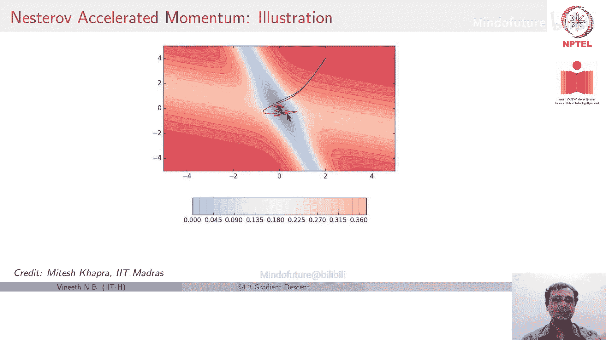

# 深度学习计算机视觉：P25：梯度下降及其变体 - 第一部分

## 概述

在本节课中，我们将要学习梯度下降算法在训练神经网络时面临的挑战，并介绍几种改进的变体，以提高训练效果。我们将从梯度下降的简要回顾开始，然后探讨神经网络的误差曲面特性，最后学习动量梯度下降和Nesterov加速动量这两种优化方法。

## 梯度下降回顾

上一节我们介绍了神经网络和反向传播。本节中，我们来看看用于训练神经网络的核心优化算法——梯度下降。

梯度下降是一种用于寻找任何可微函数最小值的优化算法。我们目前使用的损失函数是均方误差，但即使使用其他损失函数，该函数也必须是可微的。在梯度下降中，参数会沿着成本函数（或误差函数、损失函数）梯度的负方向更新。参数更新规则由以下公式给出：

**θ_new = θ_old - α * ∇L(θ)**

其中，α 是学习率或步长，∇L(θ) 是损失函数关于参数的梯度。

对于一个简单的凸函数，如果从最小值左侧的点开始，该点梯度为负，沿负梯度方向（即正方向）移动会趋向最小值。如果从右侧开始，梯度为正，沿负梯度方向移动同样会趋向最小值。这就是梯度下降最小化目标函数的直观原理。

## 梯度下降算法

以下是梯度下降算法的步骤：

1.  给定学习率 α、初始参数 θ_t 和训练数据集 D_train。
2.  当停止条件未满足时，执行以下循环（每个循环称为一个“epoch”）：
    *   初始化参数更新量 Δθ = 0。
    *   对于训练数据集中的每个数据点：
        *   使用反向传播计算损失函数关于每个参数的梯度。
        *   将梯度累加到 Δθ 中。
    *   应用参数更新：**θ_{t+1} = θ_t - α * (1/|D_train|) * Δθ**。

训练将持续进行，直到梯度趋近于零。

## 神经网络的误差曲面

上一节我们回顾了标准的梯度下降。本节中，我们来理解训练神经网络时一个关键概念——误差曲面。

神经网络的误差曲面是所有参数值与对应的成本函数值或损失函数值的图像。现代神经网络，尤其是在计算机视觉中使用的网络，拥有数百万个参数。例如，AlexNet有近6000万个参数。这意味着误差曲面存在于一个极高维的空间中，其形状可能非常复杂。

训练神经网络的目标是从误差曲面上的某个随机初始点出发，通过梯度下降找到最小值。然而，误差曲面通常是非凸的，存在许多起伏。

非凸目标函数的一个主要问题是存在许多局部最小值。最终收敛到的解取决于初始点，因为当梯度下降到达一个局部最小值时，梯度为零，算法会停止。因此，选择合适的初始点至关重要，但在高维空间中这非常困难。

同样，误差曲面上还可能存在鞍点。鞍点是梯度为零的临界点，但在某些维度上是极小值，在另一些维度上是极大值。如果梯度下降收敛到一个鞍点，训练就会提前终止，而鞍点通常不是理想的解。

研究表明，随着维度增加，局部最小值会逐渐被鞍点取代。直观理解是，在超高维空间中，一个临界点很可能在某些维度上是极大值，从而成为鞍点。

## 梯度下降的挑战：学习率与振荡

为了理解梯度下降的一个具体问题，让我们看一个简单的遍历示例。

观察梯度下降在误差曲面上的路径，可以注意到参数更新的速度会变化：在某些区域更新缓慢，在某些区域更新迅速。这种速度变化与误差曲面的梯度大小直接相关。

从等高线图的角度看，参数更新量（由黑点表示）在误差曲面梯度小的区域（蓝色区域）更新小，在梯度大的区域（红色区域）更新大。

这就引出了训练神经网络的另一个方面：高原和平坦区域。

高原和平坦区域构成了误差曲面中梯度高度非球形的“海洋”。非球形意味着梯度向量的各个维度值差异很大。在高原区域，某些维度的梯度很小，导致参数更新缓慢，梯度下降需要花费很长时间穿越这些区域。

一个自然的想法是：在高原上能否走得更快？能否加大步长？这可以通过增加学习率 α 来实现。

然而，如果全程使用很高的学习率，可能会导致问题。例如，在一个简单的误差曲面上，过高的学习率可能导致参数更新步幅过大，越过最小值，跳到误差更高的点，甚至从局部最小值区域发散出去，无法收敛。

## 动量梯度下降

为了解决振荡和加速收敛，我们引入动量梯度下降。

动量梯度下降基于一个直观想法：利用之前的更新方向来影响当前更新。想象一个盲人在喜马拉雅山脉寻找最低点。他用手杖探测周围坡度。如果他一直朝某个方向下坡，突然手杖指示应转向另一个方向，他可能不会立即完全转向，而是结合之前的方向和新的方向来决策。

数学上，我们引入一个速度向量 **v_t** 来实现动量。参数更新规则变为：

**v_t = γ * v_{t-1} + α * ∇L(θ_t)**
**θ_{t+1} = θ_t - v_t**

其中，γ 是动量参数，通常在0到1之间。

这个公式告诉我们，当前的更新方向 **v_t** 是上一时刻更新方向 **v_{t-1}**（乘以动量系数 γ）与当前梯度方向的加权组合。当 **v_{t-1}** 和当前梯度方向相同时，动量会加速在这个方向上的移动，有助于快速穿越高原。当方向不同时，动量起到缓冲作用，减少振荡。

动量参数 γ 通常设为0.5到0.9或0.95。实践中，可以从0.5开始，待训练初步稳定后增加到0.9。

在之前那个容易发散的例子中，动量可以通过结合历史更新方向，帮助抵消单个梯度造成的过大跳跃，从而使路径更稳定地趋向最小值。

从等高线图可视化可以看出，标准梯度下降在非球形误差曲面上会曲折振荡前进。而加入动量后，振荡显著减小，收敛速度更快。

## Nesterov 加速动量

动量法虽然加速了收敛，但仍在最小值附近振荡。为了进一步减少振荡，我们引入Nesterov加速动量。

其核心思想是“向前看一步”。在盲人的比喻中，不仅根据当前站立点的坡度，还先沿着动量方向迈出一小步，在那个“未来”点上探测坡度，然后用这个“向前看”的梯度来修正当前的更新方向。

数学公式与动量法类似，但计算梯度时使用的是“向前看”的参数点：

**θ_lookahead = θ_t - γ * v_{t-1}**
**v_t = γ * v_{t-1} + α * ∇L(θ_lookahead)**
**θ_{t+1} = θ_t - v_t**

与标准动量法的区别在于，梯度不是在当前参数 **θ_t** 处计算，而是在 **θ_lookahead** 处计算。

这样，算法能更早地感知到误差曲面即将发生的变化（如下坡即将转为上坡），从而提前调整更新方向，有效抑制了在最小值附近的振荡。

从同一示例的路径对比可见，Nesterov加速动量的路径比标准动量更直接，振荡更少，能以更少的步骤收敛到最小值。

## 总结

本节课中我们一起学习了梯度下降优化算法及其改进。

*   我们首先回顾了梯度下降的基本原理，它通过沿负梯度方向更新参数来最小化损失函数。
*   接着，我们探讨了神经网络误差曲面的非凸性、局部最小值和鞍点问题，这些使得训练充满挑战。
*   然后，我们分析了学习率设置不当可能导致的问题，如收敛缓慢或发散。
*   为了加速收敛并减少振荡，我们引入了**动量梯度下降**，它通过结合历史更新方向来稳定和加速训练过程。
*   最后，我们学习了**Nesterov加速动量**，它通过“向前看”一步计算梯度，进一步减少了在最小值附近的振荡，实现了更快的收敛。

这些优化算法是训练深度神经网络的重要工具，能有效应对复杂的误差曲面，使模型训练更高效、更稳定。

