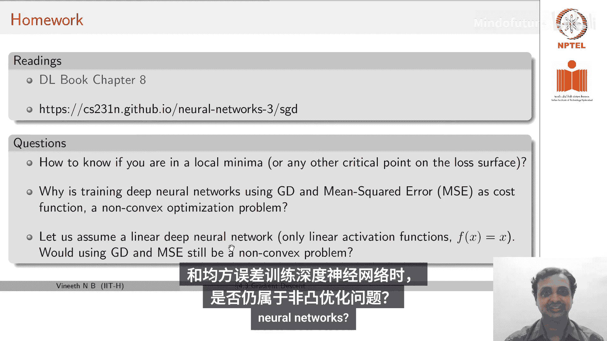

# 【NPTEL】计算机视觉的深度学习 p26 P26_梯度下降及其变体 - 第二部分 -BV1vNWkzpEua_p26-

Let's now try to analyze we've seen gradient descent， we have now seen at least one or two methods。

 momentum based gradient descent and me momentum based gradient descent。

 which can help you improve gradient descent training。

What are the pros and cons of greaterd disscent we've seen so far？For every parameter update。

Gradian descent passes the entire data。If we already saw then it computes the gradients。

 it keeps aggregating the gradients and then takes the average， can we call it an epoch。

So gradient descent passes the entire data set and it's hence called batch gradient descent。

And the advantages of Bsgian descent is theoretically speaking， from an optimization standpoint。

 the conditions of convergence are well understood。😊，And many acceleration techniques。

 there are improvements from an optimization perspective。

 such as conjugate gradient operate very well in the batch gradient descent setting。

 once again it's called batchge gradient descent because you're waiting for entire batch of data points to get completed。

 take all of these gradients， average them and then make an update。

So the disadvantage of bad gradient descent is it can be computationally slow for the same reason。

 especially if you're training data set high。Say 10，000 data points or 1 million data points。

 you're going to wait for passing through all of them before making an update。He mentioned it。

 which is a computer vision challenge。it's a very commonly used data set vision has today about 14 million samples and one iteration over all of those 14 million samples can be very slow to wait for one parameter。

That brings us to a very popular approach known as stochastic gradient in discent。

Sttochastic gradient designcent， SGV stands for。You randomly shuffle your training data。

And update your parameters after gradients are computed for each training example。

So you randomly shuffle and pick one data point forward， propagated， compute the error。

Compute the gradient。Update all your parameters right away before propagating your next data point。

 so here is your alic difference with gradient descent。The third。The third step here。

 sorry this step five here on this algorithm was outside the for loop in gradient descent。

 you did all you went through every data point， accumulated all your gradients。

 and then made the parameter update。Whereas intochastic gradient descent。

 that step of updating a parameters goes inside the form， which means for every data point。

 you're going to make a parameter。This is going to be faster。

 let's see a few pros and cons for stochastic gradient descent too。

 but before we go there were going to talk about a cvic which lies in between which is known as mini batch stochastic gradient descent。

 what is mini batch stochastic gradient descent。Mini batch stochastic gradient descent。

 as the name says， is you take a mini batch of training examples， don't just take one。

 don't take all， take 20 examples from your training data set。Forward， propagate all of them。

 compute all the outputs， compute all the errors， compute all the gradients。

 and then take the average of those 20 gradients alone and update your parameters。

Why do we need this it's possible that if you keep updating a gradient with every sample it may give you random directions one data point will tell you go like this。

 this is where Himalaya's lowest point is there another another data point will tell you another step youll just be taking difference exact steps。

As you traverse to the surface， if you listen to every data points cricket。

Averaging gives you a better sense of a greater direction that is consistent across a few more data points。

This mini batchch version of stochastic gradient descent is the default option for training neural networks today。

 often today when people say they use SCD， they actually mean mini batchch STD。Remember。

 mini batch SGD with bad size to be1 is your SGD itself。But typically people use larger batch sizes。

 200， so on and so forth to compute these gradients。So algorithmally speaking。

The applying update once again went out of the loop， but this time you're not going to compute。

You're not good to aggregate gradient for the entire training dataset， but only for one mini batch。

 which you developedote as B mini and you're only going to aggregate the gradient and average the gradient only for that mini batch in the al。

Let's try to see an illustration of stochastic gradient descent。

This is once again cont plot of an error surface， let's try to see how to gradient this。

You can see it progressing towards the minimum， at above the minimum is the blue surface。

As it goes closer to the minimum， it seems to oscillate。Do the oscillations remind you of something？

Momentum， maybe。Promentum also had similar oscillations when it reached the minimum。

Here is an illustration of mini batch SDGV。Once again， the same at surface， let's see if。

Batching data points and computing the gradient helped us a little bit。

You do see here the oscillations have mild reduced for many batch of HGD when compared to HGD。

 but the batch size here was just two， you could probably see lesser oscillations when you keep increasing the batch size because then you're not going to vacate based on every data points you gradient。

 but you're going to batch them across a larger set of data points before you update your parameters。

What are the pros and cons of stochastic gradient descent when you compare it to batch gradient descent。

 let's try to understand this。The advantages of stochastic gradient descent which。

Far by far outnumbably， it's disadvantages， it's usually much faster than batch learning when you train neural networks。

Why is that so， it's simply because there is a lot of redundancy in batch learning。

Because if you have one million data points in your data set while training your neural network model。

Then many of these data points may give you similar information。

 you probably don't need to wait for all of them to view you the gradient and then average。

Even if you take hundred of them， maybe you're going to get some sense of where the gradient is for that particular iteration and move forward in that direction。

 so you're exploiting the redundancy in data to go much faster than standard batch gradient descent。

It also offers results in better solutions this may seem a little countertuitive。

Because you would think that， by。Using the entire batch。It could be computationally slow。

 but that's the ideal way to do it， then why does stochastic gradient in descent？呃一 better solutions。

The reason is。Sttochastic gradient descent is a noisy version of gradient descent。

What do we mean by that。You are only taking 20 data points， let's assume the mini batch size was 20。

 you're taking just 20 data points getting the gradient。You keep moving along those directions。

So it's like asking， once again， you're trasing Himalayas。If if you ask thousand people。

Assuming that you had infinite computation。On infinite access to people。

 if you ask thousand0 people and they are told you go in a particular direction。

 you probably can rely on that direction。If you asked really two people and ask them what direction they' go in。

 maybe they may get it wrong。Which means that when you ask a smaller set of people。

 you may oscillate， you may take one direction than somebody else else you go another the direction。

 you keep moving around and fluctuating a little bit。

 but you eventually get there because between across all of these people they may point you in the direction in expectation you would get there but。

There may be fluctuations along the way。But this noisy updates of stochastic gradient descent is what could actually help you in escaping local mema。

 bad local memar or savggy points。Because of these noisy updates you may avoid saddle points and probably get to better local minimum over time that's what researchers have been able to understand from how HGDS performed in the blur。

Sttochasticulated in thecent is also useful for tracking changes， what do we mean？

If you have a new set of data points that come in， it's very easy to update which is 20 data points rather than have to run an entire reportpo with 1 million plus 20 data points so remember in vast gradient descent。

 you have to recompute the gradient for all the data points before you make your next move but in stochastic gradient descent。

 if new data points come， that's what we mean by tracking changes here。

 you can easily update the system and keep moving。What about disadvantages？

Disadvantages of stochastic gradient descent is that the noise in stochastic gradient waits can lead to no convergence。

To this day， sometimes remember， as we said that because of the complexity of the error surface。

Where you initialize your weights is very important。As to where which local minima you converge to。

So often today in practice， if in the first few iterations you find too much fluctuations in your error。

 people often simply change the initialization and try again。

Which means noise and SDGD8 updates can lead to no convergence， but the solution is fairly simple。

 if in the first few iterations things are not going well for you just stop。

 go back and start at a different location and start all over again it's fairly a simple solution。

This can also be controlled using learning rate。If the gradient you know is noisy。

 don't use a high learning rate。So it can also be controlled using a learning rate。

 but then identifying a proper learning rate can be a problem fixed on。

And that's the problem we want to talk about next。How do you choose a learning grade？We said that。

Moipum was one way to artificially inject a learning rate into the system。Because it's effectively。

 if the momentum of the previous step and the current ingredient aligned。

 it's almost like you had a high welding rate in those directions。😊，In general， though。

 if learning rate is too small， it can take a long time to converge。

 if the learning rate is too large， the gradients can explode。

Now how do you choose a learning rate in practice， assuming we don't use momentum。

 how do you choose a learning rate in practice？One simple option is nave leading a search。

You just keep your learning rate to be constant throughout the process， just fix it。

 just use the same learning rate across all your iterations until you reach convergence。

Or you could use uneaaling based methods。Unlink based methods are methods where you gradually reduce the learning rate over time using some formula that you come up with let's see a couple of them now。

 one of them is known as step decay where you reduce the learning rate after every N itrationations or if certain degenerative conditions are met for example。

 if the current error is more than the previous error which should not happen when you do gradient descent you expect that the current error should always be lesser than the previous error but when you do stochastic gradient descent。

And not be guaranteed because you're using G 20 data points to inside your gradient。

So what you can do is keep reducing your learning rate after every M aggressions。So。

That's one simple approach the idea here is that as you keep training over iterations in apos you're probably getting closer to your minima and when you get very close to your minima you want to take small steps so that you reach a minima and don't overshoot it that's the reason for reducing the learning rate over time that's called step decay。

Another popular option is known as exponential making。In exponential decay。

 you set an initial learning rate called alpha n， and then alpha is equal to alpha n to the power minus kt where alpha。

Alphanon and K are hyperparameters and t is an itration number。

 so you start with a learning grid alpha n and keep progressively reducing it exponentially in this particular form over every few iterationrations because P is an iteration number here as the iteration number increases the learning rate automatically starts falling down。

You can also use a simple1 by 3Dk formulalar where you start with an alpha naught。

 an alpha at a particular time step can be given by alpha n by 1 plus kt。

 where alpha and K are hyperparameters and T is an itration number。

All of these as you can see are heuristics， they're just saying。

 let's just do one of these and maybe it will work。Can we do something better？

Can we be more aware of what a neural network is doing and accordingly choose a learning rate rather than have these。

Google tools that。We fix irresspective what the network is doing。Is there a way to do this， Yes。

 there are a few methods which we're going to discuss now。

One of the earliest methods in this context was known as adaptive gradient or al diagramogram。

Our has a simple intuition as to。The fact that sparse but important features may often have small gradient when compared to others and learning could be slow in that direction。

In our case， features means dimensions of weights， rather a subset of weights。

 so you have your entire space of weights， a subset of weights。Wwhichch change only once a while。

 so let's assume that there are certain weight that you keep do not change with every mini batch in mini batch as。

 but change only once a while， they may change by a small amount。

 but that amount is important because they only change once in a while。

Spase features could be important and learning could be slow in this direction because the gradients could be small in that direction。

So a simple thought then is， why should the learning rate be the same for every gradient？

In your neural network， once again， remember that the gradient is a vector of。

The derivatives of the loss with respect to every rate in your neural network。

Why should you use the same learning rate for all of them？

Why can't you use a different learning rate for each of these weight？So what you do in undergra is。

You accumulate the squared gradients as a running sum Rt is a quantity that holds。

A running sum of squared gradients once again keep in mind that the gradient is in delta theta T is simply gradient that's a parameter update and that's a vector of the gradient with respect to every weight in the neural network so for each of those weights you maintain a running sum of the gradient squares and then your parameter update states theta t plus1 is going to be theta t minus alpha which is your learning rate divided by delta plus root Rt delta theta T delta theta T is your gradient in your current time step。

Now， why does this address this intuition？Delta here is simply used for numerical stability。

 You just set it to be a value like 10 power -6 or 10 -7 so that you don't face a divide by 0 error in case Rt is 0。

 you don't want a divide by0 error when you compute。 So that's the reason you have a delta here。

 But otherwise what this is doing is。When R is small。WThis is going to be a very small value。

This is going to become large。Or rather， the learning rate for that weight is going to become large。

When RT is large， the learning rate will become small。We are saying that for one of your weeks if。

If your gradient was large。Give it a small learning rate and for one of your ways。

 if your gradient is small， then give it a larger learning rate。

This seems to fit with the intuition that we have so far。

 and the nice part now is this kind of an approach because R is maintained for each gradient or each weight individually。

This automatically takes care of。Changing the learning rate for each weight differently。

Let's try to understand this from a simple example， so we do understand that when your error surface。

 these are con plots， when your con plots are spherical。Things are easier。 It's easier to converge。

When your concrete plots get elliptical is where your oscillations can occur。

Another important property of elliptical conduct plots is that there are certain dimensions where the change can be rapid。

A certain dimensions where the change could be rather small。

 which is what elliptical basically means。So if you see this example here， which denotes。

 let's assume the gradient and the corresponding white e value。

 we are now saying here that if you look at one of these， let's look at the black。

 frequent and predict irrelevant。It simply states that all those values keep changing regularly。

 but they don't seem to be connected to the class output。

These are some values and they don't seem to be connected to the class output in this particular scenario or the output of what other function you're modeling while there could be other values such as red and green which change only once a while so you can see in 5 t2 it doesn't matter here as to what these quantities are and this is only an example so when phi T2 is1 we see that yt definitely becomes1 when phi T2 becomes1 yt definitely becomes1 it doesn't matter when it's zero but when it is1 the output is definitely one similarly for phit3 you see that when it's1 the output is definitely minus1。

So it looks like。This particular parameter changes only once a while， but when it changes。

 it makes an impact on the final decision。So this is a scenario that says that even if the gradient is small。

 but if it happens only once a while， let's give more weight to changes in those directions。

 in those weights。And that's what this algorithm does， so here is the algorithm。

So you aggregate the gradient， you update your gradient accumulation。

 so you initialize your gradient accumulation in a parameter called rt minus1 is equal to0。

And you update your gradientd accumulation to be rt is equal to rt minus1 plus gra D at t square accumulating the square gradients。

 and then this is the formula one a small observation here which is probably not clear from this algorithm is this particular quantity on step9 is an relevant device product so which means。

And remember in this case that why Al was a schemer so far。RRT is a vector。

Root RRT will also be a vector， so this entire alpha now alpha by deelltaplasm Rt will become a vector it's a vector of learning rates multiplied by a vector of gradients。

Eleementwise multiplication， it's sometimes also called Hadamama Hadamma product is nothing but elementwise multiplication。

 remember， it's not like dark product。In a dot product。

 you take element twice multiplication and then add them all up and get a scalar。Inhaammat product。

You simply take1wise multiplication and your output is still a vector。

 you don't add the moment okay that's the main differences and this operation here in step 9 is actually a hra markboard。

Element twice multiplication。Between two vectors。There is one problem with the agrad method。

Can you try to spot the problem？The problem is that this gradient accumulation。Tom R。

Is a running sum that simply keeps accumulating over its。

Which means as you run more and more iterations， it will only keep increasing and get higher and higher and higher over time。

 which means this denominator is definitely going to get high over time for all the weight。

In particular， there are some of the weights for which gradients keep occurring in every iteration where the denoator term can very quickly increase。

This will lead to a lower learning rate for those dimensions in the weights and learning may not happen along those directions。

RMSMS Pro， which was a method that came along the same time as algra。

Proposed a slightly different approach to this problem and said。

Let RTV a convex combination of Rt minus1 and delta theta T equal squared。

 what is a convex combination where you have a rh times one term plus1 minus rh times the other term。

 it's a linear combination where the two coefficients add up to1。So rh rt plus 1。

 rh rt minus 1 plus 1 minus0 delta theta T equal squared。

This now ensures that because of the row and 1 minus row。

 the sum cannot keep exploding and is now controlled。

Think about it for a while as to why and you'll get why this will not allowed you to explore。

And now your theta t plus1 and theta， this entire expression is exactly the same as agrade。

Here is the algorithm for RM is prop with only that change in the step where you have now the running some of the accumulated square gradient to be a convex combination monitored by a quantity called rh。

 which is known as the decay， the decay decayate decides how much you want to consider the previous squared gradient。

 while you get the current squared。Very similar to momentum， but in a different context。

The most popular algorithm that is used for training neural networks today。

For adapting learning ratess is known as Adam or adaptive moments。

Adaptive Mo uses a simple intuition。Of combining ideas of RMS prop and momentum in a way。

 let's see how that is done。While agraite and RMS prop。Accumulate gradient of the squared gradient。

Iam。So， while aide and RMSp accumulate the squared gradients。

 aom accumulates both the gradient and the squared gradients， ST accumulates the gradient。

 Rt accumulates the squared gradient just like RMSp。喂。You look at the final update equation here。

 the update says the theta d plus 1 is equal to theta minus alpha。ST by Delta plus R R。

I'll explain the Tilde part in a moment， but let's first assume that there's no Tilder。

 let's just assume ST and RT。So what is this doing Al by delta plus root RPp is exactly the same that we saw in RMSMS Pro and undergrad ST would have been the current gradient in undergrad and RMS Pro。

 but now ST is the running sum of the gradient。And what is the running sum of the gradient？Moment。

Remember， momentum was what you use the previous gradient。

 the previous gradient on and so forth using momentum tab row1 is the momentum coefficient for us in this particular context。

That's why Adam can be looked at as a combination of。Paramus prop and Mo。

Now coming to why is this tder here， why not just STN RT。

 is for a very simple reason of doing what is known as bias correction in the initial iterations。

In the initial iterations， if row1 is set to a high value， which is what is typically done， row one。

 just like momentum， row1 could be set to something like 0。9 or something like that。

In your initial step Rt minus1 would be initialized to0。

 that's where rt minus-1 will start1 minus row1 will make it a very small value because row1 is close to1 so which means the gradients will not have any impact on ST in the initial iterations until they add up so there may not be much gradient that happens in initial iterations。

So what do we do for that， we say let ST tilde be ST by 1 minus row 1 power t。

 similarly rt tilde be rt by 1 minus root2 party what does this do？If robot on is point9。

Rememberumb 1 minus minus 0。1， so ST by 0。1 will now increase it tenfold。So I what with Ford。

It was reduced here， it's now going to increase it by tenfold in the initial operation。

What happens in later iterations， we have P here， P is the number of the iteration that you're talking about。

What happens here？Remember， row 1 is less than1， it's chosen to be 0。9 or something like that。

So robot party will keep reducing all the iterations， 0。9 into 0。9 is 0。

81 so it keeps as long as you have a value less than one as you raise it to the poverty。

 it's going to keep reducing。Which means this quantity in the reno will keep reducing over itations。

And sorry， this is not the quantitative nominator that R party will keep reducing to zero and one minus over poverty will get closer to1 over the iterations。

 which means after a few iterations， ST tilde will become ST， RT tilde will become R。

So the step of bias correction was only to handle the initial epochse where the gradient may not have a significant。

This is your Adamom algorithm， it's simply a summary of what we just said these are the two steps。

 you update a first movement estimate which is the gradient。

 second movement estimate which is the square gradient you maintain a running sum of both。

Correct for biases and do your update the key thing in the update is you do not have the gradient here because the gradient is subsumed into ST。

That summarizes the various methods of improving gradient descent by draining neural networks。

So some of the issues that we saw are plateaus and flat regions， local minima and saddle points。

Other issues that we will see as we go forward are vanishing and exploding gradients as neural networks become deeper and deeper。

 the gradients that propagate from the last layer to the first layer can keep vanishing or exploding。

That can cause what are known as cliffs in the error surface， we will see this a bit later。

Other challenges that could happen is sheer ill conditioning of the matrix of weights or the loss functions or the gradients that you're dealing with。

Please look at this link here to understand what this means。

You face a you could face a problem of inexact gradients。

 the gradients numerically may not be computed properly， for example。

 finding if a gradient is zero is not trivial because numerically attaining zero while training is not possible。

 you have to ensure that you manage it in some way。

 but in general numerical issues in gradients could also cause problems。

There could be poor correspondence between local and global structure。

 which means you have a global error surface and you want to get to the global minimum。

 but the local region in which you are in may not really correspond with that global structure you will be stuck with trying to handle the undulations in that local structure。

Choosing learning rate and other hyperparameters like the momentum hyperparameter or the decay rate are also problems to deal。

The somebody。The error surface or cost surface in neural networks is often non quadratic， non convex。

 high dimensional。Potentially many minimalma and flat regions。

There are no strong guarantees that the network will converge to a good solution。

The convergence is stiff， swift。Or that convergence occurss at all。But， it works。

ThisThis is an issue that's being investigated today， but it's。

It's fabulousous that training neural networks with sasticibility design works and is being used around the world in several applications。

Here's your homework， you read up deep learning book chapter 8， at least the 11 sections in that。

 as well as you can also go through Stanford CS2319， this particular lecture on SGB。

A few questions for you to take away is。How to know if you are in a local minima or any other critical point on the loss surface。

 I didn't mention a few times that finding that or finding the convergence criterion is not trivial。

Let's ask that question for you to find before we answer。

Why is training deep neural networks using gradient descent and main square error a non convex optimization problem this is the first question that we started with this lecture with。

This is something for you to ponder upon and finally， if we assume a deep linear neural network。

 no activation functions at all。Would using gradient descent and main square error still be a non convex optimization problem when you're train deep in your networks？

These are some questions to think about。

And hear other。