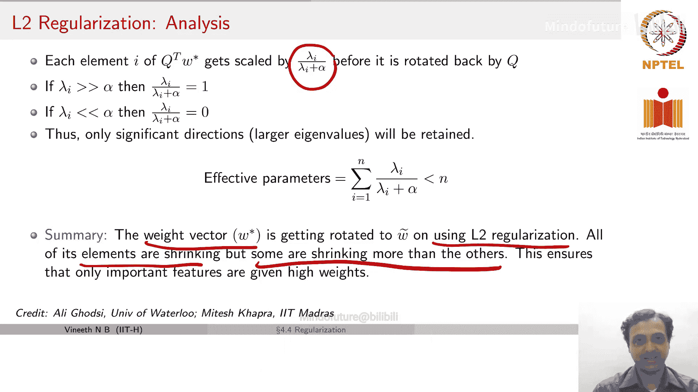

# 【NPTEL】计算机视觉的深度学习 p27 P27_神经网络中的正则化 - 第一部分 -BV1vNWkzpEua_p27-

In this lecture。We continue and talk about regularization in neural networks。

Which is an important topic。To obtain good testet performance。With these models。Before we start。

 let's review some of the questions we left behind in the previous lecture。The first question was。

How to know if you are in a local minima or any other critical point on the loss surface when you drain neural networks。

All the algorithms that we spoke about so far， back propagation， gradient descent。

 all the variants of gradient descent。Always had this。

Cluse in its while low portfolio which said until convergence or until stopping criterion is achieved。

What should be the stopping criteria？Hope you had a chance to think about it。

We are not going to talk about the answer now， but we're going to talk about it over the course of this lecture a little later in this lecture。

The second question that we left behind was。Why is training deep neural networks using gradient descent and mean squared error as cost function a non convex optimization problem？

I think we should probably spend some time here， hope。

You try to answer this question and you have a good understanding of convex and non convex functions。

 but let's very briefly review that before answering this answering this question So remember this is a simple example of a convex function and a convex function says that if。

Your X axis was here。And here was your F of X axis。A convex function says。

 the definition says that if you have a point x1 and if you have a point x2。

This is f of x1 and this is f of x2， so you have f of x1 here。F of x2 here。

Then all what we say is that。This line connecting f of x1 plus f of x2 will always lie above the curve。

So mathematically speaking， you can say that。If。off。

Any combination between x1 and x2 so let's call it， say some lambda times x1。

Plus1 minus lambda times x2。This， this quantity here。Will be any point lying between x1 and X2。

So f of lambda x1 plus 1 minus lambda x2 will always be less than or equal to。Lambda x 1。

 sorry Lada F of x1 plus1 minus lambda F of x2。That's the definition of a Comx function。

So clearly a nonconvex function is one which is not convex， so a nonconvex function。

 an example could be a surface， something like this。

 so you can clearly see that you will find lines such as these for instance。

 where the curve does not necessarily lie below the line at all types。

Now let's come back to our question as to why is training deep neural networks using gradient descent and mean square error as cost function。

 a non convex optimization problem？One thing that you have to first understand here before answering this question is the native of the cost function mean squared error itself。

Remember mean square error we all know is given by let's just take， let's use the same。

 let's assume that y was the label and say H of x was the output of the neural network mean square error tries to minimize the square of these terms and of course you take a mean half can be added for simplicity。

 you of course take a mean of these quantities that's mean square error。By one look at it。

 you can say that means square error。Will be a convex function this means where it is a quadratic function。

 which means it would be very similar to what we drew here and it would turn out to be a convex function。

Now in this context， let's ask this question， then why is training deep neural networks using gradient descent and mean square error？

A non conx optimization problem。The reason is。You could have nonlinear activation functions。

In your neural network， that can make the problem non convetx with respect to the wavess Okay。

 then your counter question is， okay， let's assume now a linear deep neural network。

where you do not use any nonlinear activation function at all， no sigmoid， no tan h， no yellow。

 so on and so forth， you only use linear activation functions。

 which is as good as say no additional activation function other than the neural network itself。

Now would training a neural network using gradient descent and mean square error？

Be a convex optimization problem or a non convex optimization problem。From the answer I said earlier。

 it should be a convex optimization problem because the cost function is mean square error。

 and I just said that nonlinear activation functions is what could make the problem non convex。

 so which means if you have linear activations， it should be convex。But the answer is no。

 but's still not convex or other， yes for non convexity。

A reason for that is the phenomenon of weight symmetry。

 there are many other cemetries in a neural network， but weight symmetry is at least one reason。

What does this mean， what does weight symmetry mean？

Remember that when we talk about an error surface。We have to give an index to each weight in the neural network。

That error surface has to have a certain dimension andgrade so the first dimension would be the first weight in the first layer connecting to the first weight in the second layer。

 the second dimension would be that first weight in the first layer connecting to the second weight in the second layer so on and so forth that's how you index all your weights and you build your error surface。

Now， if you take any two layers in a neural network。

 let's assume that these are two layers of a neural network and let's。

Connect them using some set of weights， it's obviously fully connected。

But these are some set of weights。Now， in a neural network， in a trained neural network。

 what I could do now is。Sppeak。This neuron here。And this neuron we on the second layer。

And simply swap them and also swap all the weights coming into those neurons。Once again。

 you have a trained model， you're normal learning it， you're fully trained it。

 but what I'm going to do now is take a couple of these neurons and simply swap them and also swap all the weights coming into these neurons。

Will the output change？No， because the weights are the same。

 we have simply changed the ordering of the weights in one of the layers。But on the arrow surface。

 this corresponds to a very different position。Visso an example is it's almost like let's take an example of three dimensions。

 let's say we had x dimension， y dimension as Z dimension。And let's say we had value such。2。

1 and 0 in these three dimensions。What we have done now is swap Z and Y。

 that's what we did for some of the neurons and hence some of the weights。

This will lead to a vector to01。210 and 201 are different points in the three dimensional space。

Similarly， for a neural network， if you swap neurons。After you swap。

 these points are different wave configurations because of the way we index them to construct that error surface。

But。Because of the symmetry of the neural network， they would do exactly the same output。

 exactly the same error。Which means these two weight configurations， if， as I said。

 we take a trained model。Which means it's already at a critical point。

 let's say a minimum we are now saying that here is another weight configuration which I'm giving you which also will give you the same minimum which is going to be far away because 210 and 201 are not necessarily close by in the grid there are many points in between 210 and 201 if you plot in the in three dimensional space which means there is another point further away which also has the same minimum value of error。

And this is just one s of a neuron for a neural network。Assuming you have million neurons。

 you could swap a million types。So which means there are going to be that many similar weight configurations。

 which all have the same error。Which clearly tells us that the error surface must be non convex。

 it's something like this。All these points have the same matter。

Which can happen only if your error surface is not complex clearly because there are many other points in between those minimum。

Let's move on to regularization， which is the focus of this lecture。

Let's first start with an intuitive understanding of regularization。

 most of you may have perhaps covered this in an introductory machine learning course。

 but let's briefly review this and then talk about how regularization is done in deep neural networks or neural networks。

Let's take a very simple example。Let's take this。Setets of values， one， two， three。

 we say that it satisfies some rule。4，56， it satisfies the same rule。

 789 also satisfies the same rule。9231 does not satisfy the rule。

The question for you now is what is the rule？If you observe carefully。

 this is very similar to the machine learning setting that we have。

Imagine now that these are all data points and we are given in a training data that certain data points have a certain label and certain other data points。

Have another label and our job is to find out what is the model that tells us whether something satisfies class one or class two。

Coming back to this example， what could be the rule here？Which。

Satisfies these first three and does not satisfy the set of values。

A simple thought process should tell you that there are many possibilities。

You could say three consecutive single digits。You could say three consecutive integers。

You could say three numbers in ascending order， three numbers whose sum is less than 25。

 three numbers， less than 10。It should have one，4 or seven in the first column， but for all you know。

 you can just say say yes to the first three sequences and no to all others。

 which is also correct in this particular case。Clearly。

 the last two cases would not have been the answers that you came up with intuitively。Why is that so？

The reason is even as humans。We are always looking for a rule that can generalize well if I gave you newer data points。

 I never even mentioned to you at this time that I'm going to give you newer data points。

 but still it human tendency to always come up with rules that can generalize well to data that we may see tomorrow。

And this is exactly what we want to do with neural networks or machine learning in general。

 and we call this process regularization where we。Use methods in machine learning to improve generalization performance and avoid overfitting training data so we don't want to necessarily come up with a rule that fits only the training data。

 but we want to come up with a rule that can do well。

 maybe on data that we will see tomorrow which is what we mean by test performance or generalization performance。

Sometimes even at the cost of not getting 100% accuracy on your training data。

Let's see now how we can do this with neural networks。

We need one other concept to be able to follow some of the discussions in this lecture。

 which is the concept of LP norms， hopefully you're all aware of this。

 but let's quickly review and then move forward。Remember， LP norm is formally written as。

LP of any vector x， let's say of D dimensions， let's assume that x is a vector of D dimensions， x1。

 so on to x d。LP norm of x is given by or also denoted by x。You know， is given by。X1 Part P。Plus。X 2。

Part P， so on and so forth till X D。O P， whole power one by。

You can make out that if you put PS2 you'll get your standarduc Euclidean norm or L2 normob。

 similarly you can have L1 norm， L0 norm and s and so forth L infinitefinity norm。

 you can actually have to be any number for that matter。Any post number for that matter？

A non negative number。So you see here diagrammatically。

 you can see that this is how the unit ball of each of these LP norms look like。

If you took the unit ball of L1 norm， it looks like a roommbbuus。

 the unit ball of L2 norm will look like a circle。And L infinity norm will look like a square L infinity normous given by max of a value。

 max of the vector， max element of that vector。This is important because this helps us understand certain aspects of regularization that we'll visit soon。

A couple of points to keep in mind here is that when p is less than two。

 it tends to create sparse wavess。And when p is greater than2 or greater than or equal to do for that matter。

 it tends to create similar weights。Well see why this is the case in some time from now。

 the most popular regularization method for training not just neural networks。

 even other machine learning models is known as L2 regularization。

Which imposes a penalty on the L2 norm of the parameters。

 which is the reason it's also known as L2 weight decay or simply weight decay。In this case。

 the loss function that we have for a neural network is appended by another term which has the N to norm of the weights。

This loss function can be any loss function used to train your neural network so far we have seen mean square error so you can assume it' mean square error。

 but in future well see other loss functions that you can use to train your neural network。And。

The L2 penalty is added to any of those loss functions。

So the alpha here denotes how much importance you want to give to penalizing the outline of the weights and the by2 here is for mathematical simplicity。

So the gradient now of the total objective function will look like。

Grad of Llda of w L tilda is the new objective function with the L weight decay down is equal to grad of L of w。

 which was your original loss function plus alpha times W and you differentiate this with respect to W to andcate cancel and you're left with alpha w。

So your gradient descent update rule is going to look like Wt plus1。

Is equal to WT minus Eta step length times grad of LwT minus Eta times alpha WT。

 Eta was a common term for grad delde and hence goes into each of these terms。

That's going to be your new gradient de rule for your regularized loss function。

Let's do some analysis of this regularization to understand what is really happening。

Let's first talk about it。Conceptually， intuitively。

 and then well go one mathematical way of looking at what's going on in liberalization。

We just said sometime back that。The shape of the L norm ball can help you understand what you're doing with regularization。

Let's let me add one point here that you could also minimize other norms of W in the term。

 you could have L1 weight decay， which is also a common approach which enforces sparsity in weights in the neural network by sparsity we mean many of the weights in the neural network will be forced to go to zero in L1 weight decay。

 we would say this is going to be。With respect to L1 norm， and remember。

 L1 norm of any vector is the sum of the absolute values in the vector。This is also possible。

 let's try to see what would be the effect in these different cases。Remember， in the last lecture。

 we talked about concrete plot。So you have these contour plots of your error surface with respect to the weights。

 piece of contour plots such as these， if you recall。

 which will cross sections of your error surface。Something like this。😔。

This is the counter plot of your error surface， which is the term without a regularizer。

So when we add the regularizerizer， what are we doing。

 we are now saying you want to minimize over the set of weights。

 your loss with respect to the weights as well as some constant times your two norm of the weights or one norm of the weights in certain cases。

 two norm of your weight。Great square。This。Is equivalent to saying that you want to minimize。

Your loss function。Such that。You two norm of your weights。

Is less than a certain quantity you can come up with some number， there's some constant C。

These formulations are equivalent to a certain degree under certain conditions。

 from an optimization standpoint。Why are we saying this？What this means now is。

The minimum of this new objective function is equivalent to minimum of this original objective function subject to the two norm being lesser than some value。

If you recall， this is nothing but。A non ball of the weights。And it's not the unit norm ball now。

 it's a C norm ball， the unit norm ball is when the two norm of the weights lies within one or all the weights lie within within a norm of one around the center around the origin。

 now it's a C norm ball it has a measure C which it should be less than。So which means？This。

 the solution here will be the intersection of。Let's assume that the syn ball was something like this。

 Let's assume that that's where the origin was。 let's assume that。

Here is the origin and the syn norm ball is somewhere here。

You can see now the synon ball intersects the error surface at some point and that is now going to be the minimum of this new function。

 not the point at the center because that is outside the synonm ball。

 so you have to find a minimum somewhere here。Which here this one。

 which is a minimum for both the loss and lies within the genome， which is what you're trying to do。

So when you have your L2 normm， your noball is going to look like a sphere and you intersect with the error surface and you get a certain solution。

 however， if you had L1 weight decay，Then in that particular place。

 your nonball is going to be a rh bus not。A square， not， not a sphere。So aombuus has sharp edges。

 which means it's very likely that you will find minimum alarm points where one of the axis is zero you can probably see this in a slightly different way too let's try to。

Draw the error surface elsewhere just to make our point clear。

 so we want to find the intersection of the error surface。

And the well known bo and the intersection will typically happen at one of these corners。

And what happens at one of these corners in L norm block。

 the other weight is going to be zero and in a high dimensional conumbs there may be many weights that gota0 and that's why enforcing L1 weight decay will enforce sparsity in your weights both are valid regularizers in one case you're reducing the two norm of the weights in the other case you're reducing one norm of the weights but the effect can be slightly different。

Let's now also see it。See as to what we are trying to do from a mathematical perspective。

Let's assume that we have an optimal solution for your original problem， let's call that W star。

 so which means gra L of W star is equal to0， so W star was our optimal solution before regularization only with the original loss function。

Let's now consider a term U which is given by W minus w star。

Let's write a Tayloror series expansion of loss function at W star plus U。By tele expansion。

 this is given by。L of w star plus u transpose gra L W star plus half u transpose H U where H is the hesian of the loss with respect to weights。

 What is the hessian， the matrix of all second partial derivatives， you can have matrix H is。

Matx of second partial derivatives， you can have do L。By do x， do x， which is do square x or do L。

 by do x， do y， so on and so forth， right if you had many more weights， you wouldn have that many。

 that's the size of your he rather if you had 1 million weights。

 the size of your he will be1 million cross 1 million。 It's definitely a large matrix to compute。

But let's move on with this month after discussion。So which means w star plus U is actually W。

 so I can say L of w is equal to L of w star thein as it is。

U transpose is written as W minus w star transpose because of the definition of u then you have。

Grad of L at W star plus you also replace this U with W minus W star and this U with W minus W star。

We now know that gra L at W star is zero because that's our assumption of what W star is。

 it's an optimal point for your original loss function。

Which means we are left only with the first and the third down。

 and you' are now going to have L of w to be L of w star plus half into w minus w star transpose into the Hessian into W minus W star。

Let's take its gradient now and the gradient would be given by it。

Grd of NW is equal to gra of Nw star plus。W minus W transpose。And w minus w together。

 you will have a two going to the power and if you now differentiate and divide by two here。

 the two and two would get canceled and you will be left with H。Into W minus W star。

We already know that grad L at W star is equal to zero。Which means？

You're going to have gra of LW is equal to H of w minus w star。Rather。

 going back to the previous slides equation。Going back to this equation that we have on the previous slide。

 let's write that out now here。Grad of L deta W is equal to gra of LW plus alpha w。

 that's what we saw earlier， and grad of LW can now be written as H of w minus w star plus alpha w。

Why all this， what do we want to do with this？Let's not consider。

W Tilde to be the optimal solution in the presence of regularization。Which means。

Grad of L delta W delta is going to be zero。Which means H of w tilde minus w star plus L of w tilde is is equal to 0 because we just showed on the previous slide that grad of L tilde can be written this way since that zero。

 this also ought to be0。Now let's rearrange the terms a little bit and you can write it this way。

Let's group all the W tilde terms that would give us H plus alpha I because when you add it。

 you have to make it a matrix， so we have to put alpha I here to ensure that alpha is added to every diagonal element of H you're going to have H of alpha I times w tilde is equal to H of W star。

This means W Tilta， which is a solution of your regularized loss function。

 is going to be given by H plus alpha I inverse H of W star just to remind you I hear this notation means the identity matrix in case you you don't get that already this is your identity matrix。

Now in this expression， if alpha goes to zero。It's very evident that you would be left with H andverse H W star and he andverse H is identity or rather w tilde is W star itself that's equivalent to doing no regularization。

 of course， because of alpha goes to zero， the coefficient of your L weight d KM goes to0 and there is no regularization。

So we are only concerned about the case when alpha is not equal to zero， what can we say about w tta？

It's not trivial to say something in general about WTlta unless you assume some form for H。

So to do that， let's assume that edge is symmetric， positive， semi deffinite。Rather。

symmetric is a symmetric matrix， positive symmetric for it means that the eigenvalues of h are all greater than or equal to 0 in such a scenario h can be decomposed as Q lambda Q transpose where Q is an orthogonal matrix。

Qq transpose is equal to Q transpose Q is equal to high。

This should also tell you here that cube transpose。Is equal to Q inverse。

 that's the only way you'll be able to write it this way。So why do we do this with this。

 let's try to analyze what Wta is。W Tilde from here is H plus alpha I o inverse HW star。

 let's replace H by Q lambda Q transpose。You'll have H replays by Q Lada Q transpose and H replays by Q Laq transpose。

Now， alpha I。Can be replaced by。Alpha times。Q， I， Q transferpos。

It's the same thing because QQ transpose is equal to I and then Qi， so for example。

 this one alpha I can also be written as alpha Ii to id3 matesis， it doesn't matter。

But then I we know is QQ transpose， so I can write this is Q。

Q transfers and then commutivity of I IQ is QI。I can change it。

 and that way I'll get what I have here。This wholeverse times， Q， lambmbda Q transpose W。

Now I can group the terms and write this as Q into lambda plus alpha I Q transpose hole inverse。

The rest of the terms stay the same。Now a power B hole inverse is B inverse inverse using that I'm going to get。

Q transpose inverse， lambda plus alpha I inverse， Q inverse Q lambda Q transpose W。

 this Q inverse Q will become identity identity can be replaced。

And hence you would have and also Q transpose inverse will be itself because as we said。

 for an orthogonal matrix， Q transpose is equal to Q inverse and hence Q transpose whole inverse will be Q itself。

So this is what you get as W tlder。What are we doing with this。

 it seems to be a complex representation of W Tilde， what do we want to do with it？

The main takeaway here is that。W Tilde is connected to W star。

The optimal solution of the regularized loss is connected to the optimal solution of the original loss by this transformation。

 the transformation that multiplies W star。Let's try to assist this transformation more carefully。

If you observe here。You first take W star。Multiplied by a matrix Q transpose。

 which is equivalent into doing some transformation on W star。And after you do that。

You' are multiplying by this term here。This term can remember。

 lambmbda is a diagonal matrix whenever you have a decomposition such as this。

Lambda will be a diagonal matrix， so you have lambda plus alpha I will inverse lambda which where because all our diagonal matrices。

 lambda and I are diagonal matrices， you can now write this more succinctly as you take every element of Q transpose w star it gets scaled by lambda I by lambda I plus alpha。

 how did we get this， we got this as one element of。Lambda， this is capital Lambda。Plus， alpha I。

Ho in verse。Lambda which is what we had on the earlier slide。

So this is just one term of that because this is E call so these are going to be dimates。

 one of these terms will actually turn out to be lambda I by lambda I plus alpha。

Which means every element of you first taking W star， transforming it by Q transpose。

 scaling it by lambda i by and I plus alpha， and then at the end you are rotating it by Q again Q is again when we say rotate。

 we mean it's a transformation imposed by Q on the output。

Now you are initially transforming it by Q transpose and later transforming it back by Q。

 so in some sense they will probably cancel out each other in terms of the effect。

 but in between you are imposing a scaling on your weight vector on your optimal weight。

Let's see what that scaling means， the scaling says that if Lada I is much， much greater than K。

This is going to become one。And if lambda I is significantly lesser than alpha。

 this will become zero。Rather， the scaling is going to be of value only when Lada I is much。

 much greater than alpha。Because in other cases， it's going to become zero。

 so those components of W star may just become zero after this transformation。So only when we have。

Large eigenvalues。The W star components will be retained in W Tilde。

 which is the new solution for your regularized loss。And the total number of parameters。

Is going to be given by summation i is equal to1 to n lambda i by lambda i plus alpha。

 which has to be less than n because lambda i by lambda i plus alpha will be a quantity less than 1。

 less than or re equal to 1。So which means the sum for all M elements will be less than。

So which means？Even if you had n parameters or n components of your W star vector。

 the effective parameters will definitely be less than the number of parameters that you had。

 number of components that you had or dimensions that you had in your W star。

The summary here is that your original solution， W star is getting rotated to W Tilde when you do L2 regularization。

All of its elements shrink y so because lambda i by lambda I plus alpha is always less than one as long as alpha is a non0 value。

Alpha this is always going to be less than one， which means all of its elements are shrinking。

 but some are shrinking more than the others， depending on those eigenvalues。

A lambda and what are those eigenvalues， eigenvalues of H。

 but that's when we loadedd a couple of slides back， it's eigenvalues of H， the SCM。

This ensures that only important features get high rates and other features may not get high rates。

That's one way of understanding L do weight decay。

