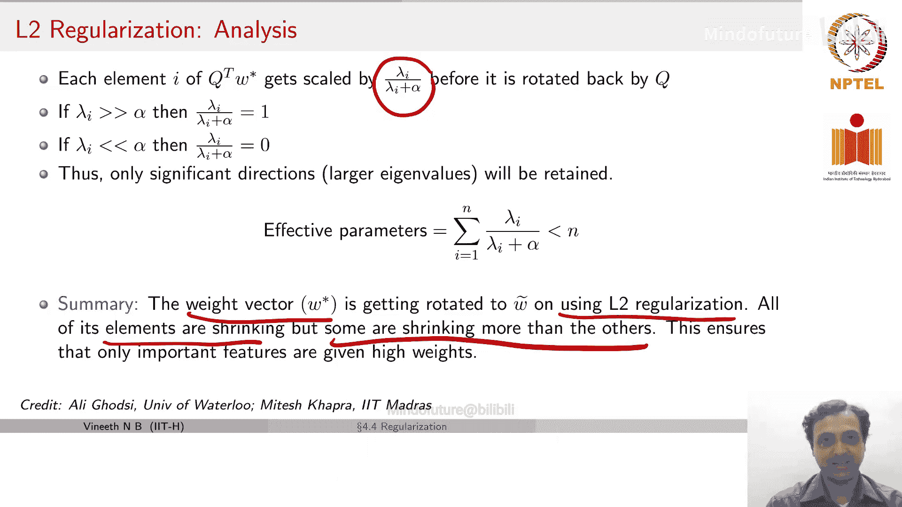

# 深度学习计算机视觉：P27：神经网络中的正则化 - 第一部分

在本节课中，我们将继续讨论神经网络中的正则化。这是一个重要的主题，旨在通过这些模型获得良好的测试性能。

在开始之前，我们先回顾一下上一节课留下的几个问题。

## 问题回顾

第一个问题是：在训练神经网络时，如何知道你是处于损失曲面的局部最小值还是其他临界点？我们目前讨论的所有算法，如反向传播、梯度下降及其变体，其循环条件中都有“直到收敛”或“直到满足停止准则”这样的表述。那么，停止准则应该是什么？我们将在本节课稍后部分讨论这个问题。

第二个问题是：为什么使用梯度下降和均方误差作为成本函数来训练深度神经网络是一个非凸优化问题？我们需要花些时间来解答这个问题。

## 凸函数与非凸函数

首先，让我们简要回顾一下凸函数和非凸函数的定义。一个凸函数满足：对于定义域内的任意两点 **x₁** 和 **x₂**，以及任意 **λ ∈ [0, 1]**，都有：
**f(λx₁ + (1-λ)x₂) ≤ λf(x₁) + (1-λ)f(x₂)**
这意味着连接函数图像上两点的线段总是位于函数图像之上。而非凸函数则不满足这个条件。

## 为什么训练深度神经网络是非凸的？

回到我们的问题：为什么使用梯度下降和均方误差训练深度神经网络是非凸优化问题？首先需要理解的是，均方误差成本函数本身通常是凸的，因为它是一个二次函数。

然而，问题在于神经网络的结构。即使我们使用线性激活函数（即没有非线性激活），训练过程仍然是非凸的。一个关键原因是**权重对称性**现象。

想象一个训练好的神经网络。如果我们交换其中任意两层中的两个神经元，并同时交换所有连接到这两个神经元的权重，网络的输出不会改变。因为权重值本身没有变，只是它们在层中的顺序变了。

但是，在构建误差曲面时，每个权重都有一个特定的索引。交换神经元和权重后，我们得到了一个完全不同的权重配置点（在权重空间中），但它却产生了与原始配置完全相同的误差值。这意味着在误差曲面上，存在许多不同的点（权重配置）具有相同的最小误差值。这种情况只能发生在非凸曲面上，因为凸曲面上只有一个全局最小值。

## 正则化简介

现在，让我们进入本节课的核心主题：正则化。

首先，我们通过一个直观的例子来理解正则化的概念。假设我们有以下数据序列，需要找出一个规则：
*   `1, 2, 3` ✅ 符合规则
*   `4, 5, 6` ✅ 符合规则
*   `7, 8, 9` ✅ 符合规则
*   `9, 2, 3` ❌ 不符合规则

可能的规则有很多，例如：“三个连续整数”、“三个升序排列的数”、“和小于25的三个数”，甚至极端地说“只对前三个序列说‘是’，其他都说‘否’”。然而，我们本能地倾向于选择前两种更“通用”的规则。

这反映了人类（和机器学习）的一种倾向：我们寻找的规则应该能够很好地**泛化**到未来可能看到的新数据上，而不仅仅是完美拟合已有的训练数据。这个过程就是**正则化**的核心思想：使用方法来提高模型的泛化性能，避免过拟合训练数据，即使这可能以牺牲一些训练精度为代价。

## Lp 范数

在深入讨论神经网络的正则化方法之前，我们需要回顾一个重要的数学概念：**Lp 范数**。

对于一个 **D** 维向量 **x = [x₁, x₂, ..., xᴅ]**，其 Lp 范数定义为：
**||x||ₚ = (|x₁|ᵖ + |x₂|ᵖ + ... + |xᴅ|ᵖ)^(1/p)**

常见的范数包括：
*   **L1 范数 (p=1)**： **||x||₁ = |x₁| + |x₂| + ... + |xᴅ|**。其单位球体像一个菱形（在二维下）。
*   **L2 范数 (p=2)**： **||x||₂ = √(x₁² + x₂² + ... + xᴅ²)**。即欧几里得范数，其单位球体是一个圆形（在二维下）。
*   **L∞ 范数 (p=∞)**： **||x||∞ = max(|x₁|, |x₂|, ..., |xᴅ|)**。其单位球体是一个正方形（在二维下）。

一个重要的特性是：当 **p < 2** 时，倾向于产生**稀疏**的权重向量（许多元素为零）；当 **p ≥ 2** 时，倾向于产生权重值**相似**的向量。

## L2 正则化（权重衰减）

最流行的正则化方法之一是 **L2 正则化**，也称为**权重衰减**。它在原始的损失函数 **L(w)** 上增加了一个惩罚项，该惩罚项与权重的 L2 范数的平方成正比。

新的损失函数 **L̃(w)** 为：
**L̃(w) = L(w) + (α/2) * ||w||₂²**

其中 **α** 是正则化系数，控制惩罚项的强度。除以 2 是为了后续求导的数学便利。

现在，总目标函数的梯度变为：
**∇L̃(w) = ∇L(w) + αw**

因此，梯度下降的更新规则变为：
**w_{t+1} = w_t - η * ∇L(w_t) - ηα * w_t**
其中 **η** 是学习率。

## 正则化的几何直观理解

我们可以从几何角度理解正则化的作用。回顾上一讲，我们讨论了损失函数的等高线图。

当我们添加 L2 正则化项时，等价于在最小化原始损失函数 **L(w)** 的同时，要求权重的 L2 范数小于某个常数 **C**：
**最小化 L(w)， 满足 ||w||₂² ≤ C**

在权重空间中，**||w||₂² ≤ C** 定义了一个以原点为中心的球体（或圆）。我们的目标是在这个球体内找到使 **L(w)** 最小的点。

原始损失函数的等高线（例如椭圆）与这个正则化球体相交。最终的最优解 **w̃** 将是球体内使损失最小的点，通常位于球体边界与损失等高线相切的位置。这迫使权重向量向原点收缩，从而限制了模型的复杂度。

如果使用 **L1 正则化**，约束区域将是一个菱形（在二维下）。由于菱形有尖角，最优解更可能落在坐标轴上，导致某些权重恰好为零，从而实现**稀疏性**。

## L2 正则化的数学分析

现在，我们从数学角度更深入地分析 L2 正则化。假设 **w*** 是原始损失函数 **L(w)** 的最优解（即 **∇L(w*) = 0**）。

令 **u = w - w***，并在 **w*** 处对 **L(w)** 进行二阶泰勒展开：
**L(w) ≈ L(w*) + uᵀ∇L(w*) + (1/2) uᵀ H u**
其中 **H** 是损失函数在 **w*** 处的海森矩阵（二阶导数矩阵）。由于 **∇L(w*) = 0**，上式简化为：
**L(w) ≈ L(w*) + (1/2)(w - w*)ᵀ H (w - w*)**

对其求梯度，得到：
**∇L(w) ≈ H (w - w*)**

现在，考虑带有 L2 正则化的损失函数梯度为零的点 **w̃**（即正则化后的最优解）：
**∇L̃(w̃) = ∇L(w̃) + αw̃ = 0**

将 **∇L(w̃) ≈ H (w̃ - w*)** 代入上式：
**H (w̃ - w*) + αw̃ = 0**

整理后得到：
**(H + αI) w̃ = H w***
因此：
**w̃ = (H + αI)⁻¹ H w***

这个公式建立了正则化后的解 **w̃** 与原始最优解 **w*** 之间的关系。

## 深入分析变换

为了进一步理解，我们假设海森矩阵 **H** 是对称半正定的，因此可以进行特征值分解：**H = QΛQᵀ**，其中 **Q** 是正交矩阵（**Qᵀ = Q⁻¹**），**Λ** 是由特征值 **λ_i** 构成的对角矩阵。

将这个分解代入 **w̃** 的表达式，经过一系列推导（利用正交矩阵的性质和矩阵逆的运算），可以得到：
**w̃ = Q [Λ/(Λ + αI)] Qᵀ w***

这里的 **Λ/(Λ + αI)** 是一个对角矩阵，其第 **i** 个对角线元素为 **λ_i / (λ_i + α)**。

这个结果意味着，正则化后的解 **w̃** 是通过以下步骤从原始解 **w*** 得到的：
1.  用 **Qᵀ** 对 **w*** 进行变换（旋转）。
2.  将变换后的向量的每个分量 **i** 乘以缩放因子 **λ_i / (λ_i + α)**。
3.  再用 **Q** 将结果变换回来。

## 缩放因子的意义

缩放因子 **λ_i / (λ_i + α)** 是关键：
*   如果特征值 **λ_i >> α**，则缩放因子接近 **1**，对应的 **w*** 分量在 **w̃** 中被几乎完整保留。
*   如果特征值 **λ_i << α**，则缩放因子接近 **0**，对应的 **w*** 分量在 **w̃** 中被严重缩小，趋近于零。

由于 **λ_i / (λ_i + α) < 1**（当 **α > 0**），所有分量都被缩小了，但缩小的程度不同。**特征值大的方向（对应损失函数曲率大的方向，通常是数据中重要的特征方向）被保留得更多，而特征值小的方向（对应不重要的特征或噪声方向）被抑制得更厉害。**

这可以理解为一种“软”特征选择或降维。有效参数的数量可以近似为 **∑_i [λ_i / (λ_i + α)]**，它小于原始参数维度 **n**。因此，L2 正则化通过缩小所有权重，但更大幅度地缩小不重要的权重，来降低模型复杂度，提高泛化能力。

## 总结

在本节课中，我们一起学习了神经网络中正则化的第一部分。我们首先探讨了深度神经网络训练本质上是非凸优化问题的原因，特别是权重对称性现象。然后，我们引入了正则化的核心思想——通过惩罚模型复杂度来提高泛化性能。

我们重点介绍了最常用的 **L2 正则化（权重衰减）**，从损失函数形式、梯度更新规则、几何直观（约束优化）和数学分析（基于海森矩阵的特征值分解）等多个角度深入理解了其工作原理。我们发现，L2 正则化等价于将原始最优解 **w*** 的各个分量按照 **λ_i / (λ_i + α)** 进行缩放，从而保留重要特征对应的权重，抑制不重要或噪声特征对应的权重，达到控制模型复杂度的目的。

我们还简要提到了 **L1 正则化**，它通过产生稀疏解（许多权重为零）来实现正则化。在下一讲中，我们将继续探讨其他类型的正则化技术。

