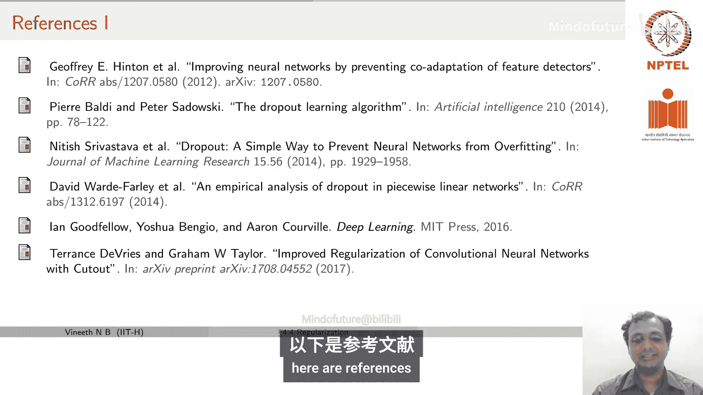

# 【NPTEL】计算机视觉的深度学习 p28 P28_神经网络中的正则化 - 第二部分 -BV1vNWkzpEua_p28-

That was one regularization approach by imposing penalty of the L2 norm or L normob of the rates。

 which is very popular， but even there you have to specify a coefficient for the L2 rate decay or L1 rate decay or any other rate decay that you choose。

Another approach is known as early stopping which is perhaps the crudeestt simplest approach that you can use the simple idea here is keep monitoring the cost function and don't let it become too low consistently stop at early vibrationeration。

Rather， don't let your model overfi your trading data。If it goes to zero error。

 youre probably zero training error， you're probably overfitting your data and you don't want that to happen。

So you want to stop a little earlier。So here is a visual example。

 so if your Y axis is accuracy and x axis is the epoX for training。

 so it's possible that your red curve here tells you that as you keep training。

 your training set accuracy keeps increasing or your training set loss keeps decreasing they both complementary。

 but it's possible that if you held aside some portion of your training data called it a test set or a validation set and did not use it for your training。

As and when you complete epos， you can take that model and test it on that hold up and see how it's performing。

As long as the performance on that holdout set or testing keeps improving。

 you keep training when it starts dipping on that holdout set， it's probably time to stop。

Even if you start going lower in training errors， even if your training set and performance keeps increasing。

 that time when you start when your performance on your holdout set。

 which you do not use for training。Decreases， it's time to stop training your neural network。

This is the idea of early stopping。This reminds us of the question that we asked last lecture。

 which we said we will cover sometime here is when do you stop。

 we said we'll talk about the stopping condition or the convergence criteria of these algorithms that we saw last lecture。

So when do you really stop？There are a few heuristics that you can use when walkko with them the problem here is that。

When you work with computers which are numerically approximated at some position。

 it may not be possible to get an absolute zero value for the gradient。

You may have to ensure that you're gradient to say temp minus5。

 temp minus6 or something like that and say I'm going to stop here。

But even that can lead to numerical errors， so we're going to talk about a few heuristics which we can use to decide when to stop trading。

One thing you can do is to train an epochs。Lower the learning rate， train m epochs。

 so on and so forth， this is an approach， but it's not a very advisable approach because you don't know what M and M should be for all kinds of neural land models。

Instead， what we can use are a couple of criteria， we can use a criteria known as the error change condition。

In the error change condition， we keep checking for the error and how it's been dropping over a window of epochs could be 10 epox 5 epox3 epos portable。

 and if the error is not dropping significantly across those epochs or mini batch hydrs。

 you say it's time to stop your training。After you stop you can always train for a fixed number of iterations you decide to stop because you still have not got to a critical point which means your gradient is not absolute zero you as well may just train a little bit more just to ensure that you probably get closer to the critical point that's one newuristic you can use。

Another heuristic is a weight change criterion， you can compare the weights at an itration on an hippoch that was at t minus 10 and at T which is your current itration and you can test if。

The maximum weight change is bounded by a value。Why do we say maximum wage change？

If we simply take L2 norm of weights in the earlier ittration and L2 norm of weights in the citration。

 that could be less than rope because there are some weights that were not changing but some weights were changing a large amount and you may have decided that the L2 norm of the weight change is fairly small but by focusing on pairwise differences between weights in t minus 10 and now and ensuring that the maximum pairwise difference between the weight at that epoch and this epoch is less than a constant is a good heuristic to stop trading too。

So in this case， it may be better not to base it on the length of the overall weight change vector。

 as I said。You could probably even this row could also be a percentage of your weight。

 you could also say that instead of row being a number saying less than 10 per minus3。

 you can say that it must be less than 10% your overall now of the weight or something like that。

Those are ways in which or any other value for that matter， those are ways in which you can。あ。

Use this as a stopping writing for your neural。Another regularization method is。

Data set augmentation。Where in addition to the data that's given to you in your training data。

 you also add more data。Through transformations on your personal data， which。

To some extent exposes your neural network to data beyond the training data and hence gives you better generalization performance so let's see how we go about this so let's see how do you really augment your data in other ways。

You exploit the fact that certain transformations to the image do not change the label of the image。

 for example， if you had a cat in an image and you want to call it a cat。

Whether the cat was small in size， large in size， rotated by 30 degrees。

 rotated the other way by 60 degrees， the cat is a cat。So why don't we take the original image。

 make these transformations， and then bring the model with all of these transformations to hope that it will probably do well on some data that it has not seen so far。

 because that gap that comes tomorrow in a new image could be rotated。

So there are different things that you can do you can do data jittering which means you can blur the image。

 you can distort the image a little bit to handle noise variations in your test data you could rotate the image as we just said you could impose color changes in the image how do you do color changes remember that every image has an R channel G channel and B channel it's common to have three channels as input to the neural network people generally don't use other color spaces although you can。

You can take the intensities in each of these channels and mix them up。

 you can take the intensities in the green channel。And call it direct red channel。

 you can take the intensities in the blue channel and call it the green channel。

 and you can get several permutations combinations out of these。

You could also inject noise in your data， you could inject some Gaussian noise across your image。

 you could also mirror your image in cases where the mirroring does not change the label。

Whether you have， if there are objects， I mean， if you see a cat one way or the other。

 it's still a cat and you may still want your model to not change its decision based on how the cat looked this way or the other way。

This helps increase data firstly because neural networks need large amounts of data for training and in addition to increasing data。

 it also acts as a regularizer because it's exposing the model to newer kinds of data beyond the training data alone。

Here are some examples of how these augmentations look。

 so here is an original photo here is red color casting just by increasing the intensity of the red channel。

 green color casting， similarly blue color casting。RGV all changed， as we said。

 just keep flipping color channels， vt， more vt， blue casting plus vt。Here are somewhat examples。

Left rotation and crop so you rotate it by left so let's see the original image again so you can see the you can see it so you can see that this was the original photo observe the top left on the next slide。

You can see that there was a left rotation and then what went outside the frame was cropped。

 rather what went outside the size of the original image was cropped similarly right rotation and crop。

Pincusion， distortion， barrel distortion， horizontal stretch。More horizontal stretch。

 vertical stretch， more vertical stretch， so on and so forth。

 horizontal stretch is this way vertical stretch is this way。

It's a good exercise for you to see which image processing operation would do all of these remember these were all byproducts of image processing operations that we talked about in the very beginning of this course you can now try to see how you would construct these distortions。

With simple image processing operations， if you needed help。

 you can also look at this paper called Deep Image scaling up recognition to understand what kind of augmentations and how you can arrive with them。

More newer methods in the last one or two years have done data augmentation in a very different manner。

A very popular method today is called mix up。What Miup does for doing dataset set augmentation is create virtual training examples by interpoolating data if you have two data points Xi and Xj could be two images X and Xj。

 you construct a new sample Xtilda， which is a convex combination between X and Xj so the new image lies on a line drawn between X and Xj。

And for the label to XI may have a label B， Xj may have a label Yj。

 remember that when you use it for training a neural network。W I。

 let's say you had three class labels， Y I would maybe be 100， this could mean a dog。

 this could mean a cat， and this could mean a horse。

So you represent YI for a dog to be 100 and Yj for a cat to be 010。

So now you could take combinations of these， you can say lambda times this vector plus1 minus lambda times this vector。

 and that will give you a new combination， the values need not be1 and0。

 it can lie between one and0 and that's the purpose here。

Wite whiteda for if you mix up the image in a particular way。

 you also mix up the label in the same way， that's what mixup does。

And mixup for the last couple of years has led to several variants like Maafold mixup， oddg mix。

 cut mix， so on and so forth， this is one interesting and effective way of performing data augmentation today。

Another popular method today is known as cutout， where you randomly mask out square regions of input。

 you can see these。Gray boxes here， So these are all boxes of gray which have masked out certain regions during training。

 That's the reason it's called cutout， which is cut out certain portions and give the rest of the image you fill in black in that location and fill in the rest of the image and fill in the image with that black portion and let the neural lamper train on that even these kinds of augmentations have shown fairly good performance。

 fairly good generalization performance when you train neural networks more recent variant of cutout is also called cut mix and there are many other followout methods。

 but these are the broad broad ones which you perhaps should know。Another approach。

 as we said for regularization is injection of noise。So this noise can be injected at a data level。

 can also be inducted at a label level or a gradient level， as we will see。In data noise。

 you add noise to the data while training。And you can mathematically show that adding Gaussian noise to the input。

Is equi to doing L2 weight decay when the loss function is some of squared error。

That's an interesting connection， you're going to leave it to you as homework。

 so this is the paper that actually showed it way back in the 90s。

You can look at that paper if you want to try to understand how to do it。

 but we will review it next lecture， but please try on your own to see if you can prove this。

So just adding noise to your input data， as I just said。

 adding gossipsian noise to input is equivalent in doing L28TK for a particular kind of a loss function。

 but which means adding noise is also a regularizer and also becomes a certain kind of an augmentation。

We can also do label noise and gradient noise and let's see how that is done。In case of label noise。

 you disturb each training sample with some probability alpha and for each disturbed sample you draw the label randomly from a uniform distribution regardless of the true label。

 so here is a model。This is the algorithm from this paper known as Dised label。

 which was published in 2016， you generate a disturbed label so for a particular trading sample which you picked up with probability alpha。

 you instead of taking its correct label。You uniformly sample from any of the labels that you have in your set of categories when you do a classification problem。

This just adds some label noise this is clearly an incorrect label。

 but this you hope will keep the neural network from overfitting your training data and hence generalize with。

This is an idea， but it's not used too often in practice。

An idea that's used in practice is known as gradient noise in this case you add noise to the gradient instead of the input or the output you add noise to the gradient while graining and how do you do that you take the gradient of any weight in the neural network when you're doing back propagation to that gradient before you update your parameter add some noise。

Remember， you would have far propagated， got an output， got an error， got gradient。

And then you would have ideally used that gradient to back propagate。

Before you back propagate and update your weights， you addg noise and what noise Gassian noise with mean zero and variance sig squared。

And this work also suggests that you anneil the Gaussian noise by decaying its variance over the itrations。

 so this sigma T square can be written as Eta by one plus d par commma where Eta and commma to are two userspec constants。

 you have to specify them if you use this method， but what it's doing now is as you keep training over time。

 you're trying to reduce the variance of this Gaussian。

 which means you're trying to keep the noise lesser and lesser and lesser。As you go through table。

This does seem to show significant improvement in performance in certain applications。

A gentle approach to achieve the regularization in。Machine learning is ensemble methods。

In ensemble methods， you train several different models separately。

And then have all modelss vote on the output。Why is this a regularizer？

Because if one of those models overfi your training data。

You still hope that the other models would not have overfied and they would perhaps help you do well as data in the generalization setting。

A standard example of a strategy for monssely is model averaging。

 so you have K different models and you get all their outputs and average the outputs and the hope is that not all of them would overfi your printing data。

So these different models that you choose for ensembling。

Could be different models that you get from different hyperparameters。

 you could use say different learning rates or different number of layers in the neural network。

 it could be different features in terms of input that you give to these models。

 or it could be different samples of your training data So if you have 10000 data points in your training data you can take 1000 of them and then train one model。

 take another 1000 train another model we will see that in a slide from now。So here is that example。

 backing which stands for bootsottrap aggregating， is an ensemble method in traditional machine learning。

 which does ensseling using the training data center。How does it do this？

If you had say K logistic regression models or any machine learning models for that matter。

 which is taking an example of logistic regression here。Given a data， a training dataset。

You construct multiple training sets。By sampling with replacement， so you construct start。

Kate different data sets from your original data set by sampling with the replacement。

 so you take if you add a data set with 10，000 data points， you take 00 of them。Train a model。

 replace them， take another thousand so you just keep。

 you can train as many models as you like by when you start sampling with replacement。

And each such model here is trained with a corresponding training dataset。

 so you can get case such models now using case samples of your training data。

Now let's try to analyze。W this can be useful。Suppose each model makes an error Epsilon I on a test sample。

 let's make this assumption。Let's to be able to mathematically analyze this。

 let's assume that epsilon I is drawn from a zero mean multivariate normal distribution with variance of Epsilon I squared to be given as V and covariance epsilon I epsilon J that is the variance between these models to be given by quantity called C。

The error made by the average prediction of all of these models is1 by k summation orri Epssononic。

 that's the average error made by。All models for the given training exam， test example。

 let's now look at the expected square error of this ensemble predictor。

The mean square error of the ensemble is going to be the expectation over1 by k summation epsilon I square。

 that's what you have here。No， that can be expanded as since one bike is a constant。

 one bike is square because one bike was。Inside the brackets， it comes out as1 by K squared。

And the term here can be expanded this way。A simple way to understand why that is correct is remember a plus b the whole square is a square plus v square plus A B plus B right so that's exactly the way we are it writing out this so we are writing out summation O I action I whole square。

Wwhich is is equivalent to saying something like epsilon 1 plus epsilon 2 plus so on and so forth till epsilon K whole square。

 which is like a plus B whole square is a square plus b square plus A B plus B A。

 So in this case we are writing。Epsilon I epsilon J， when I and J are the same。

 those will give you the square termss and epsilon I。

 epsilon J when I and J are not equal so thatll with the ABBA termss cas。

 you can now work out for higher dimensions， but that's how this expansion comes。So you then have。

Since J is equal to I， this can be summarized as summation over I epsilon I square。

And is the other term remains the same now by our definitions here。

And the linearity of expectation to expectation can be of a term can be because of the linearity of it。

 you can say expectation of a plus b is expectation of a plus expectation of B using that you can write this expectation of some of I epsiloni square。

 which would be some of Ipsilon expectation epsiloni square so let me write that out to make it clear。

 so this would be。Expectation of。Sumation。Absolutely square。Plus。

 you'll have an expectation of the other term now， but this term is can also be written as summation over expectation。

Epsilon is squared once again， because of the linearity of expectation， you can write this way。

So when you do that， you will have an expectation of Epsilon I squared。

 which is V and you will take a summation k times over v， so you will have Kv。Similarly。

 in this case you would have k into k minus 1 c， why is that the case。

 you would have I going from1 to k。J not equal to I。

 so you will get k minus1 values in the second sumation， so k into k minus1 into epsilon A epsilon J。

 the expectation is given by C， so you will have that to be sin。Now， canceling out case。

 you'll be left with1 by Kv plus k minus 1 k by c。Why what are we going to do with this。

 let's again write that out so we are saying that the mean square error of this ensemble is given by 1 by Kv plus k minus1 by Kc。

What does this tell us， this does tell us something interesting。

 it tells us that if the errors of the model are perfectly correlated， which means。

V and C are the same。 So remember。In this case， if they're perfectly correlated。

 which means all of them are exactly correlated the same way。So then V is equal to C。

Then when you substitute v is equal to C here， so you replace this with V。

 you will end up with V itself to be the answer。Rather， bagging really does not。

Because we are saying now that V is the variance of any one model and is also the variance of。

Between the models and our ensemble also has the same variance from the mean square error。

So it doesn't really help much。When all the errors of the model are all exactly the same and they're all correlated in exactly the same way。

However， if the errors of the model are independent or uncorrelated， especially if c equal0。

 roor C is the correlation between epsilon I and epsilon J。

 so if two different models errors are uncorrelated then c will be0 and your main square error will be 1 by k times V。

So which means the ensemble will have significantly lesser variances。

 the MSC of the ensemble will have significantly lesser variance。

Another way of summarizing this discussion is that the ensemble will perform at least as well as its individual members。

Now， why did we talk about ensembles， We want to now see how do you you bring that idea of ensembles to regularize a neural network that you。

An consemble of neural networks for that matter。So one major issue before we design ensembling for neural networks。

A major issue that occurs when you learn large neural networks is what is known as co adaptation。

C adapt is as it should remind you of what we talked about as heian learning at the start of this week。

That as network is trained iteratively， powerful connections are learned more and more while weaker ones are ignored。

You could ask me what's wrong， that's what learning does heavy and learning is certain terms this way。

By a person called Donald H。So heavy learning seems to say the same thing。It is allright and gentle。

 but when the same connections get learned more and more and other weaker connections are ignored。

 you may have to be concerned that your model may be overfitting your training data。

Because you do want to ensure that your model， as we said earlier。

 it's okay if you make a few mistakes on your training data， but you want to do well on your test。

So it's possible that after many hydrations， only a fraction of node connections actually participate in generating the output and just increasing your neural network size is not really going to help because the situation will continue to proliferate even then。

So what can we do here？We try to use a method called dropout， which is a regularization method。

What does dropout do in the training phase for each hidden layer， for each training sample。

 you ignore a random fraction of the notess。And in the desk face。

You use all the activations but reduce them by a factor of P P was the probability with which you pick notes and in the test phase you multiply all the activations by p P could be 0。

5 for that matter so when p is 0。5。In every layer you drop 50% of the nodes in each mini batch hydrration when you train a neural network using SGD。

 so you do that for each mini batchch itration， you probably do thousand itrations and each hydrration。

Your neural network could be slightly changing because you're randomly dropping of nodes in each layer。

 so at the end after training， what is the model that you have to use for testing？

You take the original fill model but you multiply the activations that you get from every layer by 0。

5 in this case， why do you need to do that because each node only participated 50% of the time that's how it was sampled so you probably should give only 50% weighttage to its activations。

So here is the illustration of how dropout works， this was proposed in 2014 so you have a standard neural network in this case this is the input layer and heres the output layer。

So you see here that when you applied dropout in each layer。

 there are certain neurons that you simply do not consider for that mini batch iteration when you forward propagate。

You only consider the other weight it's almost as if those weight were zero or don't exist。

 you could also do dropout in the input layer， so certain input features are just not considered at all in that iteration。

Why do we do this？Let's examine this a bit more and we'll also give you an intuition of how this。

How this can that。Remember， we said that ensemble methods are good regularizers because they can minimize the variance of a model and hence do well on future test data。

 and ensemble is generally more robust than a single model。

So we want to see how to do it with the neural network。And if a neural network has H in a new next。

 each of which can be dropped。You can now have two power hit possible models。

That's the total number of possible models that you can have with the neural network to create an ensemble。

So how do we go about creating such an ensemble that you probably don't want to train two power models and then ensemble them by voting or any other means？

So what we do now is impose one small constraint， we say that。For a particular hidden unit gauge。

There are。Two power H minus1 models， which can vary when that hidden unit is fixed。

Because there are h minus-1 so two power h minus-1 models apart from this node can be changed when this unit is fixed we are saying now that across all of those two h minus1 models this unit H must have the same weight。

 this doesn't change its weight is fixed and only the other weights can change this is the trick that we're going to use and how does that actually work it happens that。

If you do this， if you drop out with a probability of。A particular probability P。

 a 05 during training in every mini batch I。Like test time。

 simply multiplying your activations by half or P for that matter。

Is equivalent to the geometric mean of all your twoparage models。Are're going to prove this？

But before we prove， let's try to understand。Intuitively。

 why this could be useful as a regularizerizer。An intuitive example is。

 let's assume that there was a leader of an organization。Who had a thousand0 employees。

 now each of these neurons here are like employees of an organization。

And the CEO puts together these employees in certain configurations to achieve a certain task。Now。

 the way a neural network learns to perform a task is not through knowledge is by repetitiveively doing the same thing again and again and again。

 and it's effectively trial and error where you keep changing the weights and effectively get there get to performing well on your task。

So if an organization had to run this way， what could happen is over time certain people in the organizations gather certain specializations and they keep getting better and better at that while maybe others who are not exposed to that task。

Did not do so well in that kind of setting。This is what we mentioned as co adaptation。

And this could be dangerous because。After finishing a particular task。

 if the CEO had to take up a new project and certain employees left。

Then the CEO would be left with certain people who may not really know certain tasks well。

So what does the CEO do， the CEO simply takes an interesting decision of asking employees to randomly show up。

Every week， so only 50% of the employees show up every week。

 and they have to do all the tasks between them， even the tasks that the other 50% was doing。

How does this help now each employee is even learning other tasks which they may not have specialized on。

 and this builds a robust organization that can handle newer tasks in the future。

This should give you the intuition of how dropout works。

Now let's see mathematically about how dropout ensembles。So let's consider a single example。

 let's consider a logistic sigma ideal function on an input x， so the output is equal to sigma of x。

 which for the moment let's define it as something like this， let's call it1 by one plus C。

E part minus lambda x where c is greater than or equal to0。

 so this is a valid logistic sigmod function。Let's assume now that there are two power M possible subnets which are indexed by K case the index paper they use for covering all of those two power M sub networkss。

Let's define the geometric mean of the outputs from all of these subnets as G。

 this is your geometric mean formula for all those K models。

 remember K indexing2 power and possible subnets for all your two power and subnet models。

G is the geometry mean of the outputs。Similarly， you could also get a geometric mean of the complementary output instead of OK。

 you can also take1 minus OK so if you have a sigoid， it's going to give you a value between0 and1。

So if you get this is typically used for a binary classification setting where if your output is 0。

6 you're telling that this is probability with a probability of 0。

6 you're saying it's class 1 but that also means the probability of class 2 is 0。

4 that's the information that we are using here to get the complementary outputs geometric mean the normalized geometric mean now is given by g by g plus G prime where G and G prime are as defined here。

 this can be written as this will turn out to be1 by1 plus G prime by G and substituting for G prime and G which are given here and substituting for。

Or you get this term you。So G prime by g is1 minus OK by OK and you have the product that comes outside and instead of OK。

 you replace it as sigma x and instead of1 minus okay。

 you replace it by1 minus sigma of x that's how you get the first term there。

Now1 minus sigma of x by sigma of x is equal to C E par minus lambda x because let's leave that as an exercise for you to work out but that comes by simple substitution of terms here using just sigma of x here to substitute those terms you'll find that this is the answer so that's what we are replacing here。

Now this product can be converted to a summation inside the exponentialon tower， remember E power。

A into E power B is e power A plus B。Using that idea。

 this product can be converted to a summation inside the E power term。

 and that's where you go from here to here。And now let's define this， this。

 if you look at this carefully， this looks very similar to the original definition of sigma。

 just that the input X is different。So this is given by sigma of expectation over x where expectation over x is this term insight what is this telling us you could now summarize this as the normalized geometric mean。

Off。Sigma of x。Can be written as。Sigma of expectation of X。So why is this important。

 we are saying now that if you now sample these two powervari models in some way。

 probably you consider only half of them。At a particular point in time。

Simply multiplying the values of x by half will give you the same value。

So we say that the NGM or the normalized geometric mean is equivalent to the output of the overall network with weights divided by two。

Rather， this tells us that。Doing dropout by dropping nodes in each layer with a certain probability。

Becomes equivalent to taking the overall network and multiplying the activations by the same probability at test time。

 and this makes this ensemble easy to work in each mini batch hydrration。

 you drop a few neurons and then at the end of training you really are not taking two power and different models and averaging you're using just one model you're multiplying each layers outputs by P and you're done with your ensemble。

That's why this is a part for too。With that， your homework for this lecture is Cha 7。

 sections as given here。AndIf you'd like a tutorial on drop code to understand it better。

 please look at this link and as we already said earlier。

 your exercise for this lecture is show that adding Gassian noise with zero mean to the input is equivalent to L weight decay when your loss function is mean squared errors。

Give it entire time。There are references。

