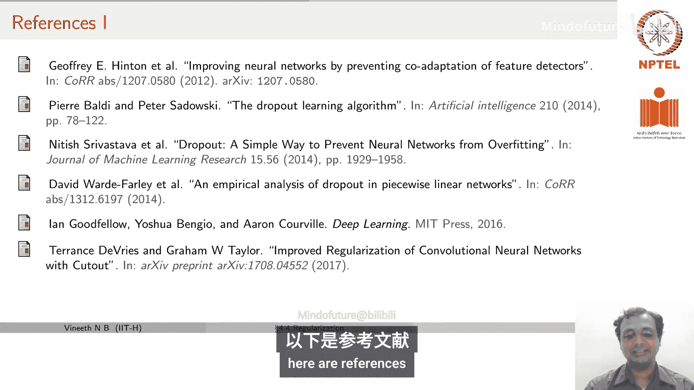

# 深度学习与计算机视觉：P28：神经网络正则化 - 第二部分

## 概述
在本节课中，我们将继续学习神经网络的正则化方法。我们将探讨早停法、数据集增强、噪声注入、集成方法以及一种非常流行的技术——Dropout。这些方法旨在防止模型过拟合训练数据，从而提高其在未见数据上的泛化能力。

---

## 早停法 🛑

上一节我们介绍了通过惩罚权重范数（如L2正则化）来防止过拟合的方法。本节中我们来看看另一种更简单直观的正则化方法：早停法。

早停法的核心思想是持续监控模型的性能，并在模型开始过拟合训练数据之前停止训练。具体做法是，在训练过程中，定期在一个独立的验证集上评估模型。当验证集上的性能不再提升甚至开始下降时，即使训练集上的损失仍在降低，也应停止训练。

以下是早停法的关键步骤：
1.  将一部分训练数据留出作为验证集。
2.  在训练过程中，定期在验证集上评估模型性能（如准确率或损失）。
3.  当验证集性能在连续多个训练周期内不再提升时，停止训练。

这种方法基于一个观察：随着训练进行，模型对训练数据的拟合越来越好（训练误差降低），但对新数据的泛化能力可能先提高后下降。

---

## 训练停止准则 ⏹️

早停法引出了一个问题：我们如何确定何时停止训练？除了监控验证集性能，还有一些启发式准则可用于判断训练是否收敛。

以下是两种常用的停止准则：

*   **误差变化准则**：在一个滑动窗口（如最近的10个训练周期）内，如果误差的下降幅度小于一个预设的阈值，则停止训练。公式可以表示为：
    `if |J(θ_t) - J(θ_{t-window})| < ε: stop`
    其中 `J` 是损失函数，`θ` 是模型参数，`ε` 是一个很小的正数。
*   **权重变化准则**：比较当前迭代与之前某次迭代（如t-10次）的模型权重。如果所有权重中最大的变化量小于一个阈值，则停止训练。这比检查权重向量的整体范数变化更严格，能捕捉到个别权重的大幅变动。

---

## 数据集增强 📈

另一种有效的正则化方法是数据集增强。其核心思想是通过对原始训练数据进行合理的变换，生成新的训练样本，从而增加数据量和多样性。

我们利用图像的一个特性：某些变换不会改变图像的语义标签。例如，一张猫的图片经过旋转、缩放、颜色调整后，它仍然是一只猫。

以下是几种常见的数据增强操作：
*   **数据抖动**：包括模糊图像、轻微扭曲以模拟噪声。
*   **几何变换**：旋转、裁剪、水平/垂直拉伸、镜像（当镜像不改变标签时）。
*   **颜色空间变换**：调整RGB通道的强度、交换通道、添加颜色投射。
*   **注入噪声**：在图像中添加高斯噪声。

更现代的数据增强方法包括：
*   **Mixup**：通过线性插值创建虚拟训练样本。对于两个样本 `(x_i, y_i)` 和 `(x_j, y_j)`，生成新样本：
    `x̃ = λ * x_i + (1-λ) * x_j`
    `ỹ = λ * y_i + (1-λ) * y_j`
    其中 `λ` 服从Beta分布。
*   **Cutout**：在训练过程中，随机将输入图像中的方形区域掩码（设置为黑色或灰色）。

这些方法不仅增加了数据，还通过让模型见识更多样的数据变体，起到了正则化的作用。

---

## 噪声注入 🔊

噪声注入是一种通过向训练过程引入随机性来防止过拟合的技术。噪声可以在不同层级添加。

*   **输入噪声**：在输入数据中添加高斯噪声。可以证明，对于使用均方误差损失函数的模型，向输入添加高斯噪声等价于进行L2权重衰减（这是一个有趣的练习，建议尝试证明）。
*   **标签噪声**：以一定概率 `α` 随机扰动训练样本的标签，即用均匀采样的随机标签替换真实标签。这迫使模型不过分依赖任何特定的标签。
*   **梯度噪声**：在反向传播更新权重之前，向梯度添加噪声。通常添加均值为零、方差随时间衰减的高斯噪声。例如，方差可以设置为：
    `σ_t^2 = η / (1 + t)^γ`
    其中 `η` 和 `γ` 是超参数。

---

## 集成方法 🤝

集成方法通过结合多个模型的预测来提升整体性能和鲁棒性。其正则化效果在于，即使其中某个模型过拟合，其他模型也可能保持较好的泛化能力，从而通过平均降低总体方差。

一个标准的集成策略是**模型平均**。假设我们有 `K` 个不同的模型，对于同一个输入，我们取所有模型输出的平均值作为最终预测。

**Bagging** 是一种经典的集成方法，它通过自助采样法构建多个训练集，并分别训练模型。假设每个模型在某个测试样本上的误差为 `ε_i`，且所有误差的均值为零，方差为 `V`，任意两个模型误差之间的协方差为 `C`。那么，集成模型（平均预测）的期望均方误差为：
`E[(1/K * Σ ε_i)^2] = (1/K)V + ((K-1)/K)C`
这个公式表明：
*   如果模型误差完全相关（`C = V`），集成并不能降低误差。
*   如果模型误差不相关（`C = 0`），集成误差方差降低为单个模型的 `1/K`。

因此，集成的关键在于构建多样性高、误差相关性低的模型。

---

## Dropout：一种高效的集成正则化方法 🎲

在训练大型神经网络时，一个常见问题是**协同适应**：某些神经元之间的连接变得非常强，而其他连接被忽略，这可能导致过拟合。

Dropout 提供了一种巧妙的解决方案，它通过在训练阶段随机“丢弃”一部分神经元来模拟集成大量子网络的效果。

**Dropout 的工作原理：**
1.  **训练阶段**：对于每个训练样本，在每个隐藏层，以概率 `p`（例如0.5）随机将神经元输出置零（即“丢弃”）。
2.  **测试阶段**：使用完整的网络，但将每个神经元的激活值乘以 `p`，以补偿训练时该神经元只有 `p` 的概率被激活。

**直观理解**：可以将神经网络比作一个公司，神经元是员工。如果总是固定团队完成任务，某些员工会过度专业化。Dropout 就像每周随机让一半员工上班，迫使所有员工都学会处理各种任务，从而打造一个更稳健、适应性更强的组织。

**数学直觉**：一个具有 `H` 个神经元的网络，通过Dropout可以生成 `2^H` 个可能的子网络。Dropout训练过程等价于同时训练这 `2^H` 个子网络的一个巨大集成。在测试时，对激活值乘以 `p` 的操作，近似于对这些子网络输出取几何平均，从而实现了高效的集成预测，而无需实际训练和存储大量模型。

---

## 总结

本节课我们一起学习了多种神经网络的正则化技术：
1.  **早停法**：通过监控验证集性能来防止过拟合。
2.  **数据集增强**：通过对原始数据施加不变性变换来增加数据多样性。
3.  **噪声注入**：在输入、标签或梯度中引入噪声以提升鲁棒性。
4.  **集成方法**：结合多个模型以降低方差，提高泛化能力。
5.  **Dropout**：一种通过随机丢弃神经元来实现高效集成的强大正则化方法。

这些方法的核心目标都是减少模型对训练数据中特定噪声或模式的依赖，鼓励学习更通用、更本质的特征，从而在遇到新数据时表现更好。在实际应用中，常常需要结合使用多种正则化技术以达到最佳效果。