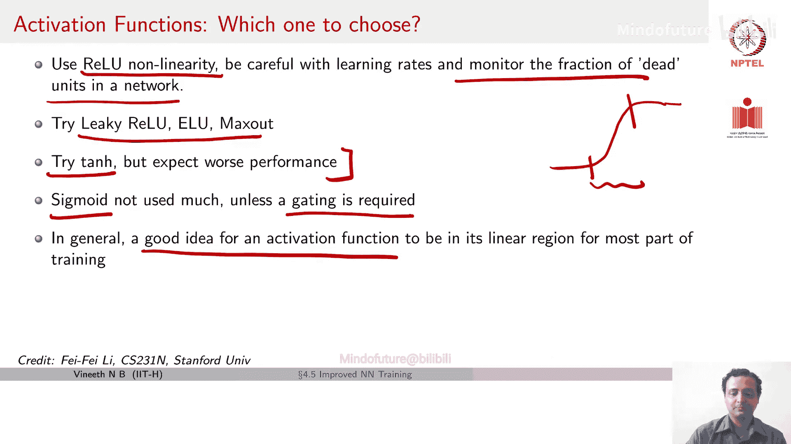

# 深度学习计算机视觉：P29：改进神经网络训练 - 第一部分

## 概述

在本节课中，我们将学习如何改进神经网络的训练过程。上一讲我们讨论了正则化及其对提升模型泛化性能的重要性。本节我们将聚焦于另一个关键组件：激活函数。我们将详细探讨不同激活函数的特性、优缺点，以及它们如何影响神经网络的训练效率和最终性能。

## 从噪声输入到L2正则化

在深入新内容之前，我们先回顾上一讲留下的一个练习：证明当损失函数为均方误差时，向输入添加零均值高斯噪声等价于L2权重衰减。

其核心直觉在于，当噪声通过一层网络时，其方差会被该层权重的平方所放大。在一个简单的单层网络中，这种被放大的噪声会直接加到输出上，并在损失函数中贡献一个额外的项，该额外项的形式与L2正则化项相同。

让我们进行数学推导。假设我们有一个输入 `x_i`，并为其添加噪声 `ε_i`，其中 `ε_i` 服从均值为0、方差为 `σ^2` 的高斯分布。对于单层网络，带噪声的输出 `y_noisy` 为：

`y_noisy = Σ_i (w_i * x_i) + Σ_i (w_i * ε_i)`

原始输出为 `y = Σ_i (w_i * x_i)`。新的均方误差期望值为：

`E[(y_noisy - t)^2] = E[(y - t + Σ_i w_i ε_i)^2]`

展开并利用期望的线性性质，同时注意到 `ε_i` 均值为0，交叉项期望为0，我们得到：

`E[(y_noisy - t)^2] = (y - t)^2 + Σ_i (w_i^2 * σ^2)`

由此可见，新的损失函数等于原始损失函数加上一项 `σ^2 * Σ_i w_i^2`，这正是L2权重衰减项的形式，其系数由噪声方差 `σ^2` 决定。

## 激活函数详解

现在，让我们进入本节课的核心主题：激活函数。在第一周的介绍中，我们简要提到了激活函数。现在，我们将花更多时间深入理解每一种激活函数及其对训练的利弊。

激活函数是应用于神经网络中每个神经元输出的非线性函数。传统上，人们在整个网络或至少同一层中使用相同的激活函数。这样做主要是为了简化计算复杂性，便于利用矩阵向量运算和高度优化的线性代数子程序，从而加速网络计算。

### 激活函数的理想特性

那么，激活函数应具备哪些特性？

1.  **连续性**：函数不应有间断点，以确保梯度处处有定义。
2.  **可微性**：这是反向传播算法计算梯度所必需的。
3.  **单调非减**：理想情况下，输入增加时，输出不应反复波动，这有助于稳定的梯度流动。
4.  **计算高效**：复杂的计算会拖慢整个网络的训练速度。

常见的激活函数包括Sigmoid、双曲正切（Tanh）、线性整流单元（ReLU）等。我们该如何选择？它们对训练有何具体影响？接下来我们将逐一分析。

以下是几种常见激活函数的快速回顾：

*   **Sigmoid**：早期为解决感知机阈值问题而引入，是逻辑函数，形状呈S型，将输入压缩到(0,1)区间。
    *   公式：`σ(x) = 1 / (1 + e^{-x})`
*   **Tanh（双曲正切）**：也是一种逻辑函数，形状与Sigmoid相似，但输出范围在(-1,1)之间。
    *   公式：`tanh(x) = (e^x - e^{-x}) / (e^x + e^{-x})`
*   **ReLU（线性整流单元）**：在2012年AlexNet中推广使用。输入为正时输出原值，为负时输出0。
    *   公式：`f(x) = max(0, x)`
*   **Leaky ReLU（带泄露线性整流单元）**：ReLU的变体。当输入为负时，输出一个小的斜率（如0.01）乘以输入，而非直接为0。
    *   公式：`f(x) = max(αx, x)`，其中α是一个小的正常数（如0.01）。
*   **ELU（指数线性单元）**：为解决ReLU在0点不可微（实践中常设导数为0）而提出，是一个平滑连续的函数。
    *   公式：`f(x) = x (if x>0)`；`f(x) = α(e^x - 1) (if x≤0)`
*   **Maxout**：可以看作是ReLU的泛化。它并非对单个神经元操作，而是对一组神经元取最大值作为该组的输出。
    *   公式：`f(x) = max(w_1^T x + b_1, w_2^T x + b_2)`（以两个神经元为例）

### 深入剖析各激活函数

现在，让我们更详细地探讨其中几种激活函数，理解它们如何影响神经网络训练。

**Sigmoid激活函数**

Sigmoid函数将输入压缩到(0,1)区间。其梯度为 `σ'(x) = σ(x) * (1 - σ(x))`。

尽管在80、90年代非常流行，但如今已较少使用。原因如下：

1.  **梯度饱和**：当输入绝对值很大时，函数曲线变得非常平缓。此时，输入的巨大变化只会引起输出的微小变化，导致梯度接近于0。这会使网络中某些权重的更新变得极其缓慢，从而拖慢训练。
2.  **非零中心化**：输出范围在(0,1)，均为正数。考虑一个简单网络层，其输入`H1`、`H2`（来自前一层Sigmoid输出）为正，权重`W1`、`W2`。根据链式法则，`∂L/∂W1`和`∂L/∂W2`的符号将完全由公共项`(∂L/∂Y)*(∂Y/∂σ)`决定。这意味着`W1`和`W2`的梯度总是同号，要么同时增加，要么同时减少，这种“锯齿形”更新路径会降低学习效率。
3.  **计算成本**：涉及指数运算，计算相对较慢。

**Tanh（双曲正切）激活函数**

Tanh函数将输入压缩到(-1,1)区间。其梯度为 `tanh'(x) = 1 - tanh^2(x)`。

与Sigmoid相比，它的主要优势是**零中心化**，输出可正可负，这有助于改善梯度流动，使学习更高效。然而，它同样存在梯度饱和问题（在输入绝对值较大时），并且计算也涉及指数运算，成本较高。

**ReLU（线性整流单元）激活函数**

ReLU是当前最常用的激活函数。其梯度为：`f'(x) = 0 (if x ≤ 0)`；`f'(x) = 1 (if x > 0)`。在实践中，`x=0`处的导数常被定义为0。

它的优点非常突出：
1.  **缓解梯度饱和**：对于正输入，ReLU处于非饱和区，梯度恒为1。这意味着较大的输入能获得相应的梯度，有利于权重更新。
2.  **加速收敛**：在AlexNet中，使用ReLU比使用Sigmoid或Tanh使SGD的收敛速度加快了约6倍。
3.  **计算高效**：只需进行阈值判断和取值操作，计算速度极快。

但ReLU有一个著名的缺点：**神经元死亡**问题。
考虑一个场景：某神经元的输入加权和`a`为负数，则ReLU输出为0。在反向传播时，梯度`∂Y/∂a`为0，导致流向该神经元权重`W1`、`W2`的梯度被完全阻断。如果这些权重初始化为负值，可能导致`a`持续为负，该神经元将永久“死亡”，不再对网络输出产生任何贡献。实证研究表明，在深度网络中，相当一部分ReLU神经元可能处于死亡状态。

**应对“死亡神经元”的策略**

1.  **偏置初始化**：将神经元的偏置项初始化为一个小的正值，有助于在训练初期使激活值`a`偏向正侧，避免过早死亡。
2.  **使用Leaky ReLU或ELU**：这两种函数在输入为负时，仍允许一个小的梯度通过（Leaky ReLU是一个小的线性斜率，ELU是一个平滑的曲线），从而保证了梯度流不会完全中断，神经元始终保持一定的活性。

### 如何选择激活函数？

在实践中，大多数情况下**ReLU**是默认的首选，因为它简单、高效且通常效果很好。但在使用ReLU时，建议监控网络中“死亡神经元”（输出恒为0的神经元）的比例，如果比例过高，可能需要调整。

如果ReLU效果不佳，可以考虑尝试**Leaky ReLU**或**ELU**。**Tanh**在某些特定场景下可以尝试，但性能通常不如ReLU。**Sigmoid**如今已很少在隐藏层使用，主要用于需要输出在(0,1)区间的场合，例如二分类输出层或某些具有“门控”机制的网络（如LSTM、GRU）。**Maxout**表现良好但参数较多，使用不如ReLU普遍。

一个重要的经验是：理想情况下，我们希望激活函数在其**线性区域**被使用的时间尽可能长。例如对于Sigmoid，我们希望输入值大部分落在其曲线中部近似线性的区间。有时可以通过调整激活函数的参数（如缩放）来扩大其线性区域，以适应输入数据的分布，这能有效改善训练性能。关于这些技巧，有一篇名为《Efficient BackProp》的经典文献提供了详细建议。

## 总结

本节课我们一起深入探讨了改进神经网络训练的一个重要方面：激活函数。我们首先通过数学推导，理解了向输入添加高斯噪声如何等价于一种L2正则化。然后，我们系统回顾了Sigmoid、Tanh、ReLU、Leaky ReLU、ELU和Maxout等常见激活函数，分析了它们各自的数学特性、优缺点以及对训练过程的影响（如梯度饱和、神经元死亡问题）。最后，我们给出了在实际应用中如何根据情况选择激活函数的实用指南。理解这些激活函数的行为，是设计和调试高效神经网络模型的基础。在下一讲中，我们将继续探讨其他改进训练的技术。