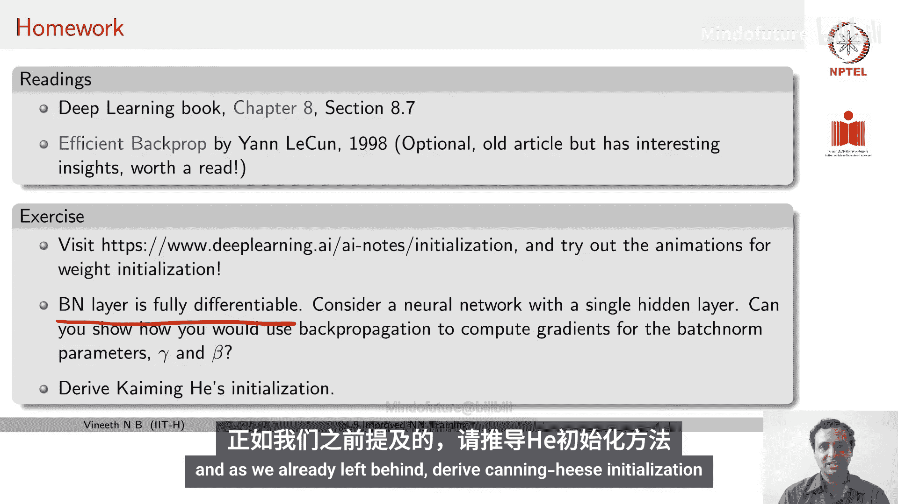

# 【NPTEL】计算机视觉的深度学习 p30 P30_改进神经网络训练 - 第二部分 -BV1vNWkzpEua_p30-

Another important component we're going to talk about here is weight initialization。

You know by now that for a neural network to learn。

 you must first initialize the weights with certain values。

And then you perform gradient descent to learn。Is this really important。

 can I just initialize all of them with zeros and go？

It is important because if you recall the neural network error surface。

Where you start is critical to which local minimumma you will reach。

We saw that the error surface can be very complex。Which means it depends on which。

Starting point you have。And you may accordingly converge to a local minima if you want to get to a better local minimum。

 you may have to start at a better position initially to be able to get that solution。

There have been recent studies which try to analyze this from other perspectives。

 but rate initialization in general is considered a very important aspect of designing neural networks in fact。

 to a certain extent this was a game changer when deep learning started becoming popular in the first decade of the 21st century。

Let's first ask the trivial question。Why don't we just initialize the neural network weights to zeros and let it learn what it should learn？

Is this a good answer？No。In fact。Any constant weight initialization scheme will perform thoroughly。

 why so？Let's take an example and understand this。Let's consider a neural network with two hidden units。

 let's say a re activation。And let's make all biases zero just for us to understand this and let all the weights be initialized with some constant alpha。

 it could be zero， it could be non zero to any constant initialization。It iss okay here。

If we do this and forward， propagate an input in the network。

The output of both hidden units in the next layer will be random of alpha x1 plus alpha x2 because the weights are the same。

Now， why is this an issue？Which means both hidden units will have the same output。

 they will have an identical influence on the cost or the loss。

 which means they will have identical gradients。If they have identical gradientillis。

 they will have identical updates and the weights will always remain the same。They start the same。

 the gradients will be the same， and they will keep taking the same value always through training。

This is not desirable。So we want to do something more than simply initialize the rates with the same values。

How weeks I then。How rates initialized then？They are generally chosen randomly， or for example。

 you can sample weights from a Gaussian distribution to have some writing in the weights。

Both very large and small weights can cause activation functions such as sigmoid and tannage to saturate。

 so that is something important to keep in mind when you initialize to。

Let's say more specifics on how we can initiate。In 2006。

 rate initialization was one of the major factors in turning around how deep neural networks was paid attention to Salo denova and Hinton introduced a method known as greedy。

 layerwise layerwise unsupervised retraining， which is considered to be a significant catalyst in the training and success of deep neural networks。

For a few years since 2006。The gentle understanding was this was extremely essential to make deep neural networks work in practice and led to a widespread adoption of deep neural networks for various applications however today it is understood that you don't need this method that there are simple weight initialization methods that you can use and you get as good results but let's try to understand what this method tried to do。

As the name says， greedy layer wise unsupvised retraining。

The suggestion was when you have a deep neural network。Before you start training the neural network。

 we are talking about the weight initialization step here。

 you take the first two layers and train them using some unsupervised technique， for example。

 you could use methods such as known as Bman machines or autoenrs， we will see that later。

To be able to train this， these two layers in an unsupervised。

Using that you would get a set of weights， now you freeze those weights。

And then take the next two layers and train them in an unsupervised manner because the first layers weights are frozen。

 you could provide inputs and multiply it by those frozen weights and they will become inputs to the second layer so you could take the second and third layer。

 train them in an unsupervised manner， and you would get a certain set of weights。

 then you freeze those weights。Then you take the third set of third layers weights。

And turning them in an unsised manner and you keep repeating this process to get an initialization on your weights for the neural network。

Why is this called so greedy because it optimizes each piece independently rather than jointly？

Layerwise， because you are doing initialization in a layerwise manner， unsupervised， as I just said。

 is because you use only the data， no labels to be able to train those networks because this is not a formal training process。

 it's only to initialize the neural network。And it's called pre training because this is done before the formal training process starts。

 as I mentioned， it's for weight initialization。So a question that you may have now is how do you do that unsupervised training between every pair of layers。

 you may have to wait for that answer in this course。

 this is achieved by networks known as autoenrs or restricted Bman machines or even you could even use other methods to be able to achieve this。

 but we will see these examples we will see auto encoders and RBMs a little later in this course。

But as I mentioned， this got superseded by newer greater racialization methods over the last decade。

Let's try to understand what has been the thought process behind coming up with newer initialization methods。

If you took a neural network， such as what you see here。

Let's consider that all your inputs have been normalized already with mean zero and variance 1。

 it's very common these days to normalize your data inputs before providing it as input to any machine learning Al。

Let's also assume now that your weights have to have mean zero and a certain variance。

 we do not know what that variance should be， that's what we want to find。

Let's not take one of these neurons。 Let's call that a1。 let's take one of the neurons here。

 Let's call that a1 for simplicity。 that's going to be given by summation over I is equal quantum n where n is the number of。

Rates coming into that neuron， W1 X。Then the variance of a1 would be i is equal to 1 to n variance of W1xi。

Assuming now， the W and x are not correlated with each other。

You can write W i1xi as du variance of w into variance of x。

 the joint coalance would go to zero and assuming that we also want all neurons to have the same variance。

 the summation。Turns into。Let's now try to understand what happens to the variance when we go deeper in the neural network。

The variance would keep getting multiplied and you would have the variance of a pre activationivation at the later layer to be n times variance power k into variance of x。

This could result in blowing up or becoming zero， depending on what the variance of W originally was。

Remember， now that。We ideally want， we already know the variance of x is given to be one。

We would want the variance of every succeeding layer also to be one。

 because that would ensure that even the layers in between are normalized。

So we would ideally want variant of a1 also to be 1。

The way to do it is that n into variance of w should then be1， we know variance of x 1。

 we want variance of a1 to also be 1 because then even the variances of activations in later layers will be normalized and then n into variance of W has to be 1。

So which means for a good initialization， you can draw weights from a normal distribution or a Gaussian distribution。

And scale them by one by rot1， where n is the node standing。That's the same thing here and by fanyl。

 we mean the number of weights coming into a particular neuron。Yeah。

Using the s there have been a few weighted initialization methods that have been developed。

 the most popular ones today are Xavius initialization or glox initialization， which is given by。

This term here， you uniformly sample from a certain range given by these values。

Or timing his initialization where you uniformly sample in this range。

These came from these two papers which were published in 2010 and 2015。

 let's try to understand one of them， at least in detail as to how that range came through。

Let's now derive how Xavius or glox relationization was derived。

We just now showed that it is good to have the variance of W to be1 by root fanin。

But we also have to consider the backward pass during backdrop。

Wwhichch also could result in affecting the weights and the gradients。

 so even the backward pass would have an impact when you have to decide the weights of the gradients because the gradients are distributed based on how the weights in a particular layer are which flows through the previous layers and so on and so forth。

So it may be wise to also consider variance of w to be 1 by fan out。

 fan out is the number of weights going out of a neuron to the next layer。

Let's hence go with the average variance of W to be2 by root fanin plus fanom。

Now we know from statistics of uniform distribution that。Given a uniform distribution from the range。

MN， we know the variance is given by n minus n equal squared by 12。

Which means if we now sample uniform blade from minus a to a。

Its variance is going to be given by2 a equal squared by 12， which is a squared by3。

Now let's put these together， we said that fanin into variance W must be one fanon as the same as n on the previous slide。

We said we want this。We know that variance of W coming from uniform distribution from an interval is a squared by3。

Putting these two together， we want salin into a squared by 3 to B1 or a to be root3 by root salin。

And now considering the backward pass and the forward pass you get。

Xavier initialization would be minus root six by root fanon plus final to plus root six by root fanon plus1。

C initialization is built on top of this， but that's going to be homework for you to work out as to how you get this as another possible initialization。

 you can by looking at it say that the ideas have to be similar but there are some minor changes you can also look at the paper that proposed this which was in the footnote on the previous slide to be able to do this homework。

Let's move to the last component of this lecture that Kate will will talk about。

 which is an important development。That came about in 2015， known as batch normalization。

Covariate shifting is a problem that in machine learning refers to a change in input distribution between training and test scenarios。

This generally causes problems because the model needs to adapt to a new distribution。

 this could also happen even during the training process itself between the distribution at one stage and the distribution at another stage。

In a neural network， this issue can show up as internal covariant shift where the input distribution can change across the layers。

So the first layer， we could normalize the data and it would have the inputs would follow us certain in distribution。

Depending the on the weights in the first layer， the second layer would receive a different distribution。

 the third layer would depend receive a different distribution based on those weights and so on and so forth。

 and the neural network has to learn to handle these different distributions。

Can we do something to address this？We know that a network trains well when its inputs are whitened or normalized。

 they are linear transformed to have zero means and unit variances。

Can we now do something to also have a similar effect in each layer。

 can we make each layer also a unit gasian， that's not it in our hands entirely because it depends on the weights。

 but how do we achieve such an effect？The answer to this is。

We could do this by considering a mini batch。Since we train neural networks using mini batch SGE。

 we could try to see if we could compute the mean and variance of any layers outputs in a mini batch and then。

Come subtract the mean and divide by the variance to normalize them in some way。To do this。

This method known as batch normalization， which was proposed in 2015。

Introduces two additional parameters， gamma and beta。

 superscriptcate denote the specific layer in which you introduce these parameters because you have to do this layer wise where gamma gamma is given by the root variance of x and beta is the mean of x。

Let's look at how this batch normalization works batch normalization is often introduced as a layer itself。

That succeeds。One of the layers of and one of the existing layers of a neural network。

So let's consider this。We assume that。After a certain leader。

You have a certain output values that you get， let the mean of all of them across the mini batch that you're propagating in a certain as Gdihyration。

 let that be muB， Similarlyly， you can compute the mini batch variance across those values that youre considering across that layer that you're considering。

To be sigma B squared。Now， if we normalize， your Xi hat would be Xi minus mu beta by sigma beta squared plus epsilon。

In this case， your output would then be。You would have Xi hat into the variance of standard deviation。

Plus， mu will give you back exc。Instead of doing that。

 what we do is to say that the output of this batch normalization layer。Garma of X hat plus beta。

Where Gama and Beta are learned。How does this help once you learn gamma and beta， in a sense。

 the output of that layer is reormalized。The mean the new socal mean would be beta and gamma would be the standard deviation of this new distribution and by learning gamma and beta。

 you're asking the neural network， normalize each layer the way you want to normalize it you don't need to do standard normalization with mean zero and unit variance。

 choose the mean， choose the variance that helps you perform the best and let the neural network learn gamma and beta。

The batch layer is generally inserted before you apply your non nonlinearity。

 so you have a layer which receives input from the previous layer。

 you do batch normalization and then apply your non nonlinearity this is typically the way it's implemented and this has given good empirical results。

Batche normalization allows higher learning grades， why？

One of the reasons to keep your learning rates low was to avoid your weights to explode in a neural network。

Or become low on the other side， if it becomes too low。

 but we are talking about higher learning rates here by ensuring that your activations are controlled because of the batch normalization。

 the learning rates can now be increased because this learning the gamma and be would take care of what the neural network needs to not let it explode。

It reduces a strong dependence on initialization because now ir respect of initialization。

 the weights can be controlled using the commma and be in every successive iteration of SD。

 it also acts as a form of regularization because whatever weights come or whatever activations come out of a layer。

 you're going to multiply it by a commma and be which has a sense of adding noise to those activations which becomes the regularizer。

An important difference， an important concern of batch normalization is that at test time your data may not be forward propagated in batches。

 you may want to predict only on a single point。Then you may not have a mean and a variance for a mini batch at test time。

How do you handle it， you choose MuB and Sigma B squared based on your training data。

Maybe the last two training batches。However， you take a running average of mu B and sigma B squared over a set of training its and you use those values at test time。

That concludes a discussion of batch normalization。

 your recommended readings for this lecture are Chapt 8 section 8。7 of the deep learning book and。

A very nice article called Efficient Backrop by Yaekun it's a very old article。

 some of it is not relevant to deep neural networks but some of it has very nice insights on efficient training of neural networks I would recommend you to read it。

Where exercises are visit this link here which has some nice animations of how a neural network behaves with different initializations。

 it's simple， click and， click and try exercise exercise for you。

The second exercise is batch normalization is fully differentiable。

Can you try finding out how you compute gradients for the batch layer should be by looking at it you can make out that it simply a multiplicative factor and an additive factor which should be differentiable。

 but how would you get do L by do gamma and do L by do beta。

 please work it out and as we already left behind derive canning his initialization。

皆さ referenceフツす。