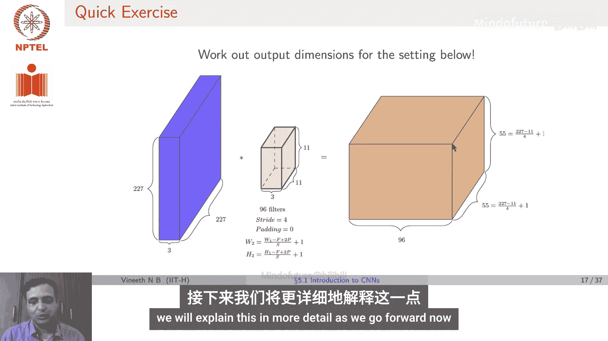

# 【NPTEL】计算机视觉的深度学习 p31 P31_卷积神经网络介绍 - 第一部分 -BV1vNWkzpEua_p31-

Continuing our discussion。We will now move on from simple feet forward neural networks。

Into the building blocks of deep learning for computer vision。

 which are convolutional neural networks。before we start that discussion。

 we will review the homework or the exercise that we left behind in the last lecture of the previous week。

One of the questions there was how do you back across a batch normalization layer。

 So what you see here is。The algorithm of batch normalization that we saw last time。

 Let's quickly review that。In terms of how it looks on this graph。

What is known as the computational graph？So you have forward propagation which is given by you've given x1 and x2 and given a mini batch of data。

 you find the mean and variance of x the inputs out of a particular layer。Out of a particular layer。

 the activation is out of a particular layer。And then you normalize that data using the mean and variance。

Once you normalize you renormalize them by scaling and shifting rather you adopt a variance gamma and a mean beta which is suitable to solve that problem。

 this is the main idea of batch normalization and that' is represented but represented by this graph here。

The forward prop as we can see is quite straightforward and we just follow this algorithm The question here is how do we do the back。

Let's try to work through the different terms here and understand this。

The first term that we have to find out is beta that' is one of the simplest terms to evaluate。

 so we will start with that to recall let's go back and see what beta was。

Note here that in the last line of the algorithm。Beta。Plus gamma times X hat is the final output Yi。

Keeping that in mind， so this is the main equation that you may want to keep in mind for the next few slides。

So do l by do beta， so you can assume that beta is almost an input into y。With。

 so you have this here。Garma times X I hat plus beta times 1 is what is y， y 1。

So which means do L by do beta is going to be given by。

D l by do y 1 into do y1 by do beta and similarly for the other y times do l by do y2 into dol do y2 by do beta and so on and so forth。

D y 1 by do beta， as you can see here is going to be 1。

So this is going to simplify to dol by do y1 plus dol by do y 2。

Whi is the final gradient of do L where L is the loss with respect to beta。

Let' us move on to the next one， similarly do l by do gamma。

 remember gamma is the constant that multiplies X hat。

 so do l by do gamma equal is equal to dol by do y1 into do y1 by do gamma and so on and so forth for all the y terms。

And do y1 by do gamma as you can see is going to be x1 hat by the very definition of these terms。

 so that term gets replaced by x1 hat， so you have do L by do y1 into x1 hat plus do L by do y do into x2 hat and that gets summarized as a summation in this way。

Let's move on to the next step。The next term is do L by do x1 hat x1 is not a parameter。

 but we need to be able to compute this so as to propagate the gradient to previous parameters in the network。

D l by do x1 high will be do l by do y1 into do y1 by do x1 high。

Do y1 by do x1 hat is given by gamma as we just saw that's what we put in here and similarly you would be able to do do L by do x 2 hat。

Let's move on to the next term， which is going to be do L by do sigma squared。

We again need this because。The gradient needs to pass through this to be able to go to do L by dox。

 which is going to be an earlier term and all the other gradients in the previous layers。

Do L by do sigma squared is given by。Do L by do x1 hat which we already computed on the previous slide into do x1 hat by do sigma square which which is the new term that we need to compute Similarlyly we need to do this for all the x terms so you have do L by do x2 hat into do x2 hat by do sigma square and it is written as a summation。

The main term that we need to evaluate here is do X hat by do sigma square so which？

Is found by the gradient of the form of X hat itself。

 let's go back a couple of slides and see what that is。So Xi hat is given by this term here。

So the gradient of do Xi hat by do sigma just follows the gradient of this particular term。

 which can be written by。Xi minus mu into minus half into sigma squared plus epsilon。

 which would have been the denominator into minus 3 by 2。Similarly， we have do L by do mu。

 which is do L by do x1 hat。Intodo x1 hat by dom mu plus do L by do x 2 hat intodo x2 hat by domu and also do L by do sigma square into do sigma square by dou。

So the first two terms get absorbed into a common summation and the last term stays as it is。

Though Xi hat by do mu is given by this gradient here。

 this once again follows directly from the definition of Xi hat to be X minus mu by root sigma squarepers epsilon。

And the term here， do sigma square by dome mu gets written in terms of x's and mus。

 because sigma square once again by the same expression can be rewritten in terms of。

All the excess and the corresponding mue。Just to repeat that。

 then remember that if we go back to the algorithm。From the same boxed equation here。

You could pick sigma b square plus epsil on the other side and get Xi hat as the denominator and you would do this for x1 hat x2 hat and all of that So do sigma do mu by do sigma square becomes a summation of all of these gradients and thats what we get here。

Each of this is one gradient with respect to one of those inputs x1。

 similarly this would be the gradient with respect to x2 and so on and so forth。

And that's how you get your doL by doMu。Finally， do l by do x1。

 that's the final gradient that you need to be able to compute to back propagate to earlier layers that is going to be do L by do x1 hat into do x1 hat by x1。

Plus do l by do sigma squared intodo sigma squared by x1 plus do l by do mu into do mu x by do x1。

So this one follows as it is do x1 hat by do x1 by once again， the definition of x1 hat。

 you will get it to be this term。Do sigma square by do x1 once again by the expansion of sigma with respect to x1。

 now you don't need to worry about the x2 term， so you will have only one gradient term here you get this and finally do mu by do x1 would simply be 1 by2 here。

By definition of x1， by a definition of mu and how it's connected to x1。Similarly。

 you would get this for do L by do x1 and so on and so forth for all the doL by do X size。

That's how the backdrop is done for batch normalization a takeaway for you at this stage is。

For any of these new parameters that you introduce in a neural network。

 a careful working out of chain rule for every term involved would would take care of how you should be able to compute the gradients and backproagate in that scenario。

 all that you need to ensure that you have only differentiable components in all your new additions to a neural network。

With that， let's move on to convolutional neural networks and this lecture is largely based on the excellent lectures of Mish Kara from I Mads。

Let's start with reviewing convolution so we did do it in the first week of this course we know now that convolution is a mathematical way of combining two signals to form a third signal。

We also know that it's an extremely important technique in signal crossing in general images are 2D signals。

But convolution is also used for other kinds of signals such as speech or acceleroator data。

 time series data， so on and so forth。In case of 2D data。

 let's assume the simple case of grayscale images。Convolution operation between a filter W whose dimension is k across k and an image x whose dimension is n1 across n 2 is expressed as。

Y of Y J。Index u going from minus k to k index v going from minus k to K W U V。

 which is the filter and X I minus u J minus k， which is the input image we've already seen this as the definition of convolution。

More generally， we can also write convolution。In the form that you see here where we are writing the indice is going from。

The flow of minus k1 by 2 to k1 by 2 and minus k2 by 2 to k2 by 2。

There is a particular reason we are talking about it because if we write the equation of convolution this way。

 thats the only difference， otherwise the rest of it is more or less the same。

 obviously the indices of W change because of how we wrote the summation here。

 the indices and the summation here。All that we are saying in this definition is that we are going to center the filter on the pixel around which we are computing the convolution。

We already did that earlier too， but we just writing that formally here。

 so for different parts in the course based on what we want to establish we may write the definition of convolution slightly differently but you can see that that the heart of it it is the same equation you do have w indices and x indices defined this way and you get the output at a particular pixel。

We know from what we've seen so far that for the 1 d case， when you do convolution。

 you slide a one dimensional filter over a one dimensional input。Similarly， in the 2 d case。

 you slide a two dimensional filter as in images such as a sobel edge filter and so on over a two dimensional input。

Let's try to take this further。What would happen in a 3D case？Why do you need a 3D case。

 isn't an image 2d？An image is 2D， but when you go to color images。

 you have three channels of images which becomes a third dimension if you want to cong with them together at one go。

So let's try to understand how this convolution would look in the 3D case。

Let's try to understand what a 3D filter would look like。Let's assume now that our input。

Will be a color image which has three channels， R， G and B。Which makes the input now a volume。

And what would a 3D filter look like？It could also be。A volume。

And we're going to refer to that as a volume going forward。

So when you now slide the volume over your input volume and perform the convolution operation。

 you will be moving it。Across the input volume at different locations and getting one scalar output as the output of the convolution in the output image so you can see that as you move the volume on different locations in the input volume you get the output。

As pixels in the output image。We also call this output image as a feature map in convolutional neural networks。

One assumption we make here is that the depth of this filter is the same as the depth of your input volume。

 and this is important。Why is it important？Because the depth of the filter is the same as the depth of the input volume。

In effect， we are doing a 2 d convolution on a 3D input。 Why do we say that？

We slide along the height and the width of the input。

But we do not slide along the depth because the depth of the filter is the same as the depth of your input volume。

So your output of this operation will also be a 2 d image。

When you did 1 d convolution with a 1 d filter on a 1 d signal， you got a 1 d output。

When you took a 2 d filter on a 2 d input an image， you got a 2 d output。

Now we are taking a 3D filter on a 3D input and our output now is not 3D but 2D。And why is that so。

 Because the depth of the filter is the same as the depth of the input？Then can't you get a volume。

 can't you get a 3 d as output here， you can even with this operation you can by defining multiple filters。

If you define multiple such filter volumes for each filter volume。

 you would get one such output or one such feature maps， one such feature map。

 and by using multiple filters you would get multiple such feature maps which together form a volume。

Let's now try to understand the dimensions。We know that even when we did convolution we had some issues around the edges of the image where convolution cannot be performed and we use techniques such as padding。

 let's revisit some of those in the context of convolution the way we see it for color images lets assume now that our input dimensions are w1 cross H1 cross D1 with height height and depth。

And the spatial extent f of each filter， the depth of each filter is the same as the depth of the input。

 so you have a say spatial extent to be f cross F and the depth is same as d1 because that' is the depth of the input volume。

Let' us assume now that the output dimensions are W2 cross H 2， cross D2。

So we are now allowing the output to have some depth D2 if you used only one filter。

 this D2 will be one。You can increase D2 by increasing the number of filters that you have。

Let's try to work out a formula for W2 and H2 in this context。

We will also talk about a quantity called stride， which decides how much you overlap successive convolutions on different parts of the image and we will also talk about the number of filters in deciding the size of this output volume or output feature maps。

Let's take it one by one。Let's first start with trying to compute the dimensions W2 and H2 of the output。

So you have your standard convolution where you place your filter on a particular location in your input image。

 you convolve the filter with the input at that location and you get one single scalar output at the center pixel in your output at the center pixel location in your output and you move this all along and keep getting different outputs in the different pixels as output in the output feature map。

Let's try to now understand。What happens if you place the kernel at the corners。

 So remember that if you place the kernel at the corners。

 you do not have inputs to compute the convolution of。

So this is a problem with all these shaded regions here， depending on the size of the filter。

So this results in an output which is of smaller dimensions than the input weve seen this earlier with convolution。

 but we are revisiting this to find out what would be the size of w2 and H2。

As the size of the filter or the kernel increases， you can make out that even more pixels along the boundary are going to get affected。

And for example， if you take a five by five kernel now， and as you slide this5 by5 kernel across。

You're going to get an even smaller output because more water pixels are going to get affected。

Because of you won't be able to convolulve with those pixels that go outside the boundary。So。

 you would have an entire region which is outside the boundary for which you will not be able to compute convolution。

 so your output in this case would be a  three cross 3 matrix we have seen these before。

In general we can say with this restricted setup that w2 will be w1 minus f plus 1 and h2 will be H1 minus f plus 1 so if your input was w1 in this case it is 7 cross 7 w1 and h1 f was 5 cross 5 so you have 7 minus 5 plus 1 which is 3 and the same for h2 and that makes your output 3 cross 3 matrix。

We saw earlier that if we want our output to be the same size as the input。

We do what is known as padding。In the first week we also talked about a few different ways of doing padding the simplest way to do padding is to add zeros along multiple rows and columns outside the image so as to extend the original dimensions of the image so that way you can convulve even the boundary pixels。

Now。You would have something like this， so your 7 by 7 becomes a 9 by 9 and now you can place your kernel even at the corners as you convolulve your three cross3 filter on this image and your output remains7 cross 7 as your input image。

We now have w2 to be w1 minus f plus 2 p plus 1 where 2 p is the padding that you have done。

 the padding that you have done and it's 2 p because you have to pad along both ends along the columns and both ends along the rows to that's the reason you need 2 p。

We' are going to further refine this formulala we are not done yet。

 and that's where we bring in the concept of a stride。When we convolullf a filter over an input。

We can also define the interval at which the filter is applied。

When you move the filter from one location on the input to the next location。

You can decide whether you would take it to the immediate next pixel or whether you want to jump two steps and go to two pixels later。

And that decides what your stride is， so if you went to the immediate pixel your stride is 1 that is the standard convolution。

 if you went two pixels further your stride is2 and that is where stride comes into the picture so let's see an example。

In this example， S is equal to 2。Or stride is equal to 2。

 so you can see here that when you took your first three cross  three window and the next three cross  three window。

 you skipped one step in between and then went forward。

And let's see these skips a bit more carefully。 You can see those skips again。

It's not only along the columns， it's also along the rows， you also skip pixel along the rows。

 the stride。Happens in both directions。And this is another way in which the size of your image gets output image gets reduced and your new formula now with this stride included becomes w2 is equal to w1 minus f plus 2p。

 which is what we had earlier， which is now divided by S this stride。

Since the stride along the columns and the rows are the same。

 you use the same s technically speaking， the strides could be different between the rows and the columns。

 but in practice it is generally retained as the same value。

Are we done with finding the values of w1 H2 not yet done。

 there is one more detail left and that detail is the depth of the output。As we already mentioned。

 the depth of the output。Comes from using multiple feature maps or multiple filters。

Each filter gives us 1，2 D output。And k such filters will give us k such 2 d outputs。

 as you can see now in the output region， we are saying now that the depth D2 is k that's the number of filters you used。

For each filter， you would completely convolve your filter volume with the input volume。

 get 12 d image。You take another filter， you could imagine taking a sobel filter along a vertical sobel filter and a horizontal sobel detect those would be two different filters so you run both of them and you would get two images as output you just place them one after the other to form a volume。

So your D D2 or the depth of the output would be your number of filters or k。

Let's try to work out and exercise so you're clear about this。

Let's consider this input to be 227 cross 227 cross 3。

Let's assume that your filter size is 11 cross 11 cross 3。

Let's assume that we are going to use 96 such filters。

These numbers have a purpose which will probably be clear to you a few a couple of lectures down but take these numbers for now as they are。

 you have 96 such filters， let's assume a stride of4 and a padding of0 nobody。

We already know that the formula is w2 is equal to w 1 minus f plus 2 p by s plus 1 and similarly for H2 can we now find out what。

D2， W2 and H2 R。Let's start with the simplest one， what is the2？D2， as we said。

 is the number of filters， which means D2 is 96。Let's then go to H2。

 H2 was given by H1227 minus f minus 11 plus 2 p， which is0。By stride by 4 plus one， which is 55。

And we get a similar value for。W。That's how you can get the output。The dimensions of the feature map。

One important thing to keep in mind here is when you embed these kinds of operations in a neural network。

Unlike a feed forward neural network where you would specify how many neurons you want in a first hidden layer here the size of that next layer is automatically decided by the size of the filter and these choices that you make。

In a fifth forward neural network。The number of weights gets decided by the number of hidden layers and the neurons in each hidden layer。

And here it's the reverse。 You decide the number of weights。And the output map gets designed。

We'll explain this in more detail as we go forward。

