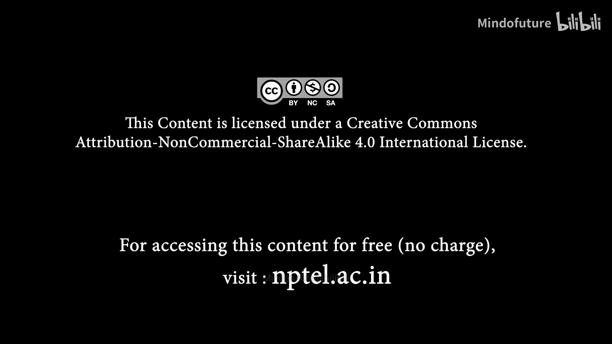
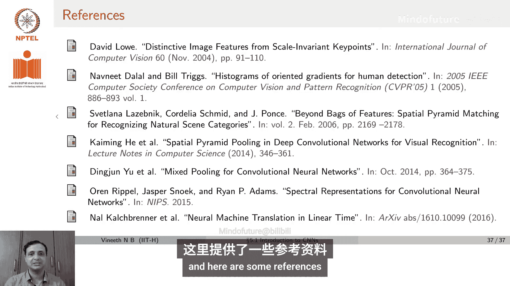

# 深度学习计算机视觉：P32：卷积神经网络介绍 - 第二部分 🧠

在本节课中，我们将要学习卷积运算与神经网络之间的联系，并深入探讨卷积神经网络的核心概念，包括其结构、优势以及一些重要的变体。

## 概述

上一节我们回顾了卷积运算的基本原理。本节中，我们来看看卷积与神经网络有何联系。我们将通过图像分类的例子，理解为何要使用卷积神经网络，而不是简单的全连接前馈神经网络。

## 从传统方法到学习滤波器

传统的基于机器学习的计算机视觉解决方案，会从图像中提取一些**手工设计的特征**，例如SIFT、LBP、HOG等。这些特征之所以被称为“手工设计”，是因为我们通过一些启发式方法和思考过程来设计提取它们的流程。这种方法在一段时间内是有效的，但将其扩展到更多数据集和更复杂的真实世界图像时，成为了瓶颈。

以下是传统方法的流程：
1.  给定一张图像。
2.  使用原始像素，或提取边缘，或提取SIFT、HOG等特征。
3.  将这些特征提供给一个分类器（如神经网络），最终得到输出（例如，识别出是某个纪念碑）。

我们现在要问的问题是：与其使用那些用于边缘检测或SIFT的手工设计核，我们能否**学习有意义的核或滤波器**？除了学习分类器的权重参数，我们能否将滤波器本身的权重系数也作为学习算法的一部分来自动学习，而不是将其分离为一个手工设计的步骤？

我们想更进一步，提出以下问题：
*   除了学习分类器的权重，我们能否学习**多个**有意义的滤波器？
*   除了学习分类器的权重，我们能否学习**多层**有意义的核和滤波器？

我们知道卷积具有良好的数学性质，可以在神经网络的不同层之间组合卷积操作。因此，我们能否在学习分类器权重的同时，利用这一点来学习多层有意义的核或滤波器？

这是可能的。实现方法很简单：将核的权重系数也视为参数，并与最终分类器的权重一起学习。具体流程如下：
1.  输入图像。
2.  通过一个卷积核，得到一个输出特征图，作为第二层。
3.  再通过另一个卷积核，得到第三层的特征图。
4.  最终，将特征图输入到一个全连接层，得到最终输出。
5.  我们可以使用反向传播来更新每个中间步骤的滤波器系数。

这种网络被称为**卷积神经网络**。之所以这样命名，是因为在每一步中，我们不是使用全连接的二部图来连接前后层，而是定义一组权重（即卷积核）对输入图像进行卷积，得到一个输出特征图，并通过反向传播来学习这些权重。

## 为何需要卷积神经网络？

学习滤波器听起来很有趣，但为什么不直接使用扁平化的图像和全连接神经网络呢？为什么我们要让事情复杂化，去学习滤波器？神经网络不是应该自己学习所需的权重吗？

以下是几个关键原因：

**1. 忽略空间相关性**
将像素扁平化为一个向量，会破坏图像中不同部分或不同角落像素之间的空间关系。空间上相距很远的像素和相邻的像素被同等对待，这丢失了表征图像的重要信息。

**2. 缺乏平移不变性**
在图像识别中，我们希望无论目标（如一只猫）出现在图像的左上角还是右下角，都能被识别出来。如果简单地将图像扁平化，位于左上角的猫和位于右下角的猫对应的向量表示会截然不同，网络没有机制去学习“猫就是猫，无论它在哪”这一特性。

**3. 计算成本高昂**
以一个100万像素的彩色图像为例，如果第一隐藏层有20个神经元，那么仅第一层就需要 `(10^6 * 3) * 20 = 60,000,000` 个权重。随着层数增加，参数量会爆炸式增长。

## 卷积神经网络的核心思想

我们通过卷积的思想来解决上述问题。在卷积中，滤波器只作用于原始图像的局部邻域，我们称之为**局部感受野**。这带来了几个好处：

**1. 局部感受野**
每个隐藏单元只连接到输入图像的一个局部区域。
*   **优点**：它捕捉了空间关系，因为滤波器与图像块进行卷积时，捕获了该区域的二维空间结构。同时，它极大地减少了模型参数。沿用之前的例子，如果使用大小为 `K1 x K2` 的滤波器，那么第一层的权重数仅为 `K1 x K2`，与全连接网络的6000万相比大幅减少。

**2. 权值共享**
无论滤波器与图像的左上角还是右下角进行卷积，都使用相同的权重值。
*   **优点**：首先，它使神经网络对图像中物体的平移具有**不变性**。其次，它进一步减少了参数数量。

**3. 池化**
池化用于压缩前一层的信息。
*   **优点**：首先，通过聚合信息（如取最大值或平均值），可以平滑微小的变化，使输出更具鲁棒性。其次，池化会对图像进行下采样，减小后续层的输入尺寸，从而减少后续卷积层的计算量。

接下来，让我们详细看看每一项。

### 局部感受野

为了对比，我们先看全连接神经网络。假设输入是16个像素（对应一个手写数字图像），有16个输入神经元。第一隐藏层有若干神经元。在全连接网络中，**每一个**输入神经元都连接到第一隐藏层的**每一个**神经元，连接非常稠密。

现在，我们对比卷积操作。在卷积中，只有特定的、空间上相邻的像素（例如像素1, 2, 5, 6）共同参与计算第一个隐藏神经元 `H11` 的输出。这种连接是**稀疏的**。

这种稀疏连接自动减少了需要学习的权重数量。更重要的是，它利用了图像的结构信息，因为参与计算的像素（如1, 2, 5, 6）在空间上是相关的。

你可能会问：稀疏连接真的是好事吗？我们是否禁止了某些像素相互作用并贡献给下一层？答案是否定的。随着神经网络深度的增加，早期没有直接交互的像素（例如 `x1` 和 `x5`）可能会在更深的层中间接交互。只要网络有足够的深度，信息并不会丢失。

### 权值共享

让我们通过一个例子来理解权值共享。假设像素1, 2, 5, 6通过一组权重连接到第一个隐藏神经元。同时，最后四个像素（例如15, 16, 11, 12）通过另一组权重连接到最后一个隐藏神经元。

我们需要问：我们希望这两组核权重不同吗？答案是否定的。我们希望同一个滤波器能够以相同的方式响应图像中的某个特征或物体，无论它出现在图像的哪个位置。这就是**平移不变性**。

此外，我们可以使用不同的核来捕捉不同类型的特征。例如，一个核可能捕捉人的眼睛，另一个核可能捕捉人的鼻子。这种在整个输入上使用相同权重的思想，被称为**权值共享**，它同样减少了参数数量。

### 池化层

池化层是一种**无参数**的下采样操作。它不需要学习任何权重。

最常见的池化操作是**最大池化**。例如，给定一个4x4的特征图，使用2x2的窗口和步长为2进行最大池化：在第一个2x2窗口中找到最大值（例如8），将其作为输出对应位置的值；然后窗口移动2步（步长=2），在下一个不重叠的2x2窗口中找到最大值（例如4），依此类推。最终，一个4x4的输入被下采样为一个2x2的输出。

除了最大池化，还有：
*   **平均池化**：取窗口内值的平均值。
*   **L2池化**：取窗口内值的L2范数。
*   其他变体，如混合池化、空间金字塔池化、频谱池化等。

## 卷积神经网络的变体

除了局部感受野、权值共享和池化这三个核心操作，卷积层本身也有一些重要的变体。

**1. 空洞卷积**
空洞卷积引入了一个新参数：**扩张率**。它控制着卷积核中值之间的间距。当扩张率大于1时，卷积核在输入图像上应用时会有间隔，这相当于让卷积核在不增加参数的情况下，拥有更大的感受野。这与步长大于1的标准卷积不同：标准卷积的每次卷积操作仍然作用于原始相邻像素，只是跳过了某些位置；而空洞卷积的每次卷积操作本身就作用于一个更稀疏、范围更大的邻域。

**2. 转置卷积**
转置卷积，有时也称为反卷积或上卷积，用于对输入进行**上采样**以得到更大的输出。传统上，我们使用插值（如双线性插值）来上采样图像，其本质也是与一个固定的核（如帐篷核）进行卷积。转置卷积的思想是：**为什么不学习这个插值核的权重呢？**

转置卷积通过一种特殊的卷积操作实现上采样。简单来说，它通过在输入元素之间插入零（或进行其他填充），然后应用标准卷积，从而得到一个尺寸更大的输出。这使得上采样过程也可以像其他层一样，通过反向传播进行学习。

**3. 其他卷积类型**
*   **3D卷积**：对3D体积（如视频帧或医学影像）进行卷积，输出也是3D体积。
*   **1x1卷积**：在深度维度上进行卷积，将 `W x H x D` 的输入转换为 `W x H x 1` 的输出，常用于降维或升维，以及增加非线性。
*   **分组卷积**：将输入通道分成若干组，每组使用独立的滤波器进行卷积，最后将结果拼接起来。这可以大幅减少计算量和参数量。
*   **可分离卷积**：将一个标准的2D卷积分解为两个连续的1D卷积（例如先进行列卷积，再进行行卷积），可以显著减少计算量。
*   **深度可分离卷积**：先对每个输入通道独立进行空间卷积（深度卷积），然后使用1x1卷积（逐点卷积）来组合这些通道的输出。这是MobileNet等高效模型的核心。
*   **扁平化卷积**：可分离卷积的高维推广。
*   **空间与跨通道卷积**：并行进行多种卷积操作（如不同尺寸的卷积核），然后将结果拼接起来。

我们将在后续课程中，结合具体应用场景看到这些卷积类型的实例。

## 总结

本节课中，我们一起学习了卷积神经网络的核心思想。我们探讨了为何全连接网络在处理图像时存在局限，并介绍了CNN的三个关键特性：**局部感受野**、**权值共享**和**池化**。这些特性使CNN能够有效捕捉空间特征、保持平移不变性，并大幅减少参数数量。此外，我们还了解了几种重要的卷积变体，如**空洞卷积**和**转置卷积**，它们扩展了CNN的功能和应用范围。

**课后思考题：**
1.  给定一个 `32 x 32 x 3` 的图像，使用6个大小为 `5 x 5 x 3` 的滤波器，步长为1，填充为0，输出的维度是多少？
2.  最大池化层是可微分的吗？如何通过它进行反向传播？

**推荐阅读：**
*   关于卷积的交互式图示，请参阅 [此链接](http://link_to_convolution_demo)。
*   关于转置卷积的详细讨论，请参阅 Distill.pub 上的 [此文章](http://link_to_deconv_article)。
*   其他优秀资源：《深度学习》一书第9章，以及CS231n课程的相关笔记。

---
**参考文献**（略）