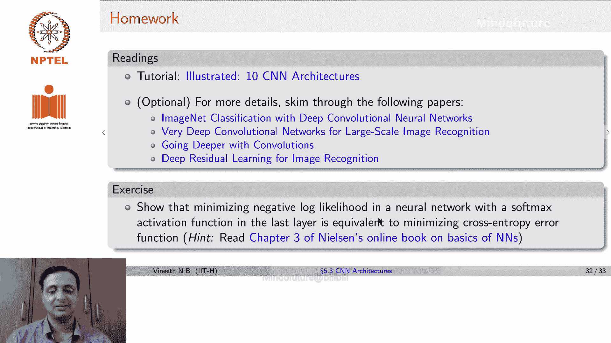

# 【NPTEL】计算机视觉的深度学习 p35 P35_图像分类CNN架构的演变 - 第二部分 -BV1vNWkzpEua_p35-

Along with VGG in 2014 was also another network called the Google net。

The Google net obviously came from Google， focused on deeper networks。

But with an objective for efficiency。To reduce the parameter count。To reduce memory usage。

And to reduce computation。So how did they go about achieving all of this？

They had up to 22 layers in the network remember vgg went up to 19 so the Google net went to 22 layers so the networks were getting deeper each year。

They did not have any F layers， how did that help？Recall that F layers had the maximum number of parameters for both Alexnet and V Gnet。

 So by getting rid of F layers， they reduced number of parameters。

And what else did they introduce they introduced a module known as the inception module which we describe in detail over the next few slides。

 please don't worry if you are not able to see this figure carefully we describe it in more detail over the next few slides。

It had a total of 5 million parameters， which was 12 xs less than AlexNe and significantly lesser than VGG。

And it was the winner in the 2014 Iner Cha ahead of VG VGG was a runner of this year that year and Google net won the challenge with a 6。

7% top five error so as you can see every year as the networks got deeper the error started dropping significantly。

Let's now talk about the inception module， which was a key innovation in their approach。

The inception module looked somewhat like this， which was one of those units that keeps repeating in their architecture。

So the previous layers output。wa branched out into one layer which did a one cross1 convolution in parallel。

 another couple of layers which did one cross one and  three cross 3。

Another couple of layers which did one cross one and5 cross 5 and another one which did max pooling and one cross one convolution。

So this was a local unit。With parallel branches。And this local structure repeated many times in the neural network。

 as you can see this inception module kit was stacked on top of each other to complete the architecture of the Google network。

So， the nave inception module， so this was the final inception module that was in the architecture。

 but let's develop this slowly so the na inception module takes a previous layer。

Instead of designing a particular filter feature size。

 filter size or VGg which always relies only on three cross 3。What the Google net？

Designers decided to do was they decided to do multiple such filter sizes in parallel and concatenate all of them so you have a one cross1 a three cross 3 a5 cross 5hi even a three cross 3 max pool and they concatenated all of those so the depths that you get in this layer after the concatenation would be the concatenation of all of those depths that you get as the output of each of these convolutions。

Or max pullinging。So they had multiple receptive field sizes and they had a pooling operation。

 which they concatenated depth twice。But there is a problem here。Do you see the problem？

The problem is this is computationally very expensive。

Remember we said for Alexnet that most of its computations are in its convolutional layer while the parameters may not be high。

 remember you have to take the filter and convve on every part of the image。

And that can be pretty expensive and now when this inception module does this across a1 cross 1 convolution a3 cross 3 convolution of I cross1 phi convolution simultaneously and then concateates things become even more computationally expensive。

So what do we do？They introduced something called one cross one bottleneck layer。

To reduce the channel dimension before expensive convolution layers。 Now。

 let's look at what this means。So if you have a 56 cross 56 cross 64 volume。

You can do a one cross one convolution across the depth。So that filter would be one cross。

 one cross 64。And if you do that。The entire 56 cross 56 cross 64 will collapse to 56 cross 56 because for each of those spatial locations。

A one cross1 cross 164 convolution will give you one scalar as an output。

Which means you will be left with。One pixel here。One pixel here， one pixel here。

 so on and so forth in the next layer， which would lead to a 56 cross 56。

So remember the filter size for this one cross one convolution would have been one cross one cross 64。

 thats the one cross one convolution or the bottleneck convolution we bottleneck layer we are talking about。

 but they had 32 such filters。Which means 32 such1 cross 16 cross1 cross 1 cross 64 filters。

 which results in the output now becoming 56 cross 56 cross 56 cross 32。

Because of 32 such filters so by doing the one cross1 convolution a 56 cross 56 cross 64 volume became a 56 cross 56 cross 32 volume and you can imagine now that you could have instead of 32 filters you could have just chosen3 filters four filters so on and so forth so the depth could have been arbitrarily reduced by using this trick of doing one cross 1 convolution and that is what。

The Google Ne designers did in the inception module。What does this help with？

This preserves spatial dimensions and reduces depth， and it projects the depth to lower dimensions。

So now the final inception module， this was the nave inception module。

 we saw a couple of slides back。The final inception module does the same convolutions。

 but now before doing those convolutions applies one cross one convolution。To reduce the depth。

 which means the number of convolutions or operations that you have to do will reduce because of that and then does three cross 3 or 5 cross 5 convolution。

This trick helps them。Become far more efficient in the number of computations。Also。

 you see here that there is a one cross one convolution after max pool instead of before max pool when compared to the other branches。

The reason for that is Max pool maintains depth。It maintains the depth at the same thing as what was given。

 so when you do max pooling the max pooling is done in a two cross to neighborhood on each channel in the volume。

So every channel， the number of channels remains the same。

 so they first do the max pooling and then do one cross one convolution to reduce the number of channels。

This inception module brings down or increases the efficiency， brings down the computations。

 but increases the efficiency of the Google network。So here is the complete architecture。

So this is the this is where the input comes in and then you have a small stem network。

 which is a con pool and。2 times a con pool， so you repeat that again then comes all these inception modules stack one after the other and at the end you have classifier output with no fully connected layers。

And in between， you see here that there are auxiliary classifier outputs this is because。

It's possible that a gradient in the last layer may not reach。Earlier layers。

 when you have many stagged layers across the neural network。So， they also have intermediate。

Classification outputs where they took the output of a particular layer。Had a bunch of。

Classification layers， which had a loss and that losses gradient was also back propagated at these locations to improve the strength of the gradient to earlier layers for weight update。

As you can see， the classification layer。😊，Both here and here， all of them。

Had a structure of average pool。One cross one convolution， F C， F softm。

 there were 22 layers in total。The parallel layers count as one layer so these different layers that you see inside the inceptionion module。

 the branches， we just count it as one layer， given that it has a total of 22 layers and the auxiliary output layers are not counted just from this end to the other end together its 22 layers in Google。

So as you can see， each year since 2012。The networks got deeper and deeper and deeper。

So the obvious question the researchers in the next year had was how far can we take it？

And they took it to about 150 layers， which we will see in a moment。So while asking this question。

 they try to understand how deep can you go with a C？

And when they studied stacking deeper and deeper layers on a plain CNN。

They found that a 20 layer CNN had a lower training error over the iterations of training。

D a 56 layer CNN。This was a little non intuitivetu。And the same observation。

Was also made on the test error。In the same setting。

 so the 20 layer cn had a lower test error over iterations。When compared to a 56 layer C。

Why would this be happening？A deeper model performs worse than a shallow model。

This was a little counterintuitive to how research was progressing with CNNs at that time。

One plausible explanation you could give for why this could be happening is。

The initial guess could be that the deep model is perhaps overfitting， and that's why the test error。

Increases for a 56 layer neural network， you have more parameters and it perhaps is becoming more complex and hence is overfitting。

But if that was true。The training error would have been stronger for a 56 layer network over a 20 layer network。

Unfortunately。Even there， the 20 layer network had a lower error。

 which means the 56 layer network was also underfitting。What would have been the reason？

For this to happen as depth of neural network increases。

The answer for this lies in what is known as the vanishing gradient problem。

The problem complementary to vanishing gradient is known as exploding gradient。

 but let's talk about each of them in one after the other。

So if you took a simple feet forward neural network。

Let's assume with sigmoid activations in each layer。

So here is a very simplistic visual for that you have xn there is a weight one that comes in first layer。

 there is a sigmoid， the next1 w2 is a weight in the second layer。

A sigmoid and so on and so forth until the last wave。If you not took a loss L。

And wanted to find do L with respect to do xn， which is one of the initial layers inputs。

You have dol by do x is equal to。sigma prime， which is the gradient of the sigmoid function into w3 transpose x2 into w3 into sigma prime w2 transpose x1 into w2 into sigma prime W1 transpose xn into w1 this comes from applying chain rule you work out the gradient in each step considering a sigmoid activation function in each layer。

You would get this。But the key key point that I'd like to draw you towards here is that the gradient of the sigmoid is less than  one by 4。

Why is that the case？Because this is how the gradient of the sigmite function looks。

It starts at a 0 close to 0， it peaks at 025 and then falls down again this comes from the shape of the sigmoid function。

 so the gradient。Is steepep in this region。 It increases and starts falling and then flattens out again。

 So the gradient of such a sigmite function turns out to be something like this。

 And the range is between 0 and 1， which means the gradient turns out as。Capping at 0 to5。

Which means do L by do xn has a bunch of values which are all less than one fourth。

What you expect will happen to do L by do x mark。The product of very small values will quickly go to zero and you have the problem of what is known as vanishing gradients。

As you go deeper and deeper into a neural network。The gradients。

 especially if you have such squashing activation functions。

 the gradients are less than1 and as they get multiplied over the several layers during back propagation。

 the gradient becomes feeble and feeble as it proceeds towards the initial layers。In other words。

 the gradients never reach the initial layers or the initial layers may get stuck with the random initialization that we came up with and may never go further。

So you could argue that instead of randomly initializing the neural network with some random weights and then not updating them at all convincingly。

 why have those layers in the first place let me not take such a deep network。

That could be one way of arguing against to solve the vanishing gradient problem。

 but we'll talk about a different approach in a slide from now。

The complementary problem known as the exploding gradient。

Can happen when maybe there is another activation function such as Relu where the gradient could be one or greater than one or depends on what the activations are or as I said。

 any other function where these terms end up becoming greater than1。The product of those values。

As you go deeper through many layers can explode to a high value and that also can cause problems。

However， exploding gradients is often easily handled by a trick known as gradient clipping this is very popularly used in practice。

People just say that when gradient goes beyond 10， for instance， you assume the gradient to be 10。

 so anything greater than 10 will just be 10 you just clip it at that value and that will ensure that the gradient does not explode。

Coming back to the vanishing ingredients problem。This problem was addressed in a C architecture in 2015 called Renets or residual nets。

They wanted to ensure that a deep model should at least perform as well as a shallow model。

How is this possible？The idea they came up with was to introduce what are known as residual blocks。

Which are connected to each other。Through identity connections or identity matrix。

What does that mean？In the original CNN。You have an X。It goes through a few layers such as con layer。

 then a re within a con layer， and it gets transformed over those layers and becomes a certain h of x。

This could be one portion of a neural network， for instance。But in a residual block。

What these designers came up with was to say that x goes through a coner。

 perlu a con just as in the vanilla CNN。But they also have a side channel。

To take the input X as it is。And add it up here two layers later。Which means。

What was originally the function H of x？Now becomes F of x。

 which is the new transformation that happens through these layers。Plus， M X。

That comes directly here and gets added at this layer after the con。Each such block。

Where the identity connections come back and add the original input is known as a residual block。

Why is it a residual block because？Originally， these layers captured a function H of x。

But now these layers capture the residual h of x minus x。 remember now we are saying here that this。

Together here must be equal to h of x。Or rather， f of x will be edge of x minus x。

Which is now the residual rather than H of x itself。

So the way the residual network was designed is to have a stack of many residual blocks。

Each residual block had two， three by three con layers as you can see。

 two three by three con layers and then the x that came out of this or whatever representation came out from this particular joint here was directly passed on again to the output of those two con layers and this was repeated。

Again and again， over the blocks in the neural network。

Periodically the numbers number of filters were doubled so you can see here that 64 which were the number of filters in the initial residual blocks became 128 after a set of residual blocks。

 which after a few more residual blocks became 5，12 and so on and so forth。

And it was also downsampled spatially using strip 2 that is divided by2 in each dimension to bring the size of the feature maps lower as you went deeper remember that helps you control the number of neurons in later layers by down samplingling。

呃的。The feature maps。They also used。Ufi。A technique called global average pooling global average pooling is like max pooling average pooling but global average pooling is the entire average of a feature map so if you have a feature map you take the average of all the pixels in that feature map and it gives you one scalar。

So if you had K channels in a particular layer。By doing global average pooling。

 you will get K scalrs。One scalar per channel， which will be the global average of that channel。

 you can imagine that as giving a feature map， taking the average intensity of that feature map。

 that is global average pooling。And then for each channel you would get one global average pool value。

 so if you had K feature maps， you would get a K dimensional vector as the output of global average pooling。

And they had a single linear layer at the end， you can see that there are no fully connected layers here。

 but for the Fc000 Fc000 is done because INe has thousand classes。

 so Fc000 is required to give thousand outputs in that last layer and finally a softmax to convert those logicits into probabilities。

They had total depths of 34， 5，1 not1 and 152 layers for imageNe。So it's called ResNe 34， ResNe 50。

 ResNe 101， ResNe 152， so on and so forth。For very deep networks which went beyond 50 layers in a SNe。

 they also used a bottleneck layer， you can see the one cross one convolutions。

To improve the efficiency similar to Google net， remember the one cross one convolutions help you reduce the depth from a certain depth to a smaller depth and then you perform your operations in that smaller depth and you can again now do one cross one convolution to go back to an initial depth if you like which is something that they did do to。

Keep the depth。In the same range， but reduce the computations by a couple of one cross one or bottleneck layers。

 couple of one cross one convolutions or bottleneck layers periodically。So this is the example。

 they start with they had at 28 cost， 28 cost 56 input。

They bottleneck it to 28 cross 28 cross 64 by doing one cross 1 convolution。

 then do the3 cross 3 convolution only on those 64 feature maps。

And then once again did one cross1 convolution and took it back to 28 cross 28 cross 256。

This actually keeps the dimension the same as the input。

 but these one cross1 convolutions make the number of computations far lesser and hence the training more efficient。

With this S net， they were able to train very deep networks， as we mentioned。

 they went up to 152 layers to train on imageNe。And they now found that deeper networks actually perform better than shallow networks。

Why so， why does this identity map of this residualservo block help train deeper networks？

When we back propagate the gradient that comes to a particular point in the residualservoir network。

While there is a path of the gradient through these layers。

Which may result in an attenation of the gradient。There is another side part for the gradient to go as it is to a previous layer without any diminishing in its value。

And these identity connections that connect residual blocks。

are like serve like highways for the gradient to just flow through， they are like short circuits。

 the gradient just flows through them while there is a part of the gradient that still keeps coming through the layers and that allows even the earlier layers to get a strong gradient signal and now deeper networks perform。

Better than shallow networks。And it won the first place in all Inet competitions and also a competition called Coco that was introduced in 2015。

So in fact， they won the child。the first place in all the major challenges in 2015。

 imagine at classification， imagine a detection where there were 16% better than the second best。

 imagine at localization where they were 27% better than the second best。

Cocoa detection where they were 11% better than second best。Coo's segmentation。

 where they were 12% better than the second best。We will discuss detection， localization。

 segmentation and the Coco data a bit later， but just to let you know that this model swept through all challenges。

In 2015 and has since then been an important architecture that people use for various applications in computer vision。

So the homework for this lecture is to go through this illustration of 10 CNN architectures。

 which is very well done， which would perhaps help you understand these architectures better。

If you're further interested， you can go through these respective papers。Which are for imate。

Reial connections， sorry Renets， VG， so on， which could probably help you understand some of the decisions which were made in the design of these architectures。

The exercise for this lecture is going to be show that minimizing negative log likelihood。

In a neural network with a softmax activation function in the last layer is equivalent to minimizing cross entropy loss function。

We are not going to work this out in the next lecture。

 please read this chapter three of Nielsen's online book if you would like to understand this further。

With that， here are your references。