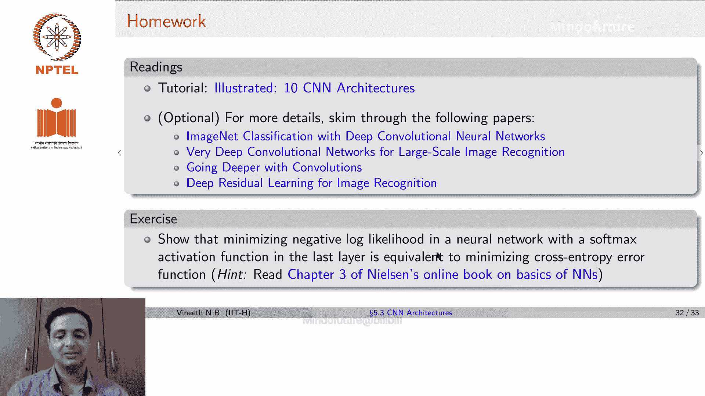

# 深度学习计算机视觉：P35：图像分类CNN架构的演变 - 第二部分

在本节课中，我们将继续探讨图像分类CNN架构的演变，重点介绍2014年的GoogleNet和2015年的ResNet。我们将了解它们如何通过创新的模块设计解决深层网络训练中的效率与梯度问题，从而推动性能的进一步提升。

## 🏗️ GoogleNet：并行化与效率提升

上一节我们介绍了VGGNet，它通过堆叠小卷积核来构建深层网络。本节中，我们来看看同年出现的另一个重要网络——GoogleNet。GoogleNet的设计目标是在增加网络深度的同时，显著提升效率，即减少参数量、内存使用和计算量。

GoogleNet的网络深度达到了22层，比VGG-19更深。它通过移除全连接层来大幅减少参数。更重要的是，它引入了一个名为 **Inception模块** 的核心创新结构。

以下是Inception模块的核心思想：

*   **并行多尺度卷积**：传统的CNN（如VGG）通常只使用单一尺寸的卷积核。Inception模块则并行地使用1x1、3x3、5x5等多种尺寸的卷积核，以及一个3x3的最大池化层。
*   **深度拼接**：将这些并行分支的输出在深度（通道）维度上进行拼接，从而融合不同感受野的特征。

然而，这种“朴素”的并行结构计算量巨大。为了解决这个问题，GoogleNet引入了 **1x1卷积瓶颈层**。

### 1x1卷积瓶颈层的作用

1x1卷积的核心作用是进行跨通道的信息整合与降维。其操作可以表示为：
`输出 = 卷积(输入, 权重)`，其中卷积核尺寸为 `1 x 1 x 输入通道数 x 输出通道数`。

例如，一个尺寸为 `56 x 56 x 64` 的特征图，经过一个具有32个滤波器的1x1卷积层后，输出尺寸变为 `56 x 56 x 32`。这实现了：
*   **保持空间维度**：宽高不变。
*   **降低通道维度**：将深度从64降至32，从而显著减少后续大卷积核（如3x3、5x5）的计算量。

### 🧩 最终的Inception模块

因此，最终的Inception模块在进行3x3、5x5卷积或池化操作之前，先使用1x1卷积进行降维。对于最大池化分支，则先进行池化操作保持通道数，再用1x1卷积降维。

这种设计极大地提升了计算效率。GoogleNet整体架构由多个这样的Inception模块堆叠而成，末端使用全局平均池化替代全连接层进行分类，总参数量仅约500万，远少于AlexNet和VGG，并以6.7%的Top-5错误率赢得了2014年ImageNet挑战赛。

此外，为了解决极深网络中的梯度消失问题，GoogleNet还引入了 **辅助分类器**。它在网络中间层添加额外的分类输出，将其损失梯度一同回传，以增强前层网络的梯度信号。

## 🚀 ResNet：残差连接与深度突破

随着网络逐年加深，研究者们开始探索深度极限。然而实验发现，简单地堆叠更多层会导致性能下降，56层网络的训练和测试误差反而高于20层网络。这并非过拟合，而是 **梯度消失问题** 导致的欠拟合。

### 梯度消失问题

在深层网络中，使用如Sigmoid这类梯度值小于1的激活函数时，反向传播的梯度会因连续相乘而指数级衰减。这导致网络前层的权重更新非常缓慢，甚至停滞，使得深层网络难以有效训练。

### 🧱 残差块（Residual Block）

ResNet的核心创新是 **残差学习**。它不再让堆叠的层直接学习目标映射 `H(x)`，而是学习残差映射 `F(x) = H(x) - x`。原始的输入 `x` 通过一个“快捷连接”直接跳接到几层之后的输出上，二者相加。
`输出 = F(x) + x`

一个基础的残差块包含两个3x3卷积层，快捷连接将块的输入直接加到第二个卷积层的输出上。

### 为什么残差连接有效？

在反向传播时，梯度有两条路径：
1.  通过卷积层进行变换，可能衰减。
2.  通过快捷连接无损地传递。

快捷连接为梯度提供了直达前层的“高速公路”，确保了即使网络极深，前层也能获得足够的梯度进行更新，从而解决了梯度消失问题。

### 🏗️ ResNet架构

ResNet通过堆叠残差块构建。随着网络加深，会周期性地通过步长为2的卷积进行下采样以减小特征图尺寸，并加倍滤波器数量以增加特征维度。网络末端使用全局平均池化将每个特征图池化为一个标量，再接一个全连接层输出分类结果。

对于超过50层的极深ResNet（如ResNet-101/152），同样引入了 **瓶颈结构** 来提升效率：使用 `1x1` 卷积先降维，再进行 `3x3` 卷积，最后再用 `1x1` 卷积升维。

凭借残差连接，ResNet成功训练了高达152层的网络，并在ImageNet分类、定位以及COCO检测与分割等多项2015年核心竞赛中全面夺冠，性能显著超越第二名，成为计算机视觉领域的里程碑式架构。

## 📚 课程总结与练习

本节课中我们一起学习了CNN架构演变的后半部分。我们看到了GoogleNet如何通过Inception模块和1x1瓶颈层在加深网络的同时提升效率，以及ResNet如何利用残差连接巧妙地解决了深层网络的梯度消失问题，从而将网络深度推向了新的高度。

### 📖 课后阅读
建议你通过[这份关于10种CNN架构的图示](https://towardsdatascience.com/illustrated-10-cnn-architectures-95d78ace614d)来巩固理解。若想深入了解设计细节，可以阅读AlexNet、VGG、GoogleNet和ResNet的原版论文。

### ✍️ 课后练习
**证明：** 在神经网络最后一层使用Softmax激活函数时，最小化负对数似然损失等价于最小化交叉熵损失函数。
提示：你可以参考Nielsen在线书籍的第三章进行推导。

**参考文献：**
*   Szegedy, C., et al. "Going deeper with convolutions." CVPR 2015. (GoogleNet/Inception-v1)
*   He, K., et al. "Deep residual learning for image recognition." CVPR 2016. (ResNet)
*   Nielsen, M. "Neural Networks and Deep Learning." Chapter 3.